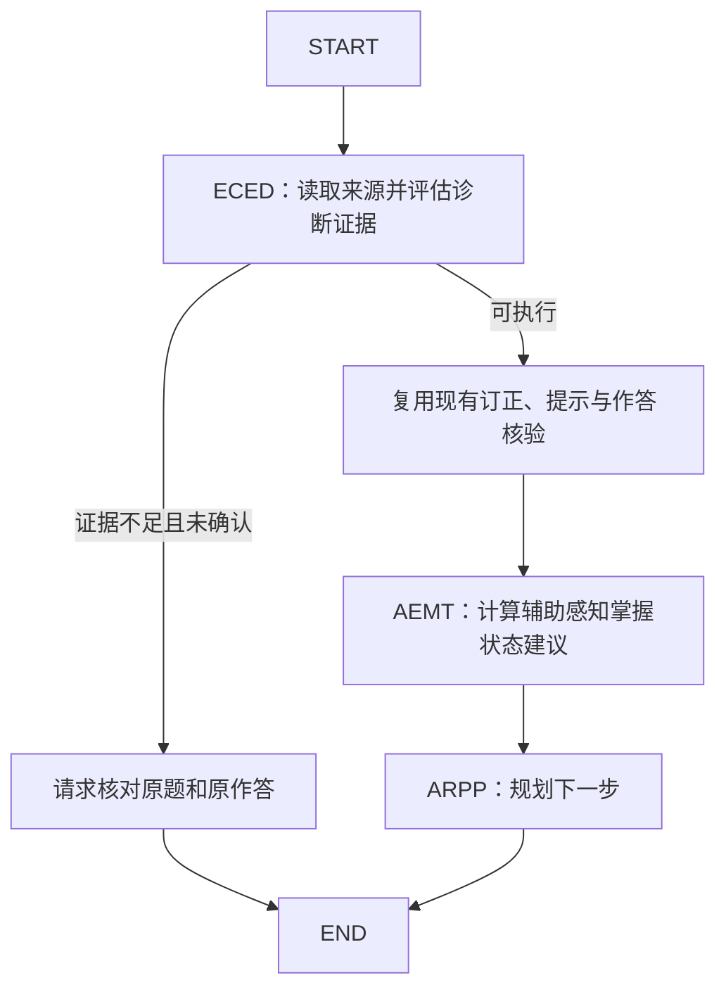

# 单一学习任务协调图

2026-10-20，实施中。入口：`backend-algorithms/service.py` 的 `learning_task` 操作 → `learning_workflow.run_learning_workflow`。

## 状态与职责

`WorkflowState` 传递 Pydantic 校验后的 `TaskContext`、`Checkpoint`、`TaskAction` 和 `TaskResult`。三个算法在独立节点运行；条件边决定执行原有学习动作还是返回确认状态。没有多角色 Agent，也没有额外的任务数据库。

Python 当前返回结构化诊断、掌握状态建议和推荐。仓颉继续负责所有权、来源版本、任务租约、预算、作答幂等、MySQL 事务和正式掌握状态。计算建议不能自行写库。

## 等待、失败和恢复

- 每轮最多经过五个业务节点，递归上限 8；等待学生时直接结束本轮。
- 检查点保存在现有 `learning_tasks.checkpoint`，下一次请求继续原任务；不使用新的 LangGraph 数据库检查点服务。
- 证据不足返回 `diagnosis_needs_confirmation`，不授予掌握证据；人工确认沿用已有诊断修正流程。
- 来源冲突、无效手写确认、判题待复核和任务轮次耗尽沿用已有明确状态。
- 整个图受已有 `task_budget_ms` 限制；模型仍经 ApiPoolProvider，不增加无限循环或无限重试。

正式掌握状态事务、真实推荐上下文和前端按钮已接入代码，正在进行真实 HTTP/MySQL 和浏览器回归，不能将目前算法图测试等同于全产品端到端验收。待办与验证见 [升级记录](QUICK_UPGRADE_REPORT.md)。
