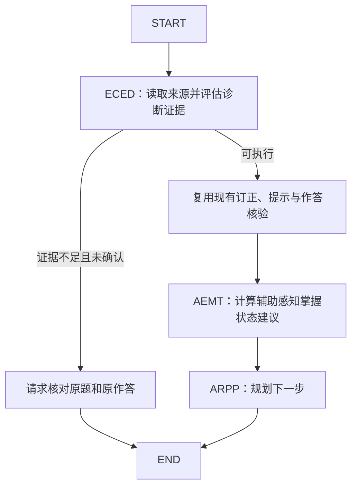

# 单一学习任务协调图

2026-10-20。入口：`backend-algorithms/service.py` 的 `learning_task` 操作 → `learning_workflow.run_learning_workflow`。

## 状态与职责

`WorkflowState` 传递 Pydantic 校验后的 `TaskContext`、`Checkpoint`、`TaskAction` 和 `TaskResult`。三个算法在独立节点运行；条件边决定执行原有学习动作还是返回确认状态。没有多角色 Agent，也没有额外的任务数据库。

Python 返回结构化诊断、掌握状态建议和推荐。仓颉继续负责所有权、来源版本、任务租约、预算、作答幂等、MySQL 事务和正式掌握状态。计算建议不能自行写库。

正式提交由 `learning_task_worker.cj` 在原有任务事务中完成：先验证题目版本和租约，再由 `learning_task_mastery.cj` 对照已保存阶段、实际提交文字、判题结论与辅助记录，调用已有 `cognition_update` 计算接口，写入 `mastery_states`、`cognitive_updates` 和复习安排。不会直接保存模型提出的掌握分数。原题独立作答与有效迁移分别记录；对照题重复曝光继续复用已有去重门槛。

`learning_task_planning.cj` 提供本人到期错题、可练题库和近期作答统计；正式保存前核对推荐题目是否仍在候选范围内。前端按 `question_source` 打开本人错题或创建真实单题练习。

## 等待、失败和恢复

- 每轮最多经过五个业务节点，递归上限 8；等待学生时直接结束本轮。
- 检查点保存在现有 `learning_tasks.checkpoint`，下一次请求继续原任务；不使用新的 LangGraph 数据库检查点服务。
- 证据不足返回 `diagnosis_needs_confirmation`，不授予掌握证据；人工确认沿用已有诊断修正流程。
- 订正前的公开证据只显示学生原步骤和规则依据，完整参考答案留在服务端证据与原诊断页，避免自动展示答案后又记为独立完成。
- 上下文准备异常返回可重试的失败状态，不会让任务持续排队。
- 来源冲突、无效手写确认、判题待复核和任务轮次耗尽沿用已有明确状态。
- 整个图受已有 `task_budget_ms` 限制；模型仍经 ApiPoolProvider，不增加无限循环或无限重试。

核心真实 HTTP/MySQL 回归覆盖确认后继续、辅助证据、正式学习记录、重复提交、超时回滚和恢复；浏览器还验证从推荐按钮创建练习并加载真实题干。完整验证结果见 [升级记录](QUICK_UPGRADE_REPORT.md)。
