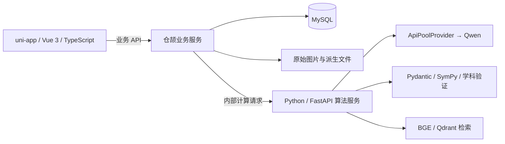
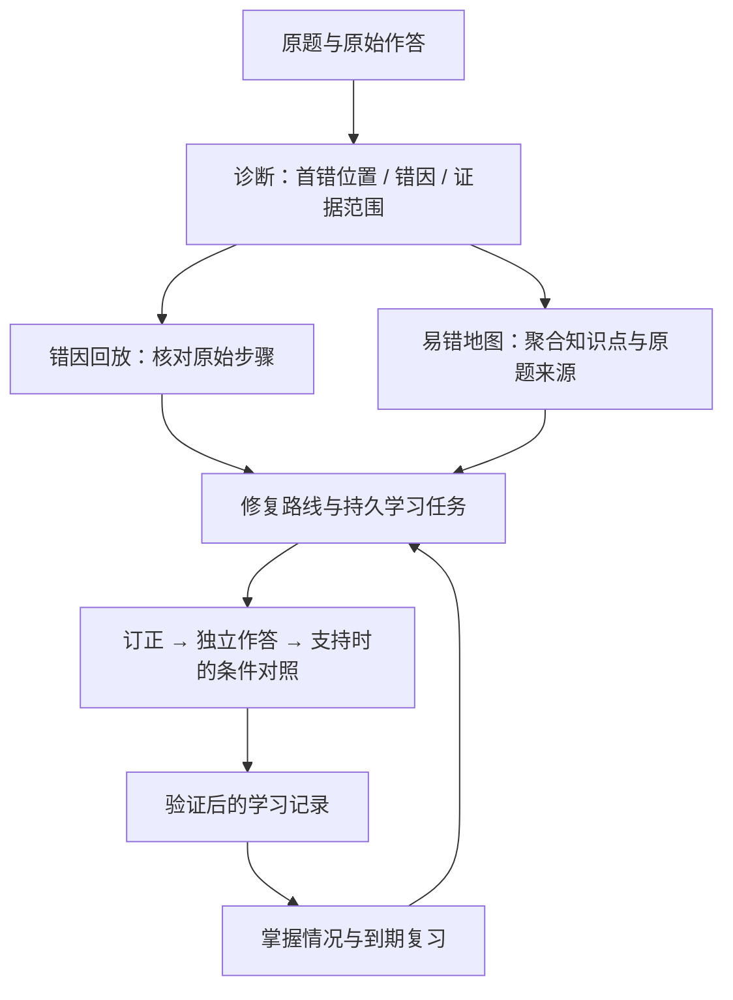
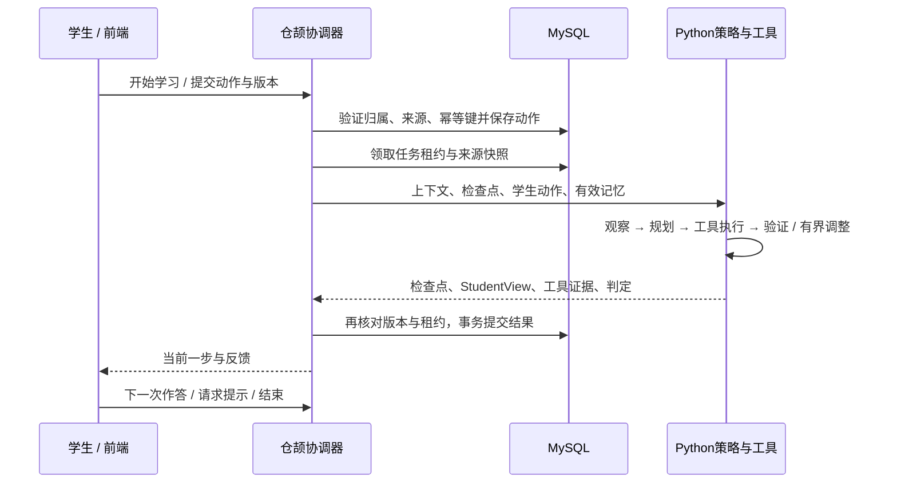

# 当前项目与智能体架构

更新：2026-10-18。本文描述当前仓颉主线实现；产品范围与验收入口见 [最终产品基线](final/README.md) 和 [实施状态](final/IMPLEMENTATION_STATUS.md)。历史 Python 业务版保留兼容，不是当前主线的业务服务。

## 一、三层职责

| 层 | 承担职责 | 边界与代码入口 |
| --- | --- | --- |
| 前端 | 录题确认、学习交互、易错地图、练习复习、报告与角色页面 | `frontend/src/pages/`、`frontend/src/components/`；只消费结构化结果，不执行模型生成的 JavaScript |
| 仓颉 | 身份与权限、题目与作答、任务生命周期、来源版本、掌握度和复习记录、数据库事务 | `backend-cangjie/src/`；业务状态以 MySQL 为准，不由浏览器或模型直接决定 |
| Python | OCR、诊断、策略与工具计算、学科判定、检索和可视化规格生成 | `backend-algorithms/service.py` 及各 `*_compute.py`；输出建议与证据，主线业务写入归仓颉 |
| 公共算法依赖 | 模型池、数学工具和兼容算法实现 | `backend/app/services/`；被算法服务复用不意味着恢复 Python 业务路由 |

原图和清洁图分别保存。模型结构化输出通过 Pydantic 校验；数学结论在已支持的规则范围内使用 SymPy 核验。所有模型请求经过 ApiPoolProvider，逻辑模型为 Qwen。MySQL 是唯一业务数据库，Qdrant 是题库检索索引。

## 二、从错题到复习的数据闭环

原题、学生步骤、诊断和学习动作保持关联；地图节点可以回到原题，不能把模型概括当作新的事实。任务保存来源快照与指纹；题目更新后旧任务不能继续提交到新题版本。学生自检要点属于本人确认的学习记录，不当作客观掌握证明。

没有题目时，首页提供学习方向与真实知识卡、例题入口；有题后按进行中任务、复习和薄弱点引导下一步。个性化来自已保存的偏好和学习证据，不虚构初始画像。

## 三、智能体是怎样工作的

采用一个持久任务协调器，配合有明确输入输出的算法能力；不是多个独立人格互相聊天。仓颉控制任务与提交权限，Python 生成受约束的支持策略并执行工具，学生反馈决定后续状态。

| 模块 | 实际入口 | 作用 |
| --- | --- | --- |
| 任务与动作接收 | `backend-cangjie/src/learning_tasks.cj` | 所有权、版本、动作和公开任务视图 |
| 执行与提交 | `backend-cangjie/src/learning_task_worker.cj` | 租约、故障恢复、事务提交、避免重复计入学习 |
| 来源与记忆 | `learning_task_sources.cj`、`learning_memory.cj`、`learning_memory_sources.cj` | 快照、失效检查、有来源的学习记忆 |
| 策略与检查点 | `backend-algorithms/learning_task_compute.py` | repair / independent / contrast / done；提示、作答、图示等动作 |
| 预算 | `backend-cangjie/src/learning_task_budget.cj` | 限制执行成本和时间；耗尽时明确退出 |
| 历史与自检 | `backend-cangjie/src/learning_task_records.cj` | 展示真实提交过程，保存学生确认的要点 |

工具输出包含验证状态和证据范围。模型给出“可能正确”不等于确认正确；参考答案辅助和独立作答分别记录。仅满足业务门槛的结果才能更新学习状态。任务可等待学生、重试或结束，不通过无限自动循环假装学生已经学会。详细合同与验收分别见 [智能体规格](final/AGENT_SPEC.md)、[智能体验收](final/AGENT_ACCEPTANCE.md)。

## 四、产品的创新重点与边界

1. **证据关联的错因回放**：从学生实际步骤定位偏差，保留原作答；无法验证时显示待核对。解决“有解析却不知道自己哪里开始错”的问题。
2. **可追溯易错地图**：把多题的知识点与错因聚合，仍可查看原题依据。解决错题零散、复习优先级不清的问题。
3. **可恢复的修复路线**：局部订正后继续独立作答，支持的题型再做条件对照，并进入后续复习。解决“看懂答案就结束”的断点。

这些是当前项目的组合设计，不宣称行业首创。完整正确率、长期提分效果仍需更广题型和真实学生试用证明。条件对照、符号验证各有支持范围，不能扩写成任意几何证明或所有学科的自动认证。考前页面应表达已有记录的复习优先级，不承诺预测考试分数。

## 五、运行与验证入口

- 主线启动：`make dev-final`；运行健康检查：`make check-final`。
- 主线完整验收：`make verify-final`，覆盖前端测试、类型检查、H5/App 资源构建和仓颉浏览器验证链。
- 兼容后端：`pytest backend/tests`；旧 `make verify` 仍针对保留的 Python 业务版。
- 当前实际证据与待办见 [实施状态](final/IMPLEMENTATION_STATUS.md)；测试中断不能记作通过，资源构建不能记作手机安装包交付。

本轮交付以能运行使用的系统为准。手机签名安装、Git 历史清理和备份恢复不在用户当前要求内。
