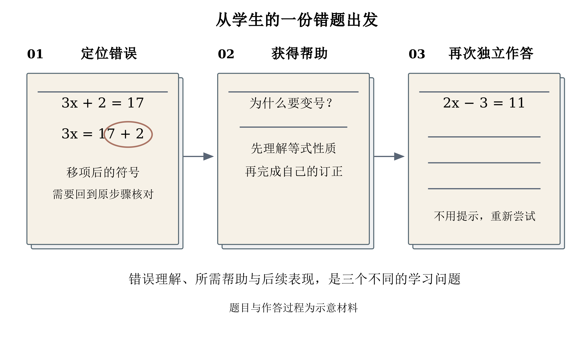
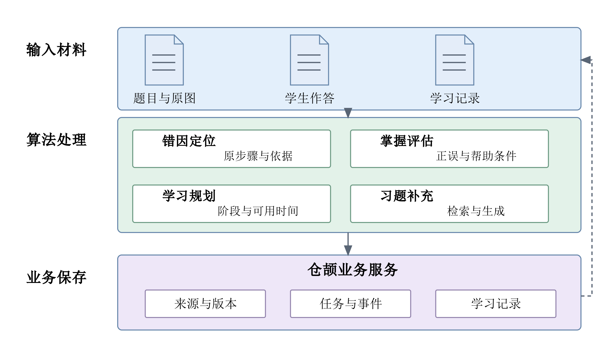
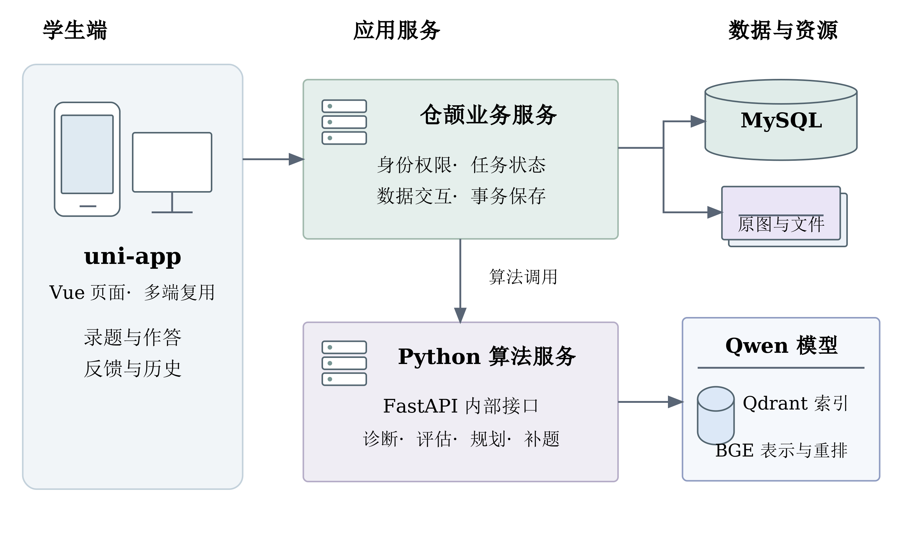

# 错题帮项目说明文档

2026“仓颉杯”智能编程大赛

## 1 项目概述

错题帮是一款**面向初一至高三学生的个人错题学习应用**。学生可以保存试卷中的错题和自己的解题过程，核对可能出错的步骤，完成订正和重新作答，再进行类似题练习与到期复习。系统围绕同一道题保存这些记录，使学生回看时能分清最初如何作答、后来接受了什么帮助，以及再次作答的结果。

### 1.1 项目背景

教育数字化政策持续推动数字资源与人工智能教育应用。《教育强国建设规划纲要（2024—2035年）》和《关于加快推进教育数字化的意见》提出资源共享与因材施教；2026年《“人工智能+教育”行动计划》进一步提出智能学伴等应用方向[1][2][3]。在线课程、题库和题目识别工具扩大了学生获取材料与解释的途径，日常错题处理中仍需要连接原作答、订正和后续练习。

关于错误学习的综述将纠正性反馈作为重要研究对象，反馈研究则进一步区分目标、当前表现和后续改进所需的信息[4][5]。这些研究为分析错题提供了一个具体视角：除了告诉学生答案是否正确，还需要让他看清出错的过程，以及接下来应检查什么。

错题是观察学生学习过程的一类直接材料。一道做错的题目中，可能同时保留题干、配图、学生答案、书写步骤和批改痕迹。最终答案能够说明本次结果，**解题过程则可能帮助解释结果怎样产生**。同样的错误答案，既可能来自条件遗漏，也可能来自概念混淆、公式使用或计算失误。只保存标准答案，往往不足以还原这一次作答中真正需要检查的地方。

这些信息的价值还体现在错误之间的关系上。学生在前一步把符号写错，后面的运算可能沿着错误结果继续进行；也可能在后续步骤又出现一个独立的计算问题。将所有错误简单归为“计算失误”，难以说明应从哪里重新检查；把后面沿着错误数字得到的每个结果都算作一个新问题，又会让学生重复检查同一处错误。错题学习需要回到学生实际写下的内容，理解不同步骤之间的联系。

**保存题目与理解错误是两个不同的学习环节**。纸质错题本便于保留原有书写，数字工具便于整理和检索，分步解析便于了解一种正确解法。然而，学生能够顺着解析读懂，并不自然等于他能够脱离解析重新完成。当天订正时使用的提示、随后是否独立作答、遇到变化条件时怎样处理，都是判断后续学习需要的重要信息。

学习科学研究为重新作答和间隔复习提供了参考。提取练习研究考察了主动回忆对延迟保持的影响，分散练习研究讨论了学习间隔与保持之间的关系，学习方法综述也区分了重复阅读、自我测试等活动的不同作用[6][7][8]。这些研究提示，错题处理不宜停留在收藏和阅读解析，还应关注学生之后实际完成了什么，以及经过一段时间后能否再次作答。

因此，面向中学生的错题学习支持，需要同时考虑三个相连的问题：学生原来的错误发生在什么位置，当前需要怎样的解释或练习，以及后续的新作答能否表明问题已经得到改善。三者以同一道题及其前后回答为联系，使错题从一次性的订正材料，成为能够在持续学习中回顾和比较的记录。这构成了错题帮选择个人课后错题学习场景的现实背景。

图1概括了错题学习中的三个连续问题：找到思路偏离的位置、选择适合当前困难的帮助，以及用新的作答检查学习情况。这里呈现的是学生需求，具体功能与技术处理在后续章节展开。

### 1.2 学生需求

**完整、可核对的材料是后续错题学习的基础**。试卷照片可能同时包含多道题，手写过程可能位于题目旁边，选择题还可能依赖配图。整理时只留下题干或正确答案，会使以后无法判断当时看漏了什么、写错了什么。原图、确认后的题目和本人回答应当能够一起查看；识别有误时，也需要能够回到原材料修正。

在材料完整的基础上，**第一个学习问题是定位错误**。以“3x＋2＝17”为例，学生若写成“3x＝17＋2”，随后再继续计算，最终结果错误的起点在于这次移项。学生需要看到原步骤与题目条件之间哪里不符，而不只是得到“移项错误”的标签。对于跳步或另一种正确解法，还需要区分表达不同和推理错误，避免把参考解法当作唯一写法。

**第二个问题是选择适合当前困难的帮助**。不了解等式性质的学生可能需要回顾概念；理解原理但写错符号的学生可能只需要局部提示。若不区分两种情况，总是展示完整解析，前者可能仍然没有理解，后者则需要从大量熟悉内容中寻找重点。学生需要围绕具体问题获得解释，并有机会自己修改和重新作答。

**第三个问题是检查能否独立使用方法**。提示后写对原题，能够说明本次学习有所推进，却不能单独回答新题是否也能完成。学生需要在不提前看到答案的情况下重新作答，并通过条件或表达发生变化的题目继续检查。之后复习时，还需要知道哪些内容已经到期、以前用了什么帮助、这次是否仍然困难。

这三类需求相互依赖：错误定位需要本人原作答，针对性帮助需要明确当前困难，后续安排需要真实的新回答和复习记录。错题帮据此组织材料保存、错因查看、订正训练和持续复习。学生不必一次了解所有功能，而可以从当前题目开始，逐步完成与自己有关的学习任务。

### 1.3 现有工具

现有学习产品已经提供了重要能力。Photomath官方页面介绍了扫描题目、分步解释以及部分题目的多种解法[9]；Anki官方手册介绍了学习步骤、复习间隔和每日学习量的设置[10]。前者帮助理解题目的解法，后者帮助安排持续复习。拍照、解析和复习提醒本身已有成熟实践。

这些产品分别侧重解题理解或长期复习。错题帮关注的是学生在几个环节之间怎样继续学习：展示标准步骤之后，能否找到自己写错的地方；得到提示之后，能否保留这次求助；重新答题之后，结果能否用于下一次安排。

错题帮选择个人课后错题学习作为实现范围，把原作答、订正时的求助和后续练习结果保存在一起。学生能够继续处理同一道错题；材料不足时，也可以返回原图核对、补写过程或修正记录。

表1 学习工具与场景对照

| 工具 | 主要场景 | 原作答与解析 | 后续学习与记录 |
| --- | --- | --- | --- |
| Photomath | 扫描数学题并理解解法 | 官方展示分步解释与部分多解法 | 本次资料未确认其个人原步骤诊断与复习联动范围 |
| Anki | 卡片学习与间隔复习 | 以用户组织的卡片内容学习 | 官方提供学习步骤、复习间隔和每日数量设置 |
| 错题帮 | 个人错题订正与后续练习 | 关联原图、本人作答和诊断引用 | 保存帮助条件、新回答、任务进度与复习记录 |

表1按所核验资料比较使用侧重点；“未确认”表示资料范围，不表示其他产品不存在该能力。Photomath与Anki的功能依据分别为官方产品页和手册[9][10]。

### 1.4 产品定位

目标用户为初一至高三学生，主要使用场景是课后订正、阶段性巩固和考前复习。手机是优先考虑的使用形态，学生可以从试卷照片开始学习；桌面浏览器复用相同账号、题目和记录，便于阅读较长解析或整理资料。

系统根据年级、学科、学习目标和已有作答安排内容。刚注册的学生还没有错题历史，首页提供录题和知识学习入口；有未完成任务时，可以继续原来的步骤；有到期题目时，可以进入复习。个人化安排使用的是学生已经填写的偏好和实际保存的学习记录。

项目当前提供学生个人账号及必要的后台维护能力。教师布置作业、班级管理和家长关联不属于学生产品范围。产品对外呈现的是题目、回答、反馈和下一项学习操作，内部算法参数留在服务端处理。

表2说明本项目的主要使用场景及对应结果。

表2 主要使用场景

| 场景 | 学生提供的内容 | 系统提供的支持 | 学生得到的记录 |
| --- | --- | --- | --- |
| 当天订正 | 原题和错误作答 | 展示疑似错误步骤与解释 | 原作答、订正过程和反馈 |
| 专项巩固 | 当前薄弱点和练习回答 | 提供同类题或变式题 | 新题答案与本次结果 |
| 阶段复习 | 到期题的新回答与自评 | 判定后安排下次复习 | 回忆结果与下次日期 |
| 考前整理 | 选题范围和组卷要求 | 汇总错题并输出资料 | 试卷、答案卷和表格 |

## 2 功能与使用

学生的主要使用过程是录入错题、核对分析、订正并重做、继续练习、按计划复习。各环节保留前一步的材料和结果。学生可以先解决当前最需要的问题，再回到其他功能，页面不要求一次阅读全部信息。

### 2.1 录入与核对

错题可以通过拍照、相册选图或手动输入进入系统。上传照片后，学生选择题目所在区域，系统识别题干、选项和作答。这里的文字识别是把图片转成可编辑内容，原照片仍然保留。学生能够对照原图检查正负号、分数、下标和题目条件，再确认保存。

识别结果需要核对，原因在于一个符号就可能改变整道题。例如“2x＋3＝11”与“2x－3＝11”的答案不同，化学式中的下标和反应系数也不能混用。页面把识别与确认分成两个步骤，让学生有机会修正材料，再让系统分析当前确认的题目。

学生可以补充最终答案，也可以保留逐步推导。对于选择题，原来选择的选项就是有效作答；对于计算题，写出中间步骤有助于定位错误。系统在没有步骤时仍可分析答案层面的可能原因；如果完全没有作答，则先展示参考解析或引导学生作答。

手动录题适合清晰的短题或识别不便的材料。学生填写题干、学科和自己的回答后保存，后续分析与照片录入使用同一套业务流程。错题本支持查询、筛选、收藏、编辑和归档，题目管理用于维护材料，不会仅因查看或收藏而增加掌握记录。

### 2.2 分析与订正

题目确认后，系统结合题干、参考解法和学生作答分析可能的错误。学生看到的不仅是“计算错误”等分类，还可以查看被引用的原步骤及解释。在受支持的数学题型中，系统会进一步检查变换是否保持原题的解；材料不足时，则显示需要核对的内容。

形成性反馈研究讨论了反馈的具体性、呈现时机和信息量[11]。错题帮据此关注学生当下能够使用的解释：先呈现被引用的原步骤和对应问题，再提供订正入口，避免一次展示过多无关内容。

错因回放按学生实际写下的过程展示问题。它帮助学生沿着原有思路检查，不要求每个人都使用与参考解析完全相同的写法。正确的省略步骤或不同解法可以保留，不能仅因与参考文字不同就认定为错误。

开始订正后，系统优先处理已经定位的问题。例如，先让学生把“17＋2”改成“17－2”，再要求完成整道方程。局部订正的作用是修正关键操作；完整重做的作用是观察学生能否重新组织解法。这两次回答分别保存，完成前一步不会代替后一步。

学生遇到困难时可以查看提示、参考答案或适用的图解，也可以通过手写图片输入回答。手写识别结果允许再次核对。系统记录这些帮助，后续解释掌握情况时会区分是否使用过提示。请求帮助本身是正常学习行为，记录它是为了更准确地安排下一次练习。

### 2.3 讲解与练习

AI讲解围绕当前题目进行。对于需要完整讲解的题目，学生先回答理解问题，再用自己的话解释方法，随后完成相似题和改变情境的题目。答案较短或适合简化处理的题目，会缩短前面的讲解环节，围绕关键问题安排练习。学生还可以提出疑问，让解释针对当前卡住的地方。

自我解释研究考察了学习者主动说明材料含义的作用[12]。本项目设置学习自检，让学生用自己的话记录本题需要注意的内容；这份表达与下一次独立回答一起保存，供之后回顾。

例如，学生知道方程的答案，却不能说明移项为什么变号。讲解可以引导他回到“等式两边同时进行相同运算”的原则。学生补充说明后，再通过一道新方程检验运用情况。产品由此把阅读解释和实际作答放在同一学习过程中。

类似题练习从当前错题出发，优先寻找检验相同知识和方法的题目。题库没有合适候选时，系统尝试生成并核验新题。进入页面后，题干和本次练习会被保存；提交回答后展示结果，再次进入能够恢复。选择继续练习时，系统再准备下一道题。

同类题主要巩固相同方法，变式题则改变数字、条件或表达方式。是否适合练习取决于所检验的能力，而不只是文字像不像。对于一元一次方程，系统可以核对题目是否仍然要求求一个未知数，以及答案是否满足给出的等式。

题库练习还提供按学科和学段选择题目的入口。系统可以结合已提交的练习记录安排一组题目。没有足够历史时，先按学生范围提供可用题；积累回答后再使用这些记录。每次结果对应当次题目，学生能够从练习中的错题继续进入错题本。

### 2.4 考试与复习

模拟考试把一组题目组织为限时作答。学生选择题量等条件后开始，可以在题目间切换并保留已输入内容。服务端保存考试题目及截止时间，交卷后按保存的题目和回答形成结果。答错的题目可以收录到个人错题本，题干、选项、配图和原作答一并保留。

模拟考试提供集中检验的机会，错题本则负责后续处理。学生在考试中出错后，不必再次手工复制整道题，也不必丢弃当时的答案。收录记录与原考试题项关联，重复点击会返回已经收录的题目，刷新后仍可看到相同状态。

到期复习要求学生先回答，再查看判定。系统保存本次答案和结果后，请学生评价回忆的难易程度，再安排下一次复习。自评反映学生感受，判题反映本次结果；两者分开保存。因此，即使都选择“很轻松”，系统确认正确和确认错误时也会采用不同安排。

学生可选择“还不会”“有点困难”“基本掌握”或“很轻松”。系统结合本次正误安排日期。例如，同样选择“很轻松”，答对时安排15天后复习，答错时安排4天后复习；其他档位采用更短间隔。当前间隔由统一规则计算，后续可结合使用数据调整。复习界面保留结果与历史，便于回看同一道题的变化。

### 2.5 知识与资料

知识卡集中介绍概念、适用条件、易错点和例题。学生在订正时可以打开相关知识，再回到当前题目。知识关系页面帮助查看概念之间的联系；个人易错地图则把本人诊断中反复出现的错因标签归组，并提供原题入口。概念关系与个人错误记录各有用途。

易错地图展示的是需要一起回顾的线索。例如，多道题都涉及移项，可以从同一节点查看对应题目，再分别检查是否因为符号、计算或条件理解出错。每个标签需要回到具体原题解释，标签相同不意味着学生在所有题目中都犯了完全相同的错误。

学习报告汇集已经保存的回答、任务和复习情况，学生可以返回相关题目。系统还根据已保存的答题结果和求助情况，计算一个安排练习时使用的参考值，称为“掌握估计”。它帮助系统选择下一项任务，不能直接理解为学生下一次考试会得到的分数。

错题组卷用于整理纸面学习资料。学生选择本人错题，安排顺序和分值，生成题目卷、答案卷或Excel资料。导出围绕所选题目形成固定文件，适合打印订正或阶段回顾。浏览知识卡、导出试卷和独立答题分别记录，普通资料操作不会被当作新的正确回答。

## 3 技术特色

错题帮围绕学生原作答组织四项相连的技术：先定位错误，再依据真实回答调整掌握估计，结合当前阶段安排后续学习，并为缺少候选的训练目标补充习题。图2概括材料、算法与学生新回答之间的联系。

图2将错因定位、掌握评估、学习规划和习题补充分开，学生的实际作答进入下一轮学习记录。诊断解释用于订正，掌握估计用于安排训练，规划给出当前动作，补题提供具体可作答内容。

表3 问题、方法与项目特色

| 学生遇到的问题 | 采用的方法 | 项目落实的特色 |
| --- | --- | --- |
| 有答案却不清楚自己的错误位置 | 原步骤引用、规则检查与前序核对 | 诊断回到本人作答，区分错误候选和已核验首错 |
| 提示后答对与独立答对混在一起 | 按帮助条件赋权的掌握更新 | 保留求助记录，用不同影响解释后续安排 |
| 订正后不知道先练什么 | 当前阶段优先、条件过滤与排序 | 先解决本题困难，再选择时间内可完成的内容 |
| 题库有相似题却不一定适合 | 检索优先、技能准入和受约束生成 | 候选与原训练目标关联，保存为可恢复练习 |

### 3.1 错因定位

系统分析错误时，**首先确认学生确实写过被引用的内容**。每个步骤保留标识和原文，诊断引用的内容需要与其对应。如果模型引用了不存在的步骤，或者原题已经修改，旧解释不能直接成为当前诊断。

过程监督研究将推理步骤作为评价对象，而不只评价最终答案[13]。这为关注中间步骤提供了研究参照。错题帮当前使用原步骤引用和数学规则检查，并未训练该论文中的过程奖励模型。

在受支持的方程中，系统通过比较变换前后的解来检查步骤。例如，“2x＋3＝11”的解是4，“2x＝11＋3”的解是7，两个等式表达的条件已经不同。系统可以据此解释为什么这一变换有问题，再让学生修正。

**“第一次出错”还需要前面的步骤已经确认正确**。如果第三步有问题，但第二步暂时无法核对，系统只能指出第三步可疑，不能保证它是最早错误。这个区别会影响学生从哪里重新检查，也是原作答和核验状态一起保存的原因。

对于文字推理、复杂几何或材料缺失的题目，系统保留模型解释和原文引用，并提示进一步核对。学生可以补过程、改原题或修正诊断记录。产品保留这些入口，使错因分析可以随更完整的材料继续完善。

### 3.2 掌握评估

同样答对一道题，可能是在完全独立时完成，也可能刚看过提示或完整答案。系统保存这些条件，再调整安排练习所使用的掌握估计。例如，提示后答对可以继续学习，但系统仍可能安排一次不看提示的回答，以取得新的判断依据。

知识追踪研究中，深度知识追踪使用循环神经网络分析作答序列，注意力知识追踪进一步考虑历史作答与当前问题的联系[14][15]。错题帮目前采用可解释的显式更新规则，区分是否使用提示；这些学习模型可作为积累足够数据后的比较对象。

在本题订正任务中，独立回答提供较强的判断依据，提示后回答使用较弱影响；看过完整答案后的复述保留为辅助学习。**只修正一个局部步骤，也不会直接等同于整道题独立完成**。这样，学生的求助和进步都能被保留，同时避免把不同学习行为混在同一个答对次数中。

在可以中断后继续的本题学习任务中，系统读取上一次估计、本次答案是否正确，以及学生是否使用过帮助，再调整下一次安排练习所需的参考值。知识追踪研究讨论了怎样根据连续作答估计学习情况[16]；项目目前使用默认参数，后续还需要结合真实学生样本调整。

条件对照进一步检查学生是否注意到题目变化。原题完成后，系统在支持范围内改变条件，要求学生重新求解。比如“2x＋3＝11”和“2x－3＝11”的答案不同，仅记住前一道答案不足以完成后一道。系统保存两次回答及帮助记录，用于解释后续安排。

### 3.3 学习规划

**系统先处理学生当前的困难，再选择下一项任务**。题目材料不完整时，先返回核对；缺少必要概念时，先提供知识回顾；同一步连续出错时，可以提供更具体的提示。当前任务完成后，再从已有候选中选择练习或复习。

自适应辅导研究曾利用多臂老虎机方法，在有限学习时间内选择学习活动[17]。该研究说明选题不仅涉及题目难度，也涉及活动顺序。项目当前按时间、目标和已有记录筛选排序，尚未采用在线探索算法。

选择下一题时，系统检查学科、剩余时间、近期是否做过以及是否已经到期。例如，只剩5分钟时，标记为预计20分钟的题会被排除。当前预计用时使用程序中的默认值，实际完成速度会因学生和题目而变化。符合条件的到期题优先，同一组内再比较薄弱程度和难度。

学生得到的是一个当前可以执行的主操作，而不是一张复杂的算法评分表。系统同时保存选择依据，技术核查时能够解释推荐来自哪道原题、为什么符合当前时间和学习范围。没有合格题目时，保留已有进度并明确反馈，不用泛泛的学习建议冒充一道练习题。

### 3.4 习题补充

学生理解原题后，需要一道检验相同知识的新题。仅按文字相似度找题，可能得到主题相近却使用不同方法的内容。系统先从已有题库查找候选，再确认候选是否真正符合当前训练目标。

稠密检索研究讨论了如何用向量表示查找相关文本，检索增强生成综述进一步梳理了检索、生成和评价环节[18][19]。本项目将相关材料作为补题输入，再检查题目条件和答案；文字相近只是候选依据，还需判断是否训练同一技能。

**题库检索与模型生成共同提供习题，但各自保留来源。**题库题检查学科、年级、可作答材料、参考答案及技能匹配；没有合格候选时，系统依据原题、知识目标和当前学习范围生成新题。一般生成题还要经过同技能、答案、材料完整性和年级适配检查，才能进入练习[20]。

受支持的一元一次方程采用可解构造。例如先确定目标解为－7，再形成5x＋3＝－32，题干、答案与解析来自同一组参数。这个方法让指定方程题能够复算；其他学科依赖相应模型与内容检查，按具体题型说明结果。

仓颉保存通过检查的题目与会话。学生提交后可以重新读取同一结果，继续练习时再取得下一题；新题暂不可用时保留当前资料。习题补充因此同时解决训练内容与连续使用两个问题。

## 4 系统实现

错题帮由学生使用的前端、保存业务数据的仓颉服务和执行算法处理的Python服务组成。三个部分通过接口交换明确的数据：前端提交操作，仓颉确认账号和题目，Python完成计算，仓颉再检查并保存结果。图3说明主要组成和连接方向。

图3中，MySQL保存账号、题目和学习记录，文件目录保存原图及导出资料，检索组件帮助寻找候选内容。学生页面只访问业务服务，不直接连接数据库或模型资源池。

### 4.1 项目技术

本项目使用的技术分为页面展示、业务处理、算法处理和数据保存四类。**仓颉负责业务规则和数据交互，Python负责算法计算，前端负责学生操作与结果展示。**以下从学生能够感知的用途介绍主要技术，后续章节再说明它们如何连接。

**uni-app用于构建学生界面。**项目使用Vue开发页面，通过uni-app复用主要代码，支持浏览器、Android和iOS等多端。题目展示、作答和学习进度采用统一的页面与交互设计[21][22]。

**仓颉是本项目的业务服务语言。**学生注册、保存错题、提交答案和继续任务时，请求先由仓颉处理。服务检查身份及数据归属，确认当前题目与任务状态，再读写MySQL。需要模型分析时，仓颉整理必要材料调用Python服务，收到结果后决定是否保存。这样，模型计算与账号权限、任务推进和数据保存具有明确分工[23]。

**Python负责算法实现，FastAPI提供算法接口。**算法服务处理题目识别、错因分析、答案判断、掌握评估和学习规划。LLM用于理解题目、生成解释和补充练习，Python组织模型调用与相应算法，再将处理结果返回仓颉服务，形成学生页面中的诊断、反馈和后续任务[24]。

**LangGraph用于组织智能体工作流。**当前项目由一个协调器串联错因诊断、学生回答处理、掌握更新和下一步安排，并根据任务需要调用检索、提示与图解等工具。学生需要补充过程或重新作答时，工作流返回页面等待；收到新回答后，再结合已保存进度继续处理。LangGraph在这里负责流程组织，具体分析与规划由Python算法和模型完成[25]。

**MySQL保存业务记录，Qdrant与BGE用于寻找相关内容。**MySQL保存账号、错题、作答和任务等相互关联的数据；原图保留在文件资源中。Qdrant保存检索索引，BGE-M3表示题目内容，BGE重排模型调整候选顺序。检索找到候选后还需检查是否适合作为本次练习，索引不替代真实题目与学习记录[26][27][28]。

这些语言、框架和模型是项目使用的现有技术。**项目自身的设计重点在于如何利用学生原作答、区分帮助条件，并将诊断连接到后续练习与复习。**技术组件提供基础能力，具体业务规则、任务条件和保存流程由项目代码组织，不能把采用某个框架本身作为自主算法创新。

### 4.2 前端与业务

界面以手机单列阅读为主，题干、步骤和输入按学习阶段展开，桌面端读取相同记录。

仓颉服务承担真正的业务处理，包括注册登录、题目管理、任务推进、练习考试、复习安排和文件访问。它检查当前用户能否读取某道题，确认回答是否对应当前步骤，并把相关记录写入MySQL。仓颉在项目中负责业务规则和数据保存，使用范围超过请求转发[23]。

学生修改题目、连续提交或中断后返回，都会影响记录怎样保存。仓颉统一处理这些情况，使前端不必自行猜测任务是否完成。需要一起保存的任务结果和学习记录在数据库事务中处理；事务可以把相关修改一起提交，失败时一并撤回[26]。

本文源码核对基线为d01d742，功能及历史验收范围由实施记录说明[29]。当前账号、题目和学习记录均由仓颉业务服务管理并保存到MySQL；Python承担算法处理。

### 4.3 算法服务

Python服务使用FastAPI提供内部计算接口，处理识别、诊断、判题、学习规划和资料生成等任务[24]。它接收仓颉准备的题目及必要记录，返回分析和计算结果，不直接读写业务数据库。LLM请求由服务端统一管理，并按配置选择模型和可用连接；凭据保存在服务端。

工具使用研究以Toolformer为例，研究语言模型如何选择和调用外部工具[30]。错题帮采用预先定义的工具和单协调工作流，允许模型提出分析建议，由程序执行工具并保存实际返回结果。

本题学习采用一个协调工作流。它读取当前题目、学生动作和已保存进度，依次安排诊断、回答处理、掌握更新和下一步选择。需要学生补充信息或重新作答时，本次计算返回页面等待；学生提交新输入后，系统再继续。这个负责安排步骤、调用工具并接收结果的程序称为协调器，系统由同一个协调器管理当前任务。

工具会实际影响下一步。例如，数学检查发现某个变换错误后，系统可以回到局部订正；知识检索没有结果时，系统记录未命中，再使用已有材料提供支持。工作流以ReAct所讨论的“动作与观察参与后续判断”为参考[31]，当前实现并未设置多个独立角色代理。

如果学生在等待分析时修改了题干，系统会检查返回结果是否仍然针对当前题目。**旧版本的分析不能覆盖新题**。历史任务保留当时的材料和动作，学生能够知道那条记录对应的是哪一次学习。

### 4.4 运行与使用

当前工程支持H5浏览器运行及App本地资源构建。浏览器访问前端后，由前端连接仓颉服务，仓颉再调用内部算法。

手机安装包需要在共享前端基础上补齐应用身份、签名、权限和可访问的后端地址，并完成真机检查。现有证据支持跨端代码与资源可以构建；安装、相机权限、文件下载和后台恢复还需要在实际设备验证。手机发行状态集中在后续计划中说明。

账号资料和学习数据按本人范围访问。媒体文件通过后端授权提供，模型资源和数据库连接不会放入前端。学生遇到识别失败可以重试或手动输入，模型暂不可用时保留原题及进度，重新进入后根据已经保存的状态继续操作。

## 5 应用与验证

本章采用运行归档和测试记录说明系统已经完成的能力。截图用于展示具体页面状态，测试用于检查输入、结果和保存是否符合规则。案例包含真实AI调用和受控测试，两类来源分别说明，均为工程样例。

### 5.1 诊断订正案例

第一组案例来自2026年10月21日真实AI调用的浏览器验收归档。题目为“3x＋2＝17”，原作答把移项写成“3x＝17＋2”。学生需要理解的具体问题是：等式两边同时减去2后，右边应是17－2。

图4左侧展示错因及被引用的作答，右侧展示订正输入。两张图共同说明诊断能够回到原步骤，学生可以针对该步骤修改。它们并未把标准答案替换成学生的原作答，也没有仅凭“计算错误”标签结束反馈。

订正的结果需要结合后续完整回答理解。把错误符号改对，只完成了当前局部操作；是否能独立完成整题，还要在下一阶段重新作答。系统保存两类记录，使学习过程中的帮助和回答都有明确位置。

这组案例说明了具体样例中的识别、诊断和订正联系。更换题型后，步骤是否能够自动核验取决于材料和规则范围。第5.5节说明相应验证范围。

### 5.2 独立作答案例

图5依次展示集合题的完整回答、方程的条件对照和学习自检。三张截图来自不同工程样例，分别说明输入方式与保存内容，不拼接为同一个学生的连续学习轨迹。

集合题要求学生判断边界，方程题要求根据当前正负号求解。系统需要保存这次真实输入及其所针对的题目；只进入页面、阅读解析或点击下一步，都不能替代回答。对于支持自动对照的一元一次方程，改变条件后重新求解，可以帮助区分记住原答案与重新运用方法。

学生使用提示时，系统保留求助记录；阶段完成表示本次任务要求已经处理，后续保持情况还需通过新练习和复习观察。右侧的自检要点为“移项检查符号，除系数后代回”，方便学生下次提醒自己。自检属于学生表达，系统不会仅凭写下一句总结就将知识点判为掌握。

### 5.3 连续练习案例

第三组案例在独立测试环境中运行。测试程序预先规定算法返回的题目和答案，再通过真实浏览器检查页面操作及保存结果。这组截图用于说明练习能否正确保存和恢复，不用于评价模型生成题目的质量。案例先保存练习“5x＋3＝－32”及回答“x＝－7”，再获取下一题“5x＋14＝44”。

图6左侧为已提交练习，右侧为新题。学生刷新后看到的应当仍是左侧同一次结果，选择继续后才进入右侧的新对象。这个区别解决的是连续使用中的记录问题，避免“再练一道”只是重复展示同一题，或者刷新后丢失刚刚提交的答案。

这组页面上的数值来自该练习入口的现行规则，不能直接与其他页面的估计值比较。本案例主要检查三件事：当前题目是否保存、回答是否关联到本题，以及重新进入后能否恢复同一次结果。

若题库和生成都没有提供合格新题，系统会保留当前错题与已保存进度，给出重试或继续巩固的入口。现有回归还检查了原题修改后旧练习不能继续更新新题记录，以及看过答案后的重复回答不会重复增加独立证据。

### 5.4 任务继续与复习

学生下一次打开应用时，首先需要找到未完成任务和应当复习的题目。图7左侧展示已有任务的首页：学生可以回到上次尚未完成的步骤。首次使用没有这些记录时，首页根据本人偏好提供录题和知识学习起点。

错题数量增加后，易错地图帮助学生寻找反复出现的问题。图7右侧把化学错因标签与相关原题联系起来，原有“待核对”状态仍然保留。学生进入详情后，可以回看题目、原作答和诊断，再决定补充条件、订正步骤或继续练习。这两张图来自历史界面归档。

到期复习则要求学生重新回答。图8采用同一固定联调样本：学生先提交“3x＝15，x＝5”，系统保存判定后，再请学生评价回忆难度。左侧是本次回答，右侧是判定及自评入口，两张图说明先作答、后自评的顺序。

学生评价的是刚刚完成的回答，而不是没有作答时直接点击“已经掌握”。重新回答会替代旧的待自评结果；原题已经修改时，系统需要重新判定后再安排日期。本组页面检查任务继续、原题回查和复习反馈，不表示已经开展真人学生的长期使用实验。

### 5.5 工程验证

表4归纳已有工程验证。完整回归与后续局部修复分别登记，测试日期及范围保持原记录；本次核对源码基线d01d742，并补查练习模式刷新恢复的6项针对性测试。

表4 工程验证概况

| 证据 | 已有结果 | 支持的结论 |
| --- | --- | --- |
| 2026年10月22日完整回归 | 前端290、算法690、仓颉46、浏览器71项通过 | 规定样例中的业务、算法、保存与主要流程 |
| 后续显示与构建检查 | 前端299项及局部56项通过；H5/App资源构建完成 | 对应排版、公式及跨端资源修复 |
| 2026年10月23日模式恢复专项 | 6项通过 | 切换变式后刷新保持模式与已判结果 |

这些结果支持现有用例中的工程行为。真实模型样例、受控返回和规则演算分别登记；学生学习收益与全部题型准确率仍需专项研究。详细证据索引单独保存，不与本章案例合并为学生实验。

## 6 成果与计划

### 6.1 当前成果

错题帮已经完成个人错题学习的主要功能：题目采集与核对、原作答分析、订正与重新回答、类似题、题库练习、模拟考试、到期复习，以及知识内容、学习报告和组卷导出。学生可以围绕同一题目连续使用这些功能，相关内容由仓颉与MySQL保存。

项目的四项重点设计已经进入实际程序。错误分析引用学生原步骤；任务中的掌握估计区分独立回答与接受帮助；后续安排检查当前任务、候选题和可用时间；习题补充连接技能匹配与保存后的实际作答。对应测试检查这些条件变化时，系统是否产生相应的处理结果。

工程上已经形成前端、仓颉业务、Python内部算法的职责分工。智能体按一个协调工作流执行，使用工具结果和学生新回答推进；业务服务负责最终保存。原题编辑、重复提交和任务中断等情况有明确的数据处理规则。

表5列出各项能力的实现状态及对应证据范围。

表5 当前实现状态

| 能力 | 当前状态 | 证据范围 |
| --- | --- | --- |
| 学生主要业务 | 已实现且有验证 | 单元、接口、数据库与浏览器回归 |
| 自动错因定位 | 已实现，题型验证范围有限 | 支持的数学规则与具体模型样例 |
| 学习估计与规划 | 已实现，参数仍需校准 | 规则演算及条件分支测试 |
| H5与App资源 | 已运行或构建 | 浏览器流程与本地资源产物 |
| 手机签名安装 | 有跨端工程基础 | 仍需发行配置和真机验收 |
| 长期学习效果 | 后续研究 | 需真实学生使用与延后测量 |

### 6.2 使用价值

学生在模拟考试中答错后，可以把当时的题目、配图和答案直接加入错题本；日后订正或复习时，仍能看到这次回答。需要手动重新整理的材料，主要是原题尚不完整或识别需要修正的部分。

更具体的反馈有助于学生核对自己的过程。系统指出被引用的步骤时，学生可以比较原文、解释和修改结果；系统区分提示与独立作答时，学生也能理解为什么仍需要下一次练习。产品把学习判断的依据尽量放在可回看的题目和回答上。

对参赛作品而言，仓颉承担了账号、数据、任务和事务等实际业务，Python提供算法处理，前端连接学生操作。项目展示了不同语言如何共同完成一套有连续数据记录的应用，也保留了进一步检查模型结果与学习安排的工程基础。

这些使用价值仍应在真实场景中继续测量。后续可以观察学生录入和核对所需时间、能否发现错误解释、是否完成后续练习，以及间隔后能否独立答题。评价对象应具体到行为和结果，而不是只统计收藏数量。

### 6.3 后续工作

第一项工作是扩充题型评测。按照学科、题型、材料完整度和作答方式整理经授权的样本，分别检查答案判断、步骤定位和生成题质量。对不同合法解法、缺少条件、错别字和模糊图片增加反向样例，避免只收集容易成功的题目。

辅导系统研究按答案、步骤和更细的交互粒度比较不同系统[32]。后续学生评价可据此分别观察完整答案提示、局部步骤提示和独立作答的差异，检验当前设计对具体学习活动的影响。

第二项工作是校准学习安排。当前估计和排序使用显式默认参数，后续应把预测与学生下一次独立作答比较，检查提示权重、练习难度和复习间隔是否需要调整。使用数据时保留来源、帮助记录和时间，才能区分方法变化与题目变化的影响。

第三项工作是完成手机交付。继续使用现有uni-app工程，补齐签名和服务地址后，在实际设备检查相机、相册、手写、键盘、文件下载、断网与后台恢复。只有取得对应安装和使用记录，才把该平台列为完成交付。

第四项工作是开展学生使用评价。在明确授权和适当的数据保护下，观察学生是否能理解反馈、是否愿意继续练习，以及延后一段时间的作答表现。项目将以这些可核对的结果决定改进顺序，逐步完善题型覆盖与日常使用体验。

## 参考文献

[1] 中共中央, 国务院. [教育强国建设规划纲要（2024—2035年）](https://www.moe.gov.cn/jyb_xxgk/moe_1777/moe_1778/202501/t20250119_1176193.html)[EB/OL]. (2025-01-19)[2026-10-23].

[2] 教育部等九部门. [关于加快推进教育数字化的意见](https://www.moe.gov.cn/srcsite/A01/s7048/202504/t20250416_1187476.html)[EB/OL]. 教办〔2025〕3号, (2025-04-11)[2026-10-23].

[3] 教育部, 国家发展改革委, 工业和信息化部, 科技部, 国家数据局. [关于印发《“人工智能+教育”行动计划》的通知](https://www.moe.gov.cn/srcsite/A16/s3342/202604/t20260410_1433240.html)[EB/OL]. 教科信〔2026〕1号, (2026-04-02)[2026-10-23].

[4] METCALFE J. [Learning from Errors](https://www.annualreviews.org/content/journals/10.1146/annurev-psych-010416-044022)[J]. Annual Review of Psychology, 2017, 68: 465–489.

[5] HATTIE J, TIMPERLEY H. [The Power of Feedback](https://journals.sagepub.com/doi/10.3102/003465430298487)[J]. Review of Educational Research, 2007, 77(1): 81–112.

[6] ROEDIGER H L, KARPICKE J D. [Test-enhanced learning: taking memory tests improves long-term retention](https://pubmed.ncbi.nlm.nih.gov/16507066/)[J]. Psychological Science, 2006, 17(3): 249–255.

[7] CEPEDA N J, PASHLER H, VUL E, et al. [Distributed practice in verbal recall tasks: A review and quantitative synthesis](https://pubmed.ncbi.nlm.nih.gov/16719566/)[J]. Psychological Bulletin, 2006, 132(3): 354–380.

[8] DUNLOSKY J, RAWSON K A, MARSH E J, et al. [Improving Students’ Learning With Effective Learning Techniques: Promising Directions From Cognitive and Educational Psychology](https://pubmed.ncbi.nlm.nih.gov/26173288/)[J]. Psychological Science in the Public Interest, 2013, 14(1): 4–58.

[9] PHOTOMATH. [Photomath: Math Explained](https://www.photomath.com/)[EB/OL]. [2026-10-23].

[10] ANKI. [Deck Options](https://docs.ankiweb.net/manual/deck-options)[EB/OL]. [2026-10-23].

[11] SHUTE V J. [Focus on Formative Feedback](https://journals.sagepub.com/doi/10.3102/0034654307313795)[J]. Review of Educational Research, 2008, 78(1): 153–189.

[12] CHI M T H, DE LEEUW N, CHIU M H, et al.. [Eliciting Self-Explanations Improves Understanding](https://onlinelibrary.wiley.com/doi/10.1207/s15516709cog1803_3)[J]. Cognitive Science, 1994, 18(3): 439–477.

[13] LIGHTMAN H, KOSARAJU V, BURDA Y, et al.. [Let’s Verify Step by Step](https://arxiv.org/abs/2305.20050)[EB/OL]. arXiv:2305.20050, 2023 [2026-10-23].

[14] PIECH C, SPENCER J, HUANG J, et al.. [Deep Knowledge Tracing](https://arxiv.org/abs/1506.05908)[EB/OL]. arXiv:1506.05908, 2015 [2026-10-23].

[15] GHOSH A, HEFFERNAN N, LAN A S. [Context-Aware Attentive Knowledge Tracing](https://arxiv.org/abs/2007.12324)[EB/OL]. arXiv:2007.12324, 2020 [2026-10-23].

[16] ABDELRAHMAN G, WANG Q, NUNES B P. [Knowledge Tracing: A Survey](https://arxiv.org/abs/2201.06953)[EB/OL]. arXiv:2201.06953, 2022 [2026-10-23].

[17] CLEMENT B, ROY D, OUDEYER P Y, et al.. [Multi-Armed Bandits for Intelligent Tutoring Systems](https://arxiv.org/abs/1310.3174)[J]. Journal of Educational Data Mining, 2015, 7(2): 20–48.

[18] KARPUKHIN V, OGUZ B, MIN S, et al.. [Dense Passage Retrieval for Open-Domain Question Answering](https://arxiv.org/abs/2004.04906)[EB/OL]. arXiv:2004.04906, 2020 [2026-10-23].

[19] GAO Y, XIONG Y, GAO X, et al.. [Retrieval-Augmented Generation for Large Language Models: A Survey](https://arxiv.org/abs/2312.10997)[EB/OL]. arXiv:2312.10997, 2023 [2026-10-23].

[20] LEWIS P, PEREZ E, PIKTUS A, et al. [Retrieval-Augmented Generation for Knowledge-Intensive NLP Tasks](https://arxiv.org/abs/2005.11401)[EB/OL]. arXiv:2005.11401, 2020 [2026-10-23].

[21] DCLOUD. [uni-app App工程](https://uniapp.dcloud.net.cn/tutorial/app-base.html)[EB/OL]. [2026-10-23].

[22] VUE.JS. [Introduction](https://vuejs.org/guide/introduction.html)[EB/OL]. [2026-10-23].

[23] 仓颉编程语言. [仓颉编程语言文档](https://cangjie-lang.cn/docs)[EB/OL]. [2026-10-23].

[24] FASTAPI. [Features](https://fastapi.tiangolo.com/features/)[EB/OL]. [2026-10-23].

[25] LANGCHAIN. [LangGraph persistence](https://docs.langchain.com/oss/python/langgraph/persistence)[EB/OL]. [2026-10-23].

[26] ORACLE. [MySQL 8.0 Reference Manual: InnoDB Transaction Model](https://dev.mysql.com/doc/refman/8.0/en/innodb-transaction-model.html)[EB/OL]. [2026-10-23].

[27] QDRANT. [Hybrid Queries](https://qdrant.tech/documentation/search/hybrid-queries/)[EB/OL]. [2026-10-23].

[28] CHEN J, XIAO S, ZHANG P, et al. [M3-Embedding: Multi-Linguality, Multi-Functionality, Multi-Granularity Text Embeddings Through Self-Knowledge Distillation](https://arxiv.org/abs/2402.03216)[EB/OL]. arXiv:2402.03216, 2024 [2026-10-23].

[29] 错题帮项目组. 错题帮源码及实施记录[CP]. 本地核对版本d01d7428c24180c9b767aa88e26c7dd732ee90b3，README.md与docs/final/IMPLEMENTATION_STATUS.md，2026-10-23。

[30] SCHICK T, DWIVEDI-YU J, DESSÌ R, et al.. [Toolformer: Language Models Can Teach Themselves to Use Tools](https://arxiv.org/abs/2302.04761)[EB/OL]. arXiv:2302.04761, 2023 [2026-10-23].

[31] YAO S, ZHAO J, YU D, et al. [ReAct: Synergizing Reasoning and Acting in Language Models](https://arxiv.org/abs/2210.03629)[EB/OL]. arXiv:2210.03629, 2022 [2026-10-23].

[32] VANLEHN K. [The Relative Effectiveness of Human Tutoring, Intelligent Tutoring Systems, and Other Tutoring Systems](https://www.tandfonline.com/doi/abs/10.1080/00461520.2011.611369)[J]. Educational Psychologist, 2011, 46(4): 197–221.
