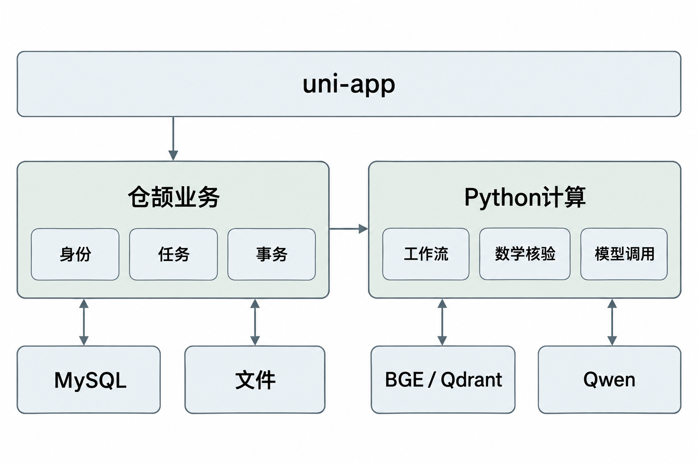
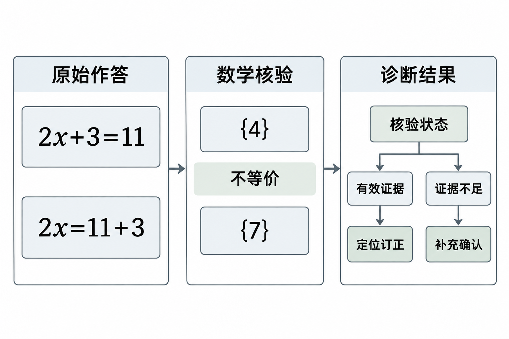
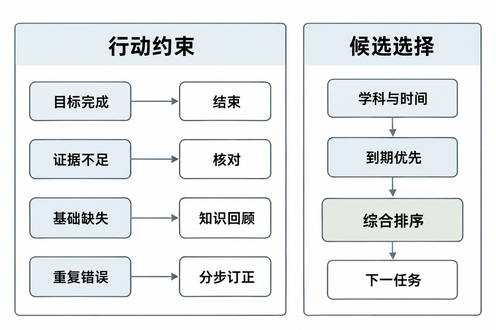
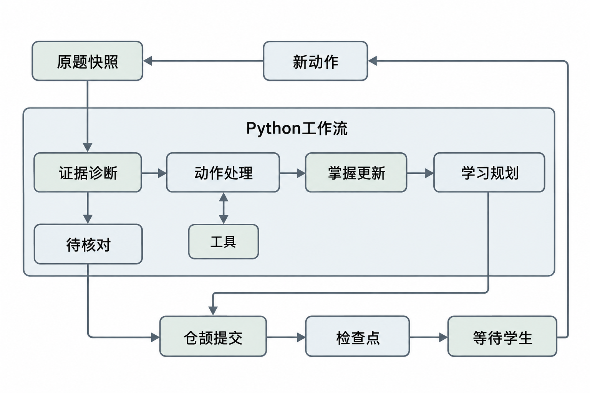
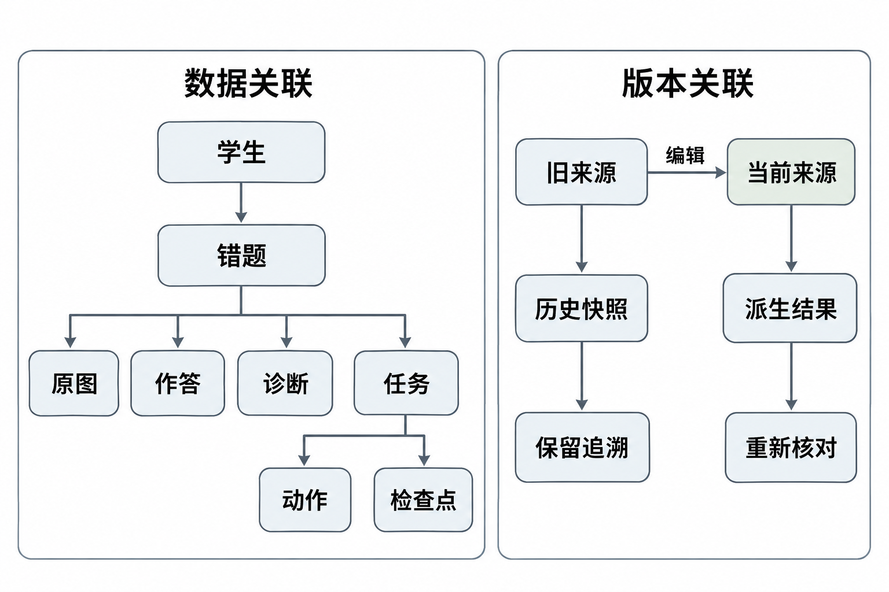
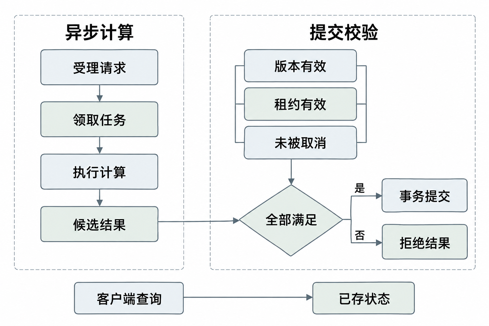

# 错题帮系统设计文档

2026“仓颉杯”智能编程大赛

源码核对基线：71894bf。修订日期：2026年10月22日。

## 1 总体设计

本报告说明错题学习系统的技术模型、执行结构与验证依据。设计以可追溯诊断、辅助条件区分和有效任务推进为目标，分别定义算法计算、业务提交及学习记录的责任。

### 1.1 设计目标

系统设计将研究问题转化为三个技术目标：过程诊断具备真实引用和核验依据，状态估计区分回答条件，学习安排受当前目标与数据资格约束。实现还需满足中断恢复、并发提交和材料修改情况下的一致性要求。

模型输出、数学工具结果和学生作答具有不同身份。算法服务负责计算和结构化结果，业务服务决定当前结果能否采用，客户端提交真实动作并显示已保存状态。局部订正、原题独立与条件对照分别记录，执行完成和掌握估计按各自含义保存。

设计目标与可观察结果如下。

表1 设计目标

| 目标 | 系统要求 | 可观察结果 |
| --- | --- | --- |
| 原材料可信 | 原图与派生识别分开，学生确认输入 | 能回看原图与本次使用的文本 |
| 诊断有依据 | 引用实际作答，保留规则与语义状态 | 能定位具体步骤并查看核对状态 |
| 学习连续 | 持久保存动作、阶段和回执 | 离开后恢复，重放不重复加分 |
| 建议可执行 | 规划使用当前来源与有效候选 | 下一动作和题目可以实际打开 |
| 状态一致 | 归属、版本、租约及事件提交受控 | 旧结果拒绝写入新题，失败可恢复 |

设计动机参考提取练习、分散练习与学习策略研究[1–3]，把重新作答及时间信息纳入可记录事件。Photomath和Anki分别提供分步解释与复习调度的产品参照[17–18]。本系统关注这些环节之间的来源关联和提交约束，教育收益与工程正确性分别验证。

**设计对象与责任分配。** 系统把一次学习活动划分为材料、判断、行动和保存四类对象。材料是题干、配图及学生原始作答；判断是分析、诊断和判题结果；行动是学生实际提交的订正、回答或求助；保存是对这些对象身份与有效性的确认。四类对象通过来源关联，但具有不同的修改条件。原题编辑属于材料变化，重新计算属于判断变化，页面刷新只读取保存状态。这个划分为后续模块设计提供一致的对象语义。

**详细设计的约束。** 正确性要求同时覆盖内容计算和状态提交。计算服务需要依据本次题目返回可解析结果，业务服务需要确保该结果对应当前用户、来源与动作。可恢复性要求在响应丢失和进程重启后找回已保存结果。可解释性要求判断及推荐能够回查引用和规则。可维护性要求公式显示、模型适配、状态管理分别具有明确入口，便于在其中一层修改后确定受影响的验证范围。

**设计取舍。** 个人错题应用采用单一业务权威与内部计算服务，有利于集中管理用户数据和学习事件。耗时模型调用独立于结果提交事务执行，以减小长计算对数据锁的影响；提交前重新校验执行资格，承担由此带来的版本检查成本。跨端客户端复用页面与数据合同，平台相机、文件和网络能力单独适配。设计优先解决真实使用中的连续作答和中断恢复，再依据实际负载决定是否扩展工作器或拆分服务。

### 1.2 系统架构

系统采用uni-app客户端、仓颉业务服务、Python内部算法服务与数据资源组成的结构。客户端负责交互和展示；仓颉承担业务身份、题目归属、状态转换和MySQL事务；Python接收业务层整理的输入，返回诊断、规划、核验和资源处理结果。MySQL保存业务事实，文件目录保存原始与派生资源，Qdrant承载可重建检索索引。模型调用经Python内部ApiPoolProvider统一轮询逻辑模型Qwen。

图1按职责区分计算与提交。学生在客户端发起录题、订正或练习，仓颉读取本人数据并建立上下文，再调用内部算法。算法结果返回后，仓颉检查对象、版本、输入和当前资格，决定哪些结果进入记录。模型和数学工具可以提供计算依据，MySQL中的任务状态和掌握记录仍由业务规则维护。当前独立算法包位于backend-algorithms，共用的识别、模型、数学和教学模块置于learning_core；旧Python业务后端已经删除。

检索资源是算法的外部依赖。Python向检索推理服务请求嵌入和重排，向Qdrant检索候选标识，仓颉按标识从MySQL回查原题和可用属性。索引提供召回线索，数据库决定题目是否存在、是否适合练习和是否已被使用。这个分工使索引能够重建，也使题目被修正或隔离后立即在业务准入环节生效。

客户端采用移动优先布局，并复用到桌面浏览器。数学内容由受控组件渲染，交互可视化消费结构化配置。客户端保存输入草稿和显示状态，实际学习记录从服务端读取。页面刷新、断线和重新登录可以改变前端会话，但不会把服务端已完成的动作恢复成新的未作答事件。

**请求路径。** 客户端请求先进入仓颉公开业务接口，完成身份识别、对象归属及动作合法性检查。同步查询直接返回当前业务视图；需要智能计算的请求由业务层准备来源和上下文，再进入Python内部入口。算法返回诊断、判定或规划提案后，仓颉补充保存语义并形成公开响应。前端按服务端状态更新输入区和操作入口，数据流的终点是可重新读取的业务结果。

**存储边界。** MySQL保存题目与学习行为的权威记录，文件目录保存原始图片和生成产物，检索索引用于候选查找。三者在可恢复性上具有不同地位：原图与作答承载实际学习事实，索引可依据已登记材料重建，导出文件代表某次固定输出。架构因此通过业务标识连接资源，而不把向量检索命中或本地文件存在直接解释为一条可供当前学生使用的题目。

**变化隔离。** 当模型提供者或提示策略调整时，Python继续返回相同的结构化业务合同；仓颉依据合同和来源决定结果是否可用。当客户端新增展示样式时，它仍消费既有学习视图。影响学习规则的变更需要同时核对计算提案、仓颉准入和前端反馈，例如新增一种判题状态就不能只修改模型输出字段。该边界将普通展示调整与学习证据语义变更区分开，便于确定回归范围。

### 1.3 技术选型

技术选型围绕跨端交互、业务状态控制和智能计算生态展开。uni-app复用Vue 3组件与页面，TypeScript约束前端数据合同；仓颉集中处理身份、任务状态和MySQL事务；Python/FastAPI承载模型、数学与检索计算。分离部署允许计算资源变化而保持业务事实的统一管理。

表2 技术选型依据

| 技术 | 承担职责 | 选择依据与约束 |
| --- | --- | --- |
| uni-app / Vue 3 | 共享页面与交互 | 复用H5与App资源，平台能力另行验收 |
| 仓颉 | 业务接口与状态提交 | 集中维护身份、来源及事务边界 |
| Python / FastAPI | 内部计算接口 | 组合结构校验、数学工具和模型调用 |
| MySQL | 业务事实持久化 | 事务保护事件与状态的一致提交 |
| Qdrant与BGE | 检索索引、嵌入及重排 | 召回候选后仍由业务层回查资格 |
| LangGraph | 单协调计算图 | 表达节点与条件边，持久化由仓颉负责 |
| Pydantic与SymPy | 结构及数学校验 | 分别验证字段合同与受支持关系 |

逻辑模型名称固定为Qwen，ApiPoolProvider统一管理服务端资源池调用。模型接口与检索资源属于可替换计算依赖，数据归属、来源版本和写入规则保持在业务层。图工作流使用当前上下文完成有限轮计算，数据库检查点由仓颉维护。

仓颉、uni-app、Vue与FastAPI的能力边界以官方文档为依据[7][12–14]。框架文档用于解释选择依据，当前模块是否接入及接入范围以本仓库实现为准。

**选型依据。** uni-app承担移动优先的共享页面与平台接口，Vue 3承担组件状态组织，TypeScript用于约束关键前端数据。仓颉承担公开业务与事务控制，使身份、数据版本和任务推进在同一服务中执行。Python提供符号计算、结构校验和智能计算生态。选型的评价对象是各层实际承担的职责，而不是语言数量；例如掌握度持久化始终经过仓颉，即使数值由Python计算。

**类型边界。** 跨语言调用使用明确字段、枚举和数值范围。客户端类型约束帮助减少界面误用，Python的Pydantic校验限制计算输入输出，仓颉执行用户归属与事务条件。这三类校验相互补充：字段能够解析只说明数据形状有效，题目属于当前用户、动作属于当前步骤等关系仍由业务查询判断。合同变化应同步检查三层对缺省值、空值和状态枚举的处理。

**运行依赖。** 数学规则、检索和模型的依赖按能力区分。支持的代数构造可使用本地确定性计算，开放题意分析依赖可用模型，候选召回依赖索引与嵌入资源。启动检查需要分别观察这些依赖，运行反馈也应对应具体能力。资源配置保留在服务端，报告记录逻辑组件与调用职责，使架构说明可以独立于某一组访问凭据阅读。

### 1.4 模块划分

模块按材料、学习、练习复习和资源输出组织，共同使用题目及事件标识。材料模块保存确认输入，学习模块保存诊断、动作与检查点，练习复习模块保存独立题目会话及回执，资源模块管理文件和导出。跨模块传递使用结构化合同，计算输出在提交前复核。

各层提供的接口内容如下。

表3 层间责任

| 层次 | 负责内容 | 向相邻层提供 |
| --- | --- | --- |
| 客户端 | 录题、校对、答题、导航、草稿与反馈 | 真实用户动作和当前页面版本 |
| 仓颉业务 | 身份、来源、状态、资格与事务 | 当前计算上下文和可用业务视图 |
| Python算法 | 识别、诊断、规划、核验与导出计算 | 结构化结果、依据和范围 |
| 数据资源 | 业务事实、原始文件和检索索引 | 按归属或内部权限访问的内容 |

业务对象的职责与提交检查如下。

表4 业务模块

| 模块 | 主要业务对象 | 提交检查重点 |
| --- | --- | --- |
| 采集与错题本 | 原图、题干、选项和作答 | 本人归属、材料确认与当前版本 |
| 诊断与学习 | 诊断依据、动作和检查点 | 实际步骤、来源、阶段及租约 |
| 练习与考试 | 候选、快照、答案和回执 | 题目资格、曝光、时限及去重 |
| 复习与知识 | 计划、回忆结果、知识来源 | 当前回执和来源有效性 |
| 报告与组卷 | 已有学习事实和输出资料 | 数据范围、资源归属与导出完整性 |

**模块间的交接对象。** 采集模块交出经确认的题目，诊断模块交出带来源的证据结果，学习任务模块交出动作、检查点和完成状态，练习模块交出具有自身身份的新题与回执，复习模块交出到期安排和回忆记录。报告及易错地图读取这些对象形成汇总。各模块围绕同一用户和题目关联，但保留自己的事件身份，因此可以在不改变原始作答的情况下重新生成分析或更新展示。

**查询与推进。** 读取详情、查看历史和恢复页面属于查询行为；提交答案、确认识别和执行自评属于推进行为。查询能够重复执行而不增加学习证据，推进需要当前版本及唯一请求标识。功能模块采用这一分类后，页面进入与退出不会改变掌握状态，后端也能够明确判断一次调用是否需要事务和幂等处理。

**变更影响分析。** 题干编辑影响以原题为来源的诊断和练习，提示策略变化影响辅助事件解释，公式组件变化影响展示与输入，检索排序变化影响候选次序。维护时应从变更对象追踪其消费者。例如修改选项结构，需要同时检查识别、确认、选择作答和错题收录；修改任务状态，需要检查受理、工作器、恢复查询和页面按钮。模块划分使验证范围与实际依赖对应。

## 2 核心算法

核心算法围绕诊断、评估、规划和习题供给组织计算。各算法接收当前来源与明确参数，输出结构化提案；业务层核对执行资格后采用结果。以下分别说明计算合同、核心机制、演算实例和适用边界。

### 2.1 错因定位算法

诊断需要处理解题路径不同、原步骤缺失及模型引用不可靠的问题。采用证据约束方法，是为了将错误候选落实到可回查材料，并利用明确数学关系增强受支持题型的判定。

证据约束错因定位算法把诊断建立在学生实际作答上。输入包含题目条件、学生步骤ID与原文、参考过程、核验结果和可引用知识。输出包含偏差位置、支持依据、核对等级和下一动作。算法首先确认某个诊断所引用的步骤确实存在，再判断该步骤表达了什么关系，最后依据此前步骤的有效性确定能否称为“首次偏差”。

图2把学生原步骤、解集核验与输出分支分开呈现。学生采用不同解法、不同列式顺序或合理省略时，步骤数量可能与参考过程不同。系统按实际内容和明确引用组织对照，不按两列的第几行强制配对。对于受支持的多项式求解，核验关注每步与原题实数解集的关系；对于一般语义题，引用实际学生步骤并保留待核对状态，参考解释用于帮助理解。

算法先执行来源筛选。候选必须引用当前学生步骤ID，原文与下标也必须匹配记录；已经判定等价、正确或合法分支的步骤不进入错误候选。有效候选再汇集学生步骤、参考引用、数学规则与知识关联。模型给出的索引、原因为候选说明，具体可信等级由可验证证据与前缀检查决定。若模型引用不存在的ID或修改后的原文，候选不会获得错误资格。

候选分数采用可配置加权形式：

S＝α₁I_s＋α₂I_r＋α₃I_f＋α₄I_k－α₅I_c。

其中，S为证据排序分，I_s表示存在匹配的学生原步骤，I_r表示受支持规则已验证该步骤与原题不等价，I_f表示参考ID及引用原文匹配，I_k表示有明确关联的知识证据，I_c表示核验结果存在矛盾。默认权重依次为1、2、1、0.5和4。各指示量只在相应条件成立时取1，分数用于候选排序，未作概率校准。知识卡与错误假设发生关联，可以增加解释线索；数学结论仍以对应规则检查为准。

排序之后，算法检查首错之前的每一步。即使第3步已经确定不等价，若第1步或第2步仍未核实，也只能称第3步可疑，不能保证它是最早错误。只有前缀步骤均在明确范围内通过、候选本身由受支持规则判错时，才给出已验证的首错位置。只有答案而没有可验证步骤时，当前实现保留答案级解释并标记待核对，不生成已验证首错。完全没有作答时才提示先作答；在题目与参考有效时，任务可进入独立作答以取得过程。

受支持多项式核验以单变量、有限非空实数解集及限定次数为范围。每个学生步骤被解释为方程或明确根值，算法比较其解集是否与原题一致；单个合法根可作为分支过程，最终是否漏根还需结合全部答案。参考步骤能够提供对应关系，但原题本身决定核验目标。修复验证进一步检查原来正确前缀是否保留，以及修复后的完整路径能否得到原题完整实数解集。

**步骤定位示例。** 原题为2x＋3＝11，学生写第1步“2x＝8”，第2步“x＝5”。第1步与原题的解一致，第2步把解改变为5，算法定位第2步并引用该步原文。修正为“x＝4”后，核验保留第1步，修复结果与原题实数解集一致。若学生直接写“x＝4”且答案完整，较短路径也可通过，不要求补写与参考相同的两行。

**证据不足示例。** 学生在几何题中写“看图可得全等”，现有材料未给出充分的边角条件。本地代数规则不能验证这条文字推理，工作流进入核对状态，要求回到原图与实际条件。这个分支保留了有用的语义建议，也避免把“模型认为合理”转换为受规则证明的结论。相关实现与回归覆盖见错因定位模块（`backend-algorithms/error_diagnosis.py`，版本71894bf）。

当前答案级分支将选择答案及其他非空回答作为真实作答输入。证据类型区分student_answer与student_step，答案级解释可保留可能错因，具体步骤定位仍执行引用和前缀规则。相关新增回归检查有答案无步骤、未知分类及正确答案比较，避免把缺少步骤误表述为完全没有作答。

数学核验借助SymPy的集合式求解接口组织解集比较[9]，结构合同使用Pydantic模型约束[8]。参考方法提供工具能力；本系统另行规定步骤来源、前序成立和候选采信条件。

**处理次序。** 诊断先建立实际步骤集合，再核对候选引用，随后采集可支持该候选的规则结果，最后决定是否具备首错资格。该次序让来源检查先于分数计算。不存在的步骤即使被模型赋予很高置信度，也无法作为有效候选；合法步骤即使与参考文本差异较大，也应保留其正确关系。输入缺少步骤时，返回答案层面的解释对象，为后续补充过程保留位置。

**候选评分演算。** 若候选具有匹配的学生步骤和受支持的不等价核验，参考与知识引用均缺失，默认排序分为1＋2＝3。若另有匹配参考，则分数为4；若再有明确知识关联，分数为4.5。矛盾项扣4分，用于降低内部依据不一致的候选排序。这些数值解释证据组成，首错资格还须通过前缀检查。因而排序最高只决定优先展示哪个候选，不能跳过独立的规则资格判定。

**合法分支处理。** 多根方程的某一根可能是合理的中间分支。以x²＝4为例，写出x＝2可以表示其中一支，完整答案还需覆盖x＝－2。诊断应结合步骤语境与最终答案判断遗漏，不能用单个分支与完整解集不相等直接证明该分支错误。当前支持范围由对齐与解集规则确定，超出可判定结构时保留待核对状态。规则验证应同时包含完整解、合法分支、漏根及新增无效根这些互相接近的输入。

**修复的判定对象。** 局部修复关注原偏差是否被正确替换，以及此前有效步骤是否保留。原题完整回答则关注最终结果和整体关系。学生把“11＋3”改为“11－3”可以完成局部订正；独立回答x＝4提供另一项完整题证据。两种提交的输入范围和输出含义不同，修复通过后推进学习阶段，完整回答通过后才进入相应掌握更新条件。

**结构化结果的消费。** 前端需要错误位置、引用文本、核验状态与下一动作；工作流需要首错索引和是否继续执行；历史回查需要来源及证据组成。结果因此同时服务展示、控制和追溯。每个消费者只使用其责任范围内的字段：页面突出当前偏差，协调器依据资格推进，业务层保存版本关联。参考解释能够帮助学生理解，实际首错位置始终绑定原作答中的具体步骤。

### 2.2 掌握更新算法

相同正确结果在不同辅助条件下具有不同证据强度。采用带权似然更新，是为了显式控制提示与独立回答的影响，并使每次更新可追溯到有效事件。

辅助感知掌握更新算法区分学生在不同支持条件下完成题目的证据强度。输入由当前掌握估计和已确认作答事件组成，事件注明回答范围、正确性、提示、完整答案暴露、来源有效性及时间间隔。算法输出新的掌握估计、不确定性、遗忘风险和更新说明。仓颉负责确认该事件来自当前用户、当前题目和已受理动作，再在事务中采用计算提案。

更新先经过事件准入。重复事件、来源失效、判题待核对或局部步骤订正均不能产生新的完整作答观察。看过完整答案后回答正确，保存为辅助学习；获得提示但未看完整答案的已确认回答，以较弱权重参与估计。独立作答使用标准权重，间隔后独立答对条件对照可以获得保持性权重。这个设计使学生可以放心求助，同时保留独立与辅助表现的区别。

设p为当前掌握先验，y为回答正确性，w为证据权重。已掌握情况下答对的似然取0.9、答错取0.1；未掌握情况下答对似然为g、答错为1－g。选择题的g按选项数m取1／max(2，m)，非选择题默认0.05。记对应回答的两类似然为L₁和L₀，则后验为：

p′＝pL₁^w／［pL₁^w＋(1－p)L₀^w］。

当回答正确时，再加入学习转移项：

p″＝p′＋(1－p′)λmin(w，1)。

λ默认0.08，回答错误时直接采用p′，结果限制在接近0与1之间，防止连续回答造成数值不可恢复。未知掌握先验默认0.35，独立回答w＝1，提示回答w＝0.35；间隔至少1天且独立答对条件对照时w可取1.25。参数用于现有可解释规则，后续校准需要真实学生样本。

不确定性以二元熵表示，H(p)＝－p log₂p－(1－p)log₂(1－p)。当估计接近0.5时，不确定性较大；接近边界时较小。遗忘风险以当前掌握及间隔组织，规则形式为R＝1－p exp(－d／τ)，其中τ默认30天；获得新的有效作答时d取0，未采用新作答时d使用距离上次有效事件的天数。没有新回答时，时间可以改变后续优先级，不虚构新的答题证据。

表5 默认计算情境

| 同一先验下的独立情境 | 证据权重 | 结果 | 记录含义 |
| --- | --- | --- | --- |
| 独立答对原题 | 1 | 0.913957 | 增加独立正确证据 |
| 提示后答对 | 0.35 | 0.608193 | 较弱证据更新 |
| 看完整答案后答对 | 0 | 0.35 | 保留辅助学习 |
| 独立答错 | 1 | 0.053640 | 降低当前估计 |
| 隔日独立答对条件对照 | 1.25 | 0.956115 | 增加保持性证据 |

表5均从先验0.35、非选择题条件独立计算，是默认规则的可复算输出。五行不是一个学生的连续轨迹，数值也不是实测学习收益。它们说明相同“答对”在不同辅助条件下会产生不同解释，学生看到解析后重复正确答案不会被记录成新的独立成功。

任务持久化还有额外约束。仓颉核对动作文本与待执行回答相同，阶段属于原题独立或条件对照，判题可采用，来源仍当前，并按任务和动作编号检查是否已写入。完整答案暴露保留在历史中，但不刷新客观掌握证据时间；局部订正保存为步骤进展。受支持的条件对照独立完成后，另经曝光与重复检查形成近迁移资格，当前工作流使用辅助感知更新，避免再叠加一份传统加法奖励。

题库练习和生成类似题沿用各自的规则更新合同，与持久任务的辅助感知估计共同写入统一业务记录。两条路径都核对独立性、判定可靠性和去重，但计算参数并不相同。报告应说明记录来自何种行为，后续统一校准再比较不同路径的估计含义。当前实现及参数见掌握更新模块（`backend-algorithms/mastery_tracker.py`，版本71894bf）。

知识追踪综述归纳了依据学习交互估计知识状态的研究路线[4]。本算法选择可解释的概率更新并引入辅助权重，参数、采信条件和事件去重均显式保存，便于复算。

**合同校验。** 掌握状态中的估计范围为0至1，各类计数为非负整数；证据事件具有非空标识、作答范围与判定枚举。配置对象禁止未知字段和非有限数值，提示权重处于0与1之间，学习率限制在0至0.2，保持权重限制在1至2。输入限制使参数错误在计算入口被识别，避免无穷值、负计数或错误字段名进入状态更新。

**正确观察演算。** 在先验p＝0.35、非选择题猜测项g＝0.05、独立权重w＝1时，正确观察的分子为0.35×0.9＝0.315，另一项为0.65×0.05＝0.0325，得到后验约0.906475。再加入学习转移0.08×(1－0.906475)，得到约0.913957。错误观察使用0.1与0.95，得到0.035／(0.035＋0.6175)≈0.053640，并直接作为结果。两个分支体现观察更新与学习转移的分别执行。

**提示权重的作用。** 权重作用于似然而非直接给结果乘系数。提示后正确时，0.9与0.05分别取0.35次幂，其似然比更接近1，使更新后的状态更接近先验。正确回答仍可获得与权重对应的学习转移；错误回答保持负向观察。完整答案暴露则在更新前进入辅助记录分支，因此其权重0表示未采用掌握证据，而不是把一次正确计算的结果清零。

**计数与时间。** 可靠完整回答增加证据计数；有提示的回答增加提示计数，独立回答增加独立计数，独立正确还增加独立正确计数。有效事件更新最后有效时间，完整答案暴露保留辅助次数。数据库适配层使用现有业务状态及事务去重，算法对象中的上次事件标识用于局部计算防重。历史事件的持久唯一性由仓颉管理，二者分别覆盖单次计算和跨请求保存。

**数值稳定与解释。** 先验及后验被限制在距0、1各约10⁻⁶的内部区间，使连续观察后仍能恢复，并保证熵计算有定义。高或低估计表示当前规则下的状态，不确定性用于观察其分布位置；证据数量仍需同时展示或保留。新用户默认先验与长期积累得到的相同数值具有不同证据基础，报告应允许回查近期回答及辅助情况。

**更新后的使用。** 学习规划读取当前估计计算薄弱度与候选信息量，复习建议还考虑时间，学生页面读取更新理由。一次更新可以改变后续选择，但不直接证明教学效果。参数校准需要固定题目、辅助条件及间隔，比较预测与后续真实独立回答之间的关系；现有默认参数则支持机制演算与工程复现。

### 2.3 学习规划算法

学习行动同时受当前阶段和资源预算限制。采用阶段优先、硬约束过滤及组内排序，是因为未完成订正、来源不全和时间耗尽等条件不能由一个相关性分数替代。

目标约束学习规划算法将诊断和掌握估计转化为学生可以执行的下一步。它接收当前任务阶段、证据充分性、先备知识、近期错误、学科、剩余时间、目标数和有效候选，输出订正、回顾知识、提示、重做、练习、复习或结束等动作。规划在已知候选和业务范围内作选择，并为选中的题目保存分量解释。

图3先处理当前任务，再选择后续内容。当前题目证据不足时，优先回到原题核对；缺少先备知识时，先打开明确知识卡；同一步反复错误时继续拆解；原题独立阶段要求重新作答；条件对照阶段使用已核验的新条件题。只有当前学习完成并且还存在时间与目标，才开始后续候选排序。这个顺序避免在学生尚未理解当前问题时不断追加新题。

规划首先检查预算。剩余时间为零或当前目标已经完成时结束本轮；候选题预计用时超过剩余时间、学科不同或刚刚完成，则从本轮选择中移除。知识卡ID、题库候选和到期错题来自仓颉提供的上下文，模型不创建可直接跳转的新数据库对象。无合格题时，已有相关知识卡可以作为回顾入口，否则说明当前没有合适内容并结束。

候选评分同时考虑错误关联、薄弱程度、预期信息量、到期、难度、时间与重复。记这七项分量分别为E、W、G、D、F、T和P，则默认评分为：

Q＝0.20E＋0.20W＋0.15G＋0.20D＋0.15F＋0.10T－0.30P。

E表示候选与当前知识目标的关联；W＝1－p表示薄弱度；G取归一化后的预期信息量；D为是否到期；F衡量候选难度与当前目标难度的接近程度；T＝1－预计分钟数/max(1，剩余分钟数)，衡量候选与剩余时间的适配程度；P为近期曝光次数的截断归一值。默认目标难度还随连续失败下调，使困难情境优先选择可完成的小任务。各分量可回读，便于解释一次推荐为何出现。

到期复习还具有显式优先级：合格的到期错题先于非到期新题，再在各自组内按分数和稳定ID排序。这个规则保护已有复习安排，防止新题总因相似度高而挤掉旧题。规划结果最多给出一个主行动和两个备选，页面只突出当前主动作，避免把算法内部评分表全部推给学生。

**有限时间示例。** 学生完成当前方程的条件对照，剩余5分钟，候选中有3分钟的同科到期错题、一道20分钟题、一道英语题和一道刚完成的题。后面三题因时间、学科或近期完成条件被过滤，规划推荐先复习到期错题。若当前学习目标已经全部完成，即使仍有候选，也返回结束。该行为把学生设定的学习量落实为停止条件。

题库练习另使用信息增益自适应选题。仓颉从当前年级与学科范围提供至多200个合格候选及至多400条本人已提交历史，算法只采用已确认独立观察，按回答前后熵的期望差衡量信息量。批量得分加入薄弱度，扣除题目曝光和批内知识重复，逐次选择1至20题；缺少知识标签时明确使用学科、学段和题型的粗粒度依据。这个入口选择一批练习题，本节规划决定当前学习后的行动，两者服务不同用户任务。

推荐回到业务层后，仓颉检查主选题与备选题确实属于本次候选集，并核对来源和最近完成情况。选择行为本身不增加掌握，实际打开、提交和判定后才形成相应事件。默认参数与优先级是当前工程策略，规则检验见学习规划回归（`backend-algorithms/tests/test_learning_planner.py`，版本71894bf）。

**输入组织。** 规划输入限制最多200个候选、400项掌握映射、100个知识点和6个知识卡标识。当前阶段限定为订正、独立、条件对照与完成；剩余时间为0至120分钟，目标数量为0至20。有限输入使本次决策范围明确。候选进入排序前按标识去重，同一题目在本次集合中只占一个位置，返回结果记录实际被选中的来源类型。

**分支优先级。** 预算或目标结束先于其他动作；证据不足先于教学推进；前置知识缺失先于当前题训练；重复错误和连续失败先于常规阶段动作。连续失败达到两次且当前阶段未结束时，可返回提示；进入完成阶段后才进行候选比较。这个优先级将教学约束写入执行次序，保证一次输入只产生一个明确主行动。剩余时间还限制简单动作的预计时长。

**评分算例。** 取一个已通过硬约束的候选，假设E＝0.8、W＝0.6、G＝0.4、D＝1、F＝0.9、T＝0.4、P＝0，则Q＝0.16＋0.12＋0.06＋0.20＋0.135＋0.04＝0.715。若其近期曝光分量增为1，其余条件保持不变，则Q降为0.415。该例用于解释权重作用，分量是演算输入；实际运行由当前候选及历史产生，并保留各分量以便回查。

**组间与组内选择。** 到期资格先决定候选所属优先组，分数再决定组内次序，同分时使用稳定标识排序。因此，一个合格到期题即使分数低于某道新题，仍可优先被选择。到期题若学科不符或超过剩余时间，则已经在过滤阶段排除。硬约束、组优先与软评分共同作用，使每一步的理由可以单独检查。

**空候选处理。** 当前阶段完成但没有合格题时，若上下文中有有效知识卡，返回知识回顾；没有相应材料时返回结束。结果包含行动、知识点、原因、预计时间、主选来源及至多两个备选。页面突出主行动，后台保留排序信息。候选不足也可由独立补题入口解决，其生成内容需通过自身准入后再形成可执行练习，不能在排序结果中临时编造题目身份。

### 2.4 习题生成算法

习题供给需要同时满足目标适配与内容可判定。采用检索优先、候选不足时生成的方式，以可回查题库为基础，并通过共同准入检查连接生成内容与实际训练。

同源核验补题算法解决“原题已经能分析，题库却缺少合适练习”的断点。算法优先选择现有题库候选，在目标无法准备、检索不可用或候选均未达到核心技能要求时，才进入由当前原题约束的生成分支。生成结果继续经过核验和来源提交检查，最终成为可保存、可作答、可恢复的具体练习。

检索查询由题目、选项、学科、年级和知识目标组成。系统使用稠密与稀疏两路召回，通过倒数排名融合组织候选，再根据重排分、结构特征、文本相似和模式信号排序。同类巩固倾向保留核心结构与方法，变式倾向改变题型、表达或场景。近期已提供和已作答的题进入排除集合，近乎重复的题按相应阈值过滤，降低用同一题反复充当“新练习”的情况。

候选排名与技能准入分别执行。同学科、同年级或出现同样数字，可以提高相关性，却不能证明题目检验了同一技能。以一元一次方程为例，直接方程可由符号结构核验；文字应用题需说明它实际要求求一个未知量，并给出由题中数字组成的线性方程。其他目标要求原题和候选的逐字引文支撑同技能判断。几何路线比较题即使包含“方程”字样，也不会仅凭文本关联通过解方程技能检查。

生成分支从当前原题、年级、模式和知识内容出发。受支持的数学近似题采用可解构造：取系数a、常数b和整数解z，令c＝az＋b，得到ax＋b＝c，再用符号求解确认答案为z。当前抽样范围为a取2至9、b取1至15、z取－9至9；若题干与此前练习相同，调整解并重新计算常数，保留可解性。这个小范围规则在模型不可用时仍能提供具体方程练习。

一般生成题先满足结构合同和已有核验，再执行另一次结构化复核。复核分别判断同技能、答案正确、材料完整和年级适宜，四项都确认才准入；需要缺失图片才能作答、答案或选项有歧义、只能生成泛泛学习建议的结果不作为练习。复核由当前提供者另次调用完成，依据仍属相应模型与规则范围。通过的结果附带生成来源、核验和原题版本，等待仓颉采用。

表6归纳从题库候选到作答写入的准入条件。

表6 类似题准入

| 环节 | 主要依据 | 未通过时的处理 |
| --- | --- | --- |
| 题库资格 | 学科年级、材料、答案与可练习标记 | 过滤候选 |
| 核心技能 | 符号结构或有原文支撑的语义对齐 | 继续其他候选或生成 |
| 生成核验 | 答案、同技能、完整性和年级 | 保留原题，提示重试 |
| 来源提交 | 当前题目及分析诊断版本 | 拒绝迟到结果并重新获取 |
| 作答写入 | 当前来源、服务端答案和曝光历史 | 不符合的结果不增加掌握 |

**补题示例。** 原题为13x＋7＝98，题库没有通过技能检查的题时，可构造并核验另一道一元一次方程。具体系数由规则抽样，学生先看到题干，提交后得到答案与解析，再选择继续练习。正式页面保存题目与会话标识，刷新后恢复原题和回执。既有回归按实际生成的系数计算答案，验证保存、恢复和继续练习的完整路径。

补题还定义了失败和复用策略。新生成未通过核验且没有旧合格题时，返回当前暂不可用并保留错题和学习记录；已有当前版本合格生成题时，可以继续使用旧题。请求“再练一道”尝试获取新题，失败后重用旧题应在界面说明为巩固原题。学生修改原题后，旧生成题不能按旧来源继续更新当前学习状态。相关实现见生成练习模块（`backend-algorithms/practice_generation.py`，版本71894bf）及仓颉生成练习业务。

检索与生成的结合参考检索增强生成研究[6]。Qdrant混合查询文档及BGE相关表示研究为检索组件提供技术参照[15–16]。本项目按实际部署配置使用嵌入、召回或重排能力，引用M3研究用于说明技术背景，不据此宣称已部署其全部模式或获得其公开基准成绩。

**检索材料准备。** 查询材料保留原题正文、选项、年级及知识目标，题图需求与文本内容一起影响候选资格。召回阶段回答“哪些材料值得进一步比较”，技能核验阶段回答“是否检验同一能力”。将两者分开后，可以在保持技能准入不变的情况下调整召回数量或排序策略，并通过候选来源追查遗漏发生在哪一环节。

**构造式补题演算。** 取a＝5、b＝3、z＝－7，则c＝5×(－7)＋3＝－32，得到5x＋3＝－32。代回可得左式等于－32，求解得到x＝－7。若调整目标解为6，保持a与b，则得到5x＋3＝33，答案变为6。构造时题干、答案与解析必须依据同一组参数生成，修改某一数值后需要重新核验全部派生内容。该确定性例子解释补题规则，实际系数由当前实现选取。

**语义候选的复核对象。** 复核分别读取题干、答案、选项及所需材料，判断目标技能、答案一致性、可独立作答性和年级适配。四个条件具有不同失败含义：同技能不成立说明训练目标偏离；答案不一致说明结果不可采用；材料不完整说明学生无法作答；年级不适配说明题目不宜进入当前学习范围。保留明确分支有利于区分继续检索、重新生成与返回原题。

**保存后的题目身份。** 生成成功先形成候选内容，经仓颉检查后才拥有可恢复会话。学生看到、提交和刷新后读取的是同一份已保存题目，判题使用服务端答案。生成请求的重试与学生请求下一题具有不同含义：前者围绕同一次获取恢复，后者需要一个新的练习对象。已经暴露答案的旧题可以继续用于巩固，其辅助历史随会话保留。

**失败终点。** 检索和生成均未取得合格内容时，保留当前错题和已有进度，返回明确不可用状态。新题未通过核验时不能通过删除核验字段绕过准入。已有有效旧题时，可按当前合同恢复旧题；原题来源变化时需重新检查其适用性。这个终点使模型失败只影响本次习题供给，学生已经提交的原作答和学习回执保持独立保存。

## 3 智能体设计

单协调器负责组织算法节点与工具观察，仓颉负责持久任务和执行资格。设计将一次计算调用与跨多次学生动作的学习任务分开，从而支持等待、恢复和受控退出。

### 3.1 协同架构

智能体采用一个协调工作流，不设置相互独立的角色代理。协调器读取当前题目、诊断、知识内容、动作和检查点，按阶段组织计算；工具承担局部能力，结果返回协调流程。算法节点共享同一任务上下文和来源，业务状态由仓颉持久化。

三个核心算法与补题机制由具体业务入口协同。持久学习任务中，LangGraph单协调工作流依次处理证据定位、必要确认、学生动作执行、掌握估计和下一步规划；任务执行内部再按工具反馈调用知识检索、步骤对齐、判题或受控可视化。类似题入口负责检索与核验补充，两者共用当前题目和学习记录，但有独立的请求与结果合同。

仓颉工作器从MySQL领取待执行任务，绑定租约并整理上下文；Python完成有限调用后返回新视图与检查点。后端核对来源、动作及执行身份再保存。LangGraph在此表达计算次序与条件边，未另设图框架数据库持久层。该结构保持单一业务事实来源。

ReAct研究将行动及环境观察纳入语言模型任务过程[5]，本系统采用其工具反馈参与决策这一设计思路，具体控制逻辑由单协调工作流实现。LangGraph持久化文档给出框架检查点能力[10]，但本项目的持久业务状态由仓颉管理，不采用另一套模型侧业务数据库。

**协调器的权限。** 协调器接收业务层整理的当前上下文与检查点，能够选择已允许的计算动作并组织工具调用。它不具备业务数据库写入权，也不创建额外的学生身份。学生题目、知识卡、候选和记忆均来自本次合法范围。计算图输出新的学习视图与状态提案，事务采用权仍保留在仓颉服务中。

**工作流与会话。** 一个学习任务可以跨越多次请求，每次图调用仅完成当前允许的计算。等待学生意味着当前调用已经返回；再次提交由业务层确认新动作后重新执行。这样既保留多轮上下文，也避免一个长时间占用连接的模型会话控制学习进度。任务标识连接这些调用，来源、动作与检查点解释每次调用发生的条件。

**节点共享。** 证据诊断、动作处理、掌握更新和学习规划读取同一上下文，并传递结构化结果。节点具有功能分工而无独立身份或竞争目标，工具是能力入口。该结构适合当前个人错题任务：关键控制条件可以在同一流程中核对，失败原因能够回到具体节点，重新进入时可依据保存状态恢复，而不必协调多份相互矛盾的代理记忆。

**入口协作。** 任务学习、类似题与普通练习各有明确入口。单协调器负责本题的阶段推进，类似题服务负责补充合格新题，普通练习服务负责批量会话。它们共享来源与学习记录，但保留各自的判定和保存合同。系统架构通过这些业务入口协作，而不是强行将全部功能包进同一个无边界对话。

### 3.2 工作流设计

图4表示一次计算调用的协作顺序。诊断节点若获得受支持证据，更新当前局部修复位置；材料需要核对时走确认分支，返回原题入口并结束。动作节点读取学生本次真实输入，完成订正或判题；掌握节点处理本次回答的辅助属性；规划节点给出后续建议。图中等待学生是交回操作权的边界，不是后台持续生成学生的下一次回答。

工作流通过检查点承接多轮学习。检查点保存当前阶段、已使用提示、答案暴露、尝试次数、条件对照和算法结果；仓颉保存动作及其来源，下一次调用读取有效状态继续。客户端只提交实际发生的动作，提示和查看答案都在允许动作范围内。一个协调器使用多个算法节点，图的运行结构清楚，工具也按允许列表接收数据和返回结果。

**方程受控轨迹。** 原题2x＋3＝11，原错答2x＝11＋3。工作流定位局部变换，学生提交“11－3”完成关键订正，进入原题独立回答；提交x＝4后记录一次完整回答，再生成只改变一项常数的对照2x－3＝11。学生独立回答x＝7完成对照，系统保存第二条合格证据，并按当前候选安排下一项到期复习。局部订正、原题独立和条件对照分别保留，不用一次最终完成覆盖中间过程。

工作流在需要学生回答时返回等待视图，结束当前计算调用。新动作通过业务受理重新进入图，材料不足则进入确认分支，目标完成或预算耗尽则退出。每次推进依赖学生输入或工具反馈，节点不会生成虚构学生动作。

本轮图调用和条件分支已由实际工作流回归覆盖，包括过程证据需确认时转确认、无原步骤时进入独立作答、首错位置驱动修复、答案不经证据泄露、检查点恢复、重复回答不重复更新、目标完成停止等情境。相关结构见单协调工作流（`backend-algorithms/learning_workflow.py`，版本71894bf）。

**诊断节点。** 工作流首先读取检查点中已有证据诊断。当前来源内已经保存的诊断可供继续执行；首次计算则根据实际步骤与参考记录建立对齐，数学题尝试受支持的多项式与不等式规则。通过核验的首错索引用于调整局部修复位置。具有实际步骤但当前规则无法核验、且缺少确认依据时，进入确认分支；没有原步骤时按当前材料条件组织独立作答。

**动作节点。** 动作处理接收学生实际选择的提示、答案、订正或回答。判题结果用于决定继续修复、进入独立阶段或处理条件对照。提示和完整答案暴露写入辅助状态，成为后续证据计算的输入。动作节点输出新的页面内容及必要观察，不能以模型代答替换学生输入。

**掌握与规划节点。** 掌握节点从已判定的实际回答构造证据事件，保留来源、回答范围及辅助条件。规划节点读取更新后的状态和当前候选，决定本轮结束或下一行动。若证据不足，工作流可以完成一次计算并返回待核对视图；这种执行结束与学习目标完成分别表示，避免界面将两者合并。

**多轮轨迹的保存。** 一次有效结果包含本轮工具观察、当前视图、检查点及可能的作答结果。仓颉在提交时关联任务和请求，将其作为后续恢复依据。学生离开后重新进入，读取已经保存的阶段；学生在另一页面推进后，旧页面需要重新对齐当前步骤。此过程让连续学习依赖可读取的业务记录，而不依赖浏览器持续存活。

**检查点复用条件。** 检查点只在同一有效来源内复用。原题发生编辑后，需要经过来源校验重新建立计算起点。图中的诊断结果与阶段内容都属于当时材料，保留它们有助于历史回查；继续使用则受当前业务资格约束。这个条件贯穿诊断复用、动作执行和结果提交三个时点。

### 3.3 工具调用

工具调用按当前阶段和允许列表组织，输入来自有效上下文，输出通过结构校验并形成观察记录。知识检索提供概念依据，步骤对齐和数学核验提供局部关系，判题提供可靠性分支，可视化提供受控表达。工具结果与业务写入分别处理。

表7 工具合同

| 工具能力 | 输入依据 | 输出及使用方式 |
| --- | --- | --- |
| 知识检索 | 学科、知识目标和有效来源 | 知识引用或未命中观察 |
| 步骤核验 | 原题、实际步骤与参考 | 等价性、偏差或待核对状态 |
| 回答判定 | 当前题目与真实新回答 | 判定状态及反馈依据 |
| 习题检索 | 目标和有效候选范围 | 候选标识、匹配依据与来源 |
| 受控可视化 | 当前来源与允许类型 | VisualizationSpec JSON |

工具失败会改变后续支持。学生错误回答2x＝14时，步骤检查得到错误反馈；知识检索若没有命中，轨迹记录未命中，随后可以退到实际步骤对齐，继续提供局部支持。单轮工具数、模型请求和执行时间有上限，失败原因与待办状态返回业务层，学生可以重试、改用文字或回原题核对。工具未命中不是新的学习成功事件。

工具轨迹保存请求对象、采用的引用和结果状态。引用知识条目或学习记忆时，应属于当前用户与有效范围。未命中、结构错误和预算退出均保留明确结果，后续策略据此调整支持。完整参考答案按阶段控制，独立作答视图不能通过工具证据提前取得答案。

**允许列表与轨迹状态。** 当前任务结果接收的工具名包括步骤检查、回答判定、知识检索、步骤对齐、条件对照、手写识别、图形检查和受控可视化。轨迹校验状态限定为已核验、拒绝、待核对和不适用。仓颉对工具名与状态枚举执行检查，单次返回的轨迹数量受限制。工具观察由此能够进入固定的保存结构，未知动作不能作为已执行事实登记。

**输入绑定。** 步骤工具使用当前题目和实际步骤，判题工具使用服务端保存的题目及本次回答，知识工具使用学科和知识目标。工具返回作答证据时，仓颉补充当前任务阶段对应的来源，随后关联工具轨迹。这一绑定过程让结果与学生本次行为具有同一身份，即使返回解释中包含其他题目，也不会改变证据归属。

**记忆引用检查。** 调用前记录本次可用记忆的引用、版本、分类、时间和来源。返回轨迹中出现的记忆引用需要属于这份集合。模型生成的解释可以使用已提供材料，但不能凭空引用另一位学生的记录或不存在的知识历史。引用不合法时拒绝采用该结果，以便在重新构造上下文后恢复。

**轨迹的用途。** 轨迹记录工具输入、输出状态及本次任务身份，用于核对某个结论采用了哪些观察。学生公开视图按当前阶段筛选显示，内部参考答案与资源配置留在服务端。轨迹完整性与学生界面简洁性因此可以同时实现：技术审查能够回查计算路径，学习页面只呈现当前必要的依据和操作。

### 3.4 状态管理

任务状态说明执行进度，阶段说明当前学习内容，两者分别保存。执行状态包含排队、运行、等待学生、需要核对、失败、完成、取消和来源失效八类；学习阶段包含局部订正、原题独立、条件对照与结束。一个等待学生任务可以处在任一需要输入的阶段，完成执行也不自动表示学生已经稳定掌握全部知识。

表8说明八种执行状态的含义与主要后续行为。

表8 任务状态

| 状态 | 进入条件 | 主要后续行为 |
| --- | --- | --- |
| 排队 | 创建或合法新动作已受理 | 领取并建立租约 |
| 运行 | 工作器持有效租约 | 计算后复核提交 |
| 等待学生 | 当前步骤需要真实回答 | 提交允许动作后重新排队 |
| 需要核对 | 输入或证据不足 | 回原题修正或合法恢复 |
| 失败 | 计算、准备或预算异常 | 保存内容并按条件重试 |
| 完成 | 本轮目标和执行已结束 | 回看记录或后续学习 |
| 取消 | 学生结束活动任务 | 保留历史，拒绝迟到写入 |
| 来源失效 | 当前材料与任务依据不同 | 从当前原题重新开始 |

状态迁移受版本与步骤编号约束。客户端提交本次看到的任务版本和当前步骤，仓颉验证允许动作后保存事件，再推进排队状态。另一页面已经提交新动作时，旧页面的输入不能覆盖当前检查点。重复请求根据动作编号和内容摘要返回原结果，内容不同却复用同一编号则拒绝，避免网络重试与真正的新作答混淆。

等待学生、需要核对或失败的任务可以在满足来源和预算条件后重新排队；租约过期的运行任务可以重新领取。取消后不采用旧结果，来源变化使其他未失效任务进入来源失效，已经完成的任务读取时也可能被标记来源不再当前。历史完成行为仍可回查，但不会因此恢复旧来源的写入资格。

执行预算分别限制单轮耗时、总动作轮数和重试领取次数。当前仓颉任务预算默认45秒，算法单次预算至多38秒，为准备和提交预留时间；任务最多24轮、领取尝试至多72次。预算是资源与恢复边界，不是每题必在该时间完成的性能承诺。学生达到上限后可以结束本次并从当前原题重开，已经形成的记录保留。

检查点保存学习阶段、辅助使用、尝试次数、条件对照及算法结果，动作记录保存学生实际输入。二者共同支持恢复：阶段决定下一动作，记录解释已有结果。执行状态与学习估计分别持久化，恢复读取不产生新的认知事件。

**状态与步骤的联合判断。** 状态决定当前任务能否执行，步骤决定学生正在回答哪一项内容。动作提交需要同时匹配任务版本与步骤标识。一个等待学生任务即使仍处于同名阶段，也可能已经进入另一道条件对照；旧输入只能按其原步骤回查。客户端草稿和服务端动作因此都保存步骤身份，避免仅用阶段名称判断可恢复性。

**工作器领取。** 当前领取事务核对题目快照和任务状态，只领取排队或租约过期的运行任务。领取后增加运行次数、生成新租约并组织上下文，租约期限按当前实现设置为90秒。算法预算与租约期限分别控制单次计算时长和执行资格恢复。旧工作器即使稍后返回，也必须持有当前租约才能进入采用路径。

**事务结果。** 结果提交可以产生等待学生、需要核对或完成等可公开状态；失败与取消由相应业务处理产生。任务版本递增，使已打开的页面能够识别推进。工具记录、当前检查点和学习事件需要具有一致提交结果；事务失败后通过原任务状态与租约恢复，不让页面单独保存一份“已经完成”的进度。

**上限处理。** 总轮次、运行次数与单轮预算限制不同资源。达到上限后保存退出原因，当前内容及已有行为仍可查看。学生从当前材料重新开始时建立新的合法执行上下文，旧任务保留其历史身份。上限表示工程调度边界，不能用来推导学生理解能力或题目实际难度。

## 4 数据设计

数据组织以题目来源和真实事件为中心。当前内容、冻结来源、派生结果及学习记忆分别具有身份与有效范围，关联设计用于支撑回查、重试和版本变化处理。

### 4.1 数据模型

系统数据围绕来源和事件组织。题目保存学生本人确认的当前内容，原图和附件提供材料来源，学生作答及步骤保留当时过程，分析和诊断保存派生结果及依据。学习任务关联题目、来源快照、动作、工具调用和检查点；练习与复习分别保存题目快照、回答、判定及计划。掌握与错误线索读取这些明确事件，形成能够回到原题的学习报告。

核心对象以题目、任务和事件关联，表9列出其作用。

表9 核心数据关系

| 对象 | 关联内容 | 业务作用 |
| --- | --- | --- |
| 当前题目 | 本人、原图、选项和确认内容 | 决定当前学习对象 |
| 原始作答 | 题目、步骤ID和原文 | 保留诊断输入 |
| 分析与诊断 | 题目版本、参考及证据 | 支持核对和局部修复 |
| 学习任务 | 来源快照、动作、检查点和工具记录 | 多轮执行与恢复 |
| 练习会话 | 原题、候选或生成题、回执 | 连续练习和曝光去重 |
| 认知事件 | 有效作答及采用规则 | 掌握估计与说明 |
| 复习计划 | 本人题目、到期和回忆记录 | 后续调度 |

原始文件和派生资源分别管理。裁剪、识别区域、清洁图片、导出文件具有各自用途，原始上传不被覆盖。文件引用与业务对象关联，派生文件只有在处理成功后进入可用记录。图像回看不仅用于界面展示，也是识别或诊断发生疑问时的核对入口。

**关系型骨架与结构内容。** 用户、题目、任务及会话通过明确标识与外键建立关系。稳定的身份、状态、时间和版本字段用于筛选及并发判断，检查点、题目快照和判定细节以结构内容保存。这样的组合既支持按用户和状态查询，也能保留不同题型的具体材料。结构内容仍需合同校验，关系型字段负责业务身份，二者承担不同约束。

**任务数据约束。** 任务表保存用户、题目、输入指纹、执行状态、版本、步骤、检查点和租约。创建请求以用户与请求编号为联合主键，动作以任务与请求编号建立唯一约束，工具步骤以任务、请求及步骤序号建立唯一约束。对照曝光记录以用户和内容摘要建立唯一身份。这些约束分别保护创建、动作、轨迹和跨任务曝光，不能用一个题目ID替代全部事件身份。

表10 关键数据约束

| 数据对象 | 当前约束 | 对业务的作用 |
| --- | --- | --- |
| 学习任务 | 用户、题目和会话外键 | 将执行对象绑定到实际来源 |
| 创建请求 | 用户与请求编号联合唯一 | 重试创建可返回既有任务 |
| 任务动作 | 任务与请求编号联合唯一 | 同一次提交只保存一条动作 |
| 工具步骤 | 任务、请求与步骤序号联合唯一 | 轨迹顺序和调用身份可回查 |
| 对照曝光 | 用户与对照内容摘要联合唯一 | 跨任务重复内容共享曝光检查 |
| 练习会话 | 用户外键及会话状态 | 保留本人一组练习的生命周期 |
| 会话题项 | 会话与位置联合唯一 | 固定题序并保存题目快照 |

**练习与考试数据。** study_sessions保存模式、标题、学科、学段、状态、时长、截止时间、版本及结果；study_session_items保存位置、题目快照、学生回答和判定。快照让后续答案始终对应会话建立时的题目。位置唯一约束固定题目顺序，截止时间由服务端保存，页面显示时间只是其投影。练习与考试能够复用会话结构，再依据模式采用相应提交和展示规则。

**查询组织。** 任务队列索引围绕状态、租约期限及创建时间，个人任务索引围绕用户、题目及创建时间，练习会话索引围绕用户及创建时间。这些索引对应领取和个人历史查询。数据模型的说明应关注查询所服务的业务操作；新增筛选需求时再检查查询条件与索引是否一致，而不预先声称某一索引能够支撑未测量的吞吐规模。

### 4.2 数据关联

图5把当前题目、历史来源快照和学习事件分开。当前题目发生编辑后，可以重建相应分析与诊断；已经建立的任务快照继续说明它当时使用的内容。快照不被重新解释成“今天的题目曾经如此”，动作也不会因题干改写而自动归入新版本。这样的关联使学生可以理解某条记录发生在什么条件下，开发者可以核对迟到结果是否仍适用。

核心实体关系以题目为中心，又允许练习有自身题目身份。生成练习通过原题、会话与版本关联，题库练习通过被推荐的候选和准入证明关联；两种题都可以有独立作答和回执。题目ID相同不代表每次作答都相同，动作编号、请求摘要和来源版本共同确定实际事件。数据组织因此同时保护内容与行为。

组卷保存选题、顺序及分值；导出在事务中读取当次内容生成固定产物。重新导出使用当时的题目与解析，文件身份和业务版本分开记录。原始上传、裁剪图、识别区域及输出文件分别保存引用，派生处理成功后才登记可用资源。

**来源到证据的关联。** 一条学习结论需要能够定位本人、题目版本、实际动作与判定结果。题目关系说明学习对象，动作关系说明学生做了什么，来源快照说明当时材料，核验信息说明结果如何获得。报告展示的估计最终回到这些记录；即使题干后来编辑，历史动作仍按保存来源解释。

**练习来源的区分。** 题库题具有题库身份，生成题具有生成会话身份，原题重做仍关联原错题。三种来源可以检验相近技能，却需要保留不同的曝光和回执。保存推荐理由时应同时记录被选来源；保存回答时使用具体题目及会话。这样可以区分重复同题、独立原题重做和新条件练习，为掌握评估提供正确的行为含义。

**汇总视图。** 易错地图从当前有效诊断组织标签，学习报告从有效事件组织表现，复习入口从计划组织时间。视图之间可以相互跳转，但统计对象分别明确。例如同一错题有两次回答，可以形成两条事件，而地图仍可能只有一个题目入口。统计时需说明计数单位是题目、动作还是知识标签，避免将不同单位相加。

**完整性检查。** 读取会话时检查所关联题项是否属于该会话，收录错题时采用本人已提交快照，读取历史时按当前用户筛选。某一派生对象不存在时，返回与该对象相应的空或错误状态，而不使用其他用户或其他版本的相近记录填补。关键关系通过外键、业务查询和来源合同共同维护。

### 4.3 版本管理

来源版本表示某次计算所依赖的内容身份。仓颉根据题目、实际作答、分析、诊断和相关记录组织来源指纹，在任务创建时保存冻结来源，执行时核对它仍对应当前有效材料。比较时区分字符串、布尔、数组顺序与对象内容，数值的等价传输表示则按规则处理，避免MySQL将1.0序列化为1而产生虚假来源变化。

学生修改题干、选项、作答或参考后，当前派生结果按相应机制失效或重建。任务读取和提交都会核对来源，不符合时进入来源失效状态。历史任务仍可解释当时的输入和动作，但不能利用旧诊断继续更新新题。这个处理也覆盖异步识别、分析返回和类似题生成：计算开始前保存快照，采用结果前复查当前版本。

**编辑期间的计算示例。** 学生提交原方程13x＋7＝98的类似题请求，随后把原题改成13x＋7＝111。算法生成的练习可能仍然可解，但其依据已不是当前内容。仓颉提交时拒绝旧来源，页面重新获取练习。生成文本不表示已经保存为练习；仓颉在保存生成题、采用后续作答时分别核对来源。原题已变时拒绝旧候选或旧作答，保留已有历史。

任务冻结来源还保护实际步骤身份。工具轨迹中的学生步骤ID由服务端当时的源记录建立，客户端不能任意选择其他题的步骤作为证据。公共历史引用快照、实际作答和允许公开的工具结果，内部参考答案、资源配置和私密上下文按显示合同处理。独立作答阶段尤其避免通过诊断证据提前泄露最终参考答案。

数据版本与任务执行版本承担不同作用。来源版本回答计算针对哪份材料，任务版本回答动作针对哪个检查点。采用计算结果需要两者均有效，来源一致但步骤已推进的旧动作仍需拒绝。请求摘要用于识别重复网络请求，历史行为据其原版本保留。

**四类身份。** 内容来源指纹识别材料，任务版本识别已保存的执行状态，步骤标识识别当前输入位置，请求编号识别一次提交。四者共同决定动作适用范围。两个请求可以针对同一题目但属于不同步骤；同一请求编号的重传必须保持原内容。分开保存这些身份，有助于准确识别来源失效、并发冲突和网络重试。

表11 版本与身份比较

| 身份 | 比较对象 | 不一致时的含义 |
| --- | --- | --- |
| 来源指纹 | 计算依赖的题目及相关材料 | 原材料已改变，需重新核对 |
| 任务版本 | 页面所见与当前任务状态 | 任务已由其他动作推进 |
| 步骤标识 | 本次回答的具体位置 | 输入属于此前步骤 |
| 请求编号 | 本次受理与已存动作 | 判断是否为同一提交 |
| 内容摘要 | 同编号请求的实际内容 | 编号被用于不同输入 |
| 执行租约 | 返回工作器与当前领取者 | 本次执行已失去提交资格 |

**比较的语义。** JSON传输可能改变数值的表示形式，来源比较需要按当前规范处理等价数字，同时保留字符串、布尔及数组次序的区别。选项顺序发生变化可能改变选择答案的含义，因此不能把选项数组排序后当成同一输入。原作答文本和步骤身份同样属于重要来源，编辑它们会改变诊断依据。

**有效性传播。** 原材料变化后，任务与候选需要在读取、执行及提交时检查来源。已经保存的历史仍保留其时间和快照，当前页面则明确新旧材料的区别。有效性检查应由记录实际依赖决定：题干改变影响相关诊断，当前步骤推进影响旧动作，记忆撤销影响引用资格。不同变更分别沿其依赖传播，而非依靠清空所有数据处理。

**并发实例。** 工作器以来源v1开始计算，学生随后将题目更新为v2。即使工作器持有尚未过期的租约，来源检查仍会拒绝v1结果。另一种情况是来源保持v1，但任务已由另一动作推进版本；此时旧步骤输入同样不具备采用资格。来源与执行状态的联合校验覆盖两种不同冲突。

### 4.4 学习记忆

知识内容、易错线索和学习记忆承担不同角色。知识卡与知识关系描述概念、条件和先备连接；易错地图按本人当前诊断归组；学习记忆组织可引用的既有事实、自述、估计和提醒，供后续策略使用。三者都能关联题目和学习记录，页面因此可以从概念回到原题，也可以从同类问题选择具体学习入口。

易错地图实际按学科和错因标签归组，并汇集相关知识点。每个节点保留对应原题、时间和诊断依据，学生点击后查看具体案例。多题同标签说明存在可一起回顾的表现，不等于这些题已经被证明具有相同心理根因。原题编辑、诊断修正和归档会影响当前地图，旧线索不会脱离来源永久保留为事实。

记忆条目具有类别、来源引用、版本和有效时间。事实来自已保存动作，估计来自当前规则，学生自述保留其主观身份，提醒说明后续计划。算法引用记忆时只取得当前用户、学科和有效范围的内容，工具轨迹还需列出引用。仓颉提交时核对引用仍在有效集合，防止一个已经撤销的自述或被编辑的原题继续影响新任务。

例如，学生自述“分式题总是忘定义域”，系统可以把它作为学习提醒；只有在实际错题和步骤中再次出现漏条件，才形成对应诊断与事件。学生修正自述或原题后，后续策略依据当前有效版本重建。记忆因此服务连续支持，同时保留“学生说过”“系统估计”和“已由作答验证”的区别。

**记忆构造。** 当前学习记忆在执行时从业务源记录重新组织。每项记录含引用标识、类别、分类、题目、来源引用、观察时间、到期时间、摘要及版本。版本由对应记录和来源版本共同形成，摘要长度受限制。该组织方式使一条记忆可以说明“来自何处、何时观察、在什么范围内有效”，便于在任务提交时再次核对引用。

**选择范围。** 当前实现对历史掌握估计与误区候选使用最近30天记录，分别最多保留3项；有效认知事件、复习记录和学生自检使用相应90天窗口与数量限制。选择过程还检查学科、来源及记录状态。时间窗口是上下文组织规则，历史业务数据仍按其原有保存机制管理；超过窗口意味着本轮不采用该条上下文。

表12 记忆分类与用途

| 类别 | 来源 | 在学习支持中的作用 |
| --- | --- | --- |
| 掌握估计 | 当前有效掌握记录 | 提供练习难度及薄弱程度参考 |
| 误区候选 | 有效错误线索 | 提示需要结合具体题目核对的方向 |
| 认知事件 | 已保存的有效学习更新 | 说明某次回答的结果和辅助条件 |
| 复习记录 | 当前来源下的系统判定 | 提供既往回忆表现 |
| 学生自检 | 学生确认的总结 | 保留本人表达和复习提醒 |
| 待办提醒 | 当前题复习计划 | 提供时间与后续行动信息 |

**上下文预算。** 记忆摘要总长度按当前实现限制在1800字符以内，单条摘要限制在400字符以内。有限摘要与完整引用清单配合使用，减少无关历史挤占当前题目内容。已经撤销的自述、过期来源或不符合当前学科的记录在组织阶段过滤；返回工具轨迹中的引用再接受集合检查。

**语义使用。** 一次正确事件说明该次回答已确认，学生自述说明本人总结，待办提醒说明计划尚需完成。这些语义直接影响后续解释。例如“很轻松”的复习自评与系统判定分别保存，不能把自评覆盖为正确结论。保留分类后，协调器可以选择更合适的支持，同时让技术审查追踪其依据。

## 5 系统实现

本章说明各层的运行实现及跨层约束。前端负责受控显示与真实输入，仓颉管理身份和事实提交，Python完成内部计算；安全、容错与部署贯穿三层。

### 5.1 前端实现

客户端以“今日、错题、学习、我的”等学生任务入口组织页面，重要行为围绕当前题目展开。首页根据当前任务、本人偏好、已保存动作和到期计划安排入口；没有历史时从年级、学科方向和知识内容开始。错题详情集中呈现原题、原作答、诊断和后续学习，参考过程、历史和辅助资料按需要展开，使页面主动作保持清楚。

录题链提供拍照、选图和手动输入。学生可以调整裁剪范围，核对识别文本，编辑题干与选项，再保存到错题本。原图始终可回看，派生图用于处理和展示。长题干、公式、分数、集合与选项图片由统一内容组件呈现；输入区域保留草稿，页面返回后按当前来源恢复，避免把旧版本草稿套到已经变更的新题。

学习页根据服务端视图展示当前题目、必要提示、输入和提交结果。学生能够选择文字或手写方式回答，识别后的手写文本允许核对；获得提示与查看答案形成不同辅助记录。提交中页面防止重复点击，网络恢复后从服务端读取回执和阶段，按钮名称与允许动作一致。任务仍在计算时显示处理状态，需要核对原作答时返回具体题目入口，而不是让学生在不可输入的页面盲目尝试。

类似题页支持恢复当前练习、提交后查看反馈，以及“再练一道”。同一题的原答案和解析在合适时机展示，刷新后的页面保留本次结果。题库练习和模拟考试使用会话快照、草稿与服务端时限，题目难度、学科和年级范围在选题时确定。页面中的学习图谱与报告读取已有事实，不通过前端计算制造成绩或掌握记录。

可视化以VisualizationSpec JSON描述类型、数据和允许的控件，客户端使用受控组件渲染。模型生成的JavaScript不进入执行环境。拖动数值、查看图形或自评可以保存为学习行为，但这些动作与独立作答分开；展示交互是否流畅和数学关系是否成立也分别核验，保持页面体验与计算合同一致。

当前源码进一步区分已确认题目的分析入口与已有结果恢复：有作答时调用诊断并由后端补齐缺少解析，无作答时生成解析，计算中显示真实处理状态。公式组件针对明确化学上下文恢复合法下标并保留系数、电荷与分组，数学内容保持原义。相关显示与状态变化由前端单测和专项浏览器记录验证。

**页面数据加载。** 页面按当前路由中的题目或任务标识读取服务端视图，初始化时区分加载、成功、无记录和失败。已有题目进入诊断或结果恢复流程，新用户从资料偏好和内容入口开始。页面状态由返回对象驱动，提交成功后再次读取可保存结果；本地输入保留学生尚未提交的内容，与服务器已经确认的回答分开。

**接口适配。** 公共请求层负责业务地址、身份头、媒体地址和错误信息。H5按配置或开发代理访问，原生端按安装配置解析可到达地址；401响应清理失效身份并进入登录。成功响应统一提取业务数据，资源链接按当前业务地址补齐。页面因此集中处理学习交互，接口细节由共享入口维护。

**任务创建。** 多个入口使用同一任务创建逻辑。创建前读取本人身份，并在请求前后检查账号是否变化；按用户和题目缓存请求编号，同一进行中请求共享结果。响应返回有效任务后清除该次创建缓存。服务端仍检查已有任务、当前来源和归属，前端缓存主要减少快速重复操作和传输重试带来的额外请求。

**草稿恢复。** 任务草稿以用户与任务为键，保存来源指纹、步骤和待提交信息。读取时核对来源指纹；当前步骤改变时，把未完成内容保留为此前草稿，并清空当前步骤的待提交状态。若服务端回执属于本页自己的请求，则按其推进对齐步骤；若由另一页面推进，则提示重新读取当前状态。这个差别避免旧答案自动进入下一题。

**内容呈现。** 题干、选项、过程及反馈采用统一内容组件。长公式需要在容器内保持可读，手写图片保留缩放查看入口，题图与解析图按学习阶段区分。组件显示错误与业务判题错误分别定位：前者检查公式结构及布局，后者检查题目、答案与规则合同。页面中的短说明服务当前任务，详细过程通过展开或历史入口获取。

**跨端交互。** 手机端重点处理单列内容、键盘弹出和底部主要动作；桌面端保持同一题目和阶段，利用可用宽度改善阅读。返回页面首先恢复服务端状态，再对齐本地草稿。提交按钮的禁用只是交互防重，最终幂等仍由业务层执行。拍照、手写、文件选择和下载按平台能力运行，相关真机行为需要在发行环境单独验证。

### 5.2 业务服务

仓颉业务服务围绕学生资料、题目材料、学习任务、练习复习和资料输出组织。账号模块提供登录和本人身份；题目模块处理采集、确认、编辑及归档；学习模块管理诊断、订正、独立回答和任务历史；练习与复习模块记录结果并安排后续行动；组卷模块保存选题和导出记录。各模块通过题目来源和学习事件关联，减少不同页面各自维护进度造成的偏差。

题目采集以学生确认作为内容进入分析的检查点。上传成功说明原始文件已经保存，识别完成说明获得了候选题干和结构，学生确认后才形成当前可用于分析的题目。题干、选项、作答和配图分别保留，选项不会被合并成无法编辑的一段说明。学生修改当前题目后，相应分析、诊断与任务需重新核对来源，旧回执继续属于旧材料。

持久学习任务由业务进程内工作器领取。主程序启动两个工作器，从MySQL读取排队或租约已过期的任务，以任务锁与租约标识当前执行资格。领取时保存执行身份，算法运行发生在结果提交事务之外，返回后再进入短事务检查来源、租约、取消和预算。这个结构把耗时计算与核心结果提交分开，使同一任务可以恢复，也防止过期工作器继续覆盖当前执行。

仓颉同时管理候选可用性。Python推荐的题目ID、备选ID和来源必须属于本轮提供的集合；类似题的当前分析、技能目标、材料完整性和已使用情况也需业务复核。学生从页面打开一道练习后，服务端保存它是如何被提供的，提交时再核对同一来源证明。客户端更换一个题号或自带“已掌握”字段不会形成有效学习写入。

受控管理入口用于维护、检查学生业务记录和定位任务问题，账号角色与专用接口决定其范围。管理能力与学生学习主线分别呈现，避免把管理操作当作学生学习事件。学生注册生成学生身份，普通注册或前端隐藏字段不能提升为管理身份。当前产品的个人使用范围与后台维护能力在权限层保持一致。

练习及考试错题收录从本人已提交会话快照取得完整题干、选项、配图和原作答。重复请求返回同一错题，事务失败时清理本次派生复制文件。此实现使收录结果与实际回答对象一致，并保持刷新后状态可恢复。

持久化设计建立在MySQL InnoDB事务模型之上[11]。事务提供提交与回滚基础，任务租约、版本与动作资格仍需由业务代码显式核验；数据库能力与业务一致性条件共同构成保存边界。

**接口合同。** 公开接口围绕资源和动作组织，任务查询与任务推进分开。下表列出当前客户端实际使用的核心相对路径，统一挂接业务API前缀。表中关注输入身份、输出含义和状态责任，具体字段长度及枚举由当前服务合同约束。

表13 核心业务接口

| 操作与相对路径 | 关键输入 | 返回与业务责任 |
| --- | --- | --- |
| POST /learning-tasks | 题目标识、请求编号 | 创建或取得本人合法任务 |
| GET /learning-tasks/{id} | 任务标识、当前身份 | 读取状态、步骤和学生视图 |
| POST /learning-tasks/{id}/actions | 请求、版本、步骤及实际动作 | 受理推进并保存动作身份 |
| GET /learning-tasks/{id}/history | 任务标识 | 读取可公开历史与依据 |
| POST /learning-tasks/{id}/cancel | 任务标识 | 标记取消并约束旧结果采用 |
| POST /practice/attempt | 当前练习来源与答案 | 判定并保存本次回执 |
| POST /reviews/{id}/attempt | 当前复习题与回答 | 保存系统判定和待自评回执 |
| POST /reviews/{id}/grade | 自评等级、判题回执编号 | 核对当前回执后安排复习 |

**动作受理事务。** 受理阶段读取当前任务与用户关系，比较来源、版本和步骤，再核对请求编号及内容摘要。已经受理的同一动作返回既有结果，新动作则保存为待执行并推进任务状态。工作器消费保存后的动作，客户端断线不会抹去其受理身份。请求体中的身份提示只用于一致性校验，实际授权以服务端当前用户为准。

**结果提交事务。** 算法返回后重新读取任务与来源，检查租约、取消、预算、推荐候选及工具引用，再保存观察、作答、学习事件与检查点。工具轨迹关联任务和请求，学习更新使用同一次实际回答。任一步失败触发事务回滚，后续恢复依据数据库状态判断已完成范围。耗时计算与短事务之间通过冻结来源及执行身份衔接。

**复习的两阶段提交。** 学生先提交回答，服务端形成判题回执，再接受难度自评安排后续日期。自评必须引用当前有效回执；重新作答后旧回执被替代，来源变化后也需要重新判定。这个顺序把客观结果与主观感受分别保存，允许相同自评在正确和错误条件下采用不同间隔。

**资料输出。** 组卷保存选题顺序与分值，导出读取具体题目及所需资源生成固定产物。学生下载时仍核对本人归属，生成失败保存明确状态。练习和考试错题收录读取本人已提交的会话快照，复制必要题图并保留原作答。记录采用成功与派生文件处理相互对应，失败时只清理本次未采用的复制产物。

### 5.3 算法服务

Python内部服务采用FastAPI提供统一计算入口，按明确操作类型分发识别、诊断、判题、学习任务、检索、知识讲解和导出计算。请求带服务端认证，输入字段具有类型、长度和数量限制，结果由结构化合同表达。算法包独立安装，运行与测试使用当前包入口；业务数据库连接和用户身份决策留在仓颉。

模型资源逻辑名称固定为Qwen，所有请求经过ApiPoolProvider轮询。资源池从config/api_pool.json或明确配置的路径读取，由服务端管理连接、错误与可用性。客户端取得的是业务结果及公开反馈，不取得资源条目、访问令牌或内部服务认证。资源暂不可用时，支持确定性计算的场景可继续完成本地规则处理，依赖模型的场景返回可理解的失败或待核对状态。

识别、分析、数学核验和诊断依据分别具有明确职责。图像处理保存原始字节，再完成裁剪、预处理和区域组织；分析整理题目、知识及参考过程；诊断对照学生实际作答；判题核对本次回答与服务端保存的题目和参考答案。模型生成的新参考仍需后续检查，结构合同本身不会把内容变成正确答案。

数学核验采用限定输入范围。代数过程可以抽取表达式并比较实数解集；不等式处理关注解集、边界与符号；答案核对兼顾受支持的数值、表达式和集合等价。系统遇到未支持的文字证明、材料不全或含义不确定的题目时，将语义反馈与已完成的本地核验分别表达，供学生补过程或修正输入。算法因而能够解释“哪一部分检查成立”，而非给所有输出贴同一种可信标签。

检索计算对当前题目及目标组织查询，获取稠密和稀疏召回结果，再按结构、题型、相似性和模式重排。多模态题目中的题图、选项图与解析图具有不同显示时机；材料缺失会影响候选可用性。仓颉回查数据库快照并确认可供练习后，算法才对有效候选计算，不把只有索引标识的记录直接交给学生作答。

算法入口按操作返回明确合同，业务层只采用通过结构及资格检查的结果。当前运行模块由入口和维护脚本可达性审计覆盖，公共能力位于learning_core，算法服务不读写业务数据库。依赖与凭据由服务端环境管理，公开文档只记录逻辑资源与操作范围。

**计算合同分层。** 内部入口先验证服务身份与请求结构，再按操作分发计算。识别返回候选题目结构，诊断返回证据与位置，判题返回结果及可采用性，规划返回下一行动，生成返回候选练习。各操作有各自必需材料。把这些返回区分开，可以让业务层准确知道一次计算完成了什么，以及还需哪一步才能成为学习记录。

表14 算法操作合同

| 操作 | 主要输入 | 输出及采用条件 |
| --- | --- | --- |
| 题目识别 | 原始图片与区域 | 待学生核对的题干及结构 |
| 题目分析 | 当前确认题目 | 参考过程及知识信息 |
| 错因诊断 | 原题、实际步骤及依据 | 候选偏差与核验等级 |
| 回答判定 | 当前题目、答案及新回答 | 正误、可靠性及反馈 |
| 任务推进 | 上下文、动作与检查点 | 新视图、轨迹与状态提案 |
| 掌握更新 | 当前状态与有效事件 | 估计及更新理由 |
| 学习规划 | 阶段、预算与候选 | 主行动及有限备选 |
| 习题补充 | 技能目标与有效来源 | 经核验的候选题目 |

**模型响应处理。** 模型输出先经过结构化解析，字段及枚举满足合同后才进入下一计算阶段。内容核验根据操作选择：步骤诊断核对引用，数学回答检查支持的表达式，生成题检查材料与答案。解析失败与内容未通过分别返回，使业务层能够决定重试、核对或结束。模型资源轮询改变调用目标，不改变结果必须满足的合同。

**确定性计算边界。** 支持的代数结构优先使用规则和符号关系，构造式方程补题可以直接形成可复算题干与答案。涉及开放题意或文字推理时使用模型与结构化复核，并记录相应可靠性状态。计算服务返回其实际完成的判断，业务层依据该状态决定是否允许学习更新，避免把所有返回统一处理为确定正确。

**内部与外部时间。** 仓颉为准备、调用和提交保留整体预算，Python计算使用更短的单次预算。工具调用和模型请求受当前工作流约束，超限时返回可识别原因。调用超时仅说明本次结果未能按时取得，实际采用资格还需由后端任务状态决定；迟到响应不能直接绕过提交检查。

**计算结果复现。** 规则结果可以依据输入、参数和代码版本复算；模型结果需要同时保留实际来源与输出状态，重复调用可能产生不同文本。因此测试采用确定性规则与受控返回检查业务分支，真实模型样例单独标记。服务包的依赖安装与算法测试入口独立于业务数据库，使计算合同能够在隔离环境验证。

### 5.4 安全与容错

学生业务按本人归属访问，服务端从认证身份确定用户，题目、任务、练习、复习、组卷和导出逐项核对。页面入口和按钮只负责帮助操作，授权仍由仓颉接口执行。当前学生个人范围不再含教师、家长或班级关系，受控管理员访问使用专用身份及接口，普通账号不会因提交角色字段而获得权限。

文件访问采用授权签发和受控读取。业务视图先核对资源归属，再签发带路径与有效期的媒体链接；文件读取验证签名、时效和路径边界。试卷业务下载另行检查当前用户对试卷的归属。链接失效后重新从业务接口取得有效地址，避免长期缓存过期地址导致图片或文件读取失败。签发后的有效链接按其合同使用，业务关系更新控制后续业务签发和读取资格。

上传处理检查格式、大小、像素和实际文件内容，图像派生与导出限制在允许目录。原始材料保留，处理失败不把不完整派生结果登记成完成。文件路径不接受任意穿越，题库题图和答案解析图按显示时机返回；学生答题前不能从题干资源接口直接取得解析图。

模型池、数据库密码和内部认证保存在服务端私有配置。Python内部计算验证服务密钥，实际业务服务和内部算法按本地端口及受控网络组合运行。错误响应与审计保留原因类别和对象标识，日志避免打印资源池条目、认证头或口令。部署需要合法可用的模型和数据资源，凭据由运行环境管理。

表15把资源类型与授权、输入和反馈检查对应起来。

表15 安全检查

| 对象 | 主要检查 | 对学生的反馈 |
| --- | --- | --- |
| 业务数据 | 身份与本人归属 | 无权限或未找到 |
| 动作提交 | 来源、版本、步骤与编号 | 刷新当前状态后重试 |
| 媒体资源 | 归属签发、签名、时效及路径 | 重新获取有效地址 |
| 内部计算 | 服务认证、结构、数量及预算 | 暂不可用或需要核对 |
| 生成内容 | 合同、数学范围与候选资格 | 明确核对状态及补充入口 |

异步计算采用受理、执行和提交三个时点。受理时仓颉验证身份、来源与动作，保存本次请求；执行时工作器领取租约并读取快照；返回后重新读取当前材料和任务状态，确认仍有资格采用结果，才写入工具记录、回答、认知事件和新检查点。这个过程把耗时计算与事实提交分开，也把“请求收到”与“学习结果已保存”分开。

图6中的第二次检查发生在事务提交前。算法调用时没有长时间持有结果提交事务，结果回来后再锁定相关任务和来源。仓颉核对租约令牌、取消标记、来源快照、动作身份及预算，任何一项不再成立便拒绝当前写入。工具轨迹与认知更新需要同事务完成，写入失败整体回滚，避免页面已经显示完成而审计缺失。

请求编号与内容摘要共同实现重试语义。相同编号、相同来源和相同内容表示同一次网络请求，返回既有回执；编号相同但内容不同，表示发生冲突，必须重新建立动作。练习还检查题目、模式、服务端保存答案和当前来源证明。恢复读取只展示既有结果，不把一次网络重试转换成第二次独立作答。

学习写入进一步限制事件资格。持久任务按实际阶段采用辅助感知更新，完整答案暴露和局部订正不增加完整作答证据；条件对照独立完成还检查跨任务重复曝光。题库和生成练习分别保存题目及已见答案状态，重复回执和已暴露答案不重复奖励。所有规则最终使用仓颉已保存事实，前端只能提交输入和实际动作。

**提交冲突示例。** 页面A和页面B同时显示同一步骤，A先提交有效答案并推进版本；B随后提交旧版本，即使答案正确也不能覆盖A形成的检查点。页面B刷新后可看到已保存结果。若A在收到响应前断线，使用同一请求编号重试会取得原回执；如果把答案改成另一内容，则需按新的当前步骤提交。这个规则同时支持用户恢复和可解释的学习事件计数。

任务恢复从数据库中的真实状态开始。进程退出后，新工作器只能领取排队或租约已经过期的运行任务；旧工作器返回结果时还需要通过租约与来源检查。识别任务启动时执行相应恢复检查，学习任务保留动作、检查点和原因。恢复过程中不依赖客户端仍然保持某个页面，也不从模型记忆重建学生已经提交的答案。

不同失败保留不同恢复入口。图像识别失败可以重试或改用文字，模型资源暂不可用可以稍后继续，来源变更需要回当前原题重开，学生取消表示当前执行结束。准备阶段超时和执行轮次上限分别记录，不把所有异常都显示成同一个“未知错误”。学生输入、手写原图和已保存回答在允许范围保留，失败不会清空整道错题。

类似题恢复优先使用当前来源的已存推荐。题库练习恢复已保存的题目与判定回执，生成练习恢复持久会话中的题目、回答和结果；“再练一道”才产生新请求。既有题已暴露答案时继续学习仍然可用，但不会伪装成首次独立表现。生成失败且有旧合格题时可以返回旧题巩固，界面保留这一含义。

复习恢复按回执身份与当前来源处理。学生提交回答后，服务端保存待自评记录；刷新后可以继续选择回忆难度。更新的作答会替代此前未完成记录，旧回执不能再推进计划。题目或参考已经变化时，需要重新提交，防止学生用旧答案的判定安排新题复习。

表16列出不同中断情境的保存依据及恢复方式。

表16 恢复情境

| 情境 | 已保存依据 | 处理方式 |
| --- | --- | --- |
| 响应丢失 | 请求编号与原回执 | 返回同一结果 |
| 进程重启 | 检查点、动作及租约 | 重新领取有效任务 |
| 模型失败 | 原题、输入及失败阶段 | 保留内容并受控重试 |
| 原题编辑 | 来源版本和冻结快照 | 拒绝旧结果，回当前来源 |
| 练习刷新 | 持久题目、回答和回执 | 恢复本次结果 |
| 复习重答 | 当前待自评回执 | 替代旧记录再调度 |

**威胁与控制点。** 主要风险包括跨用户读取、修改客户端字段冒充有效动作、过期页面提交、返回结果引用错误来源、媒体路径越界及模型输出被当成执行内容。控制点分别位于身份与归属查询、动作合同、版本与租约检查、资源读取和前端受控渲染。每项检查应与真实业务对象相连，而不是只依赖页面隐藏入口。

**幂等边界。** 幂等描述同一请求的重复采用，不能简单按答案文本去重。学生在两次合法练习中回答相同文本，可能是不同事件；同一请求编号更换内容，则是冲突。创建请求、任务动作和练习回执分别使用自身身份，业务事务再确认其来源。这样可以同时允许真实重复练习，并避免网络重传增加证据。

**租约恢复实例。** 工作器A领取任务后失去响应，租约到期后工作器B依法重新领取。B持有新租约，A稍后返回时无法通过当前租约匹配。若此时学生也修改了原题，B仍需通过来源检查，租约有效本身不足以采用结果。执行恢复与来源正确性共同保证最终记录来自仍被允许的计算。

**内容与指令分离。** 学生题目、模型解释和检索内容按数据处理。前端可视化只接收允许类型和字段，文本不成为脚本；内部工具也只使用允许入口。服务端私密配置不进入学习上下文，公开视图按阶段筛选参考答案。此设计将模型生成能力限制在题目支持所需的数据范围内。

**故障定位顺序。** 页面无法继续时，先区分请求是否受理，再检查任务是否执行，最后核对结果是否保存。未受理可重新提交；已受理但响应丢失应先恢复回执；计算失败保留来源并按状态重试；来源冲突需要回到当前材料。统一的任务标识、请求编号和退出原因使这几个阶段可以对应查找，避免把所有故障都交给学生重新录题。

### 5.5 部署方案

当前部署以本地可控服务组合支持学生个人使用与评审验证。客户端由前端开发服务或构建资源服务提供，仓颉业务服务连接独立MySQL，Python算法服务接收内部请求；检索推理、Qdrant、模型资源和文件目录按对应功能提供。业务服务默认8002、算法8012、前端默认5174，实际端口遵循运行配置和启动输出。指定5175时只改变前端服务端口及相应检查地址。

安装与运行统一为make install、make install-cangjie、make mysql和make dev等入口，已有环境沿用现有配置。全新环境的setup-local创建独立库与配置，拒绝覆盖已有资料。数据库只使用MySQL，Python算法包独立安装，启动不依赖已删除的旧业务目录。模型池位置为config/api_pool.json，部署者通过示例配置准备合法资源，不把实际文件加入公开材料。

健康检查按目的分开。存活接口说明进程响应，数据库就绪检查说明MySQL和当前表版本可用，算法入口检查内部计算服务及认证合同，前端检查说明页面资源可访问。模型额度、检索索引和实际内容质量再通过相应业务操作确认。服务端口能连接不能代替“题目可诊断、练习可提交、文件可导出”的实际流程核验。

表17区分环境、数据、计算、页面与内容的就绪条件。

表17 部署检查

| 阶段 | 关键资源 | 通过条件 |
| --- | --- | --- |
| 环境准备 | 仓颉、Python、Node及依赖 | 当前入口与包可运行 |
| 数据就绪 | 独立MySQL和表版本 | 当前结构可读取 |
| 计算就绪 | 内部服务、资源池及检索 | 对应功能可用或明确失败 |
| 页面接入 | H5资源和业务代理 | 登录及业务请求可到达 |
| 内容核验 | 录题、订正、练习和导出 | 输入、结果与保存状态一致 |

文件与模型是实际运行资料，应按用途保留。原始学生图片、业务数据库、题库图片、索引和已安装模型不属于可随意清理的旧源码。维护过程需要区分可重建缓存与业务事实，验证升级后资源引用仍能回到原文件。升级后的服务继续沿同一业务责任管理来源和资源引用。

手机是错题帮的目标使用形态，现有前端采用uni-app/Vue 3共享页面、状态和业务接口，支持H5运行及App资源构建。移动端重点处理拍照、裁剪、手写、长公式、键盘、安全区域和固定底部操作，桌面端使用同一业务对象和任务状态。跨端界面的一致性由共享组件支持，平台能力仍按具体设备验证。

H5页面可以通过可访问的业务入口使用现有服务。形成Android或iOS安装产物时，需要按平台配置应用身份、签名、权限和实际可到达的业务地址，并检查相机、文件选择、语音、下载与后台恢复。内部算法、数据库和模型池维持服务端边界，手机端取得公开业务视图。App资源构建验证的是工程资源，不等于完成签名安装或商店发行。

**组件启动顺序。** 部署先确认MySQL和表结构，再启动内部算法及其依赖，随后启动仓颉业务，最后接入前端。实际启动脚本可以并行管理进程，但就绪判定仍需要满足依赖关系。算法端口仅供受控服务调用，数据库不作为手机直接连接目标；客户端使用公开业务地址，由仓颉统一管理身份和资料。

**开发与交付地址。** 开发环境中的localhost指运行浏览器所在设备，手机访问需要使用手机能够到达的业务地址。H5代理与原生客户端地址解析分别配置，媒体相对路径也按相应业务地址处理。前端端口5175只影响当前页面入口，内部算法与数据库地址保持服务端责任。正式配置需要同时核对页面请求、图片、下载及身份流程。

**升级与数据保留。** 更新服务前核对当前结构和配置，升级后检查原题、原图、动作、练习会话和下载引用。业务资料与可重建索引分别管理；重新构建前端资源不应改变数据库中的任务状态。若某项服务升级失败，应保留当前数据并定位依赖或合同差异，修复后再验证持续学习流程。

**App验证范围。** 当前跨端资源构建支持检查共享代码与资源可生成，签名安装后的验证需要具体设备和平台配置。相机权限、键盘遮挡、文件选择、断网重连、后台恢复和下载分别作为设备验收对象。手机端恢复仍读取同一任务与回执，平台切换不生成另一套学习事实。此路线将跨端工程基础与实际发行验收明确连接。

## 6 系统验证

验证依据包括实际源码、分层测试记录和规则演算。不同批次对应不同改动范围，既有全量结果与后续专项记录分别登记，测试数量不跨批次累加。

### 6.1 测试环境

源码核对基线为71894bf，测试记录均来自2026年10月22日现有验收。完整回归使用当前仓颉业务、独立Python算法包、隔离MySQL和Chromium浏览器，前端经类型检查及H5/App资源构建。模型与检索使用受控夹具以稳定复现合同、失败及恢复分支。

表18 验证环境与范围

| 层次 | 环境与入口 | 证据对象 |
| --- | --- | --- |
| 前端单元 | Node与项目测试入口 | 组件、数学排版及状态逻辑 |
| 算法规则 | Python独立包与pytest | 结构合同、计算和条件分支 |
| 原生业务 | 仓颉SDK及原生测试 | 业务规则及状态合同 |
| 接口集成 | 仓颉服务与隔离MySQL | 归属、事务、来源及恢复 |
| 浏览器 | Chromium与项目自动化用例 | 真实渲染和主要操作 |
| 构建部署 | H5/App资源与服务就绪检查 | 资源可构建及依赖可访问 |

业务服务通常使用8002，算法使用8012，前端在本地按配置使用5175或默认端口；测试隔离实例以其日志为准。后续化学页面专项在375与1280像素视口检查同一原题。本报告复核既有日志，不把编写文档的时间视作新的业务测试执行时间。

测试组织参考pytest的夹具机制与Playwright页面断言机制[19–20]，分别支持受控输入和可观察界面状态。以下记录按实际批次报告，工具文档不作为项目测试已通过的替代证据。

**证据标识。** 每个测试批次应对应源码版本、运行日期、环境入口、执行命令及结果日志。完整回归与后续专项分别保存，后续前端测试增加并不会改变此前算法测试的执行日期。本文使用已有记录说明现有验证范围，本次新增的文档演算和结构审查单独登记，便于区分代码验证与报告核验。

**隔离原则。** 接口验证使用隔离MySQL及测试身份，构造题目、动作和来源变化；算法单元以受控输入运行；浏览器测试通过实际界面观察输入与回执。隔离环境中使用的模型或检索夹具按其作用解释，能够稳定触发错误、超时或零命中，但不能代替真实模型题意准确率评测。

**环境可比性。** 同一个显示问题需要在相同题目材料下比较不同视口，同一个恢复问题需要保留对应任务与请求身份。更换测试环境或夹具后，应说明比较对象是否保持一致。例如375与1280像素的专项检查关注同一内容的布局；它们不构成两个独立学生样本，也不推导学习效果。

### 6.2 功能测试

本轮核对现有实施记录与实际日志，采用分批证据描述。2026年10月22日完整回归批次覆盖前端290项、算法690项、仓颉原生46项及浏览器71项，并包含类型、资源构建、隔离MySQL及进程恢复。后续前端修复另有299项单元测试、类型与H5/App资源构建，以及375/1280像素化学题渲染检查；最终分组保留修正有56项针对性测试。各批次分别保留，不把后续局部结果表述为重新执行全套回归。

表19 验证批次

| 批次 | 已记录结果 | 验证范围 |
| --- | --- | --- |
| 完整工程回归 | 前端290、算法690、仓颉46、浏览器71项通过 | 业务合同、计算、数据及主要页面流程 |
| 前端排版复验 | 前端299项、类型和H5/App构建通过 | 后续公式与化学内容显示修复 |
| 浏览器专项 | 375/1280像素原题检查通过 | 题干、选项、解析及宽度 |
| 最后局部检查 | 56项针对性测试通过 | 化学分组与数学分组保留 |

单元测试检查组件与规则，接口和数据库测试检查归属、事务及持久化，浏览器测试检查真实页面和流程。模型及检索夹具用于重复检验结构、异常和资格分支。记录可沿实施状态（`docs/final/IMPLEMENTATION_STATUS.md`，版本71894bf）与配套日志索引定位，本轮文档重构未重新执行业务测试。

功能测试覆盖材料采集、诊断、订正、类似题、题库考试、复习、组卷及账号。接口重点检查实际保存、归属隔离和重复回执；浏览器重点检查流程及输入反馈。新增错题收录检查包含配图复制、原作答、重复请求与刷新状态，失败事务保持原资料。

来源变更、进程重启及并发提交属于独立可靠性检查：旧结果不能写入新来源，同一请求重试返回原回执，租约过期后可恢复领取。这些记录支撑系统持久行为，而界面截图用于辅助解释相应用户可见状态。

**端到端观察对象。** 功能验证需要同时观察页面反馈和持久记录。录题完成应能重新读取题干、选项和原图；提交答案后应取得与本次题目一致的回执；刷新后应恢复相同结果。只看到成功提示无法确认写入，只检查数据库也无法确认学生是否能够完成操作。现有接口与浏览器记录分别提供这两类证据。

表20 功能验收对象

| 功能 | 操作情境 | 需要核对的结果 |
| --- | --- | --- |
| 采集与校对 | 上传后修改识别内容 | 原图保留，确认内容可重新读取 |
| 诊断与订正 | 查看依据后提交局部修复 | 引用当前步骤，阶段与判定一致 |
| 独立回答 | 完整提交原题答案 | 保存实际输入及辅助条件 |
| 条件对照 | 回答当前生成的变化题 | 来源、答案与曝光资格一致 |
| 类似练习 | 回答后刷新再请求新题 | 原回执恢复，新题具有自身身份 |
| 题库考试 | 按会话题序提交 | 快照、时限及结果相互对应 |
| 复习调度 | 回答后提交难度自评 | 仅采用当前有效判题回执 |
| 错题收录 | 从已提交会话加入错题本 | 题图、选项及原回答完整 |
| 组卷输出 | 保存选题后下载 | 顺序、分值与授权范围一致 |
| 身份隔离 | 使用另一账号访问记录 | 服务端拒绝越权数据访问 |

表20列出验收对象与判定条件，具体通过数量仍以表中既有批次记录为准。它用于说明各类测试应观察什么，并未增加新的实测样本或执行次数。

**中断组合。** 同一动作在提交前断线与提交后响应丢失具有不同含义。前者可能没有被受理，后者可能已经保存；恢复应先取得当前服务端状态。进程重启、取消和原题修改再分别加入执行与来源条件。将这些情境分开验证，可以定位失败发生于传输、计算或事务，而不把多种原因归为页面刷新问题。

**既有功能保护。** 本次报告扩写不修改业务代码。文档中的模块边界依据现有实现，已记录的采集、复习、考试与导出能力继续保留。今后修改某一机制时，验证范围应包含其直接消费者，例如改变判题状态需要检查任务推进、掌握采用、复习调度和反馈显示，而不是只运行算法函数用例。

### 6.3 算法验证

算法验证重点是输入变化能否引起符合设计的处理差异。首错定位既检查错误能否找到，也检查正确短解、缺过程和伪造引用会不会被误判。掌握更新比较独立、提示、答案暴露和无效来源，检验重复事件和恢复读取不新增证据。学习规划检查预算、学科、刚完成题和到期复习，补题检验生成可解性、同技能准入与失败保存。

表21将主要机制的正向和反向情境并列。

表21 关键验证情境

| 机制 | 正向情境 | 反向情境 |
| --- | --- | --- |
| 首错定位 | 正确前缀后出现不等价一步 | 缺步骤或伪造步骤ID不定位 |
| 掌握更新 | 独立正确增加有效证据 | 看完整答案、恢复、重复不奖励 |
| 学习规划 | 有效到期错题优先 | 其他学科、超时和刚完成题过滤 |
| 技能准入 | 真实线性题与目标相符 | 相似路线比较题不冒充方程 |
| 生成补题 | 构造整数解并符号核验 | 泛泛建议及未确认答案不准入 |
| 业务提交 | 同源有效结果原子保存 | 来源已变或取消后拒绝旧结果 |

单协调工作流回归使用完整方程情境检查节点协同。输入原题、原错误和阶段，局部修正后进入独立作答；原题独立正确后形成合格观察并继续条件对照；对照完成产生当前资格与后续建议；检查点序列化后恢复保持既有计数。缺条件或来源冲突时进入确认与退出分支，参考答案也不会通过诊断证据提前泄露给独立输入视图。

生成练习集成进一步检查持久行为。题库没有匹配时提供已核验方程，提交空回答不能增加掌握；看过反馈后再答对保留练习意义但不重复计入独立证据。刷新恢复原回执，再练一道得到不同题目；修改原题后提交旧练习返回冲突，认知事件数量保持。这个组合检验同源补题与业务事件的连接，而非只看生成文本是否像一道题。

复习验证把系统判题和学生自评分开。只有当前有效判题回执才允许安排下一计划，正确与错误即使同选“很轻松”也分别采用15天和4天。已经被新作答替代的旧回执、原题更新后的旧判定和仍待核对的结果不能推进计划。界面与数据核验因而能够解释一次复习为何出现在某个日期。

表22列出当前复习间隔的完整规则。

表22 复习规则

| 自评 | 系统确认正确 | 系统确认错误 |
| --- | --- | --- |
| 再想一次 | 1天 | 1天 |
| 有些困难 | 2天 | 1天 |
| 已经掌握 | 7天 | 2天 |
| 很轻松 | 15天 | 4天 |

本轮源码复核确认掌握参数、证据权重及规划评分相对71894bf保持一致；诊断新增答案级分支，避免将无步骤但有答案的情况归为未作答。当前算法690项回归的验证对象包括该新增分支，后续前端修复没有改变这些算法参数。

**等价输入组。** 错因定位需要比较相同数学关系的不同表达。正确短解、完整长解及合法分支应分别取得符合其含义的结果；改变一个符号或遗漏一个根，应触发相应核验差异。对照组把文本差异与数学差异分开，有助于检查规则是否仅按参考写法匹配。证据引用的标识与原文也分别构造不一致输入，观察候选是否被拒绝。

**掌握边界组。** 固定先验和题目形式，分别改变提示、完整答案、局部范围、来源有效性及事件标识，检查采用权重和状态变化。还需比较相同事件重放与新合法事件：重放保留原结果，新事件按本次实际辅助条件更新。连续正确及连续错误用于检查数值边界，时间变化用于观察风险建议，二者不会凭空生成新的作答。

**规划约束组。** 相同候选下依次减少剩余时间、改变当前学科、标记到期或近期完成，检查过滤和优先级。即使分数很高，违反硬约束的候选也应被排除；合格到期题进入优先组，同分候选按稳定规则排序。目标完成时结束，空候选时按知识卡是否可用选择回顾或停止。测试依据是这些分支合同，而非推荐理由文字是否流畅。

**补题与协同组。** 构造式补题代回核验答案，语义候选检查四项准入，重复候选检查会话身份及曝光。工作流测试则把这些局部结果放入完整任务，检查局部修复、独立作答与条件对照的顺序。最终采用还需接口测试核对来源、租约及事务，单元计算通过与业务保存通过分别提供证据。

### 6.4 测试分析

完整回归说明规定环境下的算法合同、业务事务和主要交互满足用例约束。后续前端299项及专项渲染记录说明相关显示修复通过检查，最后56项记录进一步限定到化学与数学分组。各项结果按实际范围解释，未以局部通过替代新一轮全量验收。

算法证据由可复算规则、受控模型合同和少量真实模型运行材料构成。规则演算说明权重与条件的计算差异，受控回归说明业务能否处理合法或异常结果，真实模型案例说明指定样例的运行状态。三类证据尚不足以估计全部中学题型准确率或实际学生学习增益。

现有主要边界包括符号核验范围、语义判断的不确定性、默认参数未校准，以及平台安装和真实设备验证尚未完成。后续验证应分别建立作答数据集、参数评价及设备矩阵，继续保持来源、辅助和时间等字段，以支持独立复查。

**结论与证据对应。** “规则按配置更新”由输入输出演算及算法回归支持；“中断后可恢复”由数据库、租约和进程恢复记录支持；“页面可以完成操作”由浏览器路径支持；“移动资源可构建”由构建产物支持。每种结论使用相应层次的证据，避免把某一层通过推广到整个系统的全部能力。

**结果解释。** 同一功能可能同时涉及确定性与模型环节。方程生成的代回检查具有可复算结果，语义题复核则反映指定输入和模型输出条件下的判断。报告保留这一区别，使后续扩展能够明确增加哪类验证。测试数量用于说明工程检查规模，诊断准确率、误报率和真实学习收益需要另行定义数据集与评价过程。

**后续评价设计。** 题型覆盖评价应记录学科、题型、原始步骤质量和参考依据，并对首错定位与答案判定分别统计。学习效果评价应区分原题重复、提示后回答、独立新题和延后复习。移动验收应记录设备、平台、权限与网络条件。上述评价属于后续研究与交付计划，当前报告提供其所需的来源及事件基础。

## 7 总结与展望

### 7.1 系统总结

系统以单一业务事实来源连接算法计算与学习执行。仓颉维护身份、版本、任务和事务，Python提供诊断、掌握、规划及习题补充，uni-app呈现当前状态与真实输入。单协调工作流通过节点和工具反馈组织计算，跨轮执行由持久检查点承接。

技术成果体现为证据引用、辅助权重、候选约束、来源版本及幂等提交之间的组合。相关规则和边界由现有分层测试验证，能够解释一次诊断针对何种材料、一次学习更新采用何种事件，以及中断后如何恢复。系统为进一步题型扩展和学习效果评价保留了可核对基础。

详细设计形成了材料、计算、执行和保存之间的完整合同。题目来源决定诊断对象，实际动作决定学习事件，状态与租约决定执行资格，事务决定最终保存。各模块可以据此独立核对自己的输入与输出，再通过跨层接口验证组合行为。已有系统的可用能力建立在这些具体关系上。

当前实现的关键工程特征是单一业务权威、有限计算工作流和可恢复记录。仓颉保存来源、动作与结果，Python在受控上下文内提供计算，客户端以服务端视图承接真实输入。详细合同与分层验证共同支撑持续维护，也为新增题型和设备适配提供明确修改位置。

### 7.2 改进方向

后续演进围绕题型覆盖、参数校准、跨端能力和运行维护展开。算法扩展先增加可验证样本与范围，再将相应判定接入当前合同；复杂题型保留原材料、实际步骤和确认入口。补题机制继续检查同技能、材料完整和答案可靠性，检索与生成之间的切换条件保持可追溯，避免为扩大题量降低准入。

掌握与规划的统一校准需要持续保持事件语义。持久任务的辅助感知估计、题库练习与生成练习的规则更新可以在共同数据底座上比较，先明确独立、提示和答案曝光的含义，再研究参数迁移。复习计划、到期优先和学习报告读取同一来源，时间推进影响建议优先级，实际学习证据仍由新的有效作答形成。

运行扩展沿仓颉业务权威和Python内部计算边界进行。当前本地组合满足个人使用与项目验证，未来可以按实际负载扩展工作器、检索和计算资源；多实例需要继续保持租约、来源、幂等与事务条件。部署方式变化不会让客户端直接操作数据库或模型池，也不会把图协调器的内存状态提升为新的业务事实来源。

移动端后续完成应用身份、签名、权限与真机流程验证。运行扩容则根据实际负载检查工作器竞争、索引更新和计算服务容量；既有租约、版本与事务约束需要在多实例环境继续验证。教育效果研究与工程扩展分别建立评价指标和数据范围。

演进时优先保持事件身份和来源语义稳定。新增判题规则需要明确输入范围及状态输出，新增工具需要纳入允许列表和轨迹合同，新增平台能力需要复用现有回执恢复。只有这些边界同步更新，新的算法能力才能进入实际学习过程。参数调整同时记录规则版本及评价条件，便于比较前后行为。

实现顺序以可验证成果组织：先扩展一组明确题型及反向样例，再接入对应诊断和补题；先建立合法学生数据与授权流程，再开展参数校准；先完成签名安装和设备流程，再确认移动交付。每一阶段均保留现有题目和学习资料，以连续使用与结果可回查作为演进约束。

## 参考文献

[1] ROEDIGER H L, KARPICKE J D. [Test-enhanced learning: taking memory tests improves long-term retention](https://pubmed.ncbi.nlm.nih.gov/16507066/)[J]. Psychological Science, 2006, 17(3): 249–255.

[2] DUNLOSKY J, RAWSON K A, MARSH E J, et al.. [Improving Students’ Learning With Effective Learning Techniques: Promising Directions From Cognitive and Educational Psychology](https://pubmed.ncbi.nlm.nih.gov/26173288/)[J]. Psychological Science in the Public Interest, 2013, 14(1): 4–58.

[3] CEPEDA N J, PASHLER H, VUL E, et al.. [Distributed practice in verbal recall tasks: A review and quantitative synthesis](https://pubmed.ncbi.nlm.nih.gov/16719566/)[J]. Psychological Bulletin, 2006, 132(3): 354–380.

[4] ABDELRAHMAN G, WANG Q, NUNES B P. [Knowledge Tracing: A Survey](https://arxiv.org/abs/2201.06953)[EB/OL]. arXiv:2201.06953, 2022 [2026-10-22].

[5] YAO S, ZHAO J, YU D, et al.. [ReAct: Synergizing Reasoning and Acting in Language Models](https://arxiv.org/abs/2210.03629)[EB/OL]. arXiv:2210.03629, 2022 [2026-10-22].

[6] LEWIS P, PEREZ E, PIKTUS A, et al.. [Retrieval-Augmented Generation for Knowledge-Intensive NLP Tasks](https://arxiv.org/abs/2005.11401)[EB/OL]. arXiv:2005.11401, 2020 [2026-10-22].

[7] 仓颉编程语言. [仓颉编程语言文档](https://cangjie-lang.cn/docs)[EB/OL]. [2026-10-22].

[8] PYDANTIC. [Models](https://pydantic.dev/docs/validation/latest/concepts/models/)[EB/OL]. [2026-10-22].

[9] SYMPY. [Solveset](https://docs.sympy.org/latest/modules/solvers/solveset.html)[EB/OL]. [2026-10-22].

[10] LANGCHAIN. [LangGraph persistence](https://docs.langchain.com/oss/python/langgraph/persistence)[EB/OL]. [2026-10-22].

[11] ORACLE. [MySQL 8.0 Reference Manual: InnoDB Transaction Model](https://dev.mysql.com/doc/refman/8.0/en/innodb-transaction-model.html)[EB/OL]. [2026-10-22].

[12] DCLOUD. [uni-app App工程](https://uniapp.dcloud.net.cn/tutorial/app-base.html)[EB/OL]. [2026-10-22].

[13] VUE.JS. [Introduction](https://vuejs.org/guide/introduction.html)[EB/OL]. [2026-10-22].

[14] FASTAPI. [Features](https://fastapi.tiangolo.com/features/)[EB/OL]. [2026-10-22].

[15] QDRANT. [Hybrid Queries](https://qdrant.tech/documentation/search/hybrid-queries/)[EB/OL]. [2026-10-22].

[16] CHEN J, XIAO S, ZHANG P, et al.. [M3-Embedding: Multi-Linguality, Multi-Functionality, Multi-Granularity Text Embeddings Through Self-Knowledge Distillation](https://arxiv.org/abs/2402.03216)[EB/OL]. arXiv:2402.03216, 2024 [2026-10-22].

[17] ANKI. [Deck Options](https://docs.ankiweb.net/manual/deck-options)[EB/OL]. [2026-10-22].

[18] PHOTOMATH. [Photomath: Math Explained](https://www.photomath.com/)[EB/OL]. [2026-10-22].

[19] MICROSOFT. [Playwright: Assertions](https://playwright.dev/docs/test-assertions)[EB/OL]. [2026-10-22].

[20] PYTEST. [How to use fixtures](https://docs.pytest.org/en/stable/how-to/fixtures.html)[EB/OL]. [2026-10-22].
