# 错题帮项目说明文档

2026“仓颉杯”智能编程大赛

源码核对基线：71894bf。修订日期：2026年10月22日。

## 1 项目概述

本项目研究面向中学生个人错题学习的智能支持系统。研究对象涵盖原始作答、诊断依据、辅助行为和后续练习之间的关联，目标是在可追溯记录上实现错误定位、掌握评估与学习安排。

### 1.1 研究背景

错题是学生知识运用过程中的具体表现，既包含最终结论，也包含条件选择、概念理解和推理操作等过程信息。中学阶段的学习内容具有累积性，同一知识缺口可能在不同题型中反复出现。对错题的有效利用因而需要同时关注材料保存、过程分析和后续巩固，而不仅是题目数量及答案完整性。

纸质整理和数字收藏能够保存题干与参考解析，但原始错误步骤、接受过的帮助及后续重新作答往往分散记录。学生再次接触题目时，可能已经无法区分最初判断、订正后的答案和独立完成的结果。这使学习资料虽然不断增加，能够用于判断当前困难及后续训练的过程证据仍不充分。

智能题目解释与学习调度提供了相关技术基础。[Photomath官方产品资料](https://www.photomath.com/)介绍扫描题目、分步解释和部分题目的多种解法；[Anki官方手册](https://docs.ankiweb.net/manual/deck-options)说明学习步骤、复习间隔及每日负担配置。这些能力分别支持题目理解和持续复习。个人错题学习还需要将解释对象与学生实际作答对应，并区分不同辅助条件下获得的正确结果。

学习科学研究为重新作答和间隔回顾提供了依据。[Roediger与Karpicke的研究](https://pubmed.ncbi.nlm.nih.gov/16507066/)考察提取练习与延迟保持，[Dunlosky等的综述](https://pubmed.ncbi.nlm.nih.gov/26173288/)总结练习测试与分散练习的适用价值。由此形成的研究关注是：学生接触正确解释后，能否独立调用相应方法，以及后续练习如何根据已有表现持续调整。

### 1.2 现有问题

**过程诊断缺少可追溯依据。** 最终答案只能说明作答结果，不能直接确定错误发生的位置。标准解析与学生过程还可能采用不同的推理路径，按行号或文字相似程度对齐容易混淆合理省略和实际偏差。例如，3x+2=17被写为3x=17+2时，错误发生于等价变换；后续除法虽可沿前一步正确执行，却已经偏离原题。问题分析需要保留学生原步骤，并区分错误候选与经过核验的首次偏差。

**学习表现缺少条件区分。** 独立完成、提示后完成和看过完整答案后的重复都可能产生相同结果，但其证据含义不同。仅以答对次数估计掌握程度，会混合辅助与独立表现；仅重做原题，又可能受到答案记忆影响。因此，学习评估需要考虑回答范围、辅助暴露和条件变化，判断正确结果在何种支持下形成。

**诊断结果与后续训练衔接不足。** 错题数量增加后，章节分类难以直接决定有限时间内的练习顺序。同类标签可能来自不同具体原因，文本相似的候选也未必检验相同技能。安排后续任务需要同时考虑当前阶段、可用时间、到期复习及候选适配，缺少合格习题时还需要可核验的补充机制。

以上问题在工程层面具有共同约束：题干与原作答可能被修改，计算可能异步返回，客户端可能重复提交。若诊断、任务及学习记录缺乏一致来源，即使单次计算正确，也可能更新错误对象。技术方案因此需要将教学判断与数据有效性共同纳入设计。

### 1.3 研究目标

项目面向初一至高三学生的个人课后学习，研究目标是形成以原始作答为依据、以有效学习事件为更新基础的错题学习系统。研究范围包括材料采集、错误诊断、订正、独立训练及复习安排，业务数据由学生个人账户管理。

第一，建立可核对的过程诊断机制。候选结论应引用实际步骤，在受支持的数学范围内验证等价关系，并明确首错定位对前序步骤的要求。第二，建立辅助感知的状态估计机制。将局部订正、独立回答和辅助学习分别记录，以可靠事件更新掌握状态。第三，建立受目标约束的训练组织机制。根据任务阶段和时间预算选择动作，在候选不足时补充与原题目标一致的习题。

上述目标通过一套可恢复的系统实现。计算服务输出结构化判断，业务服务核对来源和执行资格后保存，客户端呈现当前可执行行为。验证采用分层工程测试、规则演算与已有运行案例，重点检查机制是否按约束执行以及记录能否持续保持一致。

表1 研究目标与验证依据

| 研究目标 | 关键方法 | 主要验证依据 |
| --- | --- | --- |
| 诊断可追溯 | 实际步骤引用与规则核验 | 首错、合法路径及证据不足回归 |
| 表现可区分 | 辅助感知掌握更新 | 同先验下的独立、提示与曝光演算 |
| 训练可执行 | 阶段约束与候选准入 | 时间、目标、到期与补题测试 |
| 记录可恢复 | 版本、回执与事务校验 | 数据库、重复请求及进程恢复测试 |

### 1.4 项目特色

项目特色在于将作答证据、学习状态估计和任务执行组织为相互约束的整体。错因定位引用学生实际过程，掌握更新使用回答形成时的辅助条件，学习规划仅在当前阶段和有效候选内选择行动。三者通过同一题目来源和后续真实回答关联，使解释、练习与记录具有一致对象。

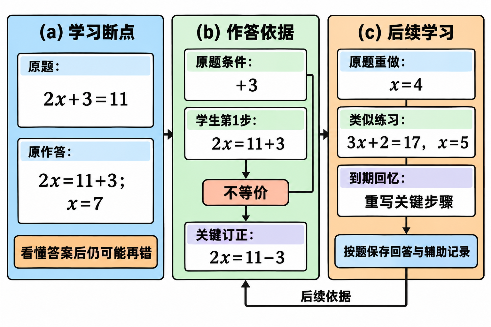

图1以方程样例概括研究问题与方案关系：原始步骤提供诊断对象，订正和独立回答提供新的观察，后续练习与复习使用这些观察。图中的不同题目及答案各有归属，机制说明与后续运行案例分别组织。

实现特色体现为仓颉业务服务与Python计算服务的职责分工。仓颉承担身份、数据版本、任务状态及事务提交；Python组织模型、数学规则和检索工具；uni-app客户端提供统一跨端交互。项目采用单协调器智能体工作流，通过工具反馈和学生动作推进任务。创新表述限定为面向错题学习的机制设计与工程实现，其教育收益在后续研究中评价。

## 2 需求分析

本章将上述研究问题转化为学习情境、功能边界和过程要求，为第3章的方法设计提供输入与评价对象。

### 2.1 用户需求

目标用户在课后订正、专项巩固和阶段复习中使用系统。课后订正要求反馈与本人写法对应，专项巩固要求新题继续检验相关技能，阶段复习要求在有限时间内识别优先内容。三类情境共享题目来源，但对输入材料、辅助支持和完成条件的要求不同。

学生输入通常来自试卷照片、手写过程或手工录入。原图、题干、选项和实际作答需要共同保留，识别文本允许核对。选择题中的选项及配图属于判断材料，计算题中的步骤原文属于诊断材料；只保存最终答案会缩小可分析范围。学生补充或修正材料后，派生结果应按新来源重新组织。

首次使用缺少历史表现，需要以年级、学科、目标和可用时间建立起点。偏好用于组织内容，实际作答用于形成学习证据。有历史记录时，应支持继续当前任务、回顾重复问题和完成到期复习；中断后返回则需要恢复已保存题目、回答和阶段。

移动端使用要求题干、公式与输入保持可读，长材料按层次呈现。任务提交、计算中、待核对和失败需要形成不同反馈，避免学生将未保存输入误认为已完成学习。桌面与移动界面读取同一业务状态，平台差异不改变题目和作答的身份。

### 2.2 功能设计

系统功能按学习材料、诊断训练和持续记录三组组织。材料组包括拍照或文字采集、原图核对、错题管理及资料导出；诊断训练组包括过程分析、局部订正、独立回答、类似题与模拟考试；持续记录组包括到期复习、易错线索、知识内容和学习报告。普通管理功能为研究机制提供材料与记录基础。

表2 功能及数据责任

| 功能组 | 主要内容 | 保存对象 |
| --- | --- | --- |
| 学习材料 | 采集、校对、检索与归档 | 原图、确认题目、选项及原作答 |
| 过程诊断 | 错因解释与步骤回放 | 引用依据、核验状态及来源 |
| 训练执行 | 订正、重做、变式与考试 | 回答、辅助记录、阶段和结果 |
| 持续学习 | 复习、知识与易错线索 | 回执、计划及有效事件 |
| 资料输出 | 错题组卷与导出 | 选题顺序、分值及导出产物 |

当前前端注册36个页面，主要导航保持稳定，诊断与任务位于题目上下文中。页面数量用于工程覆盖统计；方法贡献主要由诊断依据、辅助区分和任务约束体现。首页根据正在进行的任务与已有记录组织主要入口，空数据与服务失败分别呈现。

个人易错地图按当前诊断的学科和错因标签归组，并保留原题与依据入口。它承担线索聚合与回查功能，具体原因仍由各题证据解释。知识卡提供前置概念与例题，组卷支持纸面训练，二者形成辅助学习材料，其浏览或导出行为与独立作答记录分开保存。

### 2.3 学习流程

学习流程由材料确认、证据诊断、针对性修正、独立验证和后续安排构成。材料确认建立当前题目来源；诊断产生有引用的错误候选和核验状态；修正围绕有效偏差进行；独立验证取得新的完整回答；后续安排综合当前目标和历史记录选择练习或复习。

过程允许根据输入条件进入不同分支。缺少步骤时，答案层面分析可以保留为待核对解释，步骤首错仍需实际过程支持；缺少必要条件时，先补齐材料。连续失败时降低当前操作复杂度或提供前置知识；原题独立完成后，在支持范围内进行条件对照。完整答案曝光、局部修正和独立成功分别形成事件。

当前阶段完成后，系统在有效候选内安排后续内容。候选不足触发受约束的习题补充，到期复习按已有回执组织。中断与恢复依赖已保存的动作和检查点，来源变化则结束旧结果的当前使用资格。该流程同时规定教学推进条件和数据提交边界。

## 3 关键技术

四项关键技术分别处理诊断依据、表现解释、行动选择和习题供给。各技术共享题目来源与事件标识，结果经业务层校验后形成可使用的学习状态。

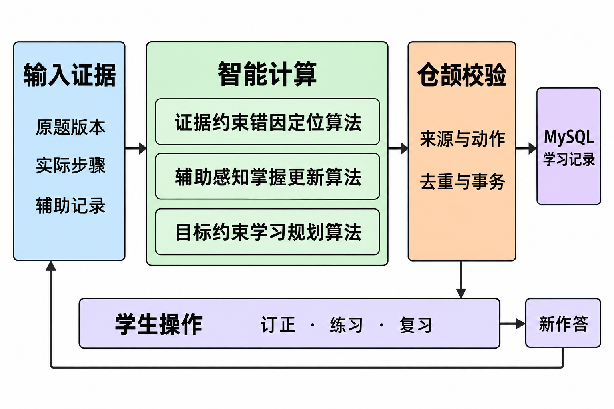

图2区分输入证据、智能计算和业务提交。模型与工具产生候选判断，学生新回答提供后续观察，仓颉维护来源与记录的有效性。方法评价由各模块规则测试和跨层提交测试共同支撑。

### 3.1 错因定位

证据约束错因定位算法处理的是已有诊断候选与来源记录之间的关系。输入包括学生实际步骤及其标识、参考步骤、对齐检查、已取得的知识证据和诊断假设；输出包括候选错误位置、支持依据、核对等级与下一动作。算法首先确保候选引用真实存在的学生步骤，步骤原文和序号与记录一致，排除错误引用或从模型解释中虚构步骤的情况。

数学核验在已支持的表达式范围检查解集和等价关系。若某一步与原题实数解集不同，且对应规则返回不成立，候选可以取得规则依据。完全一致、等价或合法分支不会仅因写法不同被列为错误。参考步骤只有在标识和文本都匹配当前参考记录时才参与评分；检索知识必须与已有假设关联，且仅表示来源关联，不能充当学生思维原因的证明。

算法为不同证据设置明确权重。学生实际步骤提供基础支持，规则核验增加较强依据，匹配参考记录和知识来源增加补充依据；与数学成立或等价结论冲突时扣分。候选按证据分排序，并保留少量可解释项。这里的分数用于候选排序，未经过真实学生数据的概率校准，因此不显示为“诊断有多少百分比一定正确”。

“首错”比“发现错误”需要更强的条件。一个后续步骤核验错误，并不证明之前步骤全部正确。算法只有在候选错误得到规则支持、此前步骤也逐个处于允许的核验范围并通过时，才将首次偏差标为已核验；前序缺少依据时仍保留候选位置，但要求学生核对过程。这一条件避免把“找到一个错误”过度解释为“确认全部推理从这里开始出错”。

例如，原题为2x+3=11，学生依次写“2x=11+3”“x=7”。在支持的线性方程规则下，原题解为4，而第一步等式的解为7，两者不等价。算法引用学生第一步原文，并记录解集不同这一核验事实；后续x=7是前述偏差延续，学习起点应围绕消去常数项展开。若学生改写为“2x=8”“x=4”，不同参考顺序不构成错误，系统不应为了给出诊断而强行定位首错。

条件检查说明了不同题型为何需要明确核验对象。例如(x²−1)/(x−1)=2约分后仍须保留x≠1，候选1不满足条件，原式无解。这个有理式空解集案例说明定义域检查的重要性；当前多项式首错规则以其明确支持范围执行，该例进入相应材料核对路径。已核验首错的演示仍采用前述线性方程，保留原始步骤与具体规则依据。

判断该算法是否有效，需要检查三个层次：引用是否真实、已支持规则能否区分合法路径与偏差、证据不足时是否停止作出强结论。当前单元和工作流回归覆盖这些条件，实际应用仍保留修正入口。后续可以在具备授权的真实作答集上评估定位一致性、误报率和补充材料后的变化；目前不以工程测试数量替代跨题型诊断准确率。

### 3.2 掌握评估

辅助感知掌握更新算法将一次作答转化为带权证据。输入是知识状态与本次事件，包括作答范围、可靠判定、提示使用、完整答案暴露、来源有效性与事件标识；输出为更新后的掌握估计、辅助和独立计数、更新理由、不确定性及遗忘风险建议。算法返回计算提案，持久写入仍由仓颉在已有事务中校验完成。

算法先检查本次事件是否可采信。来源已失效、作答未确认、判定不可靠或结果需要核对时，保持掌握状态；局部步骤订正只记录当前修复，不直接上调完整题目掌握。已处理事件不重复计入，重新进入页面也不被视作新观察。这样，一次网络重试、页面刷新或模型重算不会凭空制造新的学习证据。

通过检查后，算法区分提示与完整答案。看过完整答案的回答记入辅助学习次数，不增加掌握证据；提示后作答仍能提供较弱证据，其默认权重为0.35；没有提示和答案暴露的可靠独立回答使用权重1。符合间隔条件的独立条件对照回答可使用1.25的默认保持权重。权重来自当前透明配置，是工程初值，不代表已拟合学生认知参数。

对于有效回答，算法使用先验掌握估计与正确、错误观察的似然进行贝叶斯更新，再仅对正确观察加入有上限的学习转移。选择题依据选项数估计猜测项，非选择题使用默认猜测参数。提示权重作用于似然强度，使相同答案在不同辅助条件下产生不同更新。错误回答提供负向信息，不因“尝试过”而得到正确回答才有的学习增益。

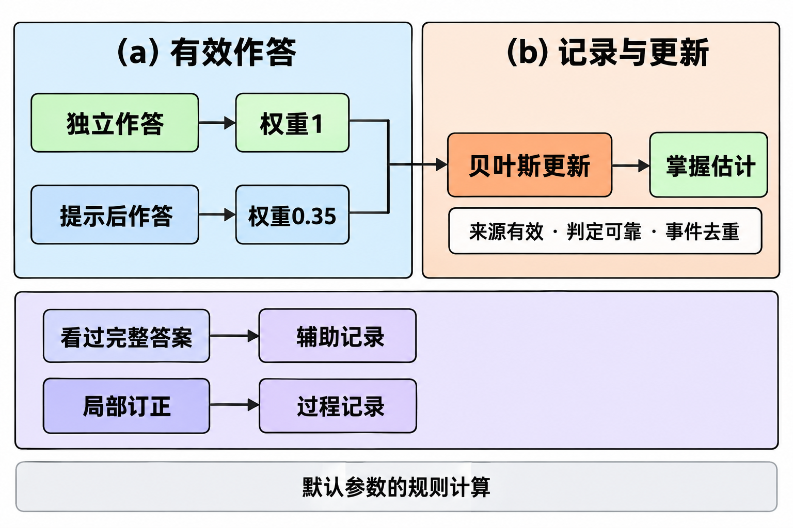

图3强调同样得到正确答案时，独立完成、提示后完成与看过完整答案具有不同证据含义。该机制保留求助的教学价值，并使辅助记录与独立表现各自承担相应证据作用。学生仍可以获得提示、查看解析和继续练习，系统则据不同记录选择更合适的后续支持。

同一先验0.35下，独立正确、提示后正确和完整答案曝光后的正确分别得到约0.914、0.608和0.350，体现辅助条件对证据解释的影响。这些数值是规则演算结果，详细公式、参数和五种情境在系统设计第2.2节集中给出。

掌握估计不是整个学习档案的唯一内容。证据次数、独立次数、已看答案记录和最后有效事件都用于解释当前结果，不确定性帮助区分缺少记录与已有较一致证据。遗忘风险根据当前状态和经过时间计算，是后续安排的提示，不会在学生没有作答时伪造一条错误答案。报告应让学生回到真实回答，而非只展示一个无法解释的百分比。

该算法当前接入持久学习任务；题库和生成类似题仍使用各自已实现的正负证据规则，不把所有入口描述为已经统一计算。算法回归检查辅助区分、局部和不可靠事件不更新、重复事件幂等、错误不获正向奖励及长序列稳定。实际保存还要接受来源和任务资格限制。后续有效性研究应考察这种区分能否改善下一次练习选择和学生理解，而不是仅比较最终显示的分值高低。

### 3.3 学习规划

目标约束学习规划算法将当前题目状态与有限学习预算转化为下一动作。输入包括当前阶段、证据是否充分、前置知识、连续失败、可用时间、剩余目标，以及带有学科、难度、到期和曝光信息的候选题。输出包含具体行动、所选来源题、理由、预计时间与少量备选，并保存可解释的排序组成。

规划先处理不能依靠分数排序解决的条件。时间或目标已完成时结束本轮；材料不足时先核对原题和作答；缺少前置知识时先回顾基础；重复错误时进行局部订正，连续失败时提供更小的提示。订正、独立作答和条件对照各有对应动作。只有当前阶段允许选择后续题时，算法才对候选排序，避免把每次学生答错都变成切换到一题新内容。

候选首先通过硬约束。超出剩余时间、学科不符或刚完成且不宜立即重复的题不进入选择。合格的到期复习保留优先级，防止新题不断占据学习时间；同一优先级内，再结合错误相关性、薄弱程度、预期信息量、难度适配、时间成本和最近曝光综合评分。重复惩罚作用于实际选择，不能只写在解释文字里而不影响排序。

难度适配使用当前估计和失败情况选择较合适目标。学生连续失败后，目标难度可以降低，以便通过较小步骤重新建立反馈；学生刚完成原题时，类似题需要检验相关技能，而不是简单展示更难内容。预期信息量用于衡量一道题能为当前状态带来多少区分信息，属于当前概率假设下的计算，不等同于题目本身的教学质量证明。

例如，一名学生计划用十分钟巩固数学，当前仍在订正方程的移项步骤，即使题库中有一条评分很高的新题，规划也先支持当前订正。完成后，若存在合格的到期错题和新练习，优先安排到期内容；若候选都需要超过剩余时间，系统选择相关知识回顾或结束本轮。这一规则情境展示行动优先级、候选排序与预算之间的关系。

规划与任务状态共同工作。Python可以给出建议，仓颉仍检查所选题是否存在、属于允许范围、来源是否当前，以及任务是否允许推进。前端只展示服务端给出的题目和动作，不通过修改“已掌握”或“推荐分”绕过资格。当前测试检查停止条件、到期优先、跨学科和超预算排除、曝光惩罚与难度作用；后续需结合真实使用研究调整权重与时间估计。

### 3.4 习题生成

同源核验补题算法解决的是原题学习之后缺少合适练习的问题。输入为已确认的原题、当前目标知识、题型与候选来源；输出为可实际作答、带来源和核验信息的练习，或明确的暂不可用结果。“同源”表示练习始终回到当前原题及目标，而不是要求新题必须来自同一份试卷；题库候选与生成候选具有不同来源标记。

算法先分离相似召回与目标准入。检索可以利用题目语义获得候选，但召回结果不直接等于适合练习。对支持的一元一次方程，系统能通过表达式结构识别求解目标；其他需要语义判断的候选，要求从原题和候选题干取得逐字依据，并检查模型决定与输入标识一致。证据不足、目标不同或返回引用不存在的候选不放行，避免只因同学科或包含相同数字而通过。

合格题库不足时进入生成。支持的数学近迁移范围可以由本地规则构造一元一次方程，再使用符号工具求解，保证该结构下的答案与参考步骤相符。其他生成题需要按结构合同返回，再以另次结构化调用核对是否检验同一技能、答案与选项是否明确、材料是否完整、难度是否适合。需要缺失图片才能解答的题不能作为自足练习提供，泛泛学习建议也不能冒充一道类似题。

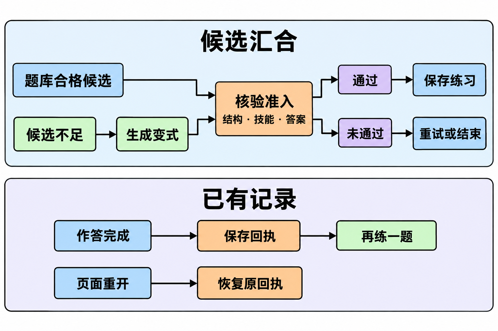

图4展示检索与生成的两条来源进入共同准入检查。题目来源、目标适配和可判定性一起决定是否能显示给学生。只有合格候选才进入作答与连续练习；未通过时保留错误状态和重试方式。新回答仍关联原来的学习目标，页面恢复则读取已保存的题目、回答和结果。

以原题2x+3=11为例，目标是完成一元一次方程的求解。“选择哪个式子是一元一次方程”虽包含同名概念，却未必检验同一种求解操作；“给出一段学习建议”更不是练习题。一个可接受的结构示例是3x+5=20，参考过程为3x=15、x=5，学生可以完成实际求解。此例用于说明本地构造结构，具体运行会按本次参数形成新题，不保证每次都生成同一组数字。

连续练习需要在“换一题”时真正改变学习对象。系统识别已有题目与本次来源，处理重复生成或重复随机值造成的同题问题，保存当前题及答案状态。提交后离开再返回，显示已有结果而不是重新生成一题掩盖历史；继续练习时再取得下一道题。生成、核验、保存与跳转必须协同，才能避免界面上有按钮却无法形成持续训练。

该算法的有效性有四个可分别检查的对象：候选是否符合目标，题干是否完整，答案是否在支持范围得到核对，保存与恢复是否对应同一道题。当前回归覆盖本地规则离线构造、通用建议拒绝、生成题独立检查及重复候选处理；真实接口和浏览器验收检查连续学习。语义题采用另次结构化复核，核对同技能、答案、完整性与年级适宜性；未通过时拒绝准入。

## 4 系统设计

系统设计将上述计算方法落实为跨端客户端、业务状态服务和内部智能计算三个责任层。项目说明侧重分工及设计依据，详细算法合同与状态模型见系统设计报告。

### 4.1 总体架构

系统采用uni-app、Vue 3与TypeScript构建跨端前端，仓颉承接唯一业务服务并与MySQL交互，Python与FastAPI提供内部算法计算。前端负责学生交互、题目排版、公式显示与状态反馈；仓颉负责身份、资源归属、任务、事务和公开接口；Python负责识别、诊断、掌握估计、规划、检索与导出计算。三层共享合同与来源标识，各自保持明确责任。

当前源码已将算法真正使用的共用能力组织到独立的learning_core包，包括模型池、结构化输出、数学处理、文字识别和教学计算。算法包不再依赖另一套业务框架，也不包含业务数据库读写。模型请求经ApiPoolProvider统一轮询，逻辑名称固定为Qwen；实际资源配置保留在服务端，不进入前端或正式参赛材料。

MySQL保存学生、题目、作答、任务、练习、复习和学习记录等业务事实。原始图片与派生文件分开管理，题库图片保持可回查；Qdrant保存可重建的检索索引，BGE承担嵌入和重排相关能力。检索给出候选标识后，仓颉回查实际内容并核对允许范围。索引可以辅助找题，但不能替代数据库中的题目归属、当前版本和真实作答。

表3 分层责任

| 层次 | 核心责任 | 输出 |
| --- | --- | --- |
| 前端 | 输入、排版、导航与反馈 | 学生请求和清晰界面 |
| 仓颉 | 业务规则、状态与MySQL事务 | 已保存事实和公开视图 |
| Python | 受控智能计算与结构校验 | 诊断、判定、规划和更新建议 |
| MySQL与文件 | 业务事实和原始材料保存 | 当前记录与可回查来源 |
| 检索与模型资源 | 提供召回、推理和支持 | 候选及计算观察 |

仓颉的使用具有实际业务深度。它不仅转发请求，还决定任务能否开始、动作是否有效、结果是否仍对应当前来源，以及是否允许写入学习证据。Python计算期间学生可以编辑原题、取消任务或从另一页面提交，因此计算完成后仍需业务复核。这种责任分配让模型能力变化与持久化一致性分开，也使错误能够定位到输入、计算或状态提交的具体环节。

### 4.2 智能体协同

智能体采用单协调器组织受控计算流程。任务上下文包括当前题目、实际步骤、诊断来源、知识内容、已保存动作和当前检查点；计算图依次处理证据诊断、当前学生动作、掌握更新和后续规划。需要补充材料时进入核对分支，需要学生回答时结束本次计算并等待新动作，系统不会在后台伪造学生回答继续推进。

LangGraph在算法层表达这些节点与条件分支，任务的持久保存仍由仓颉维护。图本身没有业务数据库写入工具，也不持有另一套检查点数据库。仓颉工作器领取任务、绑定执行资格并整理上下文；Python返回结构化结果；仓颉再核对来源、租约、请求版本和退出条件。图内状态转换与业务持久化相互协作，但不是两个相互竞争的业务状态中心。

工具结果能够改变后续选择。例如，步骤核验确认当前计算不成立后，规划可以缩小到局部订正；检索没有取得可用知识时，系统保留零命中观察，再使用已有步骤依据提供支持。通过这种方式，学生新回答和工具反馈都具有实际作用。一次模型说明不是唯一控制信号，返回结构不合格、来源冲突或预算耗尽时均有明确退出行为。

计算过程设有步骤、模型调用和时间约束。任务状态区分排队、运行、等待作答、需要核对、失败、完成、取消和来源失效，页面读取公开状态进行展示。学生暂时离开不会使运行结果失去归属；重复提交也不能重复获得学习更新。任务恢复从已保存的动作与检查点继续，避免因客户端重开而重新执行已经完成的学习动作。

### 4.3 数据管理

题目来源是各模块共同使用的连接点。原图、确认题干、选项和学生过程组成当前输入，诊断、参考解法、任务和练习据此产生。学生修改题干或原作答后，相关派生内容需要重新核对；冻结任务快照和历史动作按保存规则追溯，当前可采用结果与历史曾发生记录分别呈现。保留历史不意味着继续把过时诊断作为当前事实。

学习事件记录回答了什么、在什么范围、是否获得辅助及其可靠判定。掌握更新、易错地图、复习计划与学习报告分别消费这些记录，按照自身含义进行汇集。地图的标签是导航线索，报告的估计是计算结果，复习计划是日程；它们都需要能回到来源，而不能相互循环引用，最终只剩一个无原始依据的结论。

来源校验也适用于类似题。检索候选保留题库来源，生成题保留生成与核验信息，练习回答关联具体题目版本；重复打开时恢复的是已保存那道题，而不是一份内容可能变化的新生成结果。这样既能解释本次练习针对哪处薄弱点，也能区分原题独立重做和新增候选练习，避免将相同记录多次累计。

个人化记忆对已有事实、状态估计、自述和提醒分别组织，并保留引用、版本及时效。学生自述“分式方程总是出错”可作为支持线索，却不能直接替代每道题的实际诊断；后来修改原材料或撤销记录时，相应记忆需要失效或重新生成。记忆服务于后续上下文，不将模型总结升级为比原始作答更高的事实来源。

### 4.4 可靠性设计

智能计算的结果进入页面前经过结构和业务两类检查。Pydantic校验字段、类型与允许值，使结果可被程序处理；SymPy在支持范围检查数学表达式、解与关系。结构正确不等于题意正确，数学核验也不自动解释学生全部思维。页面通过核对状态与来源信息表达这些差别，并提供编辑原题、补充作答和重新分析的入口。

前端只消费VisualizationSpec JSON，由已有组件完成可视化和公式排版，不执行模型生成的JavaScript。题干、选项、答案与解释作为内容呈现，不能成为修改页面行为的指令。分数、集合、根式和不同等价表达需要在显示、输入与判题之间保持一致；选项选择、自由输入和原作答编辑采用各自的受控合同，避免界面美化破坏答案含义。

身份和资源规则由仓颉执行。学生读取和修改本人允许范围内的题目、任务及记录，受控维护使用专用权限。内部算法只接受服务端认证请求，不直接暴露给学生浏览器；媒体链接在已授权业务视图中签发，文件读取检查签名、有效期和路径，试卷下载另行检查当前归属。日志与错误响应不打印模型池、数据库密码或内部认证信息。

加载、空数据和错误采用不同状态。首次没有错题可以录入或选择知识内容；模型暂不可用应提供明确失败与重试；材料不足应进入核对；提交成功应能在重新读取后看到实际保存结果。交互反馈与真实状态一致，才能让学生理解当前处境，也为自动化验收提供可观察的判断对象。

## 5 实现与验证

本章区分功能实现、运行案例和分层测试。运行截图用于观察交互状态，规则和接口记录用于验证计算及持久化行为，二者共同说明现有工程能力。

### 5.1 功能实现

截至源码核对基线71894bf，系统已形成从材料输入到持续训练的工程实现。采集保存原图与确认内容，诊断关联实际作答，本题学习保留提示与检查点，类似题在候选不足时生成核验，并支持继续下一题及恢复。题库练习、模拟考试、复习、知识内容、易错地图、学习报告与组卷导出共享本人档案，主要功能能够沿题目来源连贯使用。

当前个人应用由仓颉与MySQL承接业务，Python作为内部算法包独立安装。账户资料、题目管理与学习状态由同一业务服务维护；启动、检查、测试、构建和完整验收使用统一入口，环境与源码版本可对应复现。

表4 实现状态

| 能力 | 当前状态 | 验证对象 |
| --- | --- | --- |
| 录题与档案 | 已实现并有工程验证 | 原图、选项、过程与编辑 |
| 错因回放与订正 | 已实现，题型核验范围明确 | 真实步骤、规则与待核对 |
| 掌握更新与规划 | 已实现并有算法回归 | 辅助区分、约束与排序 |
| 类似题补足 | 已实现并有接口/浏览器验证 | 适配、生成、连续练习及恢复 |
| 练习考试与复习 | 已实现并有工程验证 | 作答、结果和计划 |
| H5与App资源 | 已运行/构建 | 浏览器流程和资源产物 |
| 手机签名发行 | 已有跨端工程基础 | 后续账号、设备与发行验证 |
| 长期学习收益 | 后续研究 | 真实学生使用与延后表现 |

实现状态针对具体声明范围。支持的数学结构可以进行本地符号核验，开放语义题仍有模型能力边界；候选生成通过结构与复核，也不等于所有题型均获得形式证明。当前材料将工程正确性、固定题内容检查和长期教育效果分开，便于评委按实际证据判断成果。

### 5.2 应用案例

应用案例围绕诊断订正、独立验证、训练接续和复习组织展开。截图采用既有浏览器运行归档：诊断与订正来自2026年10月21日真实Qwen自动化核验，生成练习来自受控回归，其他图片为同一归档提交中的历史界面。各组保留原始数据与界面文字，出处见配套证据清单；不同样例按各自对象解释。

**案例一：关键步骤订正。** 方程3x+2=17的原作答将移项写为3x=17+2。诊断对象是学生实际写出的等价变换，局部输入用于修正该关系。案例观察原步骤、诊断依据与订正动作是否相连，后续完整回答的资格独立判断。

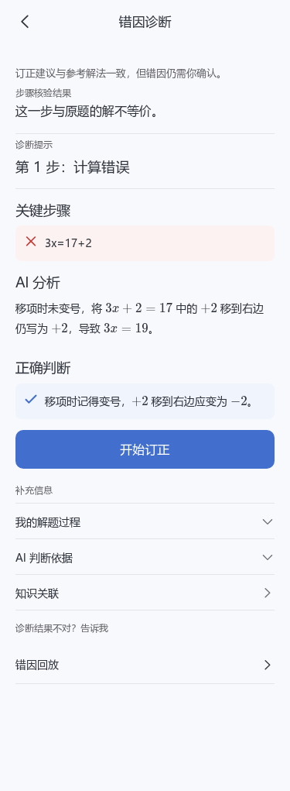

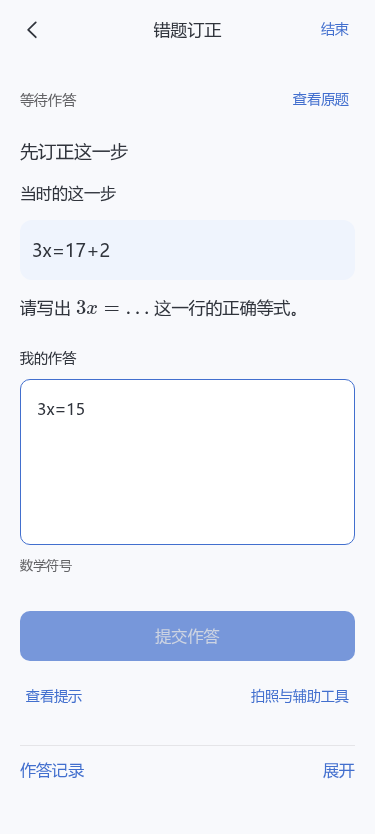

图5展示真实模型核验中的原作答、首错位置与局部修正界面。页面状态支持过程关联的观察，首错核验范围由第3.1节的规则定义。

**案例二：独立验证与条件变化。** 集合题用于展示完整重新作答；方程2x−3=11用于展示变化条件后的独立求解。前者需要判断集合边界，后者需要依据当前符号重新变换。二者是不同工程样例，分别观察独立输入和条件对照的表达。

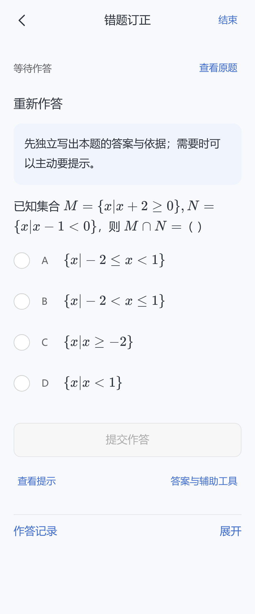

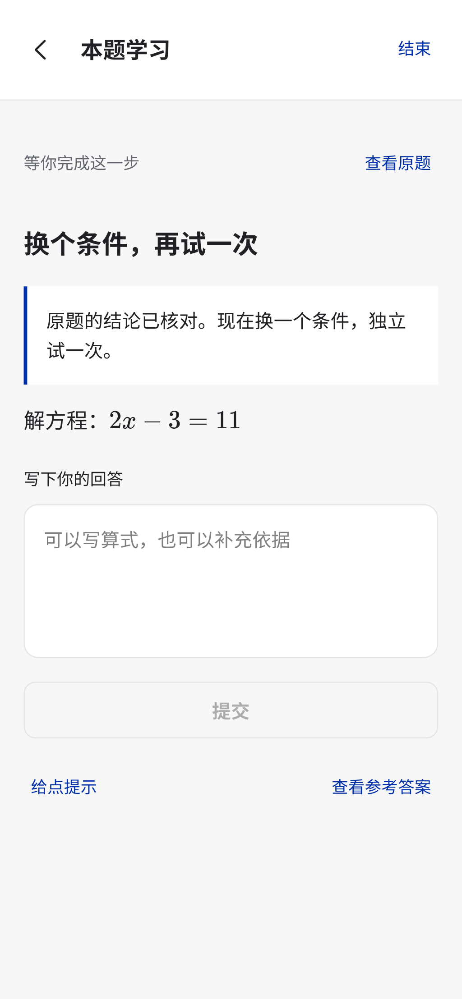

图6左侧保留集合题选项和独立输入，右侧呈现方程条件对照。严格自动条件对照主要支持一元一次方程，当前输入页说明待作答状态，判定与更新由独立回归验证。

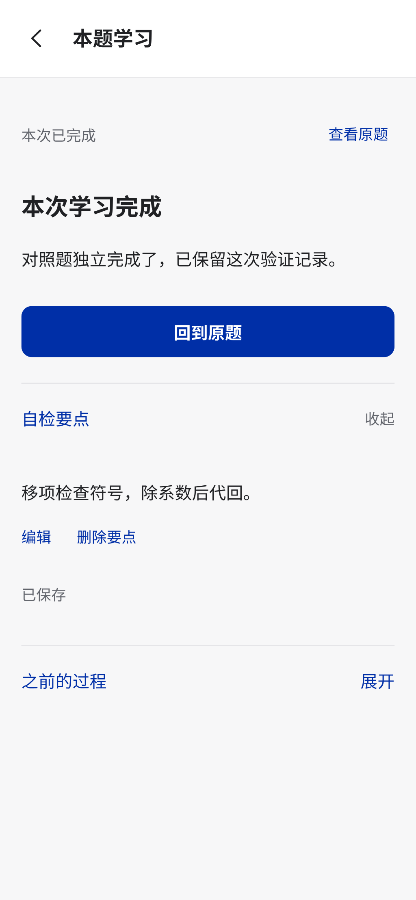

图7保存完成后的自检要点“移项检查符号，除系数后代回”。自检是学生总结记录；本次任务完成与长期掌握分别由执行状态和有效作答解释。

**案例三：习题补充与连续训练。** 题库缺少同技能候选时，生成题通过结构与答案检查后保存为具体会话。受控回归先提交5x+3=−32的回答x=−7，再恢复结果并请求下一题5x+14=44。该案例用于观察新题身份、已存回执及继续训练之间的衔接。

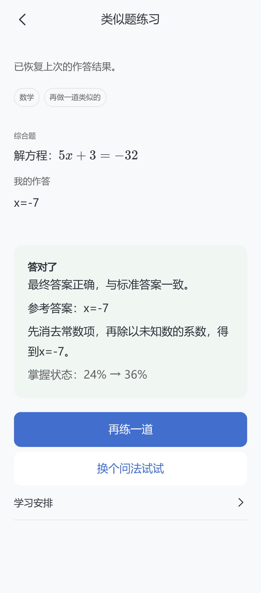

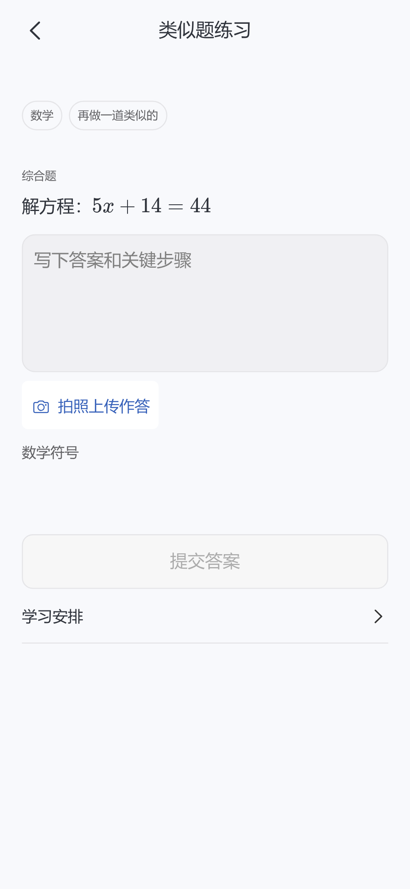

图8左侧为已保存结果，右侧为下一道题的输入。24%到36%属于当时练习合同的规则估计，相关记录不与持久任务的贝叶斯更新参数混用。

**案例四：复习组织与线索回查。** 已有任务在今日入口保持可继续状态；易错地图聚合诊断标签并返回具体来源；到期复习在反馈前收集新的回答。三个界面观察持续学习所需的任务、证据和时间关联，分别来自各自历史样例。

图9展示已有独立作答任务的继续入口。该场景说明历史任务可以作为当前学习起点，首次使用则根据本人偏好建立内容入口。

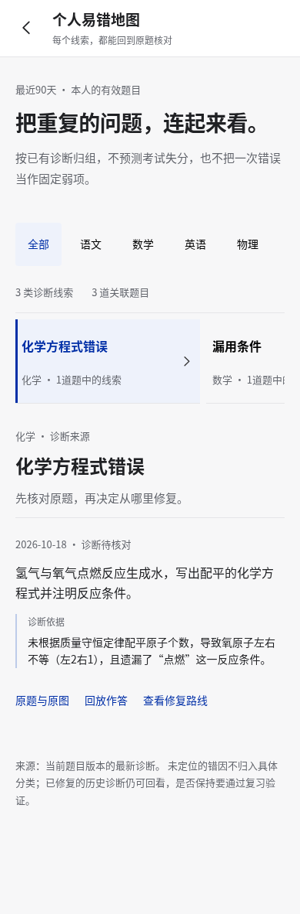

图10展示化学方程式错误线索及其原题依据，保留诊断待核对状态。关联标签用于组织回顾，实际配平和反应条件仍需按题目材料核查。

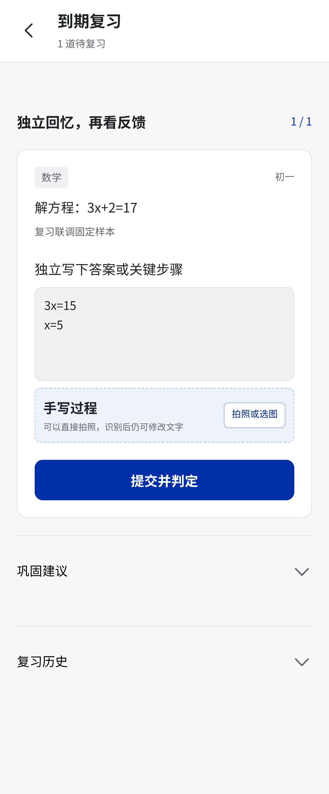

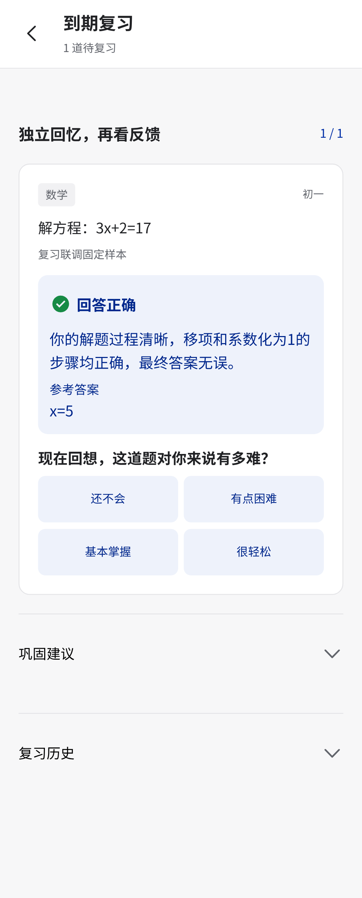

图11来自同一复习联调固定样本。先提交3x=15、x=5，再显示判定并收集难度自评，体现回答、反馈与调度依据的先后关系。

材料修正构成另一类一致性案例：原题由2x+3=11更改为2x−3=11后，旧诊断与计算需重新核对来源。原图、冻结快照和当前版本分别保留，使历史记录仍可解释，迟到结果则不能更新新材料。对应的来源变更与回滚检查纳入接口验证。

### 5.3 系统测试

本轮核对现有实施记录与实际日志，采用分批证据描述。2026年10月22日完整回归批次覆盖前端290项、算法690项、仓颉原生46项及浏览器71项，并包含类型、资源构建、隔离MySQL及进程恢复。后续前端修复另有299项单元测试、类型与H5/App资源构建，以及375/1280像素化学题渲染检查；最终分组保留修正有56项针对性测试。各批次分别保留，不把后续局部结果表述为重新执行全套回归。

表5 验证批次

| 批次 | 已记录结果 | 验证范围 |
| --- | --- | --- |
| 完整工程回归 | 前端290、算法690、仓颉46、浏览器71项通过 | 业务合同、计算、数据及主要页面流程 |
| 前端排版复验 | 前端299项、类型和H5/App构建通过 | 后续公式与化学内容显示修复 |
| 浏览器专项 | 375/1280像素原题检查通过 | 题干、选项、解析及宽度 |
| 最后局部检查 | 56项针对性测试通过 | 化学分组与数学分组保留 |

单元测试检查组件与规则，接口和数据库测试检查归属、事务及持久化，浏览器测试检查真实页面和流程。模型及检索夹具用于重复检验结构、异常和资格分支。记录可沿实施状态（`docs/final/IMPLEMENTATION_STATUS.md`，版本71894bf）与配套日志索引定位，本轮文档重构未重新执行业务测试。

### 5.4 验证分析

现有验证支持三个层次的判断。计算层能够在规定输入范围内区分合法路径、无效引用和错误候选，并按辅助条件执行不同状态更新。业务层能够校验来源、重复动作和执行资格，保存结果并恢复既有回执。界面层能够呈现主要学习流程和不同反馈状态，专项记录补充验证公式及化学内容的显示。

关键方法的验证与研究目标对应：首错测试考察引用和前缀核验，掌握测试比较辅助条件与事件去重，规划测试覆盖预算、到期及候选过滤，补题测试覆盖适配、核验、保存及恢复。对已确认错误的订正明确返回错误反馈，对答案层面推断与步骤证明分别表达，属于当前源码相对旧基线的重要修正。

证据的适用范围由输入与测试层次决定。规则演算可以复算，但参数尚未通过真实学生样本校准；受控模型回归能够检验业务对返回结果的处理，跨题型语义质量仍需独立评测。运行归档是历史工程样例，长期保持、学习迁移和实际负担属于后续使用研究。现有成果为这些研究提供可回查的事件、辅助及时间记录。

## 6 总结与展望

### 6.1 项目成果

项目完成了面向学生个人错题学习的系统实现，形成以原始材料、实际作答和有效事件为基础的诊断训练流程。核心成果包括证据约束错因定位、辅助感知掌握更新、目标约束学习规划，以及检索与生成结合的习题补充。方法通过单协调工作流与持久任务连接，计算结果经来源与资格校验后进入学习记录。

工程成果包括uni-app跨端客户端、仓颉业务服务、Python内部算法服务及MySQL数据组织，覆盖材料采集、诊断订正、独立训练、复习和资料输出。已有分层测试验证规定场景下的计算合同、持久化及恢复能力，H5运行与App本地资源构建形成移动交付基础。

### 6.2 应用价值

对学生而言，项目将错题从静态收藏转为能够继续使用的学习对象。原作答和偏差关联，减少从整份解析中寻找本人问题的负担；局部订正与完整重做分开，提供从理解到再次应用的操作；适配类似题与到期复习提供后续机会。价值体现在具体行为能否完成和记录能否回查，而不是界面显示了多少统计指标。

对软件工程实践而言，项目把语言分工与智能能力边界落实到可验证的状态合同。仓颉掌握业务权威，Python提供计算，前端消费受控结果；模型解释、数学检查、学习事件和业务提交各有明确对象。面对来源修改、模型不可用、迟到回执和重复动作时，系统能保留一致含义，这也是智能应用从演示走向日常使用的重要基础。

上述价值通过可观察行为评价：诊断是否引用实际步骤，训练是否取得新的独立回答，学习安排是否使用有效记录，离开后能否恢复。将这些对象分别测量，有助于区分界面可用性、工程可靠性和实际学习效果。

### 6.3 后续工作

后续研究首先扩展题型核验范围。新增数学结构及学科题型应同时覆盖合法不同解法、缺失材料和等价答案，明确规则证明与语义判断的边界。习题补充需进一步处理配图、选项歧义和目标适配，保持题目完整性与可判定性。

参数研究以真实、经授权的学生使用为基础，分别评价诊断一致性、独立完成和延后保持。研究设计需记录先前水平、辅助暴露、题目来源及间隔，区分阅读解析、提示后作答与独立重做。掌握与规划参数的调整应保存版本和比较结果，以便判断估计变化是否改善后续学习选择。

移动交付继续基于uni-app共享工程。当前H5和App资源已经运行或构建，签名安装、真机权限和发行验证尚需应用身份、证书及设备条件。后续按[DCloud App工程说明](https://uniapp.dcloud.net.cn/tutorial/app-base.html)组织相机、文件、网络中断和恢复检查，以实际流程及持久记录作为验收对象。

系统扩展保持仓颉业务权威与Python计算边界，按实际负载调整工作器和检索资源。通过持续保留来源、事件和测试证据，逐步从工程机制验证推进到真实使用评价。
