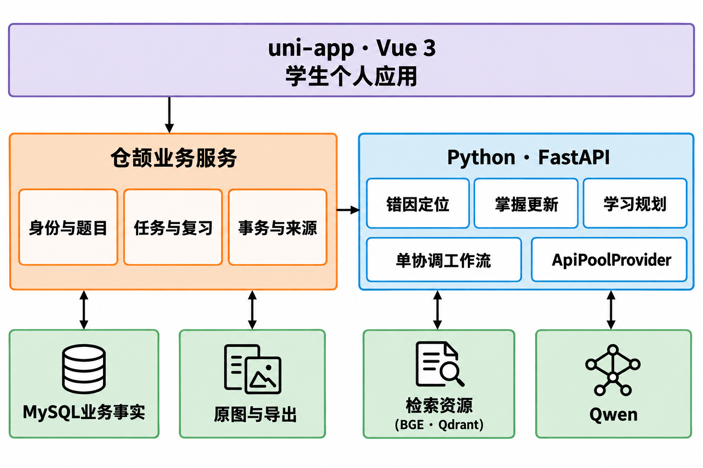
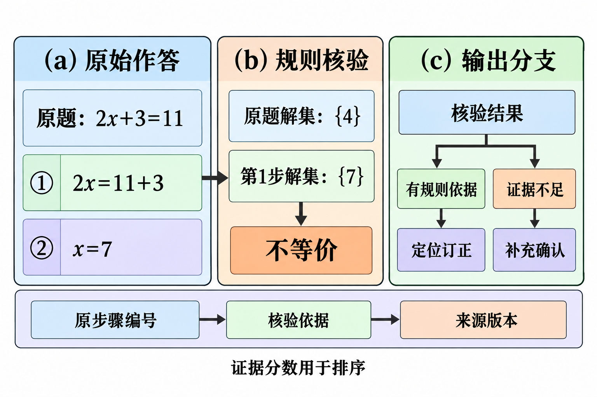
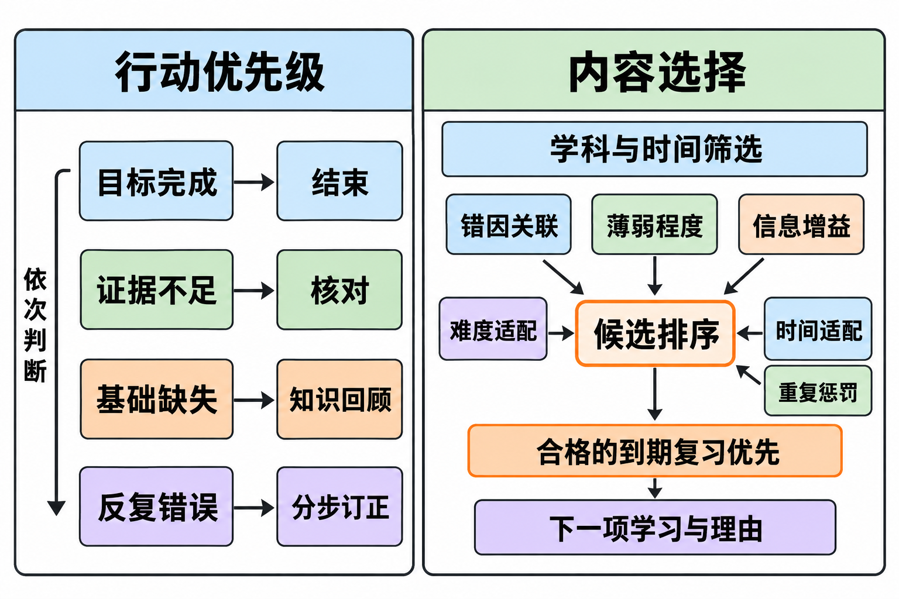
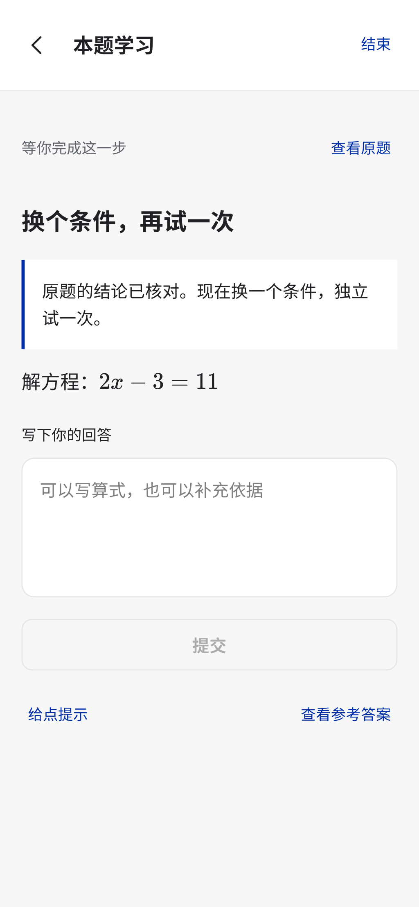
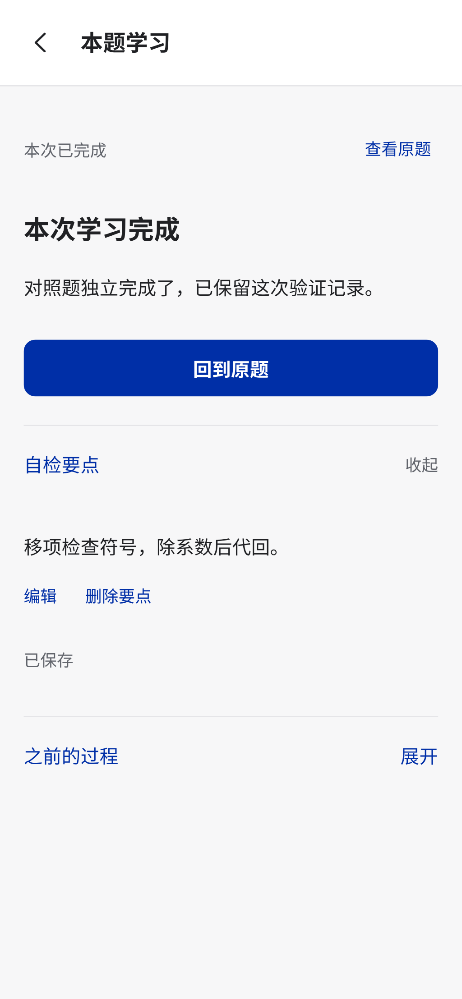
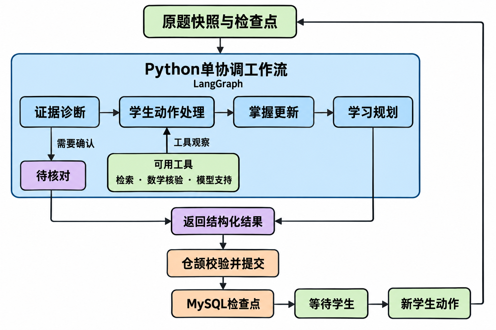
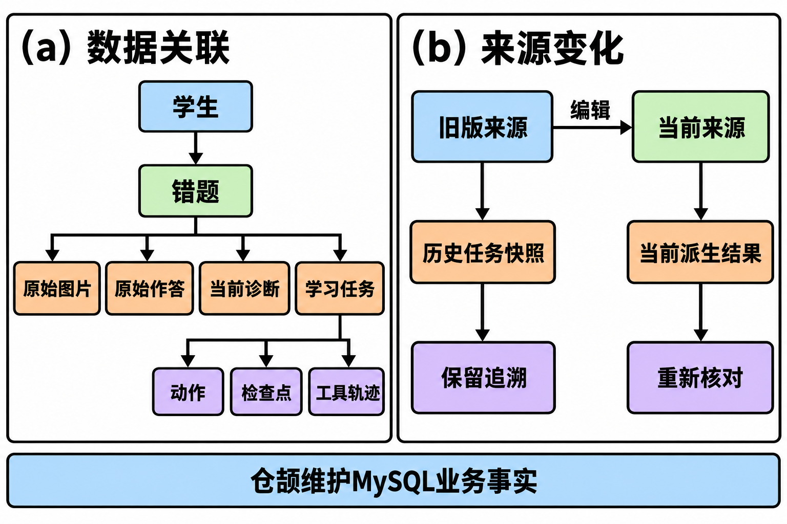
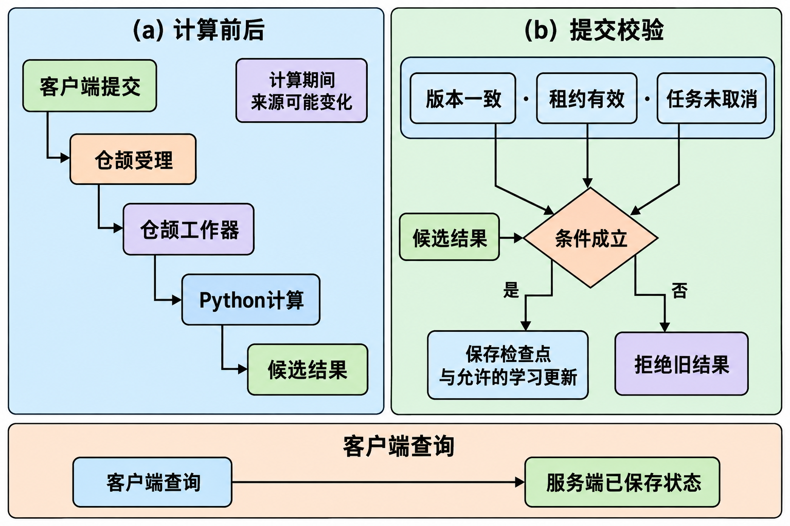

# 错题帮系统设计文档

2026“仓颉杯”智能编程大赛

项目：错题帮。源码基线：950ce87。文档日期：2026年10月22日。

## 1 总体设计

### 1.1 设计目标

错题帮围绕学生的一道原始错题保存连续学习过程。学生首先核对题目和本人作答，再理解偏差、订正步骤、重新作答、练习相近问题，并在到期后回忆。系统需要同时满足两个要求：页面上的下一步应清楚，后台形成的学习记录应有实际依据。前者决定任务如何呈现，后者决定模型建议、工具结果和学生行为如何进入业务状态。

设计目标与项目说明中的三条学生主线对应：关键错误订正要求作答与依据可追溯，换条件检查理解要求辅助程度与独立回答分开记录，后续学习安排要求任务进度和复习回执持续有效。前端用当前任务和反馈呈现这些差异，业务层保存相应事实，计算层提供受约束的判断。

一道题的输入会在学习过程中变化。学生可能修正识别漏掉的负号，补全选项，重新上传手写过程，或者更改原先的参考答案。这些修改使题目在不同时间具有不同的有效上下文。因此，系统把原始材料、当前题目版本、诊断和任务来源分别保存。后续计算必须说明使用了哪个版本，返回结果也必须重新核对当前版本，保证一次正确的旧计算不会覆盖已经修改的新问题。

学习行为还具有不同的证据强度。学生补对一个等号、看完解析后复述答案、获得提示后答对、隔天独立完成相近题，分别表示局部订正、辅助学习、较弱作答证据和保持性证据。系统以事件记录这些区别，在满足来源、判定和独立性条件后更新掌握估计。页面显示“已完成”表示本次任务结束，掌握估计则来自符合条件的事件，两者通过规则关联。

当前系统面向学生个人使用，保留账号和本人数据隔离、受控管理及运行维护能力。教师关联、家长授权和班级作业已经从当前产品主线移除。此范围使页面集中于学生本人，也使核心业务围绕题目、作答、学习任务、练习和复习组织。设计验证以实际源码和当前验收记录为依据，跨端安装与教育效果分别设置后续验证条件。

表1把这些要求对应到可观察的系统行为。

表1 设计目标

| 目标 | 系统要求 | 可观察结果 |
| --- | --- | --- |
| 原材料可信 | 原图与派生识别分开，学生确认输入 | 能回看原图与本次使用的文本 |
| 诊断有依据 | 引用实际作答，保留规则与语义状态 | 能定位具体步骤并查看核对状态 |
| 学习连续 | 持久保存动作、阶段和回执 | 离开后恢复，重放不重复加分 |
| 建议可执行 | 规划使用当前来源与有效候选 | 下一动作和题目可以实际打开 |
| 状态一致 | 归属、版本、租约及事件提交受控 | 旧结果拒绝写入新题，失败可恢复 |

### 1.2 分层架构

系统采用uni-app客户端、仓颉业务服务、Python内部算法服务与数据资源组成的结构。客户端负责交互和展示；仓颉承担业务身份、题目归属、状态转换和MySQL事务；Python接收业务层整理的输入，返回诊断、规划、核验和资源处理结果。MySQL保存业务事实，文件目录保存原始与派生资源，Qdrant承载可重建检索索引。模型调用经Python内部ApiPoolProvider统一轮询逻辑模型Qwen。

图1按职责区分计算与提交。学生在客户端发起录题、订正或练习，仓颉读取本人数据并建立上下文，再调用内部算法。算法结果返回后，仓颉检查对象、版本、输入和当前资格，决定哪些结果进入记录。模型和数学工具可以提供计算依据，MySQL中的任务状态和掌握记录仍由业务规则维护。当前独立算法包位于backend-algorithms，共用的识别、模型、数学和教学模块置于learning_core；旧Python业务后端已经删除。

检索资源是算法的外部依赖。Python向检索推理服务请求嵌入和重排，向Qdrant检索候选标识，仓颉按标识从MySQL回查原题和可用属性。索引提供召回线索，数据库决定题目是否存在、是否适合练习和是否已被使用。这个分工使索引能够重建，也使题目被修正或隔离后立即在业务准入环节生效。

客户端采用移动优先布局，并复用到桌面浏览器。数学内容由受控组件渲染，交互可视化消费结构化配置。客户端保存输入草稿和显示状态，实际学习记录从服务端读取。页面刷新、断线和重新登录可以改变前端会话，但不会把服务端已完成的动作恢复成新的未作答事件。

### 1.3 协作边界

系统以“事实集中、计算受控、提交复核”组织跨层协作。仓颉提供题目、原始作答、有效诊断、知识内容和历史记录；Python完成规定的计算；仓颉复核返回结果并事务保存。计算期间学生仍可能编辑原题、取消学习或从另一页面提交，因此请求开始时的合法性与结果返回时的可采用性分开检查。

学习智能体由一个协调工作流组织。LangGraph描述诊断、确认、学生动作、掌握估计和下一步规划的运行顺序，工具反馈影响后续处理；仓颉的任务表、检查点和租约承担持久执行。工作流在需要学生回答时结束本轮调用，将当前视图和允许动作交回客户端。学生提交真实新动作后，再由仓颉组织下一轮计算，形成受学生行为推进的持续任务。

结构化输出在算法入口和模型返回处经过Pydantic约束，受支持数学关系使用SymPy核验。结构合法说明字段可以被程序消费，数学核验说明某个明确范围的关系成立，业务复核说明结果具备当前写入资格。三个检查对应不同对象，共同形成从计算到学习记录的路径。

例如，学生在请求订正后修改原方程。Python仍可能对旧方程返回一个数学正确结果，仓颉回读时发现来源指纹已变，将任务标为来源失效并保留原记录。又如，学生提交同一作答后因断网重试，服务端识别已有动作并返回原回执，使任务继续保持一次实际作答。前一种处理保护内容身份，后一种处理保护事件身份。

表2明确各层向相邻层提供的内容。

表2 层间责任

| 层次 | 负责内容 | 向相邻层提供 |
| --- | --- | --- |
| 客户端 | 录题、校对、答题、导航、草稿与反馈 | 真实用户动作和当前页面版本 |
| 仓颉业务 | 身份、来源、状态、资格与事务 | 当前计算上下文和可用业务视图 |
| Python算法 | 识别、诊断、规划、核验与导出计算 | 结构化结果、依据和范围 |
| 数据资源 | 业务事实、原始文件和检索索引 | 按归属或内部权限访问的内容 |

## 2 模块协同

### 2.1 仓颉业务服务

仓颉业务服务围绕学生资料、题目材料、学习任务、练习复习和资料输出组织。账号模块提供登录和本人身份；题目模块处理采集、确认、编辑及归档；学习模块管理诊断、订正、独立回答和任务历史；练习与复习模块记录结果并安排后续行动；组卷模块保存选题和导出记录。各模块通过题目来源和学习事件关联，减少不同页面各自维护进度造成的偏差。

题目采集以学生确认作为内容进入分析的检查点。上传成功说明原始文件已经保存，识别完成说明获得了候选题干和结构，学生确认后才形成当前可用于分析的题目。题干、选项、作答和配图分别保留，选项不会被合并成无法编辑的一段说明。学生修改当前题目后，相应分析、诊断与任务需重新核对来源，旧回执继续属于旧材料。

持久学习任务由业务进程内工作器领取。主程序启动两个工作器，从MySQL读取排队或租约已过期的任务，以任务锁与租约标识当前执行资格。领取时保存执行身份，算法运行发生在结果提交事务之外，返回后再进入短事务检查来源、租约、取消和预算。这个结构把耗时计算与核心结果提交分开，使同一任务可以恢复，也防止过期工作器继续覆盖当前执行。

仓颉同时管理候选可用性。Python推荐的题目ID、备选ID和来源必须属于本轮提供的集合；类似题的当前分析、技能目标、材料完整性和已使用情况也需业务复核。学生从页面打开一道练习后，服务端保存它是如何被提供的，提交时再核对同一来源证明。客户端更换一个题号或自带“已掌握”字段不会形成有效学习写入。

表3汇总围绕这些业务对象的职责与提交检查。

表3 业务模块

| 模块 | 主要业务对象 | 提交检查重点 |
| --- | --- | --- |
| 采集与错题本 | 原图、题干、选项和作答 | 本人归属、材料确认与当前版本 |
| 诊断与学习 | 诊断依据、动作和检查点 | 实际步骤、来源、阶段及租约 |
| 练习与考试 | 候选、快照、答案和回执 | 题目资格、曝光、时限及去重 |
| 复习与知识 | 计划、回忆结果、知识来源 | 当前回执和来源有效性 |
| 报告与组卷 | 已有学习事实和输出资料 | 数据范围、资源归属与导出完整性 |

受控管理入口用于维护、检查学生业务记录和定位任务问题，账号角色与专用接口决定其范围。管理能力与学生学习主线分别呈现，避免把管理操作当作学生学习事件。学生注册生成学生身份，普通注册或前端隐藏字段不能提升为管理身份。当前产品的个人使用范围与后台维护能力在权限层保持一致。

### 2.2 智能计算服务

Python内部服务采用FastAPI提供统一计算入口，按明确操作类型分发识别、诊断、判题、学习任务、检索、知识讲解和导出计算。请求带服务端认证，输入字段具有类型、长度和数量限制，结果由结构化合同表达。算法包独立安装，运行与测试使用当前包入口；业务数据库连接和用户身份决策留在仓颉。

模型资源逻辑名称固定为Qwen，所有请求经过ApiPoolProvider轮询。资源池从config/api_pool.json或明确配置的路径读取，由服务端管理连接、错误与可用性。客户端取得的是业务结果及公开反馈，不取得资源条目、访问令牌或内部服务认证。资源暂不可用时，支持确定性计算的场景可继续完成本地规则处理，依赖模型的场景返回可理解的失败或待核对状态。

识别、分析、数学核验和诊断依据分别具有明确职责。图像处理保存原始字节，再完成裁剪、预处理和区域组织；分析整理题目、知识及参考过程；诊断对照学生实际作答；判题核对本次回答与服务端保存的题目和参考答案。模型生成的新参考仍需后续检查，结构合同本身不会把内容变成正确答案。

数学核验采用限定输入范围。代数过程可以抽取表达式并比较实数解集；不等式处理关注解集、边界与符号；答案核对兼顾受支持的数值、表达式和集合等价。系统遇到未支持的文字证明、材料不全或含义不确定的题目时，将语义反馈与已完成的本地核验分别表达，供学生补过程或修正输入。算法因而能够解释“哪一部分检查成立”，而非给所有输出贴同一种可信标签。

检索计算对当前题目及目标组织查询，获取稠密和稀疏召回结果，再按结构、题型、相似性和模式重排。多模态题目中的题图、选项图与解析图具有不同显示时机；材料缺失会影响候选可用性。仓颉回查数据库快照并确认可供练习后，算法才对有效候选计算，不把只有索引标识的记录直接交给学生作答。

### 2.3 学生客户端

客户端以“今日、错题、学习、我的”等学生任务入口组织页面，重要行为围绕当前题目展开。首页根据当前任务、本人偏好、已保存动作和到期计划安排入口；没有历史时从年级、学科方向和知识内容开始。错题详情集中呈现原题、原作答、诊断和后续学习，参考过程、历史和辅助资料按需要展开，使页面主动作保持清楚。

录题链提供拍照、选图和手动输入。学生可以调整裁剪范围，核对识别文本，编辑题干与选项，再保存到错题本。原图始终可回看，派生图用于处理和展示。长题干、公式、分数、集合与选项图片由统一内容组件呈现；输入区域保留草稿，页面返回后按当前来源恢复，避免把旧版本草稿套到已经变更的新题。

学习页根据服务端视图展示当前题目、必要提示、输入和提交结果。学生能够选择文字或手写方式回答，识别后的手写文本允许核对；获得提示与查看答案形成不同辅助记录。提交中页面防止重复点击，网络恢复后从服务端读取回执和阶段，按钮名称与允许动作一致。任务仍在计算时显示处理状态，需要核对原作答时返回具体题目入口，而不是让学生在不可输入的页面盲目尝试。

类似题页支持恢复当前练习、提交后查看反馈，以及“再练一道”。同一题的原答案和解析在合适时机展示，刷新后的页面保留本次结果。题库练习和模拟考试使用会话快照、草稿与服务端时限，题目难度、学科和年级范围在选题时确定。页面中的学习图谱与报告读取已有事实，不通过前端计算制造成绩或掌握记录。

可视化以VisualizationSpec JSON描述类型、数据和允许的控件，客户端使用受控组件渲染。模型生成的JavaScript不进入执行环境。拖动数值、查看图形或自评可以保存为学习行为，但这些动作与独立作答分开；展示交互是否流畅和数学关系是否成立也分别核验，保持页面体验与计算合同一致。

## 3 核心算法

### 3.1 证据约束错因定位算法

证据约束错因定位算法把诊断建立在学生实际作答上。输入包含题目条件、学生步骤ID与原文、参考过程、核验结果和可引用知识。输出包含偏差位置、支持依据、核对等级和下一动作。算法首先确认某个诊断所引用的步骤确实存在，再判断该步骤表达了什么关系，最后依据此前步骤的有效性确定能否称为“首次偏差”。

图2把学生原步骤、解集核验与输出分支分开呈现。学生采用不同解法、不同列式顺序或合理省略时，步骤数量可能与参考过程不同。系统按实际内容和明确引用组织对照，不按两列的第几行强制配对。对于受支持的多项式求解，核验关注每步与原题实数解集的关系；对于一般语义题，引用实际学生步骤并保留待核对状态，参考解释用于帮助理解。

算法先执行来源筛选。候选必须引用当前学生步骤ID，原文与下标也必须匹配记录；已经判定等价、正确或合法分支的步骤不进入错误候选。有效候选再汇集学生步骤、参考引用、数学规则与知识关联。模型给出的索引、原因为候选说明，具体可信等级由可验证证据与前缀检查决定。若模型引用不存在的ID或修改后的原文，候选不会获得错误资格。

候选分数采用可配置加权形式：

S＝α₁I_s＋α₂I_r＋α₃I_f＋α₄I_k－α₅I_c。

其中，S为证据排序分，I_s表示存在匹配的学生原步骤，I_r表示受支持规则已验证该步骤与原题不等价，I_f表示参考ID及引用原文匹配，I_k表示有明确关联的知识证据，I_c表示核验结果存在矛盾。默认权重依次为1、2、1、0.5和4。各指示量只在相应条件成立时取1，分数用于候选排序，未作概率校准。知识卡与错误假设发生关联，可以增加解释线索；数学结论仍以对应规则检查为准。

排序之后，算法检查首错之前的每一步。即使第3步已经确定不等价，若第1步或第2步仍未核实，也只能称第3步可疑，不能保证它是最早错误。只有前缀步骤均在明确范围内通过、候选本身由受支持规则判错时，才给出已验证的首错位置。没有步骤时不推断首错，诊断提示核对题目或补充过程；在题目与参考有效时，任务也可先进入独立作答，收集新的回答和依据。

受支持多项式核验以单变量、有限非空实数解集及限定次数为范围。每个学生步骤被解释为方程或明确根值，算法比较其解集是否与原题一致；单个合法根可作为分支过程，最终是否漏根还需结合全部答案。参考步骤能够提供对应关系，但原题本身决定核验目标。修复验证进一步检查原来正确前缀是否保留，以及修复后的完整路径能否得到原题完整实数解集。

**步骤定位示例。** 原题为2x＋3＝11，学生写第1步“2x＝8”，第2步“x＝5”。第1步与原题的解一致，第2步把解改变为5，算法定位第2步并引用该步原文。修正为“x＝4”后，核验保留第1步，修复结果与原题实数解集一致。若学生直接写“x＝4”且答案完整，较短路径也可通过，不要求补写与参考相同的两行。

**证据不足示例。** 学生在几何题中写“看图可得全等”，现有材料未给出充分的边角条件。本地代数规则不能验证这条文字推理，工作流进入核对状态，要求回到原图与实际条件。这个分支保留了有用的语义建议，也避免把“模型认为合理”转换为受规则证明的结论。相关实现与回归覆盖见[错因定位模块](https://github.com/Baxxhy/cuoti/blob/950ce87/backend-algorithms/error_diagnosis.py)。

### 3.2 辅助感知掌握更新算法

辅助感知掌握更新算法区分学生在不同支持条件下完成题目的证据强度。输入由当前掌握估计和已确认作答事件组成，事件注明回答范围、正确性、提示、完整答案暴露、来源有效性及时间间隔。算法输出新的掌握估计、不确定性、遗忘风险和更新说明。仓颉负责确认该事件来自当前用户、当前题目和已受理动作，再在事务中采用计算提案。

更新先经过事件准入。重复事件、来源失效、判题待核对或局部步骤订正均不能产生新的完整作答观察。看过完整答案后回答正确，保存为辅助学习；获得提示但未看完整答案的已确认回答，以较弱权重参与估计。独立作答使用标准权重，间隔后独立答对条件对照可以获得保持性权重。这个设计使学生可以放心求助，同时保留独立与辅助表现的区别。

设p为当前掌握先验，y为回答正确性，w为证据权重。已掌握情况下答对的似然取0.9、答错取0.1；未掌握情况下答对似然为g、答错为1－g。选择题的g按选项数m取1／max(2，m)，非选择题默认0.05。记对应回答的两类似然为L₁和L₀，则后验为：

p′＝pL₁^w／［pL₁^w＋(1－p)L₀^w］。

当回答正确时，再加入学习转移项：

p″＝p′＋(1－p′)λmin(w，1)。

λ默认0.08，回答错误时直接采用p′，结果限制在接近0与1之间，防止连续回答造成数值不可恢复。未知掌握先验默认0.35，独立回答w＝1，提示回答w＝0.35；间隔至少1天且独立答对条件对照时w可取1.25。参数用于现有可解释规则，后续校准需要真实学生样本。

不确定性以二元熵表示，H(p)＝－p log₂p－(1－p)log₂(1－p)。当估计接近0.5时，不确定性较大；接近边界时较小。遗忘风险以当前掌握及间隔组织，规则形式为R＝1－p exp(－d／τ)，其中τ默认30天；获得新的有效作答时d取0，未采用新作答时d使用距离上次有效事件的天数。没有新回答时，时间可以改变后续优先级，不虚构新的答题证据。

表4 默认计算情境

| 同一先验下的独立情境 | 证据权重 | 结果 | 记录含义 |
| --- | --- | --- | --- |
| 独立答对原题 | 1 | 0.913957 | 增加独立正确证据 |
| 提示后答对 | 0.35 | 0.608193 | 较弱证据更新 |
| 看完整答案后答对 | 0 | 0.35 | 保留辅助学习 |
| 独立答错 | 1 | 0.053640 | 降低当前估计 |
| 隔日独立答对条件对照 | 1.25 | 0.956115 | 增加保持性证据 |

表4均从先验0.35、非选择题条件独立计算，是默认规则的可复算输出。五行不是一个学生的连续轨迹，数值也不是实测学习收益。它们说明相同“答对”在不同辅助条件下会产生不同解释，学生看到解析后重复正确答案不会被记录成新的独立成功。

任务持久化还有额外约束。仓颉核对动作文本与待执行回答相同，阶段属于原题独立或条件对照，判题可采用，来源仍当前，并按任务和动作编号检查是否已写入。完整答案暴露保留在历史中，但不刷新客观掌握证据时间；局部订正保存为步骤进展。受支持的条件对照独立完成后，另经曝光与重复检查形成近迁移资格，当前工作流使用辅助感知更新，避免再叠加一份传统加法奖励。

题库练习和生成类似题沿用各自的规则更新合同，与持久任务的辅助感知估计共同写入统一业务记录。两条路径都核对独立性、判定可靠性和去重，但计算参数并不相同。报告应说明记录来自何种行为，后续统一校准再比较不同路径的估计含义。当前实现及参数见[掌握更新模块](https://github.com/Baxxhy/cuoti/blob/950ce87/backend-algorithms/mastery_tracker.py)。

### 3.3 目标约束学习规划算法

目标约束学习规划算法将诊断和掌握估计转化为学生可以执行的下一步。它接收当前任务阶段、证据充分性、先备知识、近期错误、学科、剩余时间、目标数和有效候选，输出订正、回顾知识、提示、重做、练习、复习或结束等动作。规划在已知候选和业务范围内作选择，并为选中的题目保存分量解释。

图3先处理当前任务，再选择后续内容。当前题目证据不足时，优先回到原题核对；缺少先备知识时，先打开明确知识卡；同一步反复错误时继续拆解；原题独立阶段要求重新作答；条件对照阶段使用已核验的新条件题。只有当前学习完成并且还存在时间与目标，才开始后续候选排序。这个顺序避免在学生尚未理解当前问题时不断追加新题。

规划首先检查预算。剩余时间为零或当前目标已经完成时结束本轮；候选题预计用时超过剩余时间、学科不同或刚刚完成，则从本轮选择中移除。知识卡ID、题库候选和到期错题来自仓颉提供的上下文，模型不创建可直接跳转的新数据库对象。无合格题时，已有相关知识卡可以作为回顾入口，否则说明当前没有合适内容并结束。

候选评分同时考虑错误关联、薄弱程度、预期信息量、到期、难度、时间与重复。记这七项分量分别为E、W、G、D、F、T和P，则默认评分为：

Q＝0.20E＋0.20W＋0.15G＋0.20D＋0.15F＋0.10T－0.30P。

E表示候选与当前知识目标的关联；W＝1－p表示薄弱度；G取归一化后的预期信息量；D为是否到期；F衡量候选难度与当前目标难度的接近程度；T＝1－预计分钟数/max(1，剩余分钟数)，衡量候选与剩余时间的适配程度；P为近期曝光次数的截断归一值。默认目标难度还随连续失败下调，使困难情境优先选择可完成的小任务。各分量可回读，便于解释一次推荐为何出现。

到期复习还具有显式优先级：合格的到期错题先于非到期新题，再在各自组内按分数和稳定ID排序。这个规则保护已有复习安排，防止新题总因相似度高而挤掉旧题。规划结果最多给出一个主行动和两个备选，页面只突出当前主动作，避免把算法内部评分表全部推给学生。

**有限时间示例。** 学生完成当前方程的条件对照，剩余5分钟，候选中有3分钟的同科到期错题、一道20分钟题、一道英语题和一道刚完成的题。后面三题因时间、学科或近期完成条件被过滤，规划推荐先复习到期错题。若当前学习目标已经全部完成，即使仍有候选，也返回结束。该行为把学生设定的学习量落实为停止条件。

题库练习另使用信息增益自适应选题。仓颉从当前年级与学科范围提供至多200个合格候选及至多400条本人已提交历史，算法只采用已确认独立观察，按回答前后熵的期望差衡量信息量。批量得分加入薄弱度，扣除题目曝光和批内知识重复，逐次选择1至20题；缺少知识标签时明确使用学科、学段和题型的粗粒度依据。这个入口选择一批练习题，本节规划决定当前学习后的行动，两者服务不同用户任务。

推荐回到业务层后，仓颉检查主选题与备选题确实属于本次候选集，并核对来源和最近完成情况。选择行为本身不增加掌握，实际打开、提交和判定后才形成相应事件。默认参数与优先级是当前工程策略，规则检验见[学习规划回归](https://github.com/Baxxhy/cuoti/blob/950ce87/backend-algorithms/tests/test_learning_planner.py)。

图4使用两张历史运行样例说明状态在界面中的含义：条件对照页等待真实回答，完成页保留本次结果与自检要点。前端展示下一动作，业务层依据当前阶段和回执推进。单张完成页不能单独证明知识点已掌握，实际写入仍需满足前述来源、独立性与判定条件。截图来源见《证据与来源》。

### 3.4 同源核验补题算法

同源核验补题算法解决“原题已经能分析，题库却缺少合适练习”的断点。算法优先选择现有题库候选，在目标无法准备、检索不可用或候选均未达到核心技能要求时，才进入由当前原题约束的生成分支。生成结果继续经过核验和来源提交检查，最终成为可保存、可作答、可恢复的具体练习。

检索查询由题目、选项、学科、年级和知识目标组成。系统使用稠密与稀疏两路召回，通过倒数排名融合组织候选，再根据重排分、结构特征、文本相似和模式信号排序。同类巩固倾向保留核心结构与方法，变式倾向改变题型、表达或场景。近期已提供和已作答的题进入排除集合，近乎重复的题按相应阈值过滤，降低用同一题反复充当“新练习”的情况。

候选排名与技能准入分别执行。同学科、同年级或出现同样数字，可以提高相关性，却不能证明题目检验了同一技能。以一元一次方程为例，直接方程可由符号结构核验；文字应用题需说明它实际要求求一个未知量，并给出由题中数字组成的线性方程。其他目标要求原题和候选的逐字引文支撑同技能判断。几何路线比较题即使包含“方程”字样，也不会仅凭文本关联通过解方程技能检查。

生成分支从当前原题、年级、模式和知识内容出发。受支持的数学近似题采用可解构造：取系数a、常数b和整数解z，令c＝az＋b，得到ax＋b＝c，再用符号求解确认答案为z。当前抽样范围为a取2至9、b取1至15、z取－9至9；若题干与此前练习相同，调整解并重新计算常数，保留可解性。这个小范围规则在模型不可用时仍能提供具体方程练习。

一般生成题先满足结构合同和已有核验，再执行另一次结构化复核。复核分别判断同技能、答案正确、材料完整和年级适宜，四项都确认才准入；需要缺失图片才能作答、答案或选项有歧义、只能生成泛泛学习建议的结果不作为练习。复核由当前提供者另次调用完成，依据仍属相应模型与规则范围。通过的结果附带生成来源、核验和原题版本，等待仓颉采用。

表5归纳从题库候选到作答写入的准入条件。

表5 类似题准入

| 环节 | 主要依据 | 未通过时的处理 |
| --- | --- | --- |
| 题库资格 | 学科年级、材料、答案与可练习标记 | 过滤候选 |
| 核心技能 | 符号结构或有原文支撑的语义对齐 | 继续其他候选或生成 |
| 生成核验 | 答案、同技能、完整性和年级 | 保留原题，提示重试 |
| 来源提交 | 当前题目及分析诊断版本 | 拒绝迟到结果并重新获取 |
| 作答写入 | 当前来源、服务端答案和曝光历史 | 不符合的结果不增加掌握 |

**补题示例。** 原题为13x＋7＝98，题库没有通过技能检查的题时，可构造并核验另一道一元一次方程。具体系数由规则抽样，学生先看到题干，提交后得到答案与解析，再选择继续练习。正式页面保存题目与会话标识，刷新后恢复原题和回执。既有回归按实际生成的系数计算答案，验证保存、恢复和继续练习的完整路径。

补题还定义了失败和复用策略。新生成未通过核验且没有旧合格题时，返回当前暂不可用并保留错题和学习记录；已有当前版本合格生成题时，可以继续使用旧题。请求“再练一道”尝试获取新题，失败后重用旧题应在界面说明为巩固原题。学生修改原题后，旧生成题不能按旧来源继续更新当前学习状态。相关实现见[生成练习模块](https://github.com/Baxxhy/cuoti/blob/950ce87/backend-algorithms/practice_generation.py)及仓颉生成练习业务。

### 3.5 单协调工作流

三个核心算法与补题机制由具体业务入口协同。持久学习任务中，LangGraph单协调工作流依次处理证据定位、必要确认、学生动作执行、掌握估计和下一步规划；任务执行内部再按工具反馈调用知识检索、步骤对齐、判题或受控可视化。类似题入口负责检索与核验补充，两者共用当前题目和学习记录，但有独立的请求与结果合同。

图5表示一次计算调用的协作顺序。诊断节点若获得受支持证据，更新当前局部修复位置；材料需要核对时走确认分支，返回原题入口并结束。动作节点读取学生本次真实输入，完成订正或判题；掌握节点处理本次回答的辅助属性；规划节点给出后续建议。图中等待学生是交回操作权的边界，不是后台持续生成学生的下一次回答。

工作流通过检查点承接多轮学习。检查点保存当前阶段、已使用提示、答案暴露、尝试次数、条件对照和算法结果；仓颉保存动作及其来源，下一次调用读取有效状态继续。客户端只提交实际发生的动作，提示和查看答案都在允许动作范围内。一个协调器使用多个算法节点，图的运行结构清楚，工具也按允许列表接收数据和返回结果。

**方程受控轨迹。** 原题2x＋3＝11，原错答2x＝11＋3。工作流定位局部变换，学生提交“11－3”完成关键订正，进入原题独立回答；提交x＝4后记录一次完整回答，再生成只改变一项常数的对照2x－3＝11。学生独立回答x＝7完成对照，系统保存第二条合格证据，并按当前候选安排下一项到期复习。局部订正、原题独立和条件对照分别保留，不用一次最终完成覆盖中间过程。

工具失败会改变后续支持。学生错误回答2x＝14时，步骤检查得到错误反馈；知识检索若没有命中，轨迹记录未命中，随后可以退到实际步骤对齐，继续提供局部支持。单轮工具数、模型请求和执行时间有上限，失败原因与待办状态返回业务层，学生可以重试、改用文字或回原题核对。工具未命中不是新的学习成功事件。

本轮图调用和条件分支已由实际工作流回归覆盖，包括过程证据需确认时转确认、无原步骤时进入独立作答、首错位置驱动修复、答案不经证据泄露、检查点恢复、重复回答不重复更新、目标完成停止等情境。相关结构见[单协调工作流](https://github.com/Baxxhy/cuoti/blob/950ce87/backend-algorithms/learning_workflow.py)。对学生，算法体现为适时的下一步；对工程，算法体现为有输入、状态、工具观察和退出条件的计算过程。

## 4 数据管理

### 4.1 数据组织

系统数据围绕来源和事件组织。题目保存学生本人确认的当前内容，原图和附件提供材料来源，学生作答及步骤保留当时过程，分析和诊断保存派生结果及依据。学习任务关联题目、来源快照、动作、工具调用和检查点；练习与复习分别保存题目快照、回答、判定及计划。掌握与错误线索读取这些明确事件，形成能够回到原题的学习报告。

图6把当前题目、历史来源快照和学习事件分开。当前题目发生编辑后，可以重建相应分析与诊断；已经建立的任务快照继续说明它当时使用的内容。快照不被重新解释成“今天的题目曾经如此”，动作也不会因题干改写而自动归入新版本。这样的关联使学生可以理解某条记录发生在什么条件下，开发者可以核对迟到结果是否仍适用。

核心实体关系以题目为中心，又允许练习有自身题目身份。生成练习通过原题、会话与版本关联，题库练习通过被推荐的候选和准入证明关联；两种题都可以有独立作答和回执。题目ID相同不代表每次作答都相同，动作编号、请求摘要和来源版本共同确定实际事件。数据组织因此同时保护内容与行为。

表6列出核心对象的关联作用。

表6 核心数据关系

| 对象 | 关联内容 | 业务作用 |
| --- | --- | --- |
| 当前题目 | 本人、原图、选项和确认内容 | 决定当前学习对象 |
| 原始作答 | 题目、步骤ID和原文 | 保留诊断输入 |
| 分析与诊断 | 题目版本、参考及证据 | 支持核对和局部修复 |
| 学习任务 | 来源快照、动作、检查点和工具记录 | 多轮执行与恢复 |
| 练习会话 | 原题、候选或生成题、回执 | 连续练习和曝光去重 |
| 认知事件 | 有效作答及采用规则 | 掌握估计与说明 |
| 复习计划 | 本人题目、到期和回忆记录 | 后续调度 |

原始文件和派生资源分别管理。裁剪、识别区域、清洁图片、导出文件具有各自用途，原始上传不被覆盖。文件引用与业务对象关联，派生文件只有在处理成功后进入可用记录。图像回看不仅用于界面展示，也是识别或诊断发生疑问时的核对入口。

### 4.2 来源版本

来源版本表示某次计算所依赖的内容身份。仓颉根据题目、实际作答、分析、诊断和相关记录组织来源指纹，在任务创建时保存冻结来源，执行时核对它仍对应当前有效材料。比较时区分字符串、布尔、数组顺序与对象内容，数值的等价传输表示则按规则处理，避免MySQL将1.0序列化为1而产生虚假来源变化。

学生修改题干、选项、作答或参考后，当前派生结果按相应机制失效或重建。任务读取和提交都会核对来源，不符合时进入来源失效状态。历史任务仍可解释当时的输入和动作，但不能利用旧诊断继续更新新题。这个处理也覆盖异步识别、分析返回和类似题生成：计算开始前保存快照，采用结果前复查当前版本。

**编辑期间的计算示例。** 学生提交原方程13x＋7＝98的类似题请求，随后把原题改成13x＋7＝111。算法生成的练习可能仍然可解，但其依据已不是当前内容。仓颉提交时拒绝旧来源，页面重新获取练习。生成文本不表示已经保存为练习；仓颉在保存生成题、采用后续作答时分别核对来源。原题已变时拒绝旧候选或旧作答，保留已有历史。

任务冻结来源还保护实际步骤身份。工具轨迹中的学生步骤ID由服务端当时的源记录建立，客户端不能任意选择其他题的步骤作为证据。公共历史引用快照、实际作答和允许公开的工具结果，内部参考答案、资源配置和私密上下文按显示合同处理。独立作答阶段尤其避免通过诊断证据提前泄露最终参考答案。

### 4.3 任务状态

任务状态说明执行进度，阶段说明当前学习内容，两者分别保存。执行状态包含排队、运行、等待学生、需要核对、失败、完成、取消和来源失效八类；学习阶段包含局部订正、原题独立、条件对照与结束。一个等待学生任务可以处在任一需要输入的阶段，完成执行也不自动表示学生已经稳定掌握全部知识。

表7说明八种执行状态的含义与主要后续行为。

表7 任务状态

| 状态 | 进入条件 | 主要后续行为 |
| --- | --- | --- |
| 排队 | 创建或合法新动作已受理 | 领取并建立租约 |
| 运行 | 工作器持有效租约 | 计算后复核提交 |
| 等待学生 | 当前步骤需要真实回答 | 提交允许动作后重新排队 |
| 需要核对 | 输入或证据不足 | 回原题修正或合法恢复 |
| 失败 | 计算、准备或预算异常 | 保存内容并按条件重试 |
| 完成 | 本轮目标和执行已结束 | 回看记录或后续学习 |
| 取消 | 学生结束活动任务 | 保留历史，拒绝迟到写入 |
| 来源失效 | 当前材料与任务依据不同 | 从当前原题重新开始 |

状态迁移受版本与步骤编号约束。客户端提交本次看到的任务版本和当前步骤，仓颉验证允许动作后保存事件，再推进排队状态。另一页面已经提交新动作时，旧页面的输入不能覆盖当前检查点。重复请求根据动作编号和内容摘要返回原结果，内容不同却复用同一编号则拒绝，避免网络重试与真正的新作答混淆。

等待学生、需要核对或失败的任务可以在满足来源和预算条件后重新排队；租约过期的运行任务可以重新领取。取消后不采用旧结果，来源变化使其他未失效任务进入来源失效，已经完成的任务读取时也可能被标记来源不再当前。历史完成行为仍可回查，但不会因此恢复旧来源的写入资格。

执行预算分别限制单轮耗时、总动作轮数和重试领取次数。当前仓颉任务预算默认45秒，算法单次预算至多38秒，为准备和提交预留时间；任务最多24轮、领取尝试至多72次。预算是资源与恢复边界，不是每题必在该时间完成的性能承诺。学生达到上限后可以结束本次并从当前原题重开，已经形成的记录保留。

### 4.4 知识记忆

知识内容、易错线索和学习记忆承担不同角色。知识卡与知识关系描述概念、条件和先备连接；易错地图按本人当前诊断归组；学习记忆组织可引用的既有事实、自述、估计和提醒，供后续策略使用。三者都能关联题目和学习记录，页面因此可以从概念回到原题，也可以从同类问题选择具体学习入口。

易错地图实际按学科和错因标签归组，并汇集相关知识点。每个节点保留对应原题、时间和诊断依据，学生点击后查看具体案例。多题同标签说明存在可一起回顾的表现，不等于这些题已经被证明具有相同心理根因。原题编辑、诊断修正和归档会影响当前地图，旧线索不会脱离来源永久保留为事实。

记忆条目具有类别、来源引用、版本和有效时间。事实来自已保存动作，估计来自当前规则，学生自述保留其主观身份，提醒说明后续计划。算法引用记忆时只取得当前用户、学科和有效范围的内容，工具轨迹还需列出引用。仓颉提交时核对引用仍在有效集合，防止一个已经撤销的自述或被编辑的原题继续影响新任务。

例如，学生自述“分式题总是忘定义域”，系统可以把它作为学习提醒；只有在实际错题和步骤中再次出现漏条件，才形成对应诊断与事件。学生修正自述或原题后，后续策略依据当前有效版本重建。记忆因此服务连续支持，同时保留“学生说过”“系统估计”和“已由作答验证”的区别。

## 5 安全运行

### 5.1 权限资源

学生业务按本人归属访问，服务端从认证身份确定用户，题目、任务、练习、复习、组卷和导出逐项核对。页面入口和按钮只负责帮助操作，授权仍由仓颉接口执行。当前学生个人范围不再含教师、家长或班级关系，受控管理员访问使用专用身份及接口，普通账号不会因提交角色字段而获得权限。

文件访问采用授权签发和受控读取。业务视图先核对资源归属，再签发带路径与有效期的媒体链接；文件读取验证签名、时效和路径边界。试卷业务下载另行检查当前用户对试卷的归属。链接失效后重新从业务接口取得有效地址，避免长期缓存过期地址导致图片或文件读取失败。签发后的有效链接按其合同使用，业务关系更新控制后续业务签发和读取资格。

上传处理检查格式、大小、像素和实际文件内容，图像派生与导出限制在允许目录。原始材料保留，处理失败不把不完整派生结果登记成完成。文件路径不接受任意穿越，题库题图和答案解析图按显示时机返回；学生答题前不能从题干资源接口直接取得解析图。

模型池、数据库密码和内部认证保存在服务端私有配置。Python内部计算验证服务密钥，实际业务服务和内部算法按本地端口及受控网络组合运行。错误响应与审计保留原因类别和对象标识，日志避免打印资源池条目、认证头或口令。部署需要合法可用的模型和数据资源，凭据由运行环境管理。

表8把资源类型与授权、输入和反馈检查对应起来。

表8 安全检查

| 对象 | 主要检查 | 对学生的反馈 |
| --- | --- | --- |
| 业务数据 | 身份与本人归属 | 无权限或未找到 |
| 动作提交 | 来源、版本、步骤与编号 | 刷新当前状态后重试 |
| 媒体资源 | 归属签发、签名、时效及路径 | 重新获取有效地址 |
| 内部计算 | 服务认证、结构、数量及预算 | 暂不可用或需要核对 |
| 生成内容 | 合同、数学范围与候选资格 | 明确核对状态及补充入口 |

### 5.2 一致性提交

异步计算采用受理、执行和提交三个时点。受理时仓颉验证身份、来源与动作，保存本次请求；执行时工作器领取租约并读取快照；返回后重新读取当前材料和任务状态，确认仍有资格采用结果，才写入工具记录、回答、认知事件和新检查点。这个过程把耗时计算与事实提交分开，也把“请求收到”与“学习结果已保存”分开。

图7中的第二次检查发生在事务提交前。算法调用时没有长时间持有结果提交事务，结果回来后再锁定相关任务和来源。仓颉核对租约令牌、取消标记、来源快照、动作身份及预算，任何一项不再成立便拒绝当前写入。工具轨迹与认知更新需要同事务完成，写入失败整体回滚，避免页面已经显示完成而审计缺失。

请求编号与内容摘要共同实现重试语义。相同编号、相同来源和相同内容表示同一次网络请求，返回既有回执；编号相同但内容不同，表示发生冲突，必须重新建立动作。练习还检查题目、模式、服务端保存答案和当前来源证明。恢复读取只展示既有结果，不把一次网络重试转换成第二次独立作答。

学习写入进一步限制事件资格。持久任务按实际阶段采用辅助感知更新，完整答案暴露和局部订正不增加完整作答证据；条件对照独立完成还检查跨任务重复曝光。题库和生成练习分别保存题目及已见答案状态，重复回执和已暴露答案不重复奖励。所有规则最终使用仓颉已保存事实，前端只能提交输入和实际动作。

**提交冲突示例。** 页面A和页面B同时显示同一步骤，A先提交有效答案并推进版本；B随后提交旧版本，即使答案正确也不能覆盖A形成的检查点。页面B刷新后可看到已保存结果。若A在收到响应前断线，使用同一请求编号重试会取得原回执；如果把答案改成另一内容，则需按新的当前步骤提交。这个规则同时支持用户恢复和可解释的学习事件计数。

### 5.3 异常恢复

任务恢复从数据库中的真实状态开始。进程退出后，新工作器只能领取排队或租约已经过期的运行任务；旧工作器返回结果时还需要通过租约与来源检查。识别任务启动时执行相应恢复检查，学习任务保留动作、检查点和原因。恢复过程中不依赖客户端仍然保持某个页面，也不从模型记忆重建学生已经提交的答案。

不同失败保留不同恢复入口。图像识别失败可以重试或改用文字，模型资源暂不可用可以稍后继续，来源变更需要回当前原题重开，学生取消表示当前执行结束。准备阶段超时和执行轮次上限分别记录，不把所有异常都显示成同一个“未知错误”。学生输入、手写原图和已保存回答在允许范围保留，失败不会清空整道错题。

类似题恢复优先使用当前来源的已存推荐。题库练习恢复已保存的题目与判定回执，生成练习恢复持久会话中的题目、回答和结果；“再练一道”才产生新请求。既有题已暴露答案时继续学习仍然可用，但不会伪装成首次独立表现。生成失败且有旧合格题时可以返回旧题巩固，界面保留这一含义。

复习恢复按回执身份与当前来源处理。学生提交回答后，服务端保存待自评记录；刷新后可以继续选择回忆难度。更新的作答会替代此前未完成记录，旧回执不能再推进计划。题目或参考已经变化时，需要重新提交，防止学生用旧答案的判定安排新题复习。

表9列出不同中断情境的保存依据及恢复方式。

表9 恢复情境

| 情境 | 已保存依据 | 处理方式 |
| --- | --- | --- |
| 响应丢失 | 请求编号与原回执 | 返回同一结果 |
| 进程重启 | 检查点、动作及租约 | 重新领取有效任务 |
| 模型失败 | 原题、输入及失败阶段 | 保留内容并受控重试 |
| 原题编辑 | 来源版本和冻结快照 | 拒绝旧结果，回当前来源 |
| 练习刷新 | 持久题目、回答和回执 | 恢复本次结果 |
| 复习重答 | 当前待自评回执 | 替代旧记录再调度 |

### 5.4 部署就绪

当前部署以本地可控服务组合支持学生个人使用与评审验证。客户端由前端开发服务或构建资源服务提供，仓颉业务服务连接独立MySQL，Python算法服务接收内部请求；检索推理、Qdrant、模型资源和文件目录按对应功能提供。业务服务默认8002、算法8012、前端默认5174，实际端口遵循运行配置和启动输出。指定5175时只改变前端服务端口及相应检查地址。

安装与运行统一为make install、make install-cangjie、make mysql和make dev等入口，已有环境沿用现有配置。全新环境的setup-local创建独立库与配置，拒绝覆盖已有资料。数据库只使用MySQL，Python算法包独立安装，启动不依赖已删除的旧业务目录。模型池位置为config/api_pool.json，部署者通过示例配置准备合法资源，不把实际文件加入公开材料。

健康检查按目的分开。存活接口说明进程响应，数据库就绪检查说明MySQL和当前表版本可用，算法入口检查内部计算服务及认证合同，前端检查说明页面资源可访问。模型额度、检索索引和实际内容质量再通过相应业务操作确认。服务端口能连接不能代替“题目可诊断、练习可提交、文件可导出”的实际流程核验。

表10区分环境、数据、计算、页面与内容的就绪条件。

表10 部署检查

| 阶段 | 关键资源 | 通过条件 |
| --- | --- | --- |
| 环境准备 | 仓颉、Python、Node及依赖 | 当前入口与包可运行 |
| 数据就绪 | 独立MySQL和表版本 | 当前结构可读取 |
| 计算就绪 | 内部服务、资源池及检索 | 对应功能可用或明确失败 |
| 页面接入 | H5资源和业务代理 | 登录及业务请求可到达 |
| 内容核验 | 录题、订正、练习和导出 | 输入、结果与保存状态一致 |

文件与模型是实际运行资料，应按用途保留。原始学生图片、业务数据库、题库图片、索引和已安装模型不属于可随意清理的旧源码。维护过程需要区分可重建缓存与业务事实，验证升级后资源引用仍能回到原文件。升级后的服务继续沿同一业务责任管理来源和资源引用。

## 6 系统验证

### 6.1 工程验收

当前文档对应950ce87业务源码。2026年10月22日的完整验收入口为make verify-final，与make verify指向同一主线，覆盖源码可达性、知识内容、静态检查、前端单测与类型、H5/App资源构建、算法、仓颉及隔离MySQL和真实浏览器流程。算法、资源构建与运行就绪的有效记录共同覆盖当前源码，具体批次由配套证据表登记。

表11按不同证据层次登记当前有效验收结果。

表11 有效验收批次

| 检查 | 结果 | 覆盖内容 |
| --- | --- | --- |
| 前端单元 | 51文件283项通过 | 组件、状态、公式和交互逻辑 |
| 类型与资源 | 类型、H5与App资源构建通过 | 当前前端工程入口 |
| 内部算法 | 686项通过 | 规则、结构、工作流和受控模型合同 |
| 仓颉原生 | 46项通过，0跳过、0错误 | 原生规则、状态和合同 |
| 接口与MySQL | 当前主线与进程恢复通过 | 权限、事务、来源及持久化 |
| 浏览器 | 70项通过，0跳过 | 隔离服务上的真实页面流程 |
| 页面尺寸 | 36页手机与桌面共72次渲染 | 指定尺寸下布局与可达操作 |

测试数量按层次分别登记，不相加为题量、用户数或模型准确率。前端单测检验逻辑，浏览器检验实际渲染与接口流程，仓颉和数据库集成检验事实保存与恢复。算法夹具控制模型和检索返回，以便重复验证失败、重试和结构边界；它们适合检查工程规则，真实题目语义质量需要另外评价。

当前验收覆盖类似题不足时的生成补充、结果恢复与继续练习，原图与手写材料保留，来源变化和重复作答保护，自适应选题以及题库练习、考试和复习。旧Python业务实现已删除，当前接口核验使用仓颉真实接口和数据不变量，测试不会重新引入另一套业务后端作为运行条件。有效记录见[当前实施记录](https://github.com/Baxxhy/cuoti/blob/950ce87/docs/final/IMPLEMENTATION_STATUS.md)。

### 6.2 机制核验

算法验证重点是输入变化能否引起符合设计的处理差异。首错定位既检查错误能否找到，也检查正确短解、缺过程和伪造引用会不会被误判。掌握更新比较独立、提示、答案暴露和无效来源，检验重复事件和恢复读取不新增证据。学习规划检查预算、学科、刚完成题和到期复习，补题检验生成可解性、同技能准入与失败保存。

表12将主要机制的正向和反向情境并列。

表12 关键验证情境

| 机制 | 正向情境 | 反向情境 |
| --- | --- | --- |
| 首错定位 | 正确前缀后出现不等价一步 | 缺步骤或伪造步骤ID不定位 |
| 掌握更新 | 独立正确增加有效证据 | 看完整答案、恢复、重复不奖励 |
| 学习规划 | 有效到期错题优先 | 其他学科、超时和刚完成题过滤 |
| 技能准入 | 真实线性题与目标相符 | 相似路线比较题不冒充方程 |
| 生成补题 | 构造整数解并符号核验 | 泛泛建议及未确认答案不准入 |
| 业务提交 | 同源有效结果原子保存 | 来源已变或取消后拒绝旧结果 |

单协调工作流回归使用完整方程情境检查节点协同。输入原题、原错误和阶段，局部修正后进入独立作答；原题独立正确后形成合格观察并继续条件对照；对照完成产生当前资格与后续建议；检查点序列化后恢复保持既有计数。缺条件或来源冲突时进入确认与退出分支，参考答案也不会通过诊断证据提前泄露给独立输入视图。

生成练习集成进一步检查持久行为。题库没有匹配时提供已核验方程，提交空回答不能增加掌握；看过反馈后再答对保留练习意义但不重复计入独立证据。刷新恢复原回执，再练一道得到不同题目；修改原题后提交旧练习返回冲突，认知事件数量保持。这个组合检验同源补题与业务事件的连接，而非只看生成文本是否像一道题。

复习验证把系统判题和学生自评分开。只有当前有效判题回执才允许安排下一计划，正确与错误即使同选“很轻松”也分别采用15天和4天。已经被新作答替代的旧回执、原题更新后的旧判定和仍待核对的结果不能推进计划。界面与数据核验因而能够解释一次复习为何出现在某个日期。

表13列出当前复习间隔的完整规则。

表13 复习规则

| 自评 | 系统确认正确 | 系统确认错误 |
| --- | --- | --- |
| 再想一次 | 1天 | 1天 |
| 有些困难 | 2天 | 1天 |
| 已经掌握 | 7天 | 2天 |
| 很轻松 | 15天 | 4天 |

### 6.3 证据解释

工程验收说明在指定输入和环境下，系统的状态、合同、保存及恢复符合检查条件。算法默认数值示例说明计算可复现，固定界面截图说明当前页面如何呈现。三类证据在文档中分别承担作用：规则公式不能代替学生学习结果，页面截图不能代替所有按钮和失败流程测试，测试数量也不能概括所有新题的语义正确性。

当前业务可追溯到源码、用例和有效验收批次。两份文档中的公式、参数、例题和状态与这些来源一致；新增案例若是受控规则情境，明确写出初值与条件。实际页面采用2026年10月21日核验账号归档：诊断与订正来自真实Qwen闭环，生成练习来自受控回归；方法图用于解释机制，出处见《证据与来源》。公开材料不包含真实学生批量资料、私有模型响应、资源池凭据或业务数据库。

下一阶段效果研究可以围绕可观察指标组织：学生能否说明首错依据、能否完成建议动作、独立与辅助表现是否被正确区分、间隔后的同技能作答是否改善。研究应记录年级、题目来源、提示暴露、先前水平和时间间隔，并设置合适比较。现阶段把这些指标作为评价设计，不填入没有实施的提分比例或长期准确率。

算法参数校准也需区分不同目标。证据排序权重服务可追溯诊断，掌握参数服务学习估计，规划权重服务行动选择，它们各自需要数据和指标。先保证当前规则可解释、事件能回查、不同路径的更新含义明确，再评估参数是否需要调整。这个顺序使后续研究能够基于真实学生行为检验机制，而不是只比较文案或图像。

## 7 移动交付

### 7.1 跨端工程

手机是错题帮的目标使用形态，现有前端采用uni-app/Vue 3共享页面、状态和业务接口，支持H5运行及App资源构建。移动端重点处理拍照、裁剪、手写、长公式、键盘、安全区域和固定底部操作，桌面端使用同一业务对象和任务状态。跨端界面的一致性由共享组件支持，平台能力仍按具体设备验证。

H5页面可以通过可访问的业务入口使用现有服务。形成Android或iOS安装产物时，需要按平台配置应用身份、签名、权限和实际可到达的业务地址，并检查相机、文件选择、语音、下载与后台恢复。内部算法、数据库和模型池维持服务端边界，手机端取得公开业务视图。App资源构建验证的是工程资源，不等于完成签名安装或商店发行。

表14区分已有工程资源与后续平台产物。

表14 移动交付阶段

| 阶段 | 当前依据或下一产物 | 验收内容 |
| --- | --- | --- |
| 共享客户端 | 已有页面与业务逻辑 | 公式、输入、导航与反馈 |
| H5及App资源 | 当前构建和浏览器记录 | 资源可构建、页面可用 |
| 平台接入 | 应用身份、签名及权限配置 | 安装、首次启动和授权 |
| 真机业务 | 对应设备与系统记录 | 拍照、学习、恢复和导出 |
| 版本维护 | 升级包与变更记录 | 兼容、数据保留和异常恢复 |

平台验收应从新账号和已有记录两种情境展开。新用户核对首次入口、录题和学习启动；已有记录用户核对任务恢复、类似题回执、到期复习和文件访问。测试时将设备系统、网络、权限和后端版本一起登记，使平台异常可以定位到前端能力、网络资源还是服务端业务，避免只用一张安装截图表示全流程完成。

### 7.2 架构演进

后续演进围绕题型覆盖、参数校准、跨端能力和运行维护展开。算法扩展先增加可验证样本与范围，再将相应判定接入当前合同；复杂题型保留原材料、实际步骤和确认入口。补题机制继续检查同技能、材料完整和答案可靠性，检索与生成之间的切换条件保持可追溯，避免为扩大题量降低准入。

掌握与规划的统一校准需要持续保持事件语义。持久任务的辅助感知估计、题库练习与生成练习的规则更新可以在共同数据底座上比较，先明确独立、提示和答案曝光的含义，再研究参数迁移。复习计划、到期优先和学习报告读取同一来源，时间推进影响建议优先级，实际学习证据仍由新的有效作答形成。

运行扩展沿仓颉业务权威和Python内部计算边界进行。当前本地组合满足个人使用与项目验证，未来可以按实际负载扩展工作器、检索和计算资源；多实例需要继续保持租约、来源、幂等与事务条件。部署方式变化不会让客户端直接操作数据库或模型池，也不会把图协调器的内存状态提升为新的业务事实来源。

本项目形成的系统成果是可持续的学生个人错题学习链：原材料经过确认进入诊断，算法根据实际证据组织支持，学生的新动作推动学习，业务层在有效来源和资格下保存结果，后续练习与复习再返回原题。当前架构把算法解释、工程执行与学习证据连接起来，为进一步题型扩展和真实使用评价提供可回查的基础。
