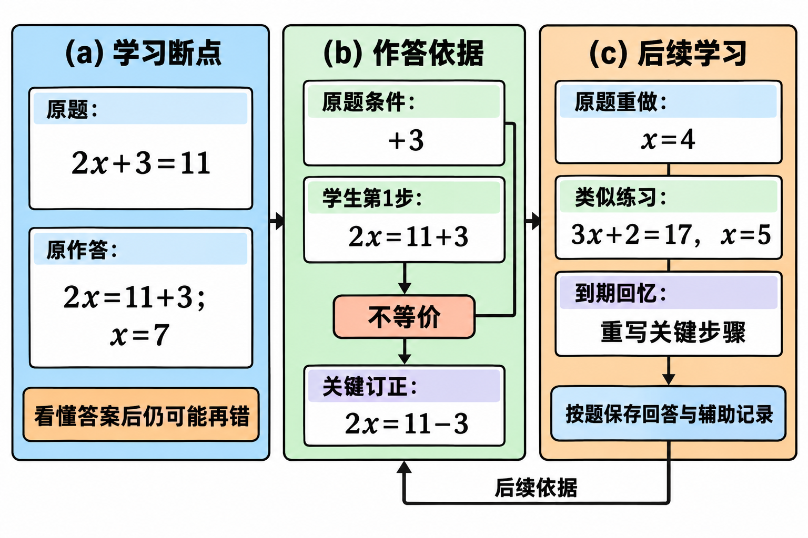
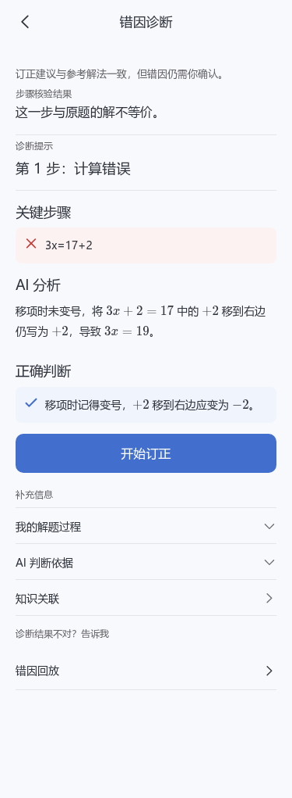
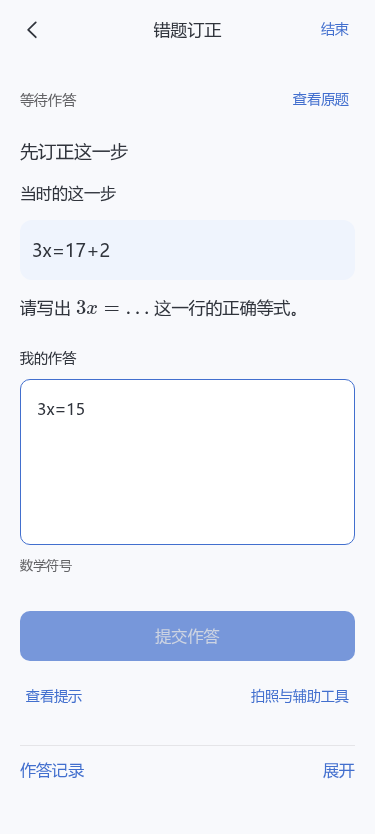
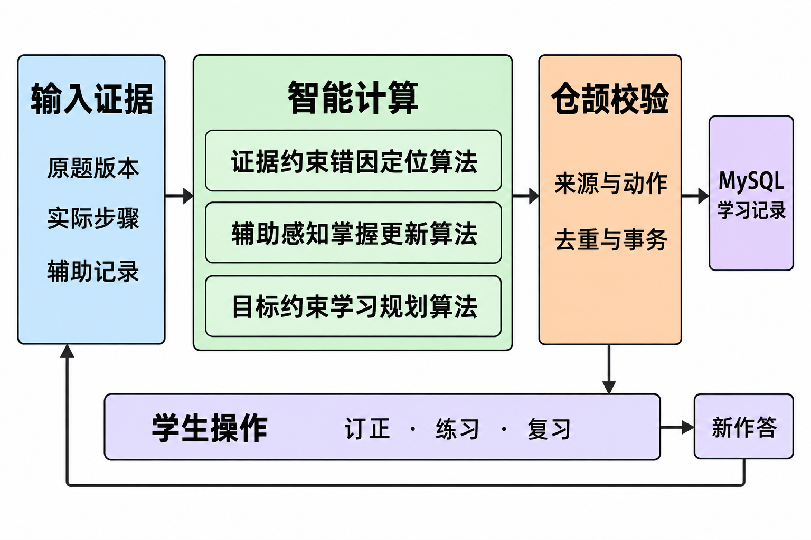
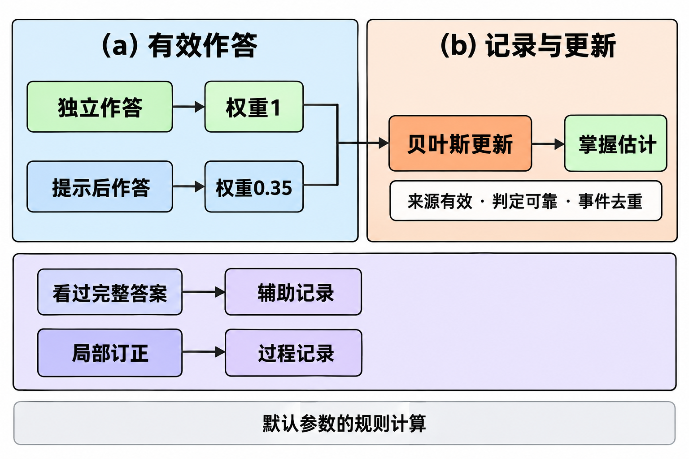
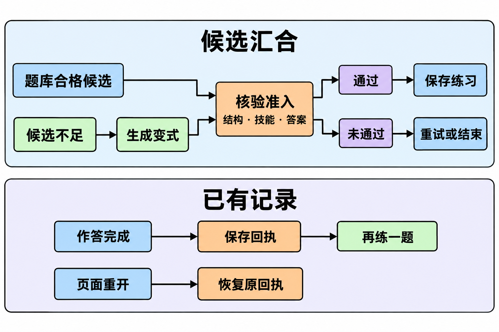
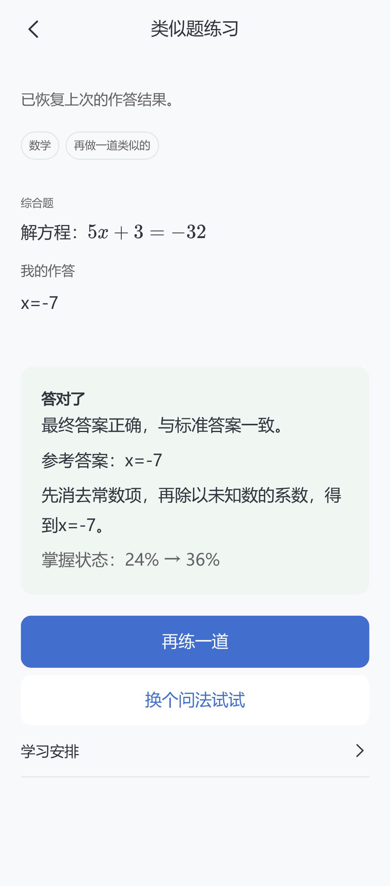
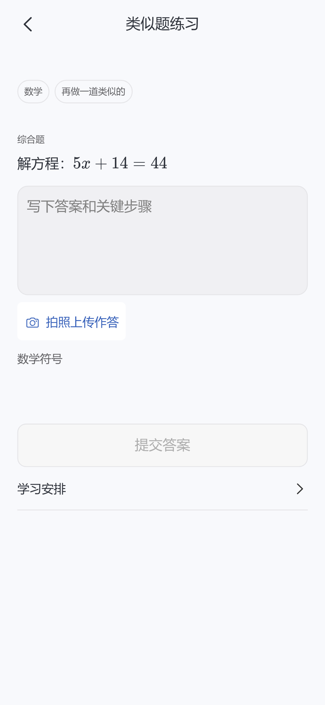

# 错题帮项目说明文档

2026“仓颉杯”智能编程大赛

项目名称：错题帮。参赛方向：综合系统。技术基线：950ce87。文档版本：2026年10月22日。

## 1 研究背景

### 1.1 学习问题

中学阶段的错题记录同时包含知识理解、解题过程与学习习惯等多类信息。学生写错一道题，可能是尚未理解某个概念，也可能只是漏看条件、符号处理不当或没有检查结论。最终答案相同的两道错题，产生偏差的环节也可能不同。因而，错题学习的对象不仅是正确答案，还包括学生原来的判断、能够支持判断的题目条件，以及重新作答时发生的变化。

传统错题整理主要围绕“保存下来”展开。学生抄写题目、粘贴原图、记录参考解析，逐渐形成按学科、章节或日期排列的资料。这样的方式保留了学习材料，却没有自然保留“为什么在此处出错”和“后来是否能够自己完成”。当记录数量增加，整理时间与复习收益之间的关系便变得不明确：题目保存得很完整，真正用于重新作答的机会却未必同步增加。

答案订正和独立解决之间存在一个容易被忽略的断点。学生阅读完整解析后，往往能够理解每一步的表面含义，也能够沿着示例重写计算。但当数字、条件或问题方向稍作变化，仍可能沿用原来的错误操作。一次正确抄写说明学生接触过正确过程，却不能直接说明其已经形成可独立使用的方法。对于需要多步推理的代数、几何和物理题，这一区别尤其重要。

过程差异又使错因定位比判断答案更复杂。解同一个方程，有人先移项，有人先去分母，有人从等式两边同时运算开始。参考解法的第二行与学生作答的第二行并不必然承担相同作用。若只比较行号、关键词或书写形式，正确的不同路径可能被误报；若只检查最后答案，真正的首次偏差又会被后续连锁错误掩盖。学生需要的是针对本人实际过程的解释，而不是再次阅读一份与自己写法脱节的标准答案。

错题之间的关联也不总是显现在章节目录中。单位换算问题可能出现在运动、密度和电学计算中；遗漏定义域、漏用图形条件或没有检查增根，也可能跨越多个知识单元。按章节保存便于查找，却难以直接呈现重复出现的错误表现。相反，仅给每道题附上一个宽泛的“粗心”标签，又无法说明下一次应该检查什么。有效的整理需要能够回到原题，保留每次判断的具体依据。

类似题练习带来另一个现实困难。题目在文字上相似，不等于真正考查同一技能；一道提到一次方程的材料，也可能要求辨认概念、比较几何长度或读图，而非练习移项和求解。过度追求相似度可能让学生练到错误目标；为了保证题量而直接使用生成内容，则可能引入答案错误、选项歧义或缺少必要配图。对于个人错题工具，练习的适配性与可核对性比不断增加题目数量更重要。

### 1.2 研究动机

错题学习包含相互关联的三个判断：本次偏差是否有依据，当前表现说明了什么，下一次练习应当如何选择。现有工具已经为这些环节提供了重要基础。例如，[Photomath官方产品页](https://www.photomath.com/)展示了扫描题目、查看分步解释与部分题目多种解法的使用方式；[Anki官方手册](https://docs.ankiweb.net/manual/deck-options)详细介绍学习步骤、复习安排和每日学习量配置。这些成熟能力说明，题目解释与复习调度已经具有清晰的产品形态。错题帮关注学生原作答、辅助使用和后续练习之间的连续记录。

学习科学为重新作答与分散回顾提供了已有研究依据。[Roediger与Karpicke的原研究](https://pubmed.ncbi.nlm.nih.gov/16507066/)考察主动提取与延迟保持，[Dunlosky等的综述](https://pubmed.ncbi.nlm.nih.gov/26173288/)将练习测试和分散练习列为具有较高适用价值的学习技术。这些研究支持本项目关注主动回忆和后续复习的动机，不能直接证明错题帮已经提高学生成绩。项目仍需通过实际产品使用检验其交互和算法能否将这些原则落实。

首先需要解决诊断依据不足的问题。错误结论可以由模型提出，但“模型认为这里错了”与“这里存在可核对的数学偏差”具有不同含义。对符号题，解集、边界和等价关系能提供较明确的检查对象；对开放题或信息不完整的作答，系统可能只能提出待确认的解释。产品需要允许不确定性以可操作方式存在，使学生知道应该补充原题、补写哪一步或核对哪条条件，而不是把所有解释显示为同样确定的结果。

其次需要解决学习表现混记的问题。请求提示、查看完整答案、完成局部订正和独立重新作答，都是有价值的学习活动，但能够提供的证据不同。将这些活动统一记为“答对一次”，会使后续推荐高估学生独立完成的能力；完全忽略辅助后的练习，又会丢失学习过程本身。个人学习状态需要反映辅助程度、作答范围和来源是否有效，并保留为什么更新或保持不变的解释。

再次需要解决从诊断到行动的衔接问题。只知道薄弱点并不等于知道今天如何安排学习。一个学生可能只剩十分钟，另一人需要先补基础知识，还有人已有到期错题应先复习。推荐既要考虑当前错误，也要考虑可用时间、已完成目标、重复曝光和连续失败。对于同一道题，系统在答错、得到提示、完成订正和重新进入时，应当提供与当前状态一致的下一步，而不是始终重复同一个建议。

个人化的前提是积累可信记录。新账号没有错题与历史表现时，系统无法据此推断学生的薄弱点；学生修改了题干或原作答后，旧诊断也不应继续支撑新建议。因此，冷启动、正常学习和来源变化具有不同的数据条件。能够从零开始，同时随着真实记录逐渐调整支持方式，是面向学生个人长期使用的重要要求。

错题学习需要回答一个连续问题：怎样依据学生实际过程理解本次偏差，再利用后续表现选择下一次学习。诊断是否可靠、辅助是否被记录、练习是否符合目标，都会影响这一过程。项目研究动机是让学生在有限时间内获得能够理解、能够继续执行的学习支持。

### 1.3 使用需求

错题帮面向中国初一至高三学生的个人课后学习。典型使用从一张试卷照片、一段本人计算或一道手工录入题开始，学生希望在较短时间内识别问题并继续练习。此时最重要的需求是原材料可核对、反馈对应本人写法、操作完成后能够保存；大量统计图和技术术语不会直接帮助学生完成当前题目。

课后订正强调局部理解。学生可能已选对公式，但代入前忘记统一单位；也可能知道移项规则，却在连续运算中错用符号。他们需要看清错误发生的位置，保留正确的前序步骤，再集中处理产生偏差的条件或操作。已有正确思路应被保留，参考方法也应能够按需展开，而不是要求所有人照同一种顺序重写。

专项巩固强调目标一致。学生完成原题后，希望再做一道能检查同一关键技能的题。对于一道练移项的方程，类似题应继续检验移项和系数处理；对于漏掉定义域的分式题，后续题应保留对条件检查的要求。练习过程还应允许中断与恢复，避免重新打开页面后丢失刚才的答案、题目或已看提示的事实。

阶段复习强调有限时间下的取舍。学生未必需要一次浏览全部错题，而是需要知道哪些题已到复习时间、哪些内容仍缺少独立作答、哪些题只是尚未整理。复习记录应区分本次回答、系统判定和学生自评，允许学生回到来源理解结果。学习安排的依据应是已有材料，而非缺少数据时给出的排名或失分预测。

表1 学习需求

| 使用情境 | 主要困难 | 产品需要回答的问题 |
| --- | --- | --- |
| 第一次进入 | 没有历史记录 | 从哪里开始学习 |
| 课后订正 | 解析与本人过程脱节 | 我从哪一步开始有问题 |
| 完成提示后作答 | 辅助与独立表现混淆 | 这次回答说明了什么 |
| 类似题巩固 | 表面相似但目标不同 | 这道题是否练到原来的问题 |
| 离开后继续 | 题目、输入与状态丢失 | 能否接着上次完成 |
| 阶段复习 | 题多而时间有限 | 今天先处理哪些已有记录 |

移动场景进一步要求清楚的信息层级。小屏幕需要优先呈现题干、输入和当前动作，长解析、原图与历史记录按需查看；桌面使用则需要更好地利用横向空间。两种设备应共享相同题目与进度。学生无须理解模型、任务图或数据库事务，但应能明确知道内容正在加载、答案已保存、需要补充材料或可以进入下一题。

## 2 产品方案

### 2.1 产品定位

错题帮是一款围绕个人错题持续学习的AI应用，以“录入错题、定位偏差、完成订正、重新作答、类似题巩固、到期复习”为使用主线。项目将一道错题作为可持续更新的学习对象，关联原图、确认后的题目、学生过程、诊断与后续回答。学生可以从当前问题进入学习，也可以从历史记录重新开始，而不需要在独立工具之间重复搬运材料。

图1以方程移项的机制示例说明整体思路：保存题目解决材料留存，原始步骤与题目条件支持偏差核对，新的独立回答提供后续判断依据。订正、辅助、练习和复习分别留下记录，新的记录再影响后续安排。

项目的核心价值集中在三个方面。第一，诊断围绕学生实际作答展开，能够展示支持结论的记录及待核对部分。第二，任务接收学生的新动作和工具结果，按已有检查点继续执行，使学习过程能够中断和恢复。第三，后续推荐使用辅助程度、目标与来源等约束，避免把看过答案后的重复视为新的独立能力。类似题的来源和核验进一步支持这些机制形成可操作的闭环。

项目选择个人学习边界，使资源归属、数据解释与产品目标保持一致。学生管理本人题目、练习和复习；维护入口只服务受控内容与运行管理。当前定位不是学校管理平台，也不以角色数量体现系统完整度。系统完整性体现在主要学习功能能够共享来源、状态和证据，形成从输入到结果的实际协同。

### 2.2 功能组织

学生端以今日、错题、学习和我的组织主要导航。今日提供当前起点和主要待办；错题承担采集、搜索、筛选、收藏、归档和详情；学习集中练习、复习、知识内容和学习记录；我的提供个人信息、偏好与设置。诊断、回放和订正位于具体题目上下文内，避免把一条学习过程拆成相互独立的顶层入口。

当前工程注册36个页面，包含登录注册、采集校对、学生学习、资料管理及受控维护等入口。页面数用于说明路由与验收覆盖，不能等同于36项独立创新。学生实际看到的是按情境逐步展开的功能：录题时关注材料，做题时关注回答，完成后再查看解释与后续安排。主导航保持稳定，次级页面提供明确返回路径。

首页根据已有数据选择一个主要动作。正在进行的订正或学习任务优先提供继续入口，已有到期记录时呈现复习起点；需要专项巩固时进入所选学科的练习；尚无记录时提供录题或知识内容。知识卡、题库、模拟考试和易错地图作为辅助入口，不与当前题目争夺同等视觉权重。服务异常会显示加载失败与重试，不能被误呈现为“今天没有任务”。

冷启动使用学生本人选择的年级、当前学科、学习目标和预计时间。目标包括弄懂一道题、巩固一类题和复习学过的内容，时间选择用于控制当前学习量。这些信息表达偏好，不能替代作答证据。新账号可以先选择知识内容或开始录题，系统不会为了填满首页生成虚构掌握率；形成真实记录后，首页再读取任务、诊断与复习安排。

表2 功能组织

| 功能区域 | 学生主要行为 | 关联记录 |
| --- | --- | --- |
| 今日 | 选择或继续当前学习 | 偏好、在途任务、到期计划 |
| 错题 | 收录、查找与核对题目 | 原图、题干、选项、原作答 |
| 诊断订正 | 核对偏差并重新作答 | 步骤依据、提示、检查点 |
| 练习考试 | 连续作答或集中检验 | 候选来源、答案、成绩记录 |
| 复习资料 | 回顾、查知识与组卷 | 复习回执、知识内容、导出 |
| 我的 | 管理个人信息与设置 | 年级、方向、目标及时间 |

### 2.3 题目档案

采集支持拍照、选择图片与手工录入。图片进入裁剪和文字识别后，学生可以对照原图核对题干、选项、符号与本人过程。原始上传图保持独立，裁剪、清洁与识别结果作为相关材料保存。这样的分工使识别错误可以回到原始证据修正，也使后续解释能够明确针对哪份确认内容展开。

题目档案同时保存题目与学生作答。对于选择题，选项文字和配图具有实际教学含义，不能只保存一个字母；对于计算题，步骤的先后和原文需要被保留。学生只有最后答案时仍能完成录入，诊断粒度按现有材料决定。补充实际过程后，再围绕新增证据重新核对，而不是由系统推测学生“可能写过”的步骤。

错题详情先展示用于辨认题目的核心内容，再组织原作答、学习入口、解析和历史。长题干、原图与公式在阅读中保持完整，长解释可以按需展开。错因回放保留错误位置、题目依据和核对状态；重新作答与类似题入口处于题目上下文中，学生不必重新选择来源。题目更新后，派生分析与学习任务按来源规则处理，避免修改原题后继续显示旧结论。

图2为2026年10月21日核验账号的真实Qwen诊断与订正存档，展示学生原作答、首错位置和局部输入怎样连接后续动作。相关页面源码与当前基线一致，出处见配套《证据与来源》。

错题管理提供搜索、学科筛选、收藏与归档，使长期积累后的材料仍可查找。归档改变日常展示与安排，不抹去已有作答；重新打开时仍能查看原题及历史。组卷保存所选题目、顺序与分值；导出时在事务中读取当次题目和解析并生成固定文件，之后重新导出使用当时的业务内容。保存、整理和学习由同一档案连接，减少重复录入。

### 2.4 学习流程

学生进入本题学习后，先看到当前需要处理的内容与允许动作。需要订正时，系统围绕已有偏差提出局部问题；需要独立作答时，显示题目与输入区域，并按当前阶段控制答案和提示的展示。提示用于降低当前步骤的困难，查看完整答案则进入辅助学习状态。两种行为都会保存，后续判断据此区分学生表现。

订正采用局部检查与完整作答分开的过程。学生修正某一步之后，系统核对该步骤的含义，再要求在适用阶段完成原题重做或相近条件题。局部正确说明当前操作得到修复，不自动代表整道题或整个知识点已经掌握。学生答错时可以继续获得与错误相关的支持，连续失败则转向更小步骤或前置知识，避免只反复显示“再试一次”。

类似题从原题目标出发，优先使用可回查的题库候选，检查是否真正检验当前技能。缺少合格候选时，再进入有约束的生成与核验。学生提交后看到本次反馈，可以继续下一题；题目、作答与辅助记录按来源保存。页面重新进入时恢复已有结果和进度，连续练习不会因为一次刷新退回最初的原题。

题库练习与模拟考试服务不同目标。练习允许按题获得反馈，考试按试卷或会话组织题目、答题卡和结束后的结果。已作答内容、剩余时间与会话状态由业务层保存，学生可以查看自己的答案与参考解释，并将需要回顾的题目加入错题本。界面不同并不改变题目归属、答案判定和来源规则。

### 2.5 复习资料

到期复习围绕原来的题目再次组织作答，分别保存学生回答、系统判定和本人反馈，再按当前规则安排下一次时间。学生自评可以表达难易感受，却不能单独覆盖可靠判定；需要核对的回答保留待核对状态，不把“感觉会了”直接转换为已掌握。复习和本题学习共享题目来源，同时保持各自记录含义。

个人易错地图按已有诊断中的学科与错因标签归组，汇集相关知识点，并保留每道原题的入口。多个“遗漏条件”记录可以帮助学生选择回顾重点，但不表示这些题都来自同一个心理原因。学生点击一条线索后，应能查看原题、实际作答与诊断依据，再决定补写过程、订正或练习。地图由此承担导航，而不是使用不透明的关联图替学生下结论。

知识内容以课程概念、条件、例题和相关问题组织，为缺少前置知识或尚无错题历史的学生提供起点。学生阅读知识卡会留下内容使用记录，用于解释当前支持，不因为页面停留就获得独立掌握证据。个人知识关系与学习报告汇集已有学习事实，让学生看到哪些内容接触过、哪些回答仍需要练习，以及建议来自哪里。

组卷支持将选定错题整理成题目卷、答案卷与表格。导出保留题目顺序、选项、必要配图和分析，便于学生进行纸面重做或离线整理。导出文件与当前业务档案关联，重新生成后能明确取得本次产物。资料工具扩展学习方式，但不会因导出或打印增加掌握记录。

## 3 核心算法

本项目的算法围绕“证据从哪里来、一次表现有多大意义、下一步如何选择”协同工作。证据约束错因定位算法筛选有来源的偏差，辅助感知掌握更新算法区分独立与辅助表现，目标约束学习规划算法选择当前行动，同源核验补题算法补足适配练习。算法名称描述其实际处理对象，具体实现与支持范围均对应当前源码。

图3将原题版本、实际步骤、辅助记录、三项算法与业务校验放在同一方法框架中。智能计算输出诊断、更新建议与学习动作，仓颉再核对当前来源、用户归属和任务版本后提交。新的学生回答成为下一次计算输入。计算结果、业务状态和学生证据具有不同位置，不能因模型返回了一段解释就直接改变学习结论。

### 3.1 错因定位

证据约束错因定位算法处理的是已有诊断候选与来源记录之间的关系。输入包括学生实际步骤及其标识、参考步骤、对齐检查、已取得的知识证据和诊断假设；输出包括候选错误位置、支持依据、核对等级与下一动作。算法首先确保候选引用真实存在的学生步骤，步骤原文和序号与记录一致，排除错误引用或从模型解释中虚构步骤的情况。

数学核验在已支持的表达式范围检查解集和等价关系。若某一步与原题实数解集不同，且对应规则返回不成立，候选可以取得规则依据。完全一致、等价或合法分支不会仅因写法不同被列为错误。参考步骤只有在标识和文本都匹配当前参考记录时才参与评分；检索知识必须与已有假设关联，且仅表示来源关联，不能充当学生思维原因的证明。

算法为不同证据设置明确权重。学生实际步骤提供基础支持，规则核验增加较强依据，匹配参考记录和知识来源增加补充依据；与数学成立或等价结论冲突时扣分。候选按证据分排序，并保留少量可解释项。这里的分数用于候选排序，未经过真实学生数据的概率校准，因此不显示为“诊断有多少百分比一定正确”。

“首错”比“发现错误”需要更强的条件。一个后续步骤核验错误，并不证明之前步骤全部正确。算法只有在候选错误得到规则支持、此前步骤也逐个处于允许的核验范围并通过时，才将首次偏差标为已核验；前序缺少依据时仍保留候选位置，但要求学生核对过程。这一条件避免把“找到一个错误”过度解释为“确认全部推理从这里开始出错”。

例如，原题为2x+3=11，学生依次写“2x=11+3”“x=7”。在支持的线性方程规则下，原题解为4，而第一步等式的解为7，两者不等价。算法引用学生第一步原文，并记录解集不同这一核验事实；后续x=7是前述偏差延续，学习起点应围绕消去常数项展开。若学生改写为“2x=8”“x=4”，不同参考顺序不构成错误，系统不应为了给出诊断而强行定位首错。

条件检查说明了不同题型为何需要明确核验对象。例如(x²−1)/(x−1)=2约分后仍须保留x≠1，候选1不满足条件，原式无解。这个有理式空解集案例说明定义域检查的重要性；当前多项式首错规则以其明确支持范围执行，该例进入相应材料核对路径。已核验首错的演示仍采用前述线性方程，保留原始步骤与具体规则依据。

判断该算法是否有效，需要检查三个层次：引用是否真实、已支持规则能否区分合法路径与偏差、证据不足时是否停止作出强结论。当前单元和工作流回归覆盖这些条件，实际应用仍保留修正入口。后续可以在具备授权的真实作答集上评估定位一致性、误报率和补充材料后的变化；目前不以工程测试数量替代跨题型诊断准确率。

### 3.2 掌握更新

辅助感知掌握更新算法将一次作答转化为带权证据。输入是知识状态与本次事件，包括作答范围、可靠判定、提示使用、完整答案暴露、来源有效性与事件标识；输出为更新后的掌握估计、辅助和独立计数、更新理由、不确定性及遗忘风险建议。算法返回计算提案，持久写入仍由仓颉在已有事务中校验完成。

算法先检查本次事件是否可采信。来源已失效、作答未确认、判定不可靠或结果需要核对时，保持掌握状态；局部步骤订正只记录当前修复，不直接上调完整题目掌握。已处理事件不重复计入，重新进入页面也不被视作新观察。这样，一次网络重试、页面刷新或模型重算不会凭空制造新的学习证据。

通过检查后，算法区分提示与完整答案。看过完整答案的回答记入辅助学习次数，不增加掌握证据；提示后作答仍能提供较弱证据，其默认权重为0.35；没有提示和答案暴露的可靠独立回答使用权重1。符合间隔条件的独立条件对照回答可使用1.25的默认保持权重。权重来自当前透明配置，是工程初值，不代表已拟合学生认知参数。

对于有效回答，算法使用先验掌握估计与正确、错误观察的似然进行贝叶斯更新，再仅对正确观察加入有上限的学习转移。选择题依据选项数估计猜测项，非选择题使用默认猜测参数。提示权重作用于似然强度，使相同答案在不同辅助条件下产生不同更新。错误回答提供负向信息，不因“尝试过”而得到正确回答才有的学习增益。

图4强调同样得到正确答案时，独立完成、提示后完成与看过完整答案具有不同证据含义。该机制保留求助的教学价值，并使辅助记录与独立表现各自承担相应证据作用。学生仍可以获得提示、查看解析和继续练习，系统则据不同记录选择更合适的后续支持。

默认参数下的规则演算可以展示这一差别。以先验0.35、无选项的完整题目回答为例，独立正确得到约0.914，提示后正确得到约0.608，看过完整答案保持0.35；可靠独立错误得到约0.054。满足当前间隔条件的独立条件对照正确可得到约0.956。表3仅列同一初值下的计算输出，不是对真实学生掌握率的测量，也不意味着一次答对就足以结束长期学习。

表3 默认更新演算

| 本次行为 | 证据权重 | 更新后估计 | 保存含义 |
| --- | --- | --- | --- |
| 独立正确 | 1.00 | 约0.914 | 增加独立作答证据 |
| 提示后正确 | 0.35 | 约0.608 | 保存辅助程度并弱更新 |
| 看过完整答案 | 0 | 0.350 | 只增加辅助学习记录 |
| 独立错误 | 1.00 | 约0.054 | 保留负向作答信息 |
| 符合间隔条件的条件对照独立正确 | 1.25 | 约0.956 | 增加保持证据 |

掌握估计不是整个学习档案的唯一内容。证据次数、独立次数、已看答案记录和最后有效事件都用于解释当前结果，不确定性帮助区分缺少记录与已有较一致证据。遗忘风险根据当前状态和经过时间计算，是后续安排的提示，不会在学生没有作答时伪造一条错误答案。报告应让学生回到真实回答，而非只展示一个无法解释的百分比。

该算法当前接入持久学习任务；题库和生成类似题仍使用各自已实现的正负证据规则，不把所有入口描述为已经统一计算。算法回归检查辅助区分、局部和不可靠事件不更新、重复事件幂等、错误不获正向奖励及长序列稳定。实际保存还要接受来源和任务资格限制。后续有效性研究应考察这种区分能否改善下一次练习选择和学生理解，而不是仅比较最终显示的分值高低。

### 3.3 学习规划

目标约束学习规划算法将当前题目状态与有限学习预算转化为下一动作。输入包括当前阶段、证据是否充分、前置知识、连续失败、可用时间、剩余目标，以及带有学科、难度、到期和曝光信息的候选题。输出包含具体行动、所选来源题、理由、预计时间与少量备选，并保存可解释的排序组成。

规划先处理不能依靠分数排序解决的条件。时间或目标已完成时结束本轮；材料不足时先核对原题和作答；缺少前置知识时先回顾基础；重复错误时进行局部订正，连续失败时提供更小的提示。订正、独立作答和条件对照各有对应动作。只有当前阶段允许选择后续题时，算法才对候选排序，避免把每次学生答错都变成切换到一题新内容。

候选首先通过硬约束。超出剩余时间、学科不符或刚完成且不宜立即重复的题不进入选择。合格的到期复习保留优先级，防止新题不断占据学习时间；同一优先级内，再结合错误相关性、薄弱程度、预期信息量、难度适配、时间成本和最近曝光综合评分。重复惩罚作用于实际选择，不能只写在解释文字里而不影响排序。

难度适配使用当前估计和失败情况选择较合适目标。学生连续失败后，目标难度可以降低，以便通过较小步骤重新建立反馈；学生刚完成原题时，类似题需要检验相关技能，而不是简单展示更难内容。预期信息量用于衡量一道题能为当前状态带来多少区分信息，属于当前概率假设下的计算，不等同于题目本身的教学质量证明。

例如，一名学生计划用十分钟巩固数学，当前仍在订正方程的移项步骤，即使题库中有一条评分很高的新题，规划也先支持当前订正。完成后，若存在合格的到期错题和新练习，优先安排到期内容；若候选都需要超过剩余时间，系统选择相关知识回顾或结束本轮。这一规则情境展示行动优先级、候选排序与预算之间的关系。

表4 规划决策

| 当前条件 | 优先动作 | 作用 |
| --- | --- | --- |
| 时间或目标完成 | 结束本轮 | 控制学习量 |
| 原题或作答证据不足 | 核对材料 | 避免在错误输入上继续 |
| 前置知识缺失 | 回顾知识 | 补足当前操作基础 |
| 重复错误或连续失败 | 订正或提示 | 缩小当前任务 |
| 当前需独立回答 | 重新作答 | 获得对应范围的表现 |
| 有合格到期候选 | 优先复习 | 避免复习被新题挤占 |
| 无可用候选 | 知识回顾或结束 | 保留真实空结果 |

规划与任务状态共同工作。Python可以给出建议，仓颉仍检查所选题是否存在、属于允许范围、来源是否当前，以及任务是否允许推进。前端只展示服务端给出的题目和动作，不通过修改“已掌握”或“推荐分”绕过资格。当前测试检查停止条件、到期优先、跨学科和超预算排除、曝光惩罚与难度作用；后续需结合真实使用研究调整权重与时间估计。

### 3.4 同源补题

同源核验补题算法解决的是原题学习之后缺少合适练习的问题。输入为已确认的原题、当前目标知识、题型与候选来源；输出为可实际作答、带来源和核验信息的练习，或明确的暂不可用结果。“同源”表示练习始终回到当前原题及目标，而不是要求新题必须来自同一份试卷；题库候选与生成候选具有不同来源标记。

算法先分离相似召回与目标准入。检索可以利用题目语义获得候选，但召回结果不直接等于适合练习。对支持的一元一次方程，系统能通过表达式结构识别求解目标；其他需要语义判断的候选，要求从原题和候选题干取得逐字依据，并检查模型决定与输入标识一致。证据不足、目标不同或返回引用不存在的候选不放行，避免只因同学科或包含相同数字而通过。

合格题库不足时进入生成。支持的数学近迁移范围可以由本地规则构造一元一次方程，再使用符号工具求解，保证该结构下的答案与参考步骤相符。其他生成题需要按结构合同返回，再以另次结构化调用核对是否检验同一技能、答案与选项是否明确、材料是否完整、难度是否适合。需要缺失图片才能解答的题不能作为自足练习提供，泛泛学习建议也不能冒充一道类似题。

图5展示检索与生成的两条来源进入共同准入检查。题目来源、目标适配和可判定性一起决定是否能显示给学生。只有合格候选才进入作答与连续练习；未通过时保留错误状态和重试方式。新回答仍关联原来的学习目标，页面恢复则读取已保存的题目、回答和结果。

以原题2x+3=11为例，目标是完成一元一次方程的求解。“选择哪个式子是一元一次方程”虽包含同名概念，却未必检验同一种求解操作；“给出一段学习建议”更不是练习题。一个可接受的结构示例是3x+5=20，参考过程为3x=15、x=5，学生可以完成实际求解。此例用于说明本地构造结构，具体运行会按本次参数形成新题，不保证每次都生成同一组数字。

连续练习需要在“换一题”时真正改变学习对象。系统识别已有题目与本次来源，处理重复生成或重复随机值造成的同题问题，保存当前题及答案状态。提交后离开再返回，显示已有结果而不是重新生成一题掩盖历史；继续练习时再取得下一道题。生成、核验、保存与跳转必须协同，才能避免界面上有按钮却无法形成持续训练。

该算法的有效性有四个可分别检查的对象：候选是否符合目标，题干是否完整，答案是否在支持范围得到核对，保存与恢复是否对应同一道题。当前回归覆盖本地规则离线构造、通用建议拒绝、生成题独立检查及重复候选处理；真实接口和浏览器验收检查连续学习。语义题采用另次结构化复核，核对同技能、答案、完整性与年级适宜性；未通过时拒绝准入。

## 4 系统架构

### 4.1 技术分工

系统采用uni-app、Vue 3与TypeScript构建跨端前端，仓颉承接唯一业务服务并与MySQL交互，Python与FastAPI提供内部算法计算。前端负责学生交互、题目排版、公式显示与状态反馈；仓颉负责身份、资源归属、任务、事务和公开接口；Python负责识别、诊断、掌握估计、规划、检索与导出计算。三层共享合同与来源标识，各自保持明确责任。

当前源码已将算法真正使用的共用能力组织到独立的learning_core包，包括模型池、结构化输出、数学处理、文字识别和教学计算。算法包不再依赖另一套业务框架，也不包含业务数据库读写。模型请求经ApiPoolProvider统一轮询，逻辑名称固定为Qwen；实际资源配置保留在服务端，不进入前端或正式参赛材料。

MySQL保存学生、题目、作答、任务、练习、复习和学习记录等业务事实。原始图片与派生文件分开管理，题库图片保持可回查；Qdrant保存可重建的检索索引，BGE承担嵌入和重排相关能力。检索给出候选标识后，仓颉回查实际内容并核对允许范围。索引可以辅助找题，但不能替代数据库中的题目归属、当前版本和真实作答。

表5 分层责任

| 层次 | 核心责任 | 输出 |
| --- | --- | --- |
| 前端 | 输入、排版、导航与反馈 | 学生请求和清晰界面 |
| 仓颉 | 业务规则、状态与MySQL事务 | 已保存事实和公开视图 |
| Python | 受控智能计算与结构校验 | 诊断、判定、规划和更新建议 |
| MySQL与文件 | 业务事实和原始材料保存 | 当前记录与可回查来源 |
| 检索与模型资源 | 提供召回、推理和支持 | 候选及计算观察 |

仓颉的使用具有实际业务深度。它不仅转发请求，还决定任务能否开始、动作是否有效、结果是否仍对应当前来源，以及是否允许写入学习证据。Python计算期间学生可以编辑原题、取消任务或从另一页面提交，因此计算完成后仍需业务复核。这种责任分配让模型能力变化与持久化一致性分开，也使错误能够定位到输入、计算或状态提交的具体环节。

### 4.2 智能体协同

智能体采用单协调器组织受控流程，不以增加角色名称代替实际能力。任务上下文包括当前题目、实际步骤、诊断来源、知识内容、已保存动作和当前检查点；计算图依次处理证据诊断、当前学生动作、掌握更新和后续规划。需要补充材料时进入核对分支，需要学生回答时结束本次计算并等待新动作，系统不会在后台伪造学生回答继续推进。

LangGraph在算法层表达这些节点与条件分支，任务的持久保存仍由仓颉维护。图本身没有业务数据库写入工具，也不持有另一套检查点数据库。仓颉工作器领取任务、绑定执行资格并整理上下文；Python返回结构化结果；仓颉再核对来源、租约、请求版本和退出条件。图内状态转换与业务持久化相互协作，但不是两个相互竞争的业务状态中心。

工具结果能够改变后续选择。例如，步骤核验确认当前计算不成立后，规划可以缩小到局部订正；检索没有取得可用知识时，系统保留零命中观察，再使用已有步骤依据提供支持。通过这种方式，学生新回答和工具反馈都具有实际作用。一次模型说明不是唯一控制信号，返回结构不合格、来源冲突或预算耗尽时均有明确退出行为。

计算过程设有步骤、模型调用和时间约束。任务状态区分排队、运行、等待作答、需要核对、失败、完成、取消和来源失效，页面读取公开状态进行展示。学生暂时离开不会使运行结果失去归属；重复提交也不能重复获得学习更新。任务恢复从已保存的动作与检查点继续，避免因客户端重开而重新执行已经完成的学习动作。

### 4.3 数据关联

题目来源是各模块共同使用的连接点。原图、确认题干、选项和学生过程组成当前输入，诊断、参考解法、任务和练习据此产生。学生修改题干或原作答后，相关派生内容需要重新核对；冻结任务快照和历史动作按保存规则追溯，当前可采用结果与历史曾发生记录分别呈现。保留历史不意味着继续把过时诊断作为当前事实。

学习事件记录回答了什么、在什么范围、是否获得辅助及其可靠判定。掌握更新、易错地图、复习计划与学习报告分别消费这些记录，按照自身含义进行汇集。地图的标签是导航线索，报告的估计是计算结果，复习计划是日程；它们都需要能回到来源，而不能相互循环引用，最终只剩一个无原始依据的结论。

来源校验也适用于类似题。检索候选保留题库来源，生成题保留生成与核验信息，练习回答关联具体题目版本；重复打开时恢复的是已保存那道题，而不是一份内容可能变化的新生成结果。这样既能解释本次练习针对哪处薄弱点，也能区分原题独立重做和新增候选练习，避免将相同记录多次累计。

个人化记忆对已有事实、状态估计、自述和提醒分别组织，并保留引用、版本及时效。学生自述“分式方程总是出错”可作为支持线索，却不能直接替代每道题的实际诊断；后来修改原材料或撤销记录时，相应记忆需要失效或重新生成。记忆服务于后续上下文，不将模型总结升级为比原始作答更高的事实来源。

### 4.4 可信交互

智能计算的结果进入页面前经过结构和业务两类检查。Pydantic校验字段、类型与允许值，使结果可被程序处理；SymPy在支持范围检查数学表达式、解与关系。结构正确不等于题意正确，数学核验也不自动解释学生全部思维。页面通过核对状态与来源信息表达这些差别，并提供编辑原题、补充作答和重新分析的入口。

前端只消费VisualizationSpec JSON，由已有组件完成可视化和公式排版，不执行模型生成的JavaScript。题干、选项、答案与解释作为内容呈现，不能成为修改页面行为的指令。分数、集合、根式和不同等价表达需要在显示、输入与判题之间保持一致；选项选择、自由输入和原作答编辑采用各自的受控合同，避免界面美化破坏答案含义。

身份和资源规则由仓颉执行。学生读取和修改本人允许范围内的题目、任务及记录，受控维护使用专用权限。内部算法只接受服务端认证请求，不直接暴露给学生浏览器；媒体链接在已授权业务视图中签发，文件读取检查签名、有效期和路径，试卷下载另行检查当前归属。日志与错误响应不打印模型池、数据库密码或内部认证信息。

加载、空数据和错误采用不同状态。首次没有错题可以录入或选择知识内容；模型暂不可用应提供明确失败与重试；材料不足应进入核对；提交成功应能在重新读取后看到实际保存结果。交互反馈与真实状态一致，才能让学生理解当前处境，也为自动化验收提供可观察的判断对象。

## 5 实现验证

### 5.1 当前实现

当前主线已经形成从学生录入到持续练习的完整工程入口。采集保存原图与确认内容，诊断关联实际作答，本题学习保留提示与检查点，类似题在候选不足时生成核验，并支持继续下一题及恢复。题库练习、模拟考试、复习、知识内容、易错地图、学习报告与组卷导出共享本人档案，主要功能能够沿题目来源连贯使用。

当前个人应用由仓颉与MySQL承接业务，Python作为内部算法包独立安装。账户资料、题目管理与学习状态由同一业务服务维护；启动、检查、测试、构建和完整验收使用统一入口，环境与源码版本可对应复现。

表6 实现状态

| 能力 | 当前状态 | 验证对象 |
| --- | --- | --- |
| 录题与档案 | 已实现并有工程验证 | 原图、选项、过程与编辑 |
| 错因回放与订正 | 已实现，题型核验范围明确 | 真实步骤、规则与待核对 |
| 掌握更新与规划 | 已实现并有算法回归 | 辅助区分、约束与排序 |
| 类似题补足 | 已实现并有接口/浏览器验证 | 适配、生成、连续练习及恢复 |
| 练习考试与复习 | 已实现并有工程验证 | 作答、结果和计划 |
| H5与App资源 | 已运行/构建 | 浏览器流程和资源产物 |
| 手机签名发行 | 已有跨端工程基础 | 后续账号、设备与发行验证 |
| 长期学习收益 | 后续研究 | 真实学生使用与延后表现 |

实现状态针对具体声明范围。支持的数学结构可以进行本地符号核验，开放语义题仍有模型能力边界；候选生成通过结构与复核，也不等于所有题型均获得形式证明。当前材料将工程正确性、固定题内容检查和长期教育效果分开，便于评委按实际证据判断成果。

### 5.2 典型案例

**方程订正。** 原题2x+3=11，学生第一步写成2x=11+3，接着得到x=7。错因定位围绕第一步等价关系展开，保留原文，订正要求回到“等式两边消去同一常数”这一操作。学生局部写出11−3后，还需在适用阶段完成完整回答x=4；单个修正表达式不能自动替代原题独立完成。支持的条件对照将左常数改为−3，得到2x−3=11，正确答案为x=7，用于检查学生是否依据当前条件操作。

**相同答案的不同证据。** 对同一道完整题，独立回答、提示后回答和看过答案后重复都可能出现x=4。系统保存不同辅助记录，掌握更新的处理不同；重新打开已完成任务不产生新回答，再次传回同一事件也不重复累计。该例直接展示算法输出怎样影响后续支持，而非仅在报告中为学生贴一个掌握标签。

**材料核对。** 如果题目被识别成2x−3=11，而原图实际为2x+3=11，参考答案与诊断都会受输入影响。学生对照原图修正后，业务层重新核对派生结果，原来的计算不能覆盖新题目。这一场景表明，诊断准确性不仅依赖模型推理，也依赖输入来源和提交时点；保留原图与版本关联具有直接产品价值。

**类似题接续。** 学生完成原题后进入类似题，系统先筛选真正考查求解的一元一次方程候选。候选不足时，支持范围的本地构造提供新的系数和常数，核验答案后显示；学生提交、离开、重新进入，仍能读到本次题目及结果。点击继续练习请求新题，上一题的错误、提示与答案不会被覆盖为新的独立记录；若新题失败而已有合格题，保留旧题供继续，不显示虚构的新题。模型生成路径则额外检查同技能、完整性与答案明确性。

图6为2026年10月21日隔离工程回归存档，受控上游用于验证类似题作答结果恢复与继续练习。图中24%到36%表示当时练习规则的状态估计。相关页面源码与当前基线一致，归档来源与验证范围见《证据与来源》。

**跨题线索。** 一题在三角形中只知∠A=50°却自行假设另一个角相等，另一题在分式运算中漏掉分母非零条件。二者都可以进入条件相关线索，但一个涉及擅加图形条件，另一个涉及遗漏代数限制。地图共同组织的是已有错误标签，学生仍需点击原题查看不同依据。这样，归组帮助选择回顾方向，诊断则尊重每道题本身。

这些案例承担不同验证目的。方程例核对数学关系与阶段粒度，辅助例核对学习证据，材料例核对来源一致性，类似题例核对功能接续，跨题例核对导航与事实关联。上述案例分别对应可回查的规则、页面和受控测试，出处由配套清单集中登记。

### 5.3 工程验证

当前有效工程验收对应源码950ce87及2026年10月22日实施记录。完整make verify-final正常退出，前端51文件283项、算法686项、仓颉原生46项通过，浏览器70项通过且零跳过；还覆盖类型检查、H5和App本地资源构建，以及隔离MySQL下的接口、事务和进程恢复。最终算法复验与资源构建记录补充确认当前交付状态。

表7 当前验收

| 范围 | 已记录结果 | 支持的判断 |
| --- | --- | --- |
| 前端逻辑 | 51文件283项 | 页面状态、公式与交互逻辑 |
| 类型与构建 | 类型、H5与App资源通过 | 当前工程可构建 |
| 内部算法 | 686项通过 | 结构、规则、边界与受控模型协议 |
| 仓颉原生 | 46项通过 | 当前业务规则与合同 |
| 接口与数据库 | 隔离MySQL及恢复通过 | 归属、事务、状态及持续保存 |
| 浏览器 | 70项通过，零跳过 | 真实页面主要流程 |
| 页面尺寸 | 36页手机/桌面共72次渲染 | 指定视口的布局表现 |

测试分层与产品风险对应。算法回归检查已有输入是否取得正确结构与范围判定，尤其覆盖合法不同解法、辅助权重、重复事件、时间目标约束、类似题不足及核验拒绝。接口验证检查计算结果是否真正落库并能重新读取；浏览器检查导航、表单、按钮、原题选项、公式与连续练习。单独通过构建不能说明学习流程已经可用，页面截图也不能代替持久化检查。

当前回归使用受控模型与检索夹具，保证相同输入能够复现异常和资格分支。它能够证明业务如何处理模型返回，不能推导真实模型在全部中学题型上的准确率。源码可达性审计确认当前算法运行模块可从入口或维护脚本到达，并检查没有业务数据库框架依赖。证据范围以[当前实施记录](https://github.com/Baxxhy/cuoti/blob/950ce87/docs/final/IMPLEMENTATION_STATUS.md)和对应源码为准，不把旧版本通过数与当前结果相加。

算法实现可沿[错因定位源码](https://github.com/Baxxhy/cuoti/blob/950ce87/backend-algorithms/error_diagnosis.py)、[掌握更新源码](https://github.com/Baxxhy/cuoti/blob/950ce87/backend-algorithms/mastery_tracker.py)、[学习规划源码](https://github.com/Baxxhy/cuoti/blob/950ce87/backend-algorithms/learning_planner.py)和[补题源码](https://github.com/Baxxhy/cuoti/blob/950ce87/backend-algorithms/practice_generation.py)定位，回归记录与案例范围由配套证据清单集中说明。

### 5.4 应用价值

对学生而言，项目将错题从静态收藏转为能够继续使用的学习对象。原作答和偏差关联，减少从整份解析中寻找本人问题的负担；局部订正与完整重做分开，提供从理解到再次应用的操作；适配类似题与到期复习提供后续机会。价值体现在具体行为能否完成和记录能否回查，而不是界面显示了多少统计指标。

对软件工程实践而言，项目把语言分工与智能能力边界落实到可验证的状态合同。仓颉掌握业务权威，Python提供计算，前端消费受控结果；模型解释、数学检查、学习事件和业务提交各有明确对象。面对来源修改、模型不可用、迟到回执和重复动作时，系统能保留一致含义，这也是智能应用从演示走向日常使用的重要基础。

项目的创新体现为面向错题学习的机制组合与具体实现：实际作答约束诊断位置，辅助程度影响学习更新，阶段和时间约束后续行动，适配与核验保障练习入口。四个环节共同支持可操作、可恢复和可解释的学习链，后续真实学生研究将分别考察理解、独立完成与延后保持。

应用评价可从学生能否找到当前动作、能否说明诊断依据、是否完成独立重做、是否在离开后顺利接续等行为开始，再观察若干天后的类似题表现。长期效果还涉及课程进度、原有基础和使用频率等因素，应与工程验证分别研究。当前实现为这类评估保留来源、辅助和时间等必要记录，而不是先给出无数据支持的收益结论。

## 6 移动交付

### 6.1 移动体验

手机是错题帮的目标产品形态，当前通过uni-app共享页面与业务接口支持移动优先设计。页面围绕纵向阅读、清晰输入和主要按钮组织，题干与公式保持可读，长解析按需展开，返回路径与当前学习状态一致。桌面端利用较宽空间组织内容，但不形成另一套题目或学习进度。

移动操作重点包括拍照选图、裁剪校对、公式输入、提示查看、答案提交与继续练习。键盘、安全区域和底部操作需要协同，避免遮住输入或误触；提交中明确反馈并限制重复动作，失败后保留可恢复内容。长题干、选项配图、集合和分式等内容应在小屏仍保持完整，数学正确性与版式可用性共同验收。

个人数据在跨端访问中保持一致。手机或桌面读取同一仓颉业务状态，学生重新进入时取得既有题目、回答与任务；本地草稿只能辅助输入，不能替代服务端已经确认的事实。弱网络下应能区分尚未提交和已受理但未完成，恢复后重新读取真实状态，而不是靠页面动画推断处理成功。

### 6.2 平台交付

当前已有H5运行、App本地资源构建和指定浏览器尺寸验证。平台签名、真机安装和发行属于下一阶段交付，不把共享源码或资源构建等同于已经生成可安装产品。跨端工程为移动应用提供基础，正式交付还需要应用身份、访问入口、权限与设备记录共同完成。

Android交付需配置应用包名、DCloud AppID、发行签名及可达业务地址，检查相机、相册、文件导出和网络权限。iOS使用对应开发者账户、证书、描述文件与测试分发渠道，单独记录设备和系统版本。具体平台流程以[DCloud App官方说明](https://uniapp.dcloud.net.cn/tutorial/app-base.html)及平台要求为依据。

表8 移动交付

| 阶段 | 已有基础或主要工作 | 完成依据 |
| --- | --- | --- |
| 共享前端 | 页面、接口与本地资源构建 | 构建结果及浏览器流程 |
| 平台配置 | 应用身份、签名、地址和权限 | 实际平台配置与产物 |
| 真机验收 | 采集、校对、学习、练习和导出 | 设备、系统与过程记录 |
| 持续维护 | 版本升级、异常恢复与兼容 | 可追溯版本及回归结果 |

安装验证以真实业务流程为单位：全新启动后完成注册登录、选图录题、确认材料、查看诊断、重新作答、连续练习、复习和导出，并检查离开恢复、权限拒绝及网络中断。手机能够打开首页只是起点，关键学习记录在重开后仍保持正确，才具有持续使用价值。

### 6.3 发展方向

近期扩展首先围绕题型与证据质量展开。支持更多数学结构和学科题型时，应同时准备实际学生写法、合法不同路径、缺失材料和等价答案测试，明确哪些结论可以规则核验、哪些仍需语义确认。类似题扩展还要处理配图、选择项与课程目标，不能只增加生成数量。算法参数应结合后续真实样本校准，并保留版本与比较依据。

学习效果评估需要从工程日志走向经过授权的实际使用。可观察学生是否理解首次偏差、能否在不查看答案时完成同类任务、若干天后是否仍能处理关键条件。对照设计应区分阅读解析、提示辅助和独立重做，记录题目来源与难度，避免把更熟悉的重复题当作迁移效果。当前默认掌握估计和排序权重提供可解释起点，后续研究决定其适用范围和调整方式。

产品迭代继续围绕个人学习闭环，而不是增加与目标无关的外围模块。首页保持明确起点，详情保留材料与过程，诊断解释依据，练习检验当前技能，复习安排已有记录；跨端与发行让这些行为能够在日常设备上稳定完成。项目将以实际作答、可靠计算与业务规则的共同约束，持续改进学生从一道错题走向下一次独立解决的过程。

**资料来源。** 项目实现与验收对应源码950ce87及配套《证据与来源》；开源组件、模型、题库及AI辅助范围见《运行与依赖说明》。正文的外部产品和研究资料链接定位到相应官方页面或原研究条目。
