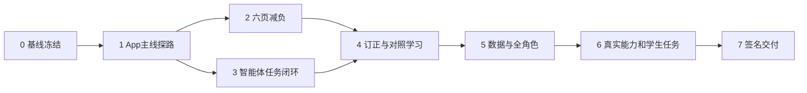

# 最终版本实施与验收计划

> 用户最新澄清：目标是整个系统能跑、能用，不定位为课程作业或展示作品，也不只完善学生作业模块。按设计文档完成主要功能，页面尽量简洁；备份恢复不做，手机签名安装暂缓。下文备份恢复/旧库迁入演练为原方案历史要求，不纳入本次开发。

设计基线：`c31890e`；当前实现与验证见 [实施进度](IMPLEMENTATION_STATUS.md)。目标与取舍以 [README](README.md) 页首和下方当前验收清单为准。既有接口重构已完成，不重复迁移。后文批次保留原方案历史要求；其中未勾选项可能是待验证、已后置或已取消，不能统一理解为本次运行交付的阻塞。

## 当前验收清单（2026-10-18）

本次完成标准是系统可启动、主要功能可操作、页面清楚好看。功能之间保持仓颉业务/MySQL、Python算法、uni-app前端的边界，不为交付增加新的平台或框架。

| 项目 | 当前结果与依据 |
| --- | --- |
| 三端启动与连接 | `make dev-final`统一启动；本次`make check-final`实测仓颉、MySQL/表版本、算法、前端四项通过 |
| 学生完整流程 | 录题、诊断、持久学习任务、练习、复习恢复、报告、组卷导出已实现；具体能力及真实样本见[系统说明](SYSTEM_DELIVERY.md) |
| 角色协作 | 教师布置/学生提交/人工反馈、家长授权报告与管理员分区已验收；详见[验收矩阵](ACCEPTANCE_MATRIX.md) |
| 页面与异常恢复 | 六个核心页面减负、窄屏检查、账号错误反馈、学习创建重试和复习草稿恢复均有专项记录；不据此声称真实学生满意度已验证 |
| 软件完整回归 | 当前代码完整提交门禁已退出0：前端202项、算法586项、仓颉34项、浏览器52项零跳过及类型/H5/App本地资源构建通过；兼容后端304项通过；逐功能核对与日志见[最终提交复核](FINAL_SUBMISSION_AUDIT_2026_10.md) |
| 实际算法与数据 | 已运行真实Qwen固定题、BGE题库推荐和内部语音；限定于记录中的题型与资源，不声称全学科任意题可靠判定 |
| 手机安装包 | 按用户要求后置，不阻塞当前H5运行版；App资源编译不等于真机安装 |
| 后续改进 | 学生现场试用、广样本教学效果与单轮/任务循环对比独立记录；不作为新增功能开发或性能优化的前置要求 |
| 不开发 | 备份恢复、商业运维平台；不要求先迁入历史库才能运行新独立库 |

后续只修复实际使用中发现的功能错误、无法完成的流程和明显页面问题，并复验受影响部分。没有代码变更时复用已有完整回归，不反复压测或消费模型。

> 2026-10-16实施调整：用户明确暂缓Android等发行工作，先完成内容与功能。批次1已完成构建/连接/启动代码，签名和真机项延后；接下来执行批次2—6中可独立完成的软件内容，批次7签名交付保留为后续。

## 1. 原方案调整

| 原计划内容 | 当前处理 |
| --- | --- |
| 补迁移16条既有接口 | 已由后续提交完成，改为回归与产品使用验收 |
| 新建仓颉浏览器验收 | 已有 `make verify-cangjie-browser`，扩展而非重写 |
| 仓颉知识卡准备 | 已有 `seed-knowledge-cangjie`，核对数据覆盖与题库资源 |
| 只交付手机浏览器/H5 | 改为Android/iOS App主线+H5辅助，签名安装独立验收 |
| 学习中心完整功能长目录 | 改四个任务入口，功能下沉到相应二级页 |
| AI能力主要按接口罗列 | 改为已有智能体增强：持久任务、观察/验证/重规划与恢复 |
| 泛泛追求功能多 | 保留既有完整功能，新增长在订正、对照练习、自检三个相关点 |

## 2. 交付批次与依赖

App探路先做：不能等全部页面完成才发现公式、文件、网络或权限在App不能工作。已有仓颉/算法代码优先复用；没有明确收益不引入新框架或拆微服务。

### 批次0：事实与合同冻结

- [x] 审查当前94条接口、智能体源码、App工程与现有验证记录，更新最终文档。
- [x] 统一产品、UI、智能体、App、交付和参考文档入口。
- [x] 建立最终验收矩阵，逐功能关联页面、仓颉函数、算法operation、表/资源、测试命令与版本。
- [x] 对现有主线建立回归基线，保存可复现测试配置；无需再次凭接口数量判断产品完成。
- [x] 确定发行所需AppID/签名/后端地址/真机材料的实际可用状态；缺项明确记录，不把该状态写成业务开发阻塞。

涉及：`docs/cangjie/FINAL_ACCEPTANCE.md`引用、最终测试矩阵、App配置样例。通过门槛：无冲突主文档；当前已有能力与计划新增一目了然。

### 批次1：手机可安装主链路

- [x] H5与App本地资源在当前锁定依赖下构建通过；正式身份、权限、图标、签名与版本随发行后置核对。
- [x] 在 `api/index.js`等加入构建环境地址；H5代理与App直接HTTPS调用分别验证，正式包不能缺省指向模拟器旧Python端口。
- [x] 补最终架构便捷启动/健康检查与停止入口，复用 `cangjie.sh`、`algorithms.sh`；不隐式初始化非空库或消费模型探测。
- [ ] Android开发基座与签名包分别跑：登录→手动录题→收藏→重启后读取；同时探测公式、Canvas、拍照/相册与导出。
- [ ] iOS用对应环境验证相同基础功能，记录证书/设备实际状态；缺发行材料时单列待完成。

涉及：`frontend/package.json`、`manifest.json`、`api/index.js`、`math-text`、`export-file.js`、`crop/`、最终启动脚本。门槛：至少Android真机有实际可安装证据；iOS没有证据不标两平台完成。

### 批次2：六个学生核心页面减负

- [x] 按UI_SPEC改今日、错题、本题详情、本题学习、学习中心、学习报告；复用现有组件与状态逻辑。
- [x] 筛选进入面板；学习中心四短入口；详情本地分区；图谱和完整证据下沉；每屏一个主行动。
- [x] 引入受控教学内容块（文本/公式/问题/图示），保留现有字符串响应兼容；停止对输出盲切120字符。图示范围见任务实现记录。
- [x] H5统一视觉Token与控件，核心窄屏、文字放大、主要键盘与长公式路径已有专项；任务辅助操作默认收起。原生安全区/键盘随真机后置，不以H5代替。
- [x] 新用户、已有记录、加载失败、空结果、需要复核的H5行动及恢复路径已通过行为/浏览器专项。

涉及：`uni-common.scss`、`constants/learning.js`、上述pages及任务呈现组件。门槛：逐页信息预算检查、375附近小屏/200%文本/键盘实际通过，现有筛选和组卷范围不回归。

### 批次3：智能体可恢复任务闭环

- [x] 设计schema下一可用迁移号；新增任务/步骤表或最小等效扩展，关联现有session/agent_run/tool_call，保证升级不影响旧记录。
- [x] 仓颉实现任务创建、读取、学生动作、取消、版本/权限/预算检查与事务提交；原turns/activity/answer入口继续兼容。
- [x] Python扩展计划/观察/验证结构与反馈重规划；复用原算法、ApiPoolProvider和检索，工具及支持边界见[任务实现](LEARNING_TASK_IMPLEMENTATION.md)。
- [x] 任务与原教学会话共用六类记忆，补来源/版本/时效、编辑/撤销/删除、在途重验与真实MySQL专项，详见记忆实施合同；记忆不代替当次作答计分。
- [x] 验证结果成为执行门槛；无来源/无结果/学科验证失败不得输出确定成功或更新掌握。
- [x] 实现任务共享提交预算、幂等、检查点、worker租约、取消与重启恢复；长模型调用不跨业务锁；时限范围与异常证据见预算实施记录。
- [x] 前端只显示StudentView和真实任务状态；恢复后台查询原任务，不重复创建。
- [x] AGENT_SPEC十类行为均有对应验证，新增真实仓颉/MySQL的非法计划/工具回执拒绝与事务回滚专项通过；重启/重复/取消沿用有效完整回归，详见[十类行为验收](AGENT_ACCEPTANCE.md)。

涉及：`agent_compute.py`、`dialogue_compute.py`、`service.py`、`tutor_dialogue.cj`、任务模块/迁移、`tutor/`。门槛：对不同学生答案和失败工具能观察到不同计划路径；重启不重复计证据；预算耗尽可恢复。

### 批次4：订正、条件对照和自检

- [x] 新建订正尝试实体或扩展合适attempt类型，保留题目指纹、原步骤引用、学生答案、提示曝光、判定依据、有效性；原步骤与不可变来源合同见来源与草稿实施记录。
- [x] 实现局部订正与整题重做的不同成功条件，防止局部结果被放大为整题掌握。
- [x] 对照练习记录变化项、教学目标、来源/生成依据、验证结果；提交前不展示泄露答案的变化解释。
- [x] 无法验证的生成题不能入学习证据；复用已验证题或明确暂停，不用“生成成功”代替正确。
- [x] 学习结束可保存一句自检要点，学生确认后由仓颉写库，可编辑/删除；版本冲突、来源失效、审计回滚与不计掌握证据按专项验收。
- [x] 与现有near/far variant、practice、review共享判题和证据资格规则，不重复计分。

涉及：新仓颉迁移/业务模块、`variant_compute.py`与统一判题、题目详情/任务/复习页面。门槛：原图和原作答不变；订正刷新后保留；旧题版本失效；条件改变与题目答案一致。

### 批次5：数据、备考和多角色完整性

- [x] 仓颉库执行现有知识初始化；核对题库来源、学科年级、答案、图片、索引及实际覆盖量。
- [x] 独立新库、已有仓颉库升级与私有配置在启动指南中分别说明；初始化保护/升级有专项。旧Python库迁入与备份恢复按用户要求不开发。
- [x] 仓颉模式浏览器的学生学习、复习、报告与三类组卷导出已验证；完整47项零跳过。
- [ ] 同类流程的原生真机复验随签名安装后置。
- [x] 补原跳过角色用例所需隔离测试身份，教师布置/学生作答/四类复核反馈、家长中心入口与管理员手机分区浏览器全通过（27项，0跳过）。
- [x] 学生明确授权、家长已关联报告、双方解除及撤回后刷新拒绝已通过真实HTTP与浏览器；28项零跳过，报告迟到响应另有前端回归。
- [x] 提供本地专用角色账号创建/预检/无回显密码与交付说明；实际CLI/MySQL/HTTP专项通过，不覆盖已有身份，不开放学生自选高权限角色。
- [ ] 签名资源过期、断网、任务失败、归档、编辑导致结果失效等现有恢复场景在App复验。

涉及：现有seed/检索配置、媒体/导出、teacher/guardian/admin、仓颉浏览器测试。门槛：无“演示数据掩盖空库”，四角色关键流程不再用跳过计完成，三类导出实际可读。

### 批次6：真实能力与学生任务验证

- [x] 固定初高中与多学科实际样本已记录，并区分真实Qwen、BGE/Qdrant、语音与模拟协议测试；只覆盖记录中的题型，不代表全学科质量充分。
- [x] 已记录逻辑模型Qwen、算法提交/依赖、固定样本、规则依据及实际失败/修复；未获知的上游权重版本不编造，不用助手检查冒称人工教学质量评审。
- [ ] 单轮Agent与任务循环的同样本教学效果对比作为后续改进，不阻塞当前运行版；不预设优越性。
- [ ] 广样本人工教学评审、初高中学生现场试用作为后续改进；没有实际参与者不编造完成率或效果。
- [x] 已修复发现的核心问题并复验；六个实际H5核心页面及任务更多方式重新截图检查。原生手机视觉一致性随真机后置。

门槛：清楚报告真实能力与未覆盖范围；界面可用性目标达标或明确说明未达标原因；出现影响学习正确性的严重问题不发布为最终版。

### 批次7：签名包与完整项目交付

- [ ] 固定版本/依赖/平台SDK，完成Android签名包、安装/升级/重启证据和iOS对应渠道证据。
- [x] 统一README推荐最终架构运行路径，保留旧Python作为兼容入口且不静默使用。
- [x] 三端配置、首次依赖安装/启动、数据库升级、题库/知识/索引、使用与恢复说明已提供；备份恢复不在范围，见[启动指南](QUICK_START.md)。
- [x] 本轮仅提交相关源码、测试、文档和核验账号截图，没有新增私有配置、私钥或真实学生原始数据；既有指定池副本沿用项目约定。
- [x] [验收矩阵](ACCEPTANCE_MATRIX.md)、实施进度与系统交付说明已记录功能、平台、版本、数据、命令、结果及限制；手机发行和实际学生研究单列。

门槛：按说明可重复安装和启动；手机不连接旧Python业务服务；App安装成功、真实教学质量和学生试用分别有独立证据。

## 3. 验证入口：已有与拟新增不混淆

| 入口 | 当前状态 | 用途 |
| --- | --- | --- |
| `make verify-cangjie` | 已有 | 原生、算法、真实MySQL/HTTP回归 |
| `make verify-cangjie-browser` | 已有 | 现有前端接仓颉；需扩展新任务与角色场景 |
| `make seed-knowledge-cangjie` | 已有 | 初始化公开知识卡，不生成学习成绩 |
| `npm --prefix frontend test` / `run typecheck` / `run build:h5` | 已有 | 前端行为、类型与H5构建 |
| `npm --prefix frontend run build:app` | 已有脚本，需本阶段实际验证 | App资源编译，不代表签名包 |
| `make verify-final`、`make dev-final/check-final` | 已新增，证据见实施进度 | 汇总最终架构验证/启动，不替代真机签名流程 |
| 真机步骤与真实模型验证入口 | 待补或适配 | 平台能力、真实算法与使用体验 |

纯文档变更仅检查链接、来源与一致性；业务实现每批运行匹配的测试，新失败/改动才追加验证。最终门槛要求完整回归，但不无理由重复同一证据。

## 4. 最终不允许的完成声明

- 94条接口验证通过 ≠ App已安装、真实模型效果已验证。
- AgentPlan存在 ≠ 持久智能体循环完成；有工具日志 ≠ 工具结果被用于下一步。
- 一次题目答对 ≠ 整个知识点掌握；局部订正 ≠ 无提示独立完成。
- 浏览器手机视口通过 ≠ 安卓/iOS真机通过。
- App资源编译成功 ≠ APK/IPA签名安装或商店发布。
- 公开知识卡数量 ≠ 全学科题库充分；模拟上游通过 ≠ 真实检索/语音可用。

## 5. 设计阶段交付记录（ba3323d）

本轮交付产品总方案、UI规格、智能体规格、手机交付规范、实施计划、参考记录和可展开页面示意。通过源码审查更新到94/94基线；不修改业务代码，不重新搭建已完成后端，不冒充真实用户试用、App打包或新功能已实现。

本次文档验证：相对链接检查通过；`git diff --check` 通过；页面示意在 Chromium 的 1440px 和 390px 视口检查了横向溢出、筛选与提示展开，无页面脚本错误。以上仅验证文档与静态示意，不替代业务回归、真实用户试用或 App 真机测试。

## 6. 后续代码实施

用户已授权按新版文档完成实际项目。后续每批实现、验证与剩余门槛持续记录在 [实施进度](IMPLEMENTATION_STATUS.md)，不受上节“设计阶段不修改业务代码”的历史范围限制。

2026-10-17进度核对：本轮按当前实现与有效证据补勾批次4已实现的局部/整题区分、受验证对照与共享判题，以及知识/题库准备和README架构入口；均限实施记录中明确的能力范围，不把多项式诊断扩大成任意方程局部订正。App、备份的范围调整仍以页首为准；真实学生试用、广样本评估和未勾选项没有据此视为完成。最新完整结果见[实施进度](IMPLEMENTATION_STATUS.md)。

2026-10-17运行版收尾：当前用户范围内的软件门槛已按实际证据核对，完整验收日志`/tmp/zhiwei-release-final.log`退出0；180项前端、171项算法、31组仓颉、47项浏览器零跳过。剩余未勾选的原生安装/真机和教学研究项目均在本页明确后置，不作为本轮运行版未实现功能。
