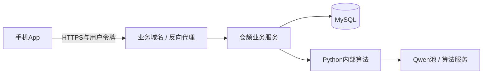

# uni-app手机软件交付方案

结论：**继续使用现有uni-app，能做可安装手机App，不需要先换框架。** 当前是Vue3的uni-app/App-Plus项目，不能把uni-app x或小程序教程直接套入。安装包中的前端通过网络访问仓颉后端；Python算法和MySQL留在后端主机。

## 1. 当前仓库具备什么，缺什么

| 位置 | 当前情况 | 交付动作 |
| --- | --- | --- |
| `frontend/package.json` | dev:app/build:app和app-plus依赖已存在 | 验证锁定版本资源编译，不把输出目录当安装包 |
| `frontend/src/manifest.json` | 名称、版本、`__UNI__MINDDIMENSION`、Camera/Record模块，iOS项为空 | 核实/申请真正DCloud应用ID、Android包名/iOS Bundle ID、图标、启动图、签名和权限说明 |
| `src/api/index.js` | H5相对`/api/v1`，非H5读取本地配置，缺省`10.0.2.2:8000` | 增加构建环境生产API；正式包不带模拟器地址或开发设置入口 |
| `vite.config.js` | H5开发代理 | 原生App没有Vite代理，要使用可达的HTTPS业务域名 |
| `utils/export-file.js` | 已区分H5打开与非H5下载/openDocument | 真机验证PDF/Excel、签名刷新和分享/打开失败 |
| `math-text` | 受控KaTeX HTML | 在App Vue/WebView实际核对数学字体、长公式、v-html和读屏，不直接声称兼容 |
| `cognition-canvas`、交互图 | uni Canvas与现有坐标布局 | 检查DPR、尺寸、触控、旋转；保留文字/列表替代 |
| `pages/crop/` | 已有触控与H5鼠标分支 | 验证图片旋转、缩放、框选精度及真机相册路径 |
| 鉴权与草稿 | 现有登录缓存、业务API | 加密钥匙串/Keystore适配是否必要先核查；不把服务端内部密钥放手机 |
| 仓颉服务 | 默认回环8002 | 通过受控网关让手机访问；不把MySQL和算法8012直接对外开放 |

这次没有生成APK/IPA，也没有验证真机；此表是针对当前源码的交付缺口。

## 2. Android路径：先形成可安装基线

1. **锁定环境**：保留当前package版本/锁文件，选择与项目编译资源匹配的HBuilderX与App运行时。不要只为追最新版一次升级全部DCloud依赖。
2. **配置应用身份**：在开发者账户核实DCloud AppID，确定永久Android包名和release签名；当前字符串不能当作已注册身份。私钥/密码放交付者安全环境，不写Git或打印日志。
3. **配置网络**：构建时注入仓颉HTTPS地址；真机环境验证API、题库图片、上传和导出。`10.0.2.2`只适用于特定Android模拟器访问宿主场景，实际手机不能拿它当服务器地址。
4. **资源编译**：执行仓库 `npm --prefix frontend run build:app`，记录实际输出/失败；这是资源编译检查，打包产物类型按当前工具链确认。
5. **HBuilderX真机运行**：按官方CLI项目支持方式导入工程与编译资源，使用标准/自定义基座联调。调试基座不是最终安装包。[官方运行说明](https://uniapp.dcloud.net.cn/tutorial/run/run-app.html)
6. **签名打包**：通过HBuilderX App发行流程生成Android包，可选择官方安心打包；或使用官方App离线SDK的Android原生工程。打包材料、包名、AppID和签名必须一致。[安心打包](https://uniapp.dcloud.net.cn/tutorial/build/SafePack)、[离线SDK](https://nativesupport.dcloud.net.cn/AppDocs/)
7. **安装验收**：真机安装签名APK，检查全新安装、权限拒绝/重新授权、登录、学习主线、重启、覆盖升级保留账户和草稿。
8. **交付**：APK、SHA-256、版本/构建说明、后端连接配置方式、测试机记录和已知限制。应用商店发布是单独动作，不把“能安装”写成“已上架”。

DCloud区分uni CLI资源编译与HBuilderX打包，且HBuilderX目前不支持Linux；当前Linux工作区可开发和编译资源，桌面HBuilderX环节需Windows/macOS。离线SDK是另一条路线，需要额外配置原生构建环境。[CLI官方说明](https://uniapp.dcloud.net.cn/worktile/CLI.html)

## 3. iOS路径：同一业务代码，独立设备验收

- 确定Bundle ID与DCloud身份映射；配置开发/分发签名、描述文件、测试设备或TestFlight渠道。
- 使用支持的打包环境；若采用iOS安心打包，按官方要求使用macOS。不要承诺当前Linux机器直接完成iOS签名发行。[DCloud安心打包](https://uniapp.dcloud.net.cn/tutorial/build/SafePack)
- 在manifest/原生配置补相机、麦克风及实际需要的相册用途说明；首次授权在对应动作发生时请求。
- iPhone验证安全区、系统返回/切换、键盘、相机方向、公式、文件打开、网络与音频中断。
- 外部分发如TestFlight/App Store需要相应Apple Developer Program能力与签名流程；证书/账户未提供时，标记iOS分发待完成，不能用Android包替代。[Apple分发说明](https://developer.apple.com/documentation/xcode/distributing-your-app-for-beta-testing-and-releases)
- 最低OS与目标SDK依据选定工具链、目标设备和发布渠道验证后固定，不在本计划编造永不过期的版本号。[DCloud打包环境](https://uniapp.dcloud.net.cn/tutorial/app-env.html)

Android与iOS的执行可以先后进行，最终“两个平台都已交付”必须有两份独立证据；如果用户只选择Android，变更发布范围需在版本说明中明确。

## 4. 手机如何连接仓颉后端

- 同一局域网试用：手机访问开发机可达地址或开发网关，验证防火墙和证书。不是把手机localhost当开发机。
- 脱离开发机/校园使用：需要手机可访问的持续运行后端地址。安装包本身不能提供离线Qwen/数据库服务。
- 仓颉保持回环监听时可由同主机网关转发；业务API和签名图片/报告走一致来源，内部算法和数据库不暴露给手机。
- 生产配置在构建/受控环境管理中注入；学生设置页显示连接状态和重试，正常使用不要求填写IP、端口或密钥。
- 不为省事把全局HTTP明文和无校验证书作为正式包方案。离线仅支持已缓存题目查看和作答草稿，不伪造判题/提交成功。

## 5. 真机适配清单

| 类别 | 必测情况 | 通过标准 |
| --- | --- | --- |
| 图片 | 相机/相册、旋转、长图、大图、框选、清洁图 | 原图保留；核对内容与实际题图一致 |
| 权限 | 拒绝相机/录音、仅部分照片、去设置后返回 | 手动/文字流程可继续；无循环弹窗 |
| 数学 | 分式、根式、矩阵、上下标、长公式 | 可读可滚动，必要条件不截掉 |
| 输入 | 键盘、公式文本、手写、撤销、切后台 | 输入与提交不被遮挡，草稿按用户和版本隔离 |
| 导出 | PDF/Excel下载、签名过期、打开失败 | 能刷新链接和重新打开，文件真实可读 |
| 语音 | 转写/朗读、中断、权限拒绝、耳机切换 | 有状态，可取消；文字主线不受阻 |
| 生命周期 | 返回键、前后台、杀进程、网络切换 | 恢复当前任务，不重复写记录或重复扣调用预算 |
| 渲染 | 360/390/430逻辑宽、200%文字、横屏、不同DPR | 无页面横向溢出、误触、底栏覆盖 |
| 性能 | 冷启动/长列表/图片加载/长算法等待 | UI可操作；长任务有真实反馈、可退出继续；记录实测指标 |
| 升级 | 新旧版本覆盖安装 | 用户数据保留，服务协议兼容，失败可恢复 |

端到端浏览器测试继续有价值，但必须再加uni自动化或实际真机步骤记录，标注机型、OS、包版本、后端commit和网络环境。

## 6. 交付物与外部材料

软件交付物：源码与锁文件、App资源产物、Android签名包、iOS对应渠道产物/证据、三端启动配置示例、MySQL升级与数据准备说明、使用指南、真实测试报告。

发行材料：DCloud身份、Android签名、iOS账户/证书/描述文件、可达后端地址、测试手机。这些是真机发行依赖，不是重新讨论架构的理由；代码和资源适配可以先完成，但缺材料时不得声称安装/发行成功。商店要求、隐私说明及所用SDK披露按实际发布渠道另行核查，本方案不擅自发布或上传用户数据。

## 代码实施入口

已新增 `frontend/.env.example` 和构建地址校验：正式App使用 `VITE_API_BASE_URL` 的HTTPS地址，不接受历史开发缓存覆盖；缺少地址会在构建时失败。本地开发资源使用 `npm --prefix frontend run build:app:local`，默认Android模拟器仓颉8002。真机使用可达网关，仓颉与Python内部服务仍绑定回环。当前无签名/真机证据，详见 [实施进度](IMPLEMENTATION_STATUS.md)。
