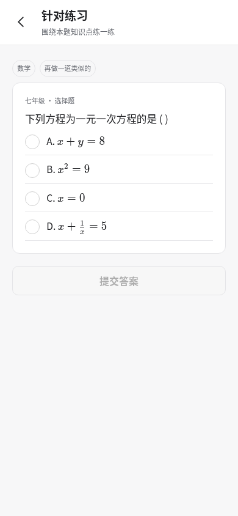

# 针对练习相关性与认知归属

## 本批计划

实际核验已确认：目标为一元一次方程，BGE候选仍可能是路线几何题；不能用排序名次代替知识点匹配。

1. 复用现有知识对齐/数学工具，增加受控的练习对齐计算。目标必须来自当前题目及分析所支持的知识卡，不再无依据选第一张卡；模型判断使用ApiPoolProvider/Qwen和Pydantic，不能凭重排分数直接放行。
2. 新推荐、旧推荐复用、提交作答使用同一校验；核对同学科/学段、当前目标、题目资格和内容。无法确认的候选跳过；提交旧的错配题不得更新掌握度、错因或复习计划。
3. 保留真实题库练习正向功能，准备本地CMM-Math中可用的方程题与独立索引。不是只让所有请求失败；需要真实匹配题能推荐、能判题，并有反例拒绝证据。
4. 用隔离MySQL检查新推荐/缓存/提交、在途变化和无副作用；实际验证已有诊断的方程、相关题与旧几何题。修复前已存在的记录不静默删除或重算。
5. 更新运行说明与支持边界，完整回归通过后提交。仓颉继续负责业务/MySQL，Python只负责算法；不增加商业运维或手机发行范围。

## 已实现

- Python `practice_alignment` 将相关性准入与BGE排序分开。独立的一元一次方程求解由SymPy判断；概念辨认及其他知识点由ApiPoolProvider/Qwen返回Pydantic结构，核对原题、候选题的逐字证据。不确定结果不放行，模型不参与数据库操作。
- 仓颉对新推荐、旧推荐缓存和作答统一校验。没有受原题/分析支持的知识卡时明确提示，不再任选第一张卡；候选仍须满足学科、学段及可自动判题资格。
- 已确认的匹配保存服务端版本凭据，绑定原题、最新分析/诊断、目标知识卡和完整题库行。未变化时复用，避免同一题在推荐与提交阶段被模型反复判成不同结果；发生变化后重新核验。客户端不能提交自己的匹配凭据。
- 拒绝错配时不更新掌握度、错因、作答或复习计划。正确作答只归属已确认的知识点；旧记录保留历史，缺少有效匹配凭据的旧练习不作为智能体的已验证长期记忆。
- 前端缺少知识点时可回到原题核对，失效练习可重新匹配，普通网络失败保留答案。推荐理由只说明知识点，不把同知识点练习冒称为精确错因干预。

## 实际运行证据

- 实际旧几何题提交返回409，前后学习记录完全一致。实际Qwen确认的“一元一次方程概念辨认”练习推荐成功、作答正确且可更新学习；其他知识点的掌握度未改变。命令 `scripts/check_live_alignment.py` 退出0，日志 `/tmp/zhiwei-alignment-actual-proof.log`。该命令使用本地专用测试账号和私有复现文件，不是首次安装入口。
- 为保证正向练习有真实内容，按文字筛选导入CMM-Math95题，61题满足现有可自动判题规则并完成真实BGE索引，5题无答案、29题需人工判定。加上已有CMMU，总库1770题、索引1442条。文字筛选和入库资格不是语义匹配或教学质量证明，每次推荐仍经过上述准入。
- 隔离专项已通过新推荐跳过高排名干扰项、旧缓存/旧作答拒绝、题库内容变化、分析版本变化、拒绝无学习写入及缺少目标提示。前端132项/36文件及类型检查、算法90项、仓颉31组已有通过证据；本批完整结果见下文最终记录。

实际390px页面已通过真实后端检查：单选控件、短公式、无横向溢出，截图已目视核对。旧截图脚本固定要求“单选题”文案，与当前真实来源的“选择题”标签不一致；移除该固定假设后通过，没有修改页面冒充通过。

## 支持边界

本批验证的是明确目标下的准入、版本和认知归属，不等同于所有学科教学质量评审。语义判断仍可能受模型质量影响；证据不足宁可不推荐，页面提供后续操作。任意手绘几何关系推理、真实学生试用、语音恢复和手机签名发行不属于本批已完成成果。

## 完整回归过程

首轮 `/tmp/zhiwei-alignment-final.log` 在分析映射用例失败：新增相关性夹具留下“一元一次方程”同名知识卡，后续断言期待自己创建的卡ID。已在相关性夹具结束时清理它自己的练习记录和知识卡，不改变实际业务数据或放宽映射断言。首轮不计通过；修复后完整重跑日志 `/tmp/zhiwei-alignment-final-v2.log`，后续结果见下文最终记录。

第二轮 `/tmp/zhiwei-alignment-final-v2.log` 的分析映射及新增相关性检查已通过，随后旧练习夹具在预期“待复核”时被资格检查返回409：夹具有标准答案但遗漏 `has_answer=true`。已补齐该资格标记，并增加 `CANGJIE_VERIFY_FOCUS=practice-evidence make verify-cangjie`，专项验证练习判题和已验证记忆的来源准入；没有放宽实际资格检查。第二轮不计完整通过。

练习证据专项 `/tmp/zhiwei-practice-evidence-focused.log` 已退出0：算法90项、仓颉31组、真实HTTP/MySQL中的练习/手写/判题/回滚、删除匹配凭据失效和恢复、候选内容变更失效与恢复均通过。随后冻结源码，第三轮完整命令 `CANGJIE_VERIFY_FOCUS= make verify-final` 日志 `/tmp/zhiwei-alignment-final-v3.log`，最终结果见下文记录。

## 最终记录

本批最终 `CANGJIE_VERIFY_FOCUS= make verify-final` 已退出0：前端132项/36文件、类型、H5/App本地资源构建、算法90项、仓颉31组、完整HTTP/MySQL与进程重启恢复、浏览器31项通过，0跳过。日志 `/tmp/zhiwei-alignment-final-v3.log`。前两轮失败与修复原因保留，不计成功。
