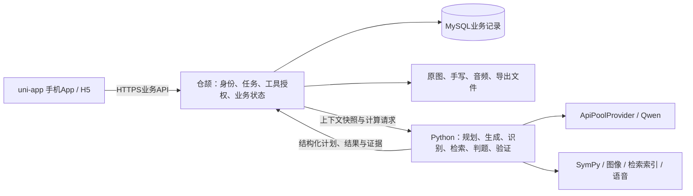

# 错题帮最终产品设计基线 v1.0

> [当前系统交付说明](SYSTEM_DELIVERY.md)
>
> [当前项目与智能体架构](../ARCHITECTURE.md)：三层职责、数据闭环、持久任务执行流程、代码入口及创新边界。最终版已通过完整主线验收，范围与证据见[收尾记录](FINALIZATION_2026_10_18.md)。
>
> 2026-10-18补查未覆盖及易错题型，见[AI内容补充验收](EXTENDED_AI_ACCEPTANCE_2026_10.md)：修复参考行号硬对齐造成的误判、错因类别兼容和未验证建议的展示；12道真实模型样本、三条实际学习任务及页面结果分别登记。等待时间、手机安装包与Git历史按用户最新要求不再作为本轮待办。
>
> 2026-10-18按最终提交要求再次逐项复核，见[最终提交复核](FINAL_SUBMISSION_AUDIT_2026_10.md)：关联当前功能、修复、测试与真实页面，不以历史通过次数代替当前结果。
>
> 2026-10-17新增[冷启动与学生个性化调研及落地建议](COLD_START_PERSONALIZATION_RESEARCH.md)：保留完整增量提案，当前已接入学习方向、知识卡起点与诊断驱动的修复入口，其余内容不自动计入交付。
>
> 同日推进[产品体验升级](PRODUCT_UPGRADE_2026_10.md)：在原能力上接入错因回放、可追溯易错地图、修复路线和学习方向；具体实现与验收状态见该记录。首次无题可进入真实知识卡与例题，独立入门测评仍未开发。
>
> 随后按三种学生情境操作并登记缺陷，见[试用与问题登记](THREE_STUDENT_AUDIT_2026_10.md)。模拟学生情境与真实Qwen固定样本分开记录，不计作真人学生参与。
>
> 最新一轮[全系统提交前测试与缺陷登记](RELEASE_HARDENING_2026_10.md)扩展输入矩阵、真实主学习闭环、反事实证据与历史缓存检查；该轮最终执行状态以记录为准。
>
> 当前交付要求：整个系统能运行、能使用，页面简单、好看、少说明。验收覆盖录题、学习智能体、练习复习、记录报告、组卷导出及教师/家长/管理员协作，不只检查学生作业模块。不开发备份恢复，手机签名安装暂缓；各算法能力按实际配置和已验证范围说明。

设计日期：2026-10-16，代码基线：`c31890e`。2026-10-17当前运行版已完成本次软件验收；实际功能、证据与限制见[系统交付说明](SYSTEM_DELIVERY.md)，手机签名安装后置。

这份文件是产品唯一总入口。此前 `PRODUCT_REDESIGN.md` 和两轮“最终交付”文档作为历史方案保留；与本版冲突时以本版为准。既有仓颉迁移完成情况仍以 [接口验收](../cangjie/FINAL_ACCEPTANCE.md) 为证据。

## 1. 对前一版的判断

前一版具备功能清单和三端边界，可以作为早期规划，但不应直接称为最终手机产品设计：

- **实用性**：主学习流程覆盖充分，但功能目录、重复说明和过长教学内容仍可能增加使用负担。
- **创新性**：需要把“AI教学”落实到能观察、规划、执行、验证、调整的任务机制，并用具体学习结果验证；不能只增加几个LLM调用名称。
- **美观性**：颜色和组件名不能保证成品好看。必须补页面结构、信息预算、交互状态、手机预览及真机验收。
- **代码适配**：旧版78/94的迁移判断已经过时。当前94条既有业务接口均有仓颉验证记录；当前已有智能体基础，不需要重新迁移或另起一套后端。
- **手机交付**：H5能在手机打开，不等于可安装App已完成；本版把App适配、签名安装、网络连接和真机操作纳入交付。

本版目标是兼顾三者的可执行设计，不能保证未经学生试用的效果或主观审美评价。

## 2. 产品定位与使用人群

**帮助初一至高三学生，把“这道题做错了”变成“知道错在哪、能独立做对、过几天仍记得”。**

主场景是作业后的错题整理、遇到卡点时的短时学习、到期复习和考前专项。当前先交付能运行使用的H5系统，保持手机窄屏适配与uni-app工程；Android/iOS签名安装按用户要求后置。后续交付安装包时，两平台分别验证，不能拿资源构建或Android结果代替iOS真机证据。

语文、数学、英语及其他中学学科按现有学段配置展示；题库/知识覆盖不足要如实说明。主观题和步骤证据不足不能用数学答案匹配规则强行判断。

最终版本仍以个人学习为主，复用教师、家长和管理员现有能力；不扩张为商业多租户平台。用户未要求的收费系统、排行榜、广告、社交、无限聊天不进入范围。

## 3. 设计基线事实：直接复用了什么

| 事实 | 代码/证据 | 设计结论 |
| --- | --- | --- |
| 94/94既有接口完成仓颉迁移 | `docs/cangjie/routes.json`、`FINAL_ACCEPTANCE.md` | 继续集成和产品化，不重做迁移 |
| 仓颉负责数据库与业务 | `backend-cangjie/src/`，schema版本005 | 新业务也在仓颉保存与授权 |
| Python算法已独立 | `backend-algorithms/service.py`及计算模块 | 复用ApiPoolProvider/Qwen、Pydantic、SymPy和检索 |
| 智能体已有计划/工具/记忆/验证 | `agent_compute.py`、`dialogue_compute.py`、`tutor_dialogue.cj` | 已有有界单轮智能体，进一步补可恢复任务和反馈重规划 |
| 检索和练习已接入 | `retrieval.cj`、`practice_recommend.cj`、`practice_attempt.cj` | 不再列为未实现；真实数据与质量另验收 |
| 已有仓颉浏览器验证 | `make verify-cangjie-browser`，记录18通过/4角色专项跳过 | 补手机App及被跳过角色场景，保留原有证据 |
| uni-app已有App工程入口 | `frontend/package.json`含dev:app/build:app，manifest含app-plus | 保留Vue3/uni-app/uni-ui，不迁移Flutter或uni-app x |
| 已有知识初始化 | `make seed-knowledge-cangjie`，公开250卡/65关系 | 使用现有仓颉导入，不重建Python写库工具 |
| App环境尚待验收 | manifest中现有appid、iOS配置、原生地址配置需要核实 | 不能把编译资源当成安装包或真机证据 |

上表保存设计时的`c31890e`事实和测试数量，不能当作当前表版本或待办清单。此后持久任务、订正、页面与角色流程已实施，当前结果以[系统交付说明](SYSTEM_DELIVERY.md)和[验收矩阵](ACCEPTANCE_MATRIX.md)为准；不重复重构既有后端。

## 4. 统一架构

- 仓颉是业务事实与状态权威；Python计算建议不直接写MySQL或推进业务状态。
- Python规划器可动态选择任务路径；仓颉验证工具、输入版本、权限、预算和状态转换后执行。智能体属于系统，不是手机本地大模型。
- 手机只包含前端与必要原生能力；仓颉、Python、MySQL运行在用户可访问的后端主机。安装App不意味着后台自动搬进手机。
- 原Python业务版本保留作回归参照；正式App业务地址指向仓颉，不能静默回退旧业务服务。
- 原图、原作答、后续订正分开保存；前端只消费VisualizationSpec等受控结构，不执行模型生成的JS。

## 5. 功能完整，但学生入口收敛

一级导航沿用 **今日 / 错题 / 学习 / 我的**，中间“录入”是动作，不是第五个信息栏目。进入作答、框选、教学时隐藏全局导航，保留返回与当前任务。

| 区域 | 核心目的 | 功能归属 | 默认不展开 |
| --- | --- | --- | --- |
| 今日 | 告诉我现在先做什么 | 继续学习、到期复习、教师任务、录入 | 全量功能、多个统计图、工具过程 |
| 错题 | 找到和整理题目 | 搜索/学科/状态/收藏/到期、知识点/错因分组、归档、带选题组卷 | 所有筛选项、每题完整解析 |
| 学习 | 主动选择学习任务 | 复习、专项、备考、知识与报告 | 长目录说明和全屏图谱 |
| 我的 | 管理自己的使用 | 年级/账户、帮助、自检要点、记录管理、角色工作台 | 管理员指标、重复学习工具目录 |
| 本题 | 把这次问题解决 | 原图/作答、诊断、讲解、订正、独立练习、学习档案 | 答案、完整证据、历史对话、复杂可视化 |

完整功能包含：拍照/相册/手动录入、框选与OCR校对、分析诊断及纠正、短步教学/追问/理解检查/教回、受控可视化、内部语音合成/转写接口（学生端按既有约定不提供入口）、真实题库练习/手写、近远迁移、原题重做/局部订正、自检要点、到期复习/历史、知识卡/关系、学情报告/图谱、组卷/三类导出、教师作业与复核、家长只读、管理员脱敏查询、失败恢复。

不要求学生知道每个内部模块叫什么；功能可通过本题上下文、搜索和分类任务找到。

## 6. 三项重点创新及可验证边界

| 创新 | 学生看到什么 | 系统真正做什么 | 完成证据 |
| --- | --- | --- | --- |
| 只修关键一步 | “这一步先改一下”+一个输入 | 依据首错证据确定目标，独立保存订正，校验该步骤 | 原作答未变；修正结果与依据可追溯；局部正确不算整题掌握 |
| 改一个条件再试 | 原题与新题的一个变化高亮，提示暂不展开 | 限定变化目标，检索/生成并验证对照题，依据回答调整后续 | 题目可解、答案验证、变化与目标匹配；失败使用已验证题而非硬凑 |
| 证据驱动的小学习计划 | “先补这一步，再独立试一题” | 智能体读取真实记录、规划、执行工具、验证、根据新回答重规划 | 同一目标可因证据进入不同路径；过程可恢复；只有独立有效作答才更新掌握 |

自检要点是学习结束时可选保存的一句话，不单独做成复杂笔记软件。不会因为AI说“你会了”、点击完成或保存笔记就增加掌握度。

这些是本项目的产品差异化设计，不声称全球首创或已证明学习效果；详细实验与验收见 [交付计划](DELIVERY_PLAN.md)。

## 7. 页面不能成为文档：强制信息预算

下面是本项目设计约束，不是假称外部标准：

- 默认首屏一个主行动，最多两个次行动；不靠把按钮藏进无含义图标达到数量限制。
- 今日首屏一个任务卡，最多两条简短后续事项；学习中心首屏四个短入口：复习、练一类题、考前组卷、查知识。
- 教学一轮只提出一个问题。引导以1—3句为目标，正文通常40—100汉字；公式/必要题干不强行截断。超过预算拆成完整语义步骤，禁止按120字符切断公式或句子。
- 非任务必要的大图默认不显示；题目图可查看完整尺寸，教学图一次一张且按需出现。主页不默认显示图谱、雷达图、角色大头像或装饰插画。
- 默认最多两个展开内容块；证据、完整解析、历史按需打开，长内容进入独立页面。
- 报告默认一句结论、最多三项需要关注的知识；“看变化”后才打开一张简单图，详细关系图是二级功能。
- 筛选默认只有搜索、学科和“筛选”按钮；收藏/到期/阶段/分组进入面板，生效后显示选中条件。

页面规格、文案和空/错状态见 [手机UI规范](UI_SPEC.md)，示意可打开 [可展开的手机页面稿](mobile-preview.html)。示意数据不连接后端，不作为真实学习记录。

## 8. 手机App与交付口径

保留当前uni-app主线，采用App-Plus Vue页面完成Android/iOS；不为手机化先整体换框架。Android先完成APK签名安装与真机主链路；iOS完成证书、描述文件、签名及真机/TestFlight渠道验证。H5同步保留。

仓库的 `build:app` 是资源编译入口，不是“一条命令直接获得最终APK/IPA”的保证。DCloud明确区分uni CLI资源编译与HBuilderX打包；HBuilderX目前不支持Linux，当前Linux工作区可完成代码和资源验证，桌面打包需相应Windows/macOS环境，或配置官方离线SDK工具链。[DCloud CLI](https://uniapp.dcloud.net.cn/worktile/CLI.html)

App版本必须解决API公网/局域网可达、相机/相册/录音授权、数学渲染、Canvas、键盘/安全区、文件下载、退后台恢复和升级保留。完整路线见 [手机交付规范](MOBILE_DELIVERY.md)。

## 9. 智能体产品边界

学生只接触一个围绕题目的“学习助手”。内部采用一个主任务协调器配合专业能力，不增加“选择哪个专家”的页面。智能体根据证据选择解释、知识补充、步骤订正、练习和复核；在需要学生回答时等待，不自己替学生编造答案继续闯关。

现有六工具、AgentPlan、记忆与验证继续复用。新增的重点是持久任务、有界观察—行动循环、证据失败后的重规划、取消/恢复、结果验证真正控制下一步，以及可审计的行为测试。详见 [智能体规格](AGENT_SPEC.md)。

## 10. 文档和执行顺序

| 文档 | 负责内容 |
| --- | --- |
| 本文件 | 唯一产品目标、范围、事实与取舍 |
| [UI_SPEC.md](UI_SPEC.md) | 手机页面结构、信息预算、视觉Token、状态与导航 |
| [AGENT_SPEC.md](AGENT_SPEC.md) | 已有智能体审查、任务协议、工具/记忆/验证、评估 |
| [MOBILE_DELIVERY.md](MOBILE_DELIVERY.md) | uni-app打包、真机适配、后端连接与交付物 |
| [DELIVERY_PLAN.md](DELIVERY_PLAN.md) | 基于现有仓库的分批修改、依赖、完成门槛 |
| [REFERENCES.md](REFERENCES.md) | 竞品观察、技能使用、官方技术来源与证据范围 |

执行顺序：当前基线确认 → App可安装与主链路探路 → 六个核心页面减负 → 智能体可恢复闭环 → 订正/对照练习/自检 → 数据与全角色 → 真实算法/学生试用 → 签名交付。每批有具体文件、测试和退出条件。

本目录已经进入代码实施，阶段状态和测试结果按下方记录更新。全部当前范围内的必需门槛通过后才把实现标记为最终交付；手机发行按用户要求后置。

当前代码实施与验证记录：[实施进度](IMPLEMENTATION_STATUS.md)、[最终验收矩阵](ACCEPTANCE_MATRIX.md)。

实施范围更新（2026-10-16）：用户已明确先完善内容和功能，手机签名/安装包交付暂缓。保留手机优先设计，当前代码验收先覆盖仓颉业务、Python算法与H5完整流程；原生发行章节作为后续交付规范。

持久学习任务已进入实际代码：[任务实现与证据](LEARNING_TASK_IMPLEMENTATION.md)。学生从题目“继续解决”进入，当前验证过的局部订正/单条件对照适用于一元一次方程，其余题型保留统一判题与原完整教学路径；不生成未经验证的对照题。

任务图示已接入同一持久任务：等式两边同操作、一次/二次函数参数观察，按需展示一张图，收起后继续原作答。原式、当前参数和学生观察可恢复；查看图示属于辅助学习，观察自述不计独立掌握证据。具体适用范围及验证见[任务实现记录](LEARNING_TASK_IMPLEMENTATION.md)。

当前新增009任务来源迁移和草稿步号隔离；当时的题目及原步骤可从任务历史按需回看。已有仓颉库需显式备份并执行`upgrade-db`；详情见[来源与草稿实施记录](SOURCE_AND_DRAFT_IMPLEMENTATION.md)。

任务和原教学会话已接入同一长期记忆边界：历史估计、已判定事件与学生自述分类处理；只读本人同学科且来源有效、未过期的记录。历史会影响下一步支持规划，来源变化会阻止旧结果提交。详见[记忆实施合同](MEMORY_IMPLEMENTATION.md)。

当前任务已接入共享45秒提交预算、回合/执行上限与明确停止/重开入口；迟到响应和事务最后更新超时均有隔离验收。具体时限含义及软实时边界见[预算实施记录](BUDGET_IMPLEMENTATION.md)。

角色浏览器已从23通过/4跳过补齐为27通过/0跳过，使用临时库随机教师、家长、管理员账号，详情见[实施进度](IMPLEMENTATION_STATUS.md)。这不替代家长报告/解除关联页面、数据交付或真实教学质量验收。

家长端补充的授权、解除与报告读取边界见[家长查看权限合同](GUARDIAN_ACCESS_IMPLEMENTATION.md)，实际验证结果持续记录在实施进度。

家长权限批次已实际完成学生授权、报告读取、双方解除及刷新拒绝；当前完整浏览器28项通过/0跳过，前端114项通过，H5/App本地资源构建通过。身份配置便捷入口、数据交付、手绘关系与真实使用验证仍待后续。

本地教师、家长、管理员专用账号创建命令见[身份配置](LOCAL_IDENTITIES.md)，学生注册不开放角色选择；已有邮箱不会被改身份或重设密码。

实际环境启动、固定方程真实Qwen核验与首页/学习页首批视觉完善见[实际运行记录](ACTUAL_RUNTIME_IMPLEMENTATION.md)。本轮另发现原始上传字节保留、空练习题库和语音未加载问题，仍在继续处理，不把29项浏览器回归当成所有实际资源都已可用。

内部语音合成与转写现已通过实际仓颉/MySQL及既有Whisper缓存核验；此前502已由依赖协议升级修复。学生界面保留无语音入口设计，转写不保证逐字准确；运行命令及限制见[语音运行记录](VOICE_RUNTIME_IMPLEMENTATION.md)。
