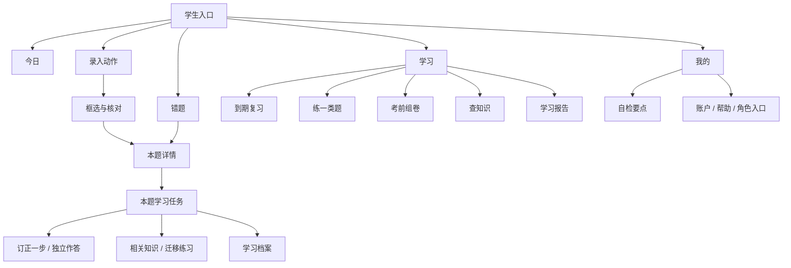

# 手机界面与信息架构规格

适用：当前Vue3 + uni-app/uni-ui，手机优先，H5/平板适配。总需求见 [产品基线](README.md)。本文件的数字是设计目标，须通过真机与学生任务验证。

## 1. 视觉方向

**安静、清楚、有温度的学习工具。** 延续仓库现有克莱因蓝与浅色背景，减少说明文字、边框层级和无任务意义的图形。初高中都可用，不采用幼儿园卡通风格，也不做成人办公数据大屏。

`ui-ux-pro-max`检索给出的营销Hero/Testimonials布局不适用于学习App，已排除；不引入GSAP、外部英文字体或紫色渐变。采用已匹配的移动触控/间距指导、技能通用对比度/安全区规则和IA渐进展开原则。证据见 [参考记录](REFERENCES.md)。

| Token | 最终基线 | 当前仓库关系 |
| --- | --- | --- |
| 主色 | `#002FA7`，按钮/选中/关键操作 | 保留 `uni-common.scss` |
| 背景/表面 | `#F7F7F8` / `#FFFFFF` | 保留 |
| 正文/次级文字 | `#202124` / `#62656C` | 保留；关键说明不得改为低对比灰 |
| 状态 | 成功`#28734A`、待核对`#986A20`、错误`#C23934` | 配文字和图形，不只靠颜色 |
| 字体 | 系统中文字体；正文16px，说明13—15px，导航标题19—22px，内容主标题28px/桌面32px，小标题18px | 用层级和行距区分导航、当前目标与来源说明，不引入外部英文字体 |
| 间距 | 4/8基础节奏，页边16—20px，块间24px，卡内16—20px | 不做多层卡套卡 |
| 圆角 | 卡片12px；按钮10—12px | 不到处使用大胶囊 |
| 图标 | 现有uni-icons，统一24px轮廓；选中样式统一 | 缺失图标必须检查，不混入emoji |
| 触点 | App逻辑布局以48为目标，真机核对Android48dp/iOS44pt；H5主控件至少44CSS px | 不能把rpx、px、dp、pt直接当等价 |
| 动效 | 按压/切换120—180ms；任务反馈不用整屏庆祝 | 系统减少动态效果时关闭非必要动效 |
| 主题 | 首版以浅色为正式验收主题；深色需独立适配后启用 | 不宣称自动反色就是深色完成 |

公式渲染使用现有受控KaTeX路径，必要公式区域局部滚动，页面本身不横向溢出。复杂公式、下标和较长选项在真机200%字体下单独核对。

## 2. 页面地图与导航规则

- 一级用固定导航；二级进入任务后使用返回，不重复显示两个主导航。
- 所有“本题”页面保留question_id、内容版本和来源页。返回恢复来源筛选/滚动位置，不默认丢回首页。
- Tab切换不无限增长页面栈；安卓系统返回键、App手势返回与页面返回保持一致；有未提交输入时保存草稿或提供离开选择。
- 查看答案、知识、证据是辅助动作；关闭后回到原输入位置。只允许一层临时面板，长内容进独立页面。
- 教师/家长/管理员按身份进入工作台，不让学生在设置里任意切换角色。
- 旧搜索URL继续兼容；内部命名可保留，但页面统一使用学生理解的词。

## 3. 六个核心页面规格

### 3.1 今日：只决定下一步

默认首屏：问候与日期一行 → 一个推荐任务卡 → 一个主按钮 → 最多两条后续事项。底部导航和录入可达。不显示完整功能目录、多个成绩数字或图谱。

- 主卡按当前有效任务选择：继续未完成/待核对任务，或到期复习；教师截止任务可通过明确规则调整优先级，不由随机模型决定。
- 文案示例：“先把上次那一步弄懂”“这次复习2道题”。时长只在已有统计支持时估计，不虚构“3分钟学会”。
- 次行动：“换个任务”“录入错题”。换任务展示至多三个可执行选项。
- 新用户：保留录题，同时给出“没带错题，也能开始”的学习方向入口；选择后按本人年级与学科进入真实知识卡和例题，不把阅读计为独立掌握。
- 已有诊断：当没有需要优先继续的任务/复习/教师安排时，按所选学科和重复诊断线索推荐本题修复路线。学习方向保存在仓颉/MySQL，允许学生修改。
- 主卡采用白底、顶部蓝色细线与清楚标题，蓝色集中用于行动；不再用整块高饱和背景承载说明文字。
- 无任务：短说明+主动练习入口，不造进度、不不断催促打卡。

对应：`pages/index/index.vue`、仓颉dashboard及后续任务投影。

增量核心页面：`pages/replay/replay`按持久化步骤ID展示作答/参考/诊断依据，未对齐时明确说明；`pages/error-map/error-map`以错因目录连接知识标签与原题来源，手机横向目录、桌面双栏；`pages/repair/repair`以步骤线连接实际教学、题库练习与复习，区分局部订正、原题独立与单条件对照，并按档案标出下一步。原题、原图、诊断修正和旧学习入口均保留。具体取舍见[产品体验升级](PRODUCT_UPGRADE_2026_10.md)。

### 3.2 错题：先找题，再整理

默认：搜索框 → 学科标签（横向可滚动）+筛选 → 题目列表。每条题仅学科/日期或状态一行、题干摘要两行、一个明确状态；必要缩略图可小尺寸出现，不默认渲染完整题图。

- 收藏/到期/处理状态/分组移入筛选面板，应用后显示已选条件和清除，不把所有开关排满首页。
- 状态用“待核对、待找错因、继续学习、待复习”，不是高分即“已掌握”。
- 批量选题只在“选择”模式出现；组卷带准确ID范围。知识点分组按主知识点展示并注明，不能让一题因多标签重复进入试卷。
- 空筛选说明“暂时没找到”，提供“清除条件”；无题目提供录入。

对应：`pages/problem/list.vue`、`utils/learning.js`。当前已有筛选逻辑继续复用，主要调整呈现。

### 3.3 本题详情：保留题，不展开整个系统

首屏：题目/查看原图 → 原答案简述 → 一句当前状态 → “继续解决”主按钮。下方三个本地分区“题目 / 学与练 / 记录”，一次只显示一个分区。

- 原答案明确叫“当时的答案”；新答案叫“这次订正”，避免看不出哪次作答。
- 诊断摘要可显示一个关键原因，完整证据需主动查看。
- 参考答案折叠；看完后回到原学习步骤并记录提示曝光资格，不把看答案后的正确算独立完成。
- 收藏为可访问的次操作；组卷/归档/编辑在更多操作内，危险操作有明确后果。
- 原始题干不可为了信息预算省掉关键条件；长题干可独立全文查看，进入作答后仍可随时查看原题。

对应：`pages/detail/detail.vue`、`journey/`、`diagnosis/`。

### 3.4 本题学习：一个问题，等学生行动

顶部：返回、题目简称、“查看题目”。中间：当前短引导+一个教学对象（步骤/输入/选项/图形四选一为主）。底部：输入和一个提交按钮，“给点提示”作为次行动。

- 默认不是无限聊天瀑布。历史对话进“之前的过程”；当前问题与输入保持同屏，避免追问堆积。
- 学生能看见目标：“先检查移项”。必要时显示短计划“先订正，再试一题”，不显示工具名称、token、内部置信度或隐藏推理。
- 解释按完整语义分步，一轮一个问题；错误原因一个，行动一个。禁止按固定字符截断数学表达式。
- 手写作答先保存原图并异步转写，核对文字后再确认提交；不清晰/空结果不自动判题，失败可改用文字。刷新保留修改后的文字，照片主动打开，点击时刷新签名链接。
- 图示仅在能解释当前卡点时出现，最多一张；可选“用图看看”，不是把图文音视频全开。
- 需要等待时只显示真实阶段“正在核对这一步”，不伪造实时思考流水；长任务可退出稍后继续。
- 答错给具体可执行帮助；连续卡住降低任务粒度或展示短例子；达预算暂停，不无限询问。
- 查看完整解析允许但说明进入辅助学习；不能扣惩罚分或羞辱学生。
- “之前的过程”默认收起，主动打开才读取本人动作和公开反馈；长回答按完整内容展开。完成后提供“自检要点”，学生确认保存最多300字，可以编辑/删除。原题更新后的旧要点标为历史提醒，不自动当作当前结论。
- 正常文字作答默认只显示“提交”主按钮及“给点提示 / 更多方式”两个辅助入口。“更多方式”按需展开拍照、图示和参考答案；展开不提交学习动作，不改输入。换到新步骤后收起，已有照片核对和失败恢复仍在对应状态直接显示。

对应：`pages/tutor/tutor.vue`，新增订正/对照练习复用统一任务呈现组件。

### 3.5 学习中心：四个短入口，细功能逐层出现

首屏四项：**复习 / 练一类题 / 考前组卷 / 查知识**。每项名称+可选一行10—16字说明，不给每个功能写两段介绍。报告放“学习回顾”一行入口。

- 复习页内找历史；练一类题内选择错题/收藏/知识点，继承当前学科；组卷页内找导出历史；查知识内看前置关系。
- 教师任务在今日及对应列表入口；没有任务时不占主卡。
- 当前页面九条功能长目录改为四任务入口+二级选择，不删除功能。

对应：`pages/learning/learning.vue`、`constants/learning.js`、现有review/practice/paper/library页面。

### 3.6 学习报告：给建议，不给数据墙

首屏一句变化结论、最近一个有效变化、至多三个待巩固项。每项可直接“练一道”或“查看错题”。图表默认折叠或独立页，一次最多一张，注明统计范围。

- 没有充分证据就说“还需要一次独立练习确认”；不按模型自述增加进步百分比。
- 图谱只在“查看知识关系”中展示；手机默认一层邻接和至多8个可读节点，保留列表替代。
- 本次学习结束页：一个已完成动作+一个下一步，可选保存一句自检要点；不同时展示雷达图/路径图/热力图。

对应：`pages/analysis/analysis.vue`、`cognition-canvas`、学习档案。

## 4. 其他功能的简洁模式

| 功能 | 默认信息 | 展开/二级信息 |
| --- | --- | --- |
| OCR核对 | 一块当前待确认内容，错误位置突出 | 原图/所有步骤/批注 |
| 知识卡 | 名称、一句定义、一个关键公式或例子 | 全部公式、前置/后续知识与易错点 |
| 复习 | 一题、输入、提交 | 上次错因/提示须主动查看并计提示资格 |
| 组卷 | 试卷名、已选题、生成 | 知识/错因/掌握筛选、排序和分值 |
| 自检要点 | 一句话和关联题 | 编辑、来源、历史 |
| 我的 | 用户/年级、记录、帮助、设置 | 身份限定的角色工作台 |
| 设置 | 账户、显示、隐私与数据、服务连接诊断 | 高级配置仅开发/管理模式，学生不填写IP或池信息 |

## 5. 状态与文案合同

| 状态 | 学生文案示例 | 可执行操作 |
| --- | --- | --- |
| 识别不确定 | “这处没看清，帮我核对一下” | 定位对应字段/原图 |
| 算法暂时失败 | “这次没能核对完成，你写的内容还在” | 重试/保存稍后继续 |
| 无合适练习 | “暂时没有匹配的题” | 原题重做/回知识卡；不假造题库题 |
| 提交版本冲突 | “题目刚更新过，请先核对新内容” | 保留草稿，查看差异再提交 |
| 需要人工复核 | “这次结果还不能确定” | 查看依据/补充步骤/允许的教师反馈入口 |
| 无权限 | “这个记录不在你的账户中” | 返回本人列表 |
| 网络中断 | “已保留草稿，连网后继续” | 恢复网络后重新确认提交状态 |

草稿与学习证据分开。手机本地仅缓存可恢复草稿/查看偏好，按用户和题目版本隔离；退出后清理，不将缓存结果显示成已提交。

## 6. 可用性验收

- 手机逻辑宽度360、390、430以及横屏、平板和桌面；放大字体后不遮住操作。系统键盘打开时当前输入与提交可达。
- 首屏行动预算、文字块数、图表数逐页截屏核查；长题干例外记录原因，不以截断题目达标。
- 学生不需阅读帮助即可尝试：录第一题、找到上次题、要提示、独立提交、找复习、组卷；初高中各招募实际参与者记录表现。
- 首轮试用建议6—8人、包含初中/高中，用于发现问题，不作为代表全体学生的统计样本。核心任务目标至少80%无需提示完成，失败点必须记录并修订；不达标不宣称“已验证适合”。
- 无障碍：标签、焦点、对比度、非颜色状态、触点、减少动效；新公式/图的读屏替代文本要可理解。
- 原生App另做安卓返回键、退后台/进程重启、授权拒绝、导出打开和低速网络测试。H5截图不替代。

家长权限入口与报告恢复：学生从“我的 → 家长查看权限”明确确认授权，双方可解除；报告隐藏/刷新清空旧内容并复核权限，详见[家长查看权限合同](GUARDIAN_ACCESS_IMPLEMENTATION.md)。不向学生开放角色切换。

学生作业页面：一次只展开一项，默认优先待完成；切换保留文字，提交后保持本项并显示状态。题干、手写与反馈只在展开项呈现；实际窄屏样例见[作业页面](screenshots/assignment-simple.png)。

组卷编辑：打开试卷时显示真实等待状态，连续选择按最后一次选择呈现；保存失败保留当前编辑并持续提示，排序/删除/导出采用明确按钮。大字体下标题可收缩、导出按宽度换行，实际范围见[组卷恢复记录](PAPER_RECOVERY_IMPLEMENTATION.md)。

账号表单已统一标签、密码管理器用途、持久错误与按行高增长的输入框；H5原生标签和年级选择可用键盘操作，App继续保留uni-app控件。360/390/430与200%文字证据见[账号页面记录](ACCOUNT_ACCESS_IMPLEMENTATION.md)，不能替代原生键盘/读屏真机验收。

复习恢复补充：当前题与一次提交为默认主内容，巩固建议/历史按需展开；文字及已有作答照片可恢复。判题/评价失败在操作附近保留错误与重试说明；恢复判题依赖仓颉有效回执，不从本地缓存开放掌握更新。实现和验证状态见[复习恢复记录](REVIEW_RECOVERY_IMPLEMENTATION.md)。

多题复习补充：一次只展开当前题，题下提供上一题/下一题与准确位置；暂时卡住可以先做其他题，切换不计完成，逐题保留作答。普通入口恢复上次所看题，明确题目链接优先定位。缓存失败时本页保留，刷新恢复仍需要有效本机存储。实现与验收见[多题复习记录](REVIEW_QUEUE_IMPLEMENTATION.md)。

复习异常恢复：正常作答不增加说明；失败/待核对时提供回原题入口，来源变化时旧文字默认收起，只允许显式使用且不覆盖新文字。旧安排不在待办时说明真实状态、继续原题，其他题保持独立。具体合同和真实页面见[复习原题与旧稿记录](REVIEW_ORIGIN_IMPLEMENTATION.md)。
