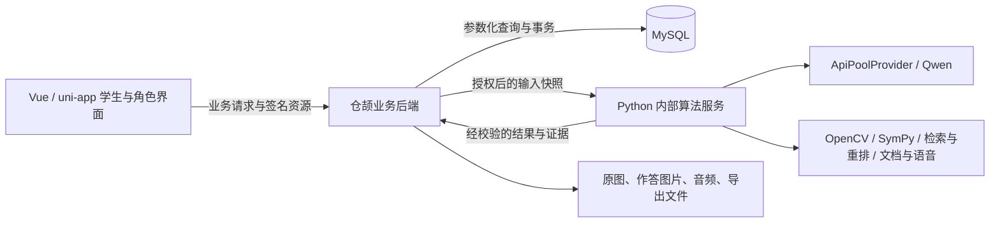

# 错题帮最终交付方案：仓颉业务后端 + Python 算法 + 学生前端

> 历史版本：当前后端已完成94条既有业务接口重构；本文件不再作为最新设计。产品、手机App、简洁UI和智能体规划统一以 [最终设计基线 v1.0](../../final/README.md) 为准。

日期：2026-10-16。状态：需求与方案基线，尚非最终交付验收报告。

## 1. 需求结论与优先级

用户要求的是一个功能完整、分类清楚、适合中学生实际使用的最终项目，不是只有新界面的 Python 版本，也不是若干仓颉接口示例。

最终运行链路固定为：**前端 → 仓颉业务后端 → MySQL；仓颉按需调用 Python 算法服务，再由仓颉保存结果并返回前端。** Python 不承担对学生开放的业务 API，不代替仓颉读写业务库。不能用前端继续访问旧 Python、仓颉转发旧业务路由或模拟数据来宣布迁移完成。

优先级：完整学习闭环与结果可信 > 三端架构落实 > 功能可发现、操作易理解 > 增量创新。功能丰富通过清晰分类和上下文入口提供，不把所有功能堆在首页。

范围沿用项目本地单用户应用定位，保留已有教师、家长、管理员能力并验证权限。主交付端是手机浏览器与桌面 H5；小程序上架、原生安装包、云端多租户、收费订阅、社交排名不自动纳入。前端实际使用 Vue 3、uni-app/uni-ui、JavaScript/TypeScript，不为符合旧描述强行更换到 Vant。

## 2. 目标用户与主要使用情境

目标年级为初一至高三。语文、数学、英语以及物理、化学、生物、历史、地理、道德与法治/思想政治按学段组织；不能把某一学科的判题规则直接套到其他学科。学科可见性与知识卡适用范围由统一教育配置驱动。

| 使用情境 | 学生想完成的事 | 产品应交付的结果 |
| --- | --- | --- |
| 刚做错题 | 保存题目和自己当时的思路 | 原图、题干、作答、步骤分别保留，可核对可修改 |
| 不知道错在哪 | 找出导致错误的原因 | 有证据的诊断；信息不足时明确待确认，不编造首错步骤 |
| 看过解析仍不会 | 先补概念或关键一步 | 针对性讲解、必要可视化、逐级提示和理解检查 |
| 想确认自己会了 | 不看答案独立完成 | 原题重做/针对练习/迁移题的独立记录，区分提示后完成 |
| 过几天复习 | 不遗漏该回顾的问题 | 到期任务、作答反馈、后续计划和可追溯历史 |
| 考前集中巩固 | 找同类错题并安排练习 | 组合筛选、分组、重点收藏、专项试卷与独立解析导出 |
| 查看进步 | 知道哪里改善、哪里仍不稳定 | 基于实际作答的报告和下一步建议，不把估计分数等同考试能力 |
| 接到教师任务 | 完成作业并理解反馈 | 布置—作答—自动判断/人工复核—反馈—重做的完整链路 |

这些是基于现有产品与用户目标的任务定义，不冒充已完成的学生访谈。最终适用性还需要真实学生任务试用验证。

## 3. 三端职责与调用边界

| 职责 | 仓颉 | Python | 前端 |
| --- | --- | --- | --- |
| 登录、角色、所有权 | 验证并执行 | 不接收用户令牌替代业务鉴权 | 登录状态及角色界面 |
| 题目、作答、任务、知识库 | 查询、版本、事务、持久化 | 只接收计算需要的上下文 | 录入、核对、呈现与操作 |
| OCR、分析、诊断 | 选择有权访问的资源、组织任务、验证版本、保存结果 | Qwen调用、Pydantic校验、图像和符号算法 | 展示不确定项和人工纠正入口 |
| 教学流程 | 决定合法阶段转换、次数、会话版本和证据保存 | 生成讲解、评估复述、建议提示/分支 | 分步骤学习，不自行宣布过关 |
| 题库检索 | 业务候选条件、可用性和权限、最终取题 | 编码、相似度、重排与算法索引 | 展示题目、来源与适配说明 |
| 判题与认知更新 | 读取服务端标准答案，条件满足后事务落库 | 返回判定、置信/复核要求、认知计算建议 | 展示反馈，不上传可信标准答案 |
| 复习调度 | 保存计划、完成状态、撤销和并发约束 | 可计算间隔/优先级建议 | 到期任务、作答与历史 |
| 文件与语音 | 原文件、归属、签名访问、记录状态 | 临时目录计算及文件字节/摘要 | 上传、播放、预览与下载 |
| 系统状态 | 汇总数据库与算法能力状态，限制管理权限 | 返回真实能力状态且不暴露池凭据 | 用学生能理解的方式反馈失败 |

补充约束：

1. 业务 MySQL 只有仓颉主线访问；Python 检索可访问算法索引，但索引不是业务事实源。最终题目、答案、授权仍由仓颉从 MySQL 校验。算法索引更新由明确的仓颉数据导出/同步协议提供，不让检索服务自行导入旧 ORM。
2. 模型仍固定逻辑名称 Qwen，通过 ApiPoolProvider 轮询；结构化结果经 Pydantic，数学结论尽量经 SymPy。不得在报告、错误或日志中打印池凭据。
3. 网络调用前后使用输入版本或等效快照检查；避免模型等待期间长期占用关键数据库锁。结果过期时拒绝覆盖新内容。
4. 前端仅消费受校验的 VisualizationSpec，不执行模型生成的 JavaScript。
5. Python 的临时文件不是持久文件仓库；原图绝不被清洁图覆盖。题目原作答与后续订正分别存储。
6. 旧 `backend/` 可保留为回归参照和过渡入口，最终交付命令与验收禁止依赖其业务服务运行。

## 4. 功能信息架构

一级目的地保留“今日 / 错题 / 学习 / 我的”，录入是全局动作；教师、家长和管理员进入各自工作台，不占用学生主导航。

| 一级分类 | 二级功能 | 边界 |
| --- | --- | --- |
| 今日 | 继续上次、待核对、到期复习、教师任务、最近反馈 | 负责行动调度，不复制所有工具；有明确主行动 |
| 错题 | 学科/关键词/状态/收藏/到期筛选，知识点/错因分组，详情、归档、组卷 | 题目资产管理，不把分组或收藏计作学习 |
| 学习·复习巩固 | 到期独立作答、反馈、复习历史、原题重做与订正记录 | 复习是计划任务；主动重做是单独记录，不能重复记证据 |
| 学习·专项备考 | 针对练习、近/远迁移、重点收藏、组卷编排、双PDF/Excel、教师任务 | 题库题和生成题来源明确；导出不算掌握 |
| 学习·知识学情 | 知识检索、前置关系、本题知识、报告、可选图谱、自检要点 | 知识库解释概念，报告解释个人记录，不互相替代 |
| 我的 | 年级/账户、使用指南、记录管理、角色工作台、退出 | 不再建立第二套学习目录；无任意角色切换 |
| 本题上下文 | 原图与原作答、诊断纠正、讲解、理解检查、教回、练习、学习档案 | 一个题目上下文贯穿，不让学生反复找同一题 |

## 5. 最终版功能清单与完成标准

状态说明：**已有**指存在可复用代码，不等于已经在仓颉最终架构验收；**补齐**指本次最终交付需完成；**增量**指明确新增的数据与交互设计，不用临时标签假装实现。

| 模块 | 交付功能 | 当前判断 | 最终验收要点 |
| --- | --- | --- | --- |
| 账户与初次使用 | 注册、登录、改密、年级、真实空首页、开始第一题 | 已有 | 全新仓颉库注册后可走完整主线；不出现演示学习成绩 |
| 录入 | 拍照/相册、手动题、单/多选选项、框选、原图预览 | 已有 | 真实图片流经仓颉和Python，原图摘要不变 |
| 识别核对 | 题干、公式、选项、学生步骤、批注、疑点确认 | 已有 | 修改后仓颉保存；失败重试及刷新可继续；旧结果不覆盖新内容 |
| 错题管理 | 搜索、组合筛选、分组、收藏、详情、归档 | 已有 | 返回保留查看条件；跨账号隔离；归档保留历史 |
| 分析诊断 | 参考路径、首错点、证据、反事实解释、人工纠正 | 已有 | 无步骤时不编造步骤；模型失败可恢复；修改题目使旧证据失效 |
| 本题教学 | 概念讲解、分步提示、理解检查、教回、追问、恢复会话 | 补齐 | `/tutor/.../turns`落实；多入口保持同一阶段和记录 |
| 可视化 | 已支持类型、参数调整、观察记录、回到本题 | 已有 | 真实保存配置与观察；不执行自由代码，不影响未完成阶段 |
| 迁移练习 | 近迁移、远迁移、生成依据、独立作答、辅助完成区分 | 补齐 | 检索与旧题复核落实；标准答案由服务端提供；失败不假装通过 |
| 针对练习 | 推荐、题源、题图、文本/手写作答、反馈、重练 | 补齐 | 三条practice路由和手写上下文完整；不只返回推荐列表 |
| 原题重做与订正 | 独立尝试、提示记录、过程/答案、对照原作答、订正历史 | 增量 | 新尝试单独持久化；提示后正确和独立正确分开；不覆盖原作答 |
| 自检要点 | 从错因生成待确认要点、学生编辑、题目/知识关联、复习前查看 | 增量 | 学生确认后保存；笔记不自动写入掌握分；可修改删除 |
| 到期复习 | 到期列表、独立作答、判定、计划、历史、原题入口 | 已有 | 以北京时间处理日期；待复核不更新掌握；重复请求不重复计数 |
| 知识库 | 学科/年级/关键词检索、公式、易错点、前置关系、相关错题 | 已有 | 最终库有实际内容；年级先过滤再截断；检索不是永远空列表 |
| 学情报告 | 知识/错因趋势、证据、薄弱项行动、可选关联图谱 | 已有 | 所有统计来自仓颉/MySQL；避免虚假精确结论或“看过=掌握” |
| 组卷备考 | 带范围选题、排序、分值、保存历史、题目PDF、解析PDF、Excel | 已有 | 实际下载可打开、中文公式可读、题图不丢失，数据不串账号 |
| 教师任务 | 班级、题库、布置、作答、手写、复核、重判/撤销、反馈 | 已有 | 教师与学生真实账号浏览器闭环；人工复核不覆盖后续新作答 |
| 家长查看 | 关联学生、学习概览、薄弱处与建议 | 已有 | 只读且只可看关联学生；解除关联后访问立即失效 |
| 管理与帮助 | 使用说明、学生/会话查询、脱敏状态、必要异常定位 | 在改 | 未提交实现需完整回归；学生不可越权 |
| 语音辅助 | 转写、学生确认、朗读、原音频与失败记录 | 在改 | 文本主线始终可用；实际音频验证，不把模拟引擎当真实完成 |
| 使用恢复 | 加载重试、输入保留、任务刷新、媒体链接更新、返回来源 | 部分需整体验证 | 在仓颉模式下复用现有恢复用例，不只跑旧Python |

增量功能优先复用当前判题、认知证据和题目版本机制；如果无法保证独立判定，则作为“订正记录/待复核”呈现，不能给出已掌握结论。具体表结构与接口需在对应阶段形成设计并做迁移回滚验证。

不纳入这一版的功能：整卷批量拆题识别、无限自由聊天、自动预测考试分数、社交排行、家长实时监控、付费系统。它们不是当前中学生错题闭环成立的条件；后续增加时重新定义数据和验收，不留下假入口。

## 6. 中学生使用标准

- 首页说清今天做什么，单次学习只突出当前动作；复杂证据、图谱和系统信息按需展开。
- 诊断使用具体、可纠正的语言；不以“粗心”“能力差”等标签代替证据。年级/学科名称统一。
- 原始作答、参考答案、订正、教师反馈视觉区分。独立作答前不持续显示标准答案，主动查看提示有记录。
- 支持公式和选择题；长题干、长反馈、图表在手机上可阅读。输入框不被键盘和固定栏挡住，主要触点不小于44px。
- 作答失败保留输入，识别失败保留原图，网络恢复不重复创建任务；刷新后回到可解释的状态。
- 空数据引导去录入或学习，不提供假进度；知识/题库缺数据时明确原因和可执行下一步。
- 非必要操作不强制语音，不把未成年学生引入无限对话；以完成一道题的任务为中心。
- 让学生能完成、能返回、能理解反馈，比增加动画和指标更重要。

## 7. 数据、运行与交付形态

1. 最终交付有一组明确入口启动 MySQL、Python算法、仓颉业务与前端，配置与端口分别命名。启动检查不发起未经说明的模型探测。
2. 仓颉独立开发/测试库与旧库隔离。先完成可重复初始化、版本升级、知识/题库导入和媒体目录准备，再验证新用户流程。
3. 如需要迁入旧用户数据，采用备份—复制到独立目标库—升级—校验—切换流程；不原地清空，不默认双写，不擅自迁移全部旧数据。
4. 题库交付包含来源、年级、学科、答案/解析、图片依赖与可练习标记。记录实际覆盖范围，缺覆盖不能靠随机生成题伪装。
5. 最终验收不用旧业务服务：即使停止原FastAPI业务进程，前端核心流程仍可用；Python算法进程仍然存在是正常架构。
6. 交付清单包含源代码、环境/依赖说明、配置示例（无凭据）、数据库初始化/升级说明、知识与题库准备说明、启动/停止命令、学生使用指南、测试证据、已知限制、备份恢复步骤。

## 8. 最终完成定义

不是“编译成功”，不是“94条接口有函数”，不是“沿用旧Python测试全绿”。必须同时满足：

- 必需接口没有pending/partial，每条有仓颉实现和对应验证依据；新增功能也进入契约清单。
- 业务库由仓颉查询和保存；Python算法测试证明没有旧ORM/业务入口依赖。
- 学生的录入—诊断—教学—独立作答—复习—报告、以及考前组卷在最终架构实际完成。
- 教师/学生/家长/管理员关键路径与权限验证不因默认跳过而被当作完成。
- 知识库、题库、图片和导出不是空配置；跨服务失败与重启恢复可解释、可重试。
- 真实模型与真实语音分别有验证记录；模拟测试只证明协议和逻辑，不证明真实质量。真实学生试用结论单独记录。
- 所有通过记录标注代码版本、后端种类、数据集、运行命令和跳过项；任何未通过项在交付说明中明确列出。

本方案替代上一轮“Python主线的功能组织改造”作为最终交付目标；上一轮前端分类成果继续复用，不推倒重做。
